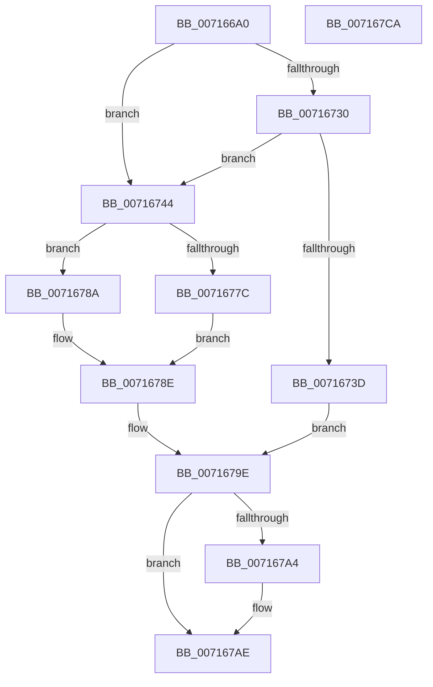

# FsRtlHeatInit

- RVA: `0x007166A0`–`0x007167CB` (길이 `299` bytes)
- VA: `0x00000001407166A0`
- 실행 섹션: `PAGE`
- PDB 이름 있음: `예`; PDB Function 태그: `아니요`
- unwind 정보 RVA: `0x000C447C`
- 디코드: `83`개 명령, `299/299` bytes 표시
- 미해석 바이트: `0` (있으면 어셈블리에 `.byte`로 보존)

> 이 문서는 커널 이미지의 기계어와 PDB 기호를 분석해 생성했습니다. 4번과 5번은 함수 원형과 자료형을 바이너리 사용 방식에서 추정한 C 해석이며 원본 소스 복구 결과는 아닙니다.

## 1. Dependencies

- 직접 호출 지점: **5**; 고유 호출 대상: **4**
- 직접 호출자로 확인된 함수: **0**
- RIP 상대 이미지 참조: **4**

### Outgoing calls
- `0x00716727` → [FsRtlpQueryValueKey](FsRtlpQueryValueKey_function_00716BA0.md) (function, `0x00716BA0`)
- `0x0071676F` → [FsRtlpQueryValueKey](FsRtlpQueryValueKey_function_00716BA0.md) (function, `0x00716BA0`)
- `0x00716797` → [FsRtlpHeatRegisterVolume](FsRtlpHeatRegisterVolume_function_0071696C.md) (function, `0x0071696C`)
- `0x007167A9` → [ExFreePoolWithTag](../../poolcode/B8/ExFreePoolWithTag_function_00B82870.md) (function, `0x00B82870`)
- `0x007167B7` → [_security_check_cookie](../../text/6A/_security_check_cookie_function_006AC640.md) (function, `0x006AC640`)

### Direct callers
- 이 함수 시작 RVA로 연결되는 직접 call은 확인되지 않았습니다. 간접 호출은 완전히 역산할 수 없습니다.

### Static image references
- `0x007166B3` → RVA `0x00E0A740` (`.data`; read)
- `0x007166E5` → RVA `0x00AFC140` (` ?? ::NNGAKEGL::`string'`; read)
- `0x007166FA` → RVA `0x00AFBEF0` (` ?? ::NNGAKEGL::`string'`; read)
- `0x00716744` → RVA `0x00AFC1D0` (` ?? ::NNGAKEGL::`string'`; read)

## 2. Other-region calls and transfers

- 다른 실행 섹션으로 향하는 call: **2**
  - `0x007167A9` → [ExFreePoolWithTag](../../poolcode/B8/ExFreePoolWithTag_function_00B82870.md) (`PAGE` → `POOLCODE`)
  - `0x007167B7` → [_security_check_cookie](../../text/6A/_security_check_cookie_function_006AC640.md) (`PAGE` → `.text`)
- 별도 외부 분기/꼬리 이동을 확인하지 못했습니다.

## 3. Assembly (complete function range)

```asm
007166A0  40 55                           push rbp
007166A2  53                              push rbx
007166A3  56                              push rsi
007166A4  57                              push rdi
007166A5  41 56                           push r14
007166A7  48 8D 6C 24 C9                  lea rbp, [rsp - 0x37]
007166AC  48 81 EC D0 00 00 00            sub rsp, 0xd0
007166B3  48 8B 05 86 40 6F 00            mov rax, qword ptr [rip + 0x6f4086]
007166BA  48 33 C4                        xor rax, rsp
007166BD  48 89 45 27                     mov qword ptr [rbp + 0x27], rax
007166C1  83 65 BB 00                     and dword ptr [rbp - 0x45], 0
007166C5  4C 8D 4D 9F                     lea r9, [rbp - 0x61]
007166C9  83 65 AB 00                     and dword ptr [rbp - 0x55], 0
007166CD  33 C0                           xor eax, eax
007166CF  48 89 01                        mov qword ptr [rcx], rax
007166D2  4D 8B F0                        mov r14, r8
007166D5  48 8D 45 C7                     lea rax, [rbp - 0x39]
007166D9  C6 45 97 00                     mov byte ptr [rbp - 0x69], 0
007166DD  48 89 45 9F                     mov qword ptr [rbp - 0x61], rax
007166E1  4C 8D 45 9B                     lea r8, [rbp - 0x65]
007166E5  48 8D 05 54 5A 3E 00            lea rax, [rip + 0x3e5a54]
007166EC  C7 45 9B 5C 00 00 00            mov dword ptr [rbp - 0x65], 0x5c
007166F3  48 89 45 BF                     mov qword ptr [rbp - 0x41], rax
007166F7  48 8B F2                        mov rsi, rdx
007166FA  48 8D 05 EF 57 3E 00            lea rax, [rip + 0x3e57ef]
00716701  C7 45 B7 80 00 82 00            mov dword ptr [rbp - 0x49], 0x820080
00716708  48 89 45 AF                     mov qword ptr [rbp - 0x51], rax
0071670C  48 8D 55 A7                     lea rdx, [rbp - 0x59]
00716710  48 8D 45 97                     lea rax, [rbp - 0x69]
00716714  C7 45 A7 0E 00 10 00            mov dword ptr [rbp - 0x59], 0x10000e
0071671B  48 8B F9                        mov rdi, rcx
0071671E  48 89 44 24 20                  mov qword ptr [rsp + 0x20], rax
00716723  48 8D 4D B7                     lea rcx, [rbp - 0x49]
00716727  E8 74 04 00 00                  call 0x140716ba0
0071672C  85 C0                           test eax, eax
0071672E  78 14                           js 0x140716744
00716730  48 8B 5D 9F                     mov rbx, qword ptr [rbp - 0x61]
00716734  8B 43 08                        mov eax, dword ptr [rbx + 8]
00716737  83 3C 18 00                     cmp dword ptr [rax + rbx], 0
0071673B  75 07                           jne 0x140716744
0071673D  BF 01 00 00 C0                  mov edi, 0xc0000001
00716742  EB 5A                           jmp 0x14071679e
00716744  48 8D 05 85 5A 3E 00            lea rax, [rip + 0x3e5a85]
0071674B  C7 45 A7 24 00 26 00            mov dword ptr [rbp - 0x59], 0x260024
00716752  48 89 45 AF                     mov qword ptr [rbp - 0x51], rax
00716756  4C 8D 4D 9F                     lea r9, [rbp - 0x61]
0071675A  48 8D 45 97                     lea rax, [rbp - 0x69]
0071675E  4C 8D 45 9B                     lea r8, [rbp - 0x65]
00716762  48 89 44 24 20                  mov qword ptr [rsp + 0x20], rax
00716767  48 8D 55 A7                     lea rdx, [rbp - 0x59]
0071676B  48 8D 4D B7                     lea rcx, [rbp - 0x49]
0071676F  E8 2C 04 00 00                  call 0x140716ba0
00716774  48 8B 5D 9F                     mov rbx, qword ptr [rbp - 0x61]
00716778  85 C0                           test eax, eax
0071677A  78 0E                           js 0x14071678a
0071677C  8B 43 08                        mov eax, dword ptr [rbx + 8]
0071677F  8B 0C 18                        mov ecx, dword ptr [rax + rbx]
00716782  83 E1 07                        and ecx, 7
00716785  09 4F 04                        or dword ptr [rdi + 4], ecx
00716788  EB 04                           jmp 0x14071678e
0071678A  83 4F 04 07                     or dword ptr [rdi + 4], 7
0071678E  4C 8B C7                        mov r8, rdi
00716791  49 8B D6                        mov rdx, r14
00716794  48 8B CE                        mov rcx, rsi
00716797  E8 D0 01 00 00                  call 0x14071696c
0071679C  8B F8                           mov edi, eax
0071679E  80 7D 97 00                     cmp byte ptr [rbp - 0x69], 0
007167A2  74 0A                           je 0x1407167ae
007167A4  33 D2                           xor edx, edx
007167A6  48 8B CB                        mov rcx, rbx
007167A9  E8 C2 C0 46 00                  call 0x140b82870
007167AE  8B C7                           mov eax, edi
007167B0  48 8B 4D 27                     mov rcx, qword ptr [rbp + 0x27]
007167B4  48 33 CC                        xor rcx, rsp
007167B7  E8 84 5E F9 FF                  call 0x1406ac640
007167BC  48 81 C4 D0 00 00 00            add rsp, 0xd0
007167C3  41 5E                           pop r14
007167C5  5F                              pop rdi
007167C6  5E                              pop rsi
007167C7  5B                              pop rbx
007167C8  5D                              pop rbp
007167C9  C3                              ret
007167CA  CC                              int3
```

## 4. C-style interpretation (structured pseudocode)

```c
__int64 __fastcall FsRtlHeatInit(__int64 a1, __int64 a2, __int64 a3)
{
    __int64 result;
    __int64 v_rsp;
    unsigned __int64 v_stack_m38;
    unsigned __int64 v_stack_m5F;
    unsigned __int64 v_stack_m98;
    unsigned __int64 v_stack_mA0;
    unsigned int v_stack_mA4;
    unsigned int v_stack_mA8;
    unsigned __int64 v_stack_mB0;
    unsigned int v_stack_mB4;
    unsigned __int64 v_stack_mB8;
    unsigned __int64 v_stack_mC0;
    unsigned __int64 v_stack_mC4;
    unsigned __int8 v_stack_mC8;
    unsigned __int64 v_stack_mD8;

    v_rsp = (v_rsp) - (208);
    result = (*(unsigned __int64 *)(v_rip + 7291014)) ^ (v_rsp);
    v_stack_m38 = result;
    result = 0;
    *(unsigned __int64 *)(a1) = 0;
    v_stack_mC8 = 0;
    v_stack_mC0 = v_stack_m98;
    v_stack_mC4 = 92;
    v_stack_mA0 = v_rip + 4086356;
    v_stack_mA8 = 0x820080ULL;
    v_stack_mB0 = v_rip + 4085743;
    v_stack_mB8 = 0x10000EULL;
    v_stack_mD8 = v_stack_mC8;
    result = FsRtlpQueryValueKey(v_stack_mA8, v_stack_mB8, v_stack_mC4, v_stack_mC0);
    if (sign_flag) goto loc_00716744;
    if ((*(unsigned int *)((unsigned int)(*(unsigned int *)(v_stack_mC0 + 8)) + v_stack_mC0 * 1)) != 0) goto loc_00716744;
    goto loc_0071679E;
loc_00716744:
    v_stack_mB8 = 0x260024ULL;
    v_stack_mB0 = v_rip + 4086405;
    v_stack_mD8 = v_stack_mC8;
    result = FsRtlpQueryValueKey(v_stack_mA8, v_stack_mB8, v_stack_mC4, v_stack_mC0);
    if (sign_flag) goto loc_0071678A;
    a1 = (unsigned int)(((unsigned int)(*(unsigned int *)((unsigned int)(*(unsigned int *)(v_stack_mC0 + 8)) + v_stack_mC0 * 1))) & (7));
    goto loc_0071678E;
loc_0071678A:
loc_0071678E:
    result = FsRtlpHeatRegisterVolume(a2, a3, (unsigned int)(0xC0000001ULL), v_stack_mC0);
loc_0071679E:
    if (v_stack_mC8 != 0) {
        a2 = 0;
        a1 = v_stack_mC0;
        result = ExFreePoolWithTag(a1, a2, (unsigned int)(0xC0000001ULL), v_stack_mC0);
    }
    a1 = (v_stack_m38) ^ (v_rsp);
    result = _security_check_cookie(a1, a2, (unsigned int)(0xC0000001ULL), v_stack_mC0);
    v_rsp = (v_rsp) + (208);
    return result;
}
```

## 5. (Beta) C Style

```c
int64_t FsRtlHeatInit(void *Arg1, int64_t Arg2, int64_t Arg3)
{
    uint8_t *arg1 = (uint8_t *)Arg1;

    int64_t result;
    int64_t local_rsp;
    uint64_t v_stack_m38;
    uint64_t v_stack_m5F;
    uint64_t v_stack_m98;
    uint64_t v_stack_mA0;
    uint32_t v_stack_mA4;
    uint32_t v_stack_mA8;
    uint64_t v_stack_mB0;
    uint32_t v_stack_mB4;
    uint64_t v_stack_mB8;
    uint64_t v_stack_mC0;
    uint64_t v_stack_mC4;
    uint8_t v_stack_mC8;
    uint64_t v_stack_mD8;

    local_rsp = (local_rsp) - (208);
    result = (*(uint64_t *)(v_rip + 0x6F4086)) ^ (local_rsp);
    v_stack_m38 = result;
    result = 0;
    *(uint64_t *)(arg1) = 0;
    v_stack_mC8 = 0;
    v_stack_mC0 = v_stack_m98;
    v_stack_mC4 = 92;
    v_stack_mA0 = v_rip + 4086356;
    v_stack_mA8 = 0x820080ULL;
    v_stack_mB0 = v_rip + 4085743;
    v_stack_mB8 = 0x10000EULL;
    v_stack_mD8 = v_stack_mC8;
    result = FsRtlpQueryValueKey(v_stack_mA8, v_stack_mB8, v_stack_mC4, v_stack_mC0);
    if (sign_flag) goto loc_00716744;
    if ((*(uint32_t *)((uint32_t)(*(uint32_t *)(v_stack_mC0 + 0x8)) + v_stack_mC0 * 1)) != 0) goto loc_00716744;
    goto loc_0071679E;
loc_00716744:
    v_stack_mB8 = 0x260024ULL;
    v_stack_mB0 = v_rip + 4086405;
    v_stack_mD8 = v_stack_mC8;
    result = FsRtlpQueryValueKey(v_stack_mA8, v_stack_mB8, v_stack_mC4, v_stack_mC0);
    if (sign_flag) goto loc_0071678A;
    Arg1 = (uint32_t)(((uint32_t)(*(uint32_t *)((uint32_t)(*(uint32_t *)(v_stack_mC0 + 0x8)) + v_stack_mC0 * 1))) & (7));
    goto loc_0071678E;
loc_0071678A:
loc_0071678E:
    result = FsRtlpHeatRegisterVolume(Arg2, Arg3, (uint32_t)(0xC0000001ULL), v_stack_mC0);
loc_0071679E:
    if (v_stack_mC8 != 0) {
        Arg2 = 0;
        Arg1 = v_stack_mC0;
        result = ExFreePoolWithTag(Arg1, Arg2, (uint32_t)(0xC0000001ULL), v_stack_mC0);
    }
    Arg1 = (v_stack_m38) ^ (local_rsp);
    result = _security_check_cookie(Arg1, Arg2, (uint32_t)(0xC0000001ULL), v_stack_mC0);
    local_rsp = (local_rsp) + (208);
    return result;
}
```

### 관측된 메모리 오프셋

구조체 형식이 확인되지 않은 접근은 인자 기준의 오프셋으로만 기록했습니다.

| 기준 인자 | 오프셋 표현 | 폭 (bit) | 접근 |
|---|---:|---:|---|
| `Arg1` | `+ 0x0` | `64` | `W` |
| `Arg1` | `+ 0x4` | `32` | `R/W` |

## 6. Execution-region graph

[열기: 2D/3D 그래프와 함수 탐색 컨트롤 패널](../../../control-panel.html?section=page&rva=0x007166A0&view=graph)

- 2D 그래프는 위에서 아래로 흐르고, 3D 그래프는 빈 공간을 드래그해 회전합니다. Shift+드래그는 이동, 휠은 확대·축소, 함수 노드 선택은 대상 보고서 이동입니다.

### Static fallback


