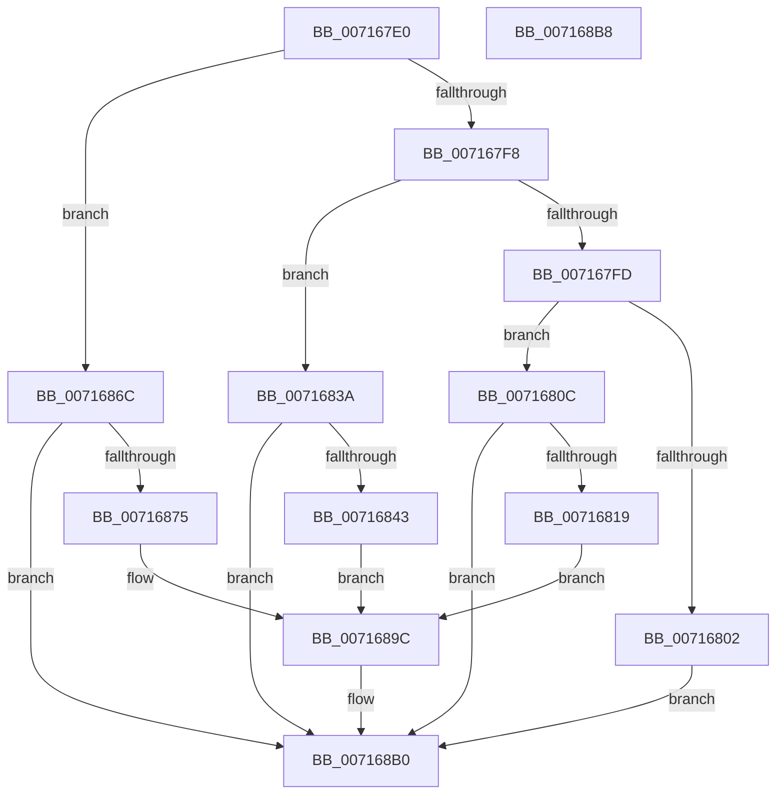

# FsRtlHeatLogIo

- RVA: `0x007167E0`–`0x007168B9` (길이 `217` bytes)
- VA: `0x00000001407167E0`
- 실행 섹션: `PAGE`
- PDB 이름 있음: `예`; PDB Function 태그: `아니요`
- unwind 정보 RVA: `0x000697A4`
- 디코드: `55`개 명령, `217/217` bytes 표시
- 미해석 바이트: `0` (있으면 어셈블리에 `.byte`로 보존)

> 이 문서는 커널 이미지의 기계어와 PDB 기호를 분석해 생성했습니다. 4번과 5번은 함수 원형과 자료형을 바이너리 사용 방식에서 추정한 C 해석이며 원본 소스 복구 결과는 아닙니다.

## 1. Dependencies

- 직접 호출 지점: **1**; 고유 호출 대상: **1**
- 직접 호출자로 확인된 함수: **0**
- RIP 상대 이미지 참조: **5**

### Outgoing calls
- `0x007168AB` → [McTemplateK0xxxqq_EtwWriteTransfer](../../text/58/McTemplateK0xxxqq_EtwWriteTransfer_function_00582EDC.md) (function, `0x00582EDC`)

### Direct callers
- 이 함수 시작 RVA로 연결되는 직접 call은 확인되지 않았습니다. 간접 호출은 완전히 역산할 수 없습니다.

### Static image references
- `0x0071680C` → RVA `0x00F8EF18` (`.data`; read)
- `0x0071681B` → RVA `0x00026838` (`.rdata`; read)
- `0x00716845` → RVA `0x000263D0` (`.rdata`; read)
- `0x00716877` → RVA `0x00026400` (`.rdata`; read)
- `0x0071689F` → RVA `0x00E06CE0` (`.data`; read)

## 2. Other-region calls and transfers

- 다른 실행 섹션으로 향하는 call: **1**
  - `0x007168AB` → [McTemplateK0xxxqq_EtwWriteTransfer](../../text/58/McTemplateK0xxxqq_EtwWriteTransfer_function_00582EDC.md) (`PAGE` → `.text`)
- 별도 외부 분기/꼬리 이동을 확인하지 못했습니다.

## 3. Assembly (complete function range)

```asm
007167E0  40 53                           push rbx
007167E2  48 83 EC 40                     sub rsp, 0x40
007167E6  4C 8B 8A B8 00 00 00            mov r9, qword ptr [rdx + 0xb8]
007167ED  33 DB                           xor ebx, ebx
007167EF  41 0F B6 11                     movzx edx, byte ptr [r9]
007167F3  83 EA 03                        sub edx, 3
007167F6  74 74                           je 0x14071686c
007167F8  83 EA 01                        sub edx, 1
007167FB  74 3D                           je 0x14071683a
007167FD  83 FA 0E                        cmp edx, 0xe
00716800  74 0A                           je 0x14071680c
00716802  BB F0 00 00 C0                  mov ebx, 0xc00000f0
00716807  E9 A4 00 00 00                  jmp 0x1407168b0
0071680C  F6 05 05 87 87 00 08            test byte ptr [rip + 0x878705], 8
00716813  0F 84 97 00 00 00               je 0x1407168b0
00716819  8B 01                           mov eax, dword ptr [rcx]
0071681B  48 8D 15 16 00 91 FF            lea rdx, [rip - 0x6effea]
00716822  89 44 24 38                     mov dword ptr [rsp + 0x38], eax
00716826  49 8B 40 08                     mov rax, qword ptr [r8 + 8]
0071682A  89 5C 24 30                     mov dword ptr [rsp + 0x30], ebx
0071682E  48 89 5C 24 28                  mov qword ptr [rsp + 0x28], rbx
00716833  48 89 44 24 20                  mov qword ptr [rsp + 0x20], rax
00716838  EB 62                           jmp 0x14071689c
0071683A  F6 05 D7 86 87 00 04            test byte ptr [rip + 0x8786d7], 4
00716841  74 6D                           je 0x1407168b0
00716843  8B 01                           mov eax, dword ptr [rcx]
00716845  48 8D 15 84 FB 90 FF            lea rdx, [rip - 0x6f047c]
0071684C  89 44 24 38                     mov dword ptr [rsp + 0x38], eax
00716850  41 8B 41 08                     mov eax, dword ptr [r9 + 8]
00716854  89 44 24 30                     mov dword ptr [rsp + 0x30], eax
00716858  49 8B 41 18                     mov rax, qword ptr [r9 + 0x18]
0071685C  48 89 44 24 28                  mov qword ptr [rsp + 0x28], rax
00716861  49 8B 40 08                     mov rax, qword ptr [r8 + 8]
00716865  48 89 44 24 20                  mov qword ptr [rsp + 0x20], rax
0071686A  EB 30                           jmp 0x14071689c
0071686C  F6 05 A5 86 87 00 02            test byte ptr [rip + 0x8786a5], 2
00716873  74 3B                           je 0x1407168b0
00716875  8B 01                           mov eax, dword ptr [rcx]
00716877  48 8D 15 82 FB 90 FF            lea rdx, [rip - 0x6f047e]
0071687E  41 8B 49 08                     mov ecx, dword ptr [r9 + 8]
00716882  89 44 24 38                     mov dword ptr [rsp + 0x38], eax
00716886  89 4C 24 30                     mov dword ptr [rsp + 0x30], ecx
0071688A  49 8B 49 18                     mov rcx, qword ptr [r9 + 0x18]
0071688E  48 89 4C 24 28                  mov qword ptr [rsp + 0x28], rcx
00716893  49 8B 48 08                     mov rcx, qword ptr [r8 + 8]
00716897  48 89 4C 24 20                  mov qword ptr [rsp + 0x20], rcx
0071689C  4D 8B 08                        mov r9, qword ptr [r8]
0071689F  48 8D 0D 3A 04 6F 00            lea rcx, [rip + 0x6f043a]
007168A6  4C 8B 44 24 70                  mov r8, qword ptr [rsp + 0x70]
007168AB  E8 2C C6 E6 FF                  call 0x140582edc
007168B0  8B C3                           mov eax, ebx
007168B2  48 83 C4 40                     add rsp, 0x40
007168B6  5B                              pop rbx
007168B7  C3                              ret
007168B8  CC                              int3
```

## 4. C-style interpretation (structured pseudocode)

```c
__int64 __fastcall FsRtlHeatLogIo(__int64 a1, __int64 a2, __int64 a3, __int64 a4, __int64 a5)
{
    __int64 result;
    __int64 v_rbx;
    __int64 v_rsp;
    unsigned int v_stack_m10;
    unsigned int v_stack_m18;
    unsigned __int64 v_stack_m20;
    unsigned __int64 v_stack_m28;

    v_rsp = (v_rsp) - (64);
    v_rbx = 0;
    a2 = (unsigned int)((*(unsigned __int8 *)(*(unsigned __int64 *)(a2 + 184))) - (3));
    if (condition_is_equal) goto loc_0071686C;
    a2 = (unsigned int)((a2) - (1));
    if (condition_is_equal) goto loc_0071683A;
    if (((unsigned int)(a2)) == 14) goto loc_0071680C;
    goto loc_007168B0;
loc_0071680C:
    if (((*(unsigned __int8 *)(v_rip + 8881925)) & (8)) == 0) goto loc_007168B0;
    v_stack_m10 = (unsigned int)((unsigned int)(*(unsigned int *)(a1)));
    v_stack_m18 = (unsigned int)((unsigned int)(0xC00000F0ULL));
    v_stack_m20 = (unsigned int)(0xC00000F0ULL);
    v_stack_m28 = *(unsigned __int64 *)(a3 + 8);
    goto loc_0071689C;
loc_0071683A:
    if (((*(unsigned __int8 *)(v_rip + 8881879)) & (4)) == 0) goto loc_007168B0;
    v_stack_m10 = (unsigned int)((unsigned int)(*(unsigned int *)(a1)));
    v_stack_m18 = (unsigned int)((unsigned int)(*(unsigned int *)(*(unsigned __int64 *)(a2 + 184) + 8)));
    v_stack_m20 = *(unsigned __int64 *)(*(unsigned __int64 *)(a2 + 184) + 24);
    v_stack_m28 = *(unsigned __int64 *)(a3 + 8);
    goto loc_0071689C;
loc_0071686C:
    if (((*(unsigned __int8 *)(v_rip + 8881829)) & (2)) == 0) goto loc_007168B0;
    v_stack_m10 = (unsigned int)((unsigned int)(*(unsigned int *)(a1)));
    v_stack_m18 = (unsigned int)((unsigned int)(*(unsigned int *)(*(unsigned __int64 *)(a2 + 184) + 8)));
    v_stack_m20 = *(unsigned __int64 *)(*(unsigned __int64 *)(a2 + 184) + 24);
    v_stack_m28 = *(unsigned __int64 *)(a3 + 8);
loc_0071689C:
    result = McTemplateK0xxxqq_EtwWriteTransfer(v_rip + 7275578, v_rip - 7275646, a5, *(unsigned __int64 *)(a3));
loc_007168B0:
    v_rsp = (v_rsp) + (64);
    return (unsigned int)((unsigned int)((unsigned int)(0xC00000F0ULL)));
}
```

## 5. (Beta) C Style

```c
int64_t FsRtlHeatLogIo(void *Arg1, void *Arg2, void *Arg3, int64_t Arg4, int64_t Arg5)
{
    uint8_t *arg1 = (uint8_t *)Arg1;
    uint8_t *arg2 = (uint8_t *)Arg2;
    uint8_t *arg3 = (uint8_t *)Arg3;

    int64_t result;
    int64_t local_rbx;
    int64_t local_rsp;
    uint32_t v_stack_m10;
    uint32_t v_stack_m18;
    uint64_t v_stack_m20;
    uint64_t v_stack_m28;

    local_rsp = (local_rsp) - (64);
    local_rbx = 0;
    Arg2 = (uint32_t)((*(uint8_t *)(*(uint64_t *)(arg2 + 0xB8))) - (3));
    if (condition_is_equal) goto loc_0071686C;
    Arg2 = (uint32_t)((Arg2) - (1));
    if (condition_is_equal) goto loc_0071683A;
    if (((uint32_t)(Arg2)) == 14) goto loc_0071680C;
    goto loc_007168B0;
loc_0071680C:
    if (((*(uint8_t *)(v_rip + 0x878705)) & (8)) == 0) goto loc_007168B0;
    v_stack_m10 = (uint32_t)((uint32_t)(*(uint32_t *)(arg1)));
    v_stack_m18 = (uint32_t)((uint32_t)(0xC00000F0ULL));
    v_stack_m20 = (uint32_t)(0xC00000F0ULL);
    v_stack_m28 = *(uint64_t *)(arg3 + 0x8);
    goto loc_0071689C;
loc_0071683A:
    if (((*(uint8_t *)(v_rip + 0x8786D7)) & (4)) == 0) goto loc_007168B0;
    v_stack_m10 = (uint32_t)((uint32_t)(*(uint32_t *)(arg1)));
    v_stack_m18 = (uint32_t)((uint32_t)(*(uint32_t *)(*(uint64_t *)(arg2 + 0xB8) + 0x8)));
    v_stack_m20 = *(uint64_t *)(*(uint64_t *)(arg2 + 0xB8) + 0x18);
    v_stack_m28 = *(uint64_t *)(arg3 + 0x8);
    goto loc_0071689C;
loc_0071686C:
    if (((*(uint8_t *)(v_rip + 0x8786A5)) & (2)) == 0) goto loc_007168B0;
    v_stack_m10 = (uint32_t)((uint32_t)(*(uint32_t *)(arg1)));
    v_stack_m18 = (uint32_t)((uint32_t)(*(uint32_t *)(*(uint64_t *)(arg2 + 0xB8) + 0x8)));
    v_stack_m20 = *(uint64_t *)(*(uint64_t *)(arg2 + 0xB8) + 0x18);
    v_stack_m28 = *(uint64_t *)(arg3 + 0x8);
loc_0071689C:
    result = McTemplateK0xxxqq_EtwWriteTransfer(v_rip + 7275578, v_rip - 7275646, Arg5, *(uint64_t *)(arg3));
loc_007168B0:
    local_rsp = (local_rsp) + (64);
    return (uint32_t)((uint32_t)((uint32_t)(0xC00000F0ULL)));
}
```

### 관측된 메모리 오프셋

구조체 형식이 확인되지 않은 접근은 인자 기준의 오프셋으로만 기록했습니다.

| 기준 인자 | 오프셋 표현 | 폭 (bit) | 접근 |
|---|---:|---:|---|
| `Arg1` | `+ 0x0` | `32` | `R` |
| `Arg2` | `+ 0xB8` | `64` | `R` |
| `Arg3` | `+ 0x0` | `64` | `R` |
| `Arg3` | `+ 0x8` | `64` | `R` |

## 6. Execution-region graph

[열기: 2D/3D 그래프와 함수 탐색 컨트롤 패널](../../../control-panel.html?section=page&rva=0x007167E0&view=graph)

- 2D 그래프는 위에서 아래로 흐르고, 3D 그래프는 빈 공간을 드래그해 회전합니다. Shift+드래그는 이동, 휠은 확대·축소, 함수 노드 선택은 대상 보고서 이동입니다.

### Static fallback


