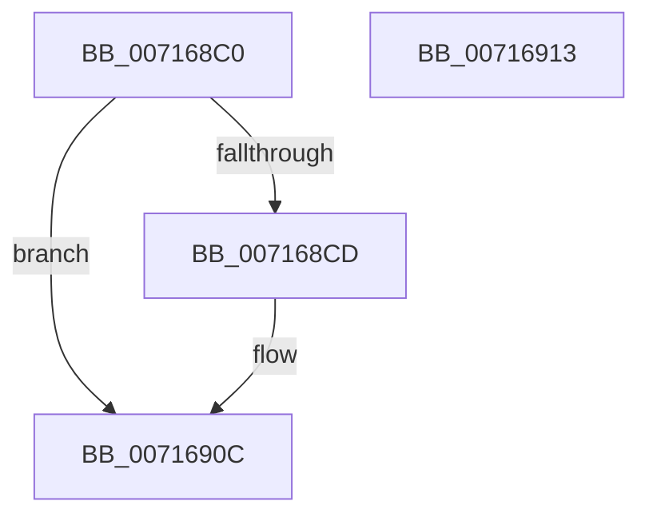

# FsRtlHeatLogTierMove

- RVA: `0x007168C0`–`0x00716914` (길이 `84` bytes)
- VA: `0x00000001407168C0`
- 실행 섹션: `PAGE`
- PDB 이름 있음: `예`; PDB Function 태그: `아니요`
- unwind 정보 RVA: `0x0006C2A4`
- 디코드: `20`개 명령, `84/84` bytes 표시
- 미해석 바이트: `0` (있으면 어셈블리에 `.byte`로 보존)

> 이 문서는 커널 이미지의 기계어와 PDB 기호를 분석해 생성했습니다. 4번과 5번은 함수 원형과 자료형을 바이너리 사용 방식에서 추정한 C 해석이며 원본 소스 복구 결과는 아닙니다.

## 1. Dependencies

- 직접 호출 지점: **1**; 고유 호출 대상: **1**
- 직접 호출자로 확인된 함수: **0**
- RIP 상대 이미지 참조: **1**

### Outgoing calls
- `0x00716907` → [McTemplateK0xxxqqqq_EtwWriteTransfer](../../text/58/McTemplateK0xxxqqqq_EtwWriteTransfer_function_005832A8.md) (function, `0x005832A8`)

### Direct callers
- 이 함수 시작 RVA로 연결되는 직접 call은 확인되지 않았습니다. 간접 호출은 완전히 역산할 수 없습니다.

### Static image references
- `0x007168C4` → RVA `0x00F8EF18` (`.data`; read)

## 2. Other-region calls and transfers

- 다른 실행 섹션으로 향하는 call: **1**
  - `0x00716907` → [McTemplateK0xxxqqqq_EtwWriteTransfer](../../text/58/McTemplateK0xxxqqqq_EtwWriteTransfer_function_005832A8.md) (`PAGE` → `.text`)
- 별도 외부 분기/꼬리 이동을 확인하지 못했습니다.

## 3. Assembly (complete function range)

```asm
007168C0  48 83 EC 58                     sub rsp, 0x58
007168C4  F6 05 4D 86 87 00 10            test byte ptr [rip + 0x87864d], 0x10
007168CB  74 3F                           je 0x14071690c
007168CD  8B 01                           mov eax, dword ptr [rcx]
007168CF  89 44 24 48                     mov dword ptr [rsp + 0x48], eax
007168D3  8B 84 24 88 00 00 00            mov eax, dword ptr [rsp + 0x88]
007168DA  89 44 24 40                     mov dword ptr [rsp + 0x40], eax
007168DE  8B 84 24 80 00 00 00            mov eax, dword ptr [rsp + 0x80]
007168E5  89 44 24 38                     mov dword ptr [rsp + 0x38], eax
007168E9  48 8B 42 08                     mov rax, qword ptr [rdx + 8]
007168ED  44 89 4C 24 30                  mov dword ptr [rsp + 0x30], r9d
007168F2  4C 8B 0A                        mov r9, qword ptr [rdx]
007168F5  4C 89 44 24 28                  mov qword ptr [rsp + 0x28], r8
007168FA  4C 8B 84 24 90 00 00 00         mov r8, qword ptr [rsp + 0x90]
00716902  48 89 44 24 20                  mov qword ptr [rsp + 0x20], rax
00716907  E8 9C C9 E6 FF                  call 0x1405832a8
0071690C  33 C0                           xor eax, eax
0071690E  48 83 C4 58                     add rsp, 0x58
00716912  C3                              ret
00716913  CC                              int3
```

## 4. C-style interpretation (structured pseudocode)

```c
__int64 __fastcall FsRtlHeatLogTierMove(__int64 a1, __int64 a2, __int64 a3, int a4, unsigned int a5, unsigned int a6, __int64 a7)
{
    __int64 result;
    __int64 v_rsp;
    unsigned int v_stack_m10;
    unsigned int v_stack_m18;
    unsigned int v_stack_m20;
    unsigned int v_stack_m28;
    unsigned __int64 v_stack_m30;
    unsigned __int64 v_stack_m38;

    v_rsp = (v_rsp) - (88);
    if (((*(unsigned __int8 *)(v_rip + 8881741)) & (16)) != 0) {
        result = *(unsigned int *)(a1);
        v_stack_m10 = (unsigned int)(result);
        result = a6;
        v_stack_m18 = (unsigned int)(result);
        result = a5;
        v_stack_m20 = (unsigned int)(result);
        result = *(unsigned __int64 *)(a2 + 8);
        v_stack_m28 = a4;
        a4 = *(unsigned __int64 *)(a2);
        v_stack_m30 = a3;
        a3 = a7;
        v_stack_m38 = result;
        result = McTemplateK0xxxqqqq_EtwWriteTransfer(a1, a2, a3, a4);
    }
    result = 0;
    v_rsp = (v_rsp) + (88);
    return result;
}
```

## 5. (Beta) C Style

```c
int64_t FsRtlHeatLogTierMove(void *Arg1, void *Arg2, int64_t Arg3, int32_t Arg4, uint32_t Arg5, uint32_t Arg6, int64_t Arg7)
{
    uint8_t *arg1 = (uint8_t *)Arg1;
    uint8_t *arg2 = (uint8_t *)Arg2;

    int64_t result;
    int64_t local_rsp;
    uint32_t v_stack_m10;
    uint32_t v_stack_m18;
    uint32_t v_stack_m20;
    uint32_t v_stack_m28;
    uint64_t v_stack_m30;
    uint64_t v_stack_m38;

    local_rsp = (local_rsp) - (88);
    if (((*(uint8_t *)(v_rip + 0x87864D)) & (16)) != 0) {
        result = *(uint32_t *)(arg1);
        v_stack_m10 = (uint32_t)(result);
        result = Arg6;
        v_stack_m18 = (uint32_t)(result);
        result = Arg5;
        v_stack_m20 = (uint32_t)(result);
        result = *(uint64_t *)(arg2 + 0x8);
        v_stack_m28 = Arg4;
        Arg4 = *(uint64_t *)(arg2);
        v_stack_m30 = Arg3;
        Arg3 = Arg7;
        v_stack_m38 = result;
        result = McTemplateK0xxxqqqq_EtwWriteTransfer(Arg1, Arg2, Arg3, Arg4);
    }
    result = 0;
    local_rsp = (local_rsp) + (88);
    return result;
}
```

### 관측된 메모리 오프셋

구조체 형식이 확인되지 않은 접근은 인자 기준의 오프셋으로만 기록했습니다.

| 기준 인자 | 오프셋 표현 | 폭 (bit) | 접근 |
|---|---:|---:|---|
| `Arg1` | `+ 0x0` | `32` | `R` |
| `Arg2` | `+ 0x0` | `64` | `R` |
| `Arg2` | `+ 0x8` | `64` | `R` |

## 6. Execution-region graph

[열기: 2D/3D 그래프와 함수 탐색 컨트롤 패널](../../../control-panel.html?section=page&rva=0x007168C0&view=graph)

- 2D 그래프는 위에서 아래로 흐르고, 3D 그래프는 빈 공간을 드래그해 회전합니다. Shift+드래그는 이동, 휠은 확대·축소, 함수 노드 선택은 대상 보고서 이동입니다.

### Static fallback


