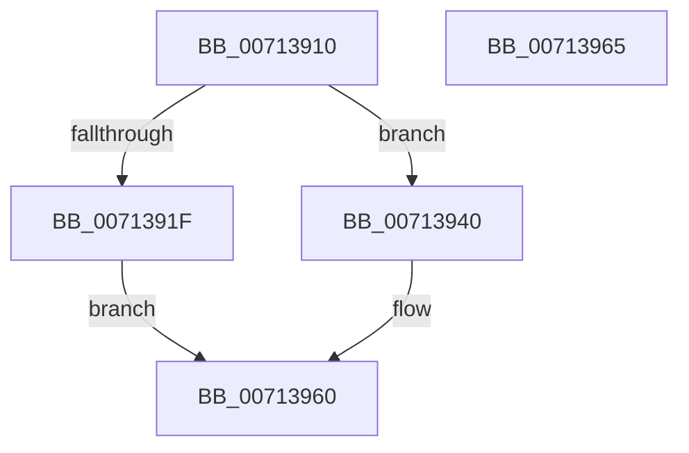

# FsRtlInitExtraCreateParameterLookasideList

- RVA: `0x00713910`–`0x00713966` (길이 `86` bytes)
- VA: `0x0000000140713910`
- 실행 섹션: `PAGE`
- PDB 이름 있음: `예`; PDB Function 태그: `아니요`
- unwind 정보 RVA: `0x00063458`
- 디코드: `24`개 명령, `86/86` bytes 표시
- 미해석 바이트: `0` (있으면 어셈블리에 `.byte`로 보존)

> 이 문서는 커널 이미지의 기계어와 PDB 기호를 분석해 생성했습니다. 4번과 5번은 함수 원형과 자료형을 바이너리 사용 방식에서 추정한 C 해석이며 원본 소스 복구 결과는 아닙니다.

## 1. Dependencies

- 직접 호출 지점: **2**; 고유 호출 대상: **2**
- 직접 호출자로 확인된 함수: **1**
- RIP 상대 이미지 참조: **0**

### Outgoing calls
- `0x00713939` → [ExInitializeNPagedLookasideList](../../text/46/ExInitializeNPagedLookasideList_function_004686E0.md) (function, `0x004686E0`)
- `0x0071395B` → [ExInitializePagedLookasideListInternal](../../text/46/ExInitializePagedLookasideListInternal_function_00468040.md) (function, `0x00468040`)

### Direct callers
- [IoInitSystemPreDrivers](../../init/C2/IoInitSystemPreDrivers_function_00C2AC3C.md) at `0x00C2AFDA`

### Static image references
- 디코드된 RIP-relative 메모리 참조가 없습니다.

## 2. Other-region calls and transfers

- 다른 실행 섹션으로 향하는 call: **2**
  - `0x00713939` → [ExInitializeNPagedLookasideList](../../text/46/ExInitializeNPagedLookasideList_function_004686E0.md) (`PAGE` → `.text`)
  - `0x0071395B` → [ExInitializePagedLookasideListInternal](../../text/46/ExInitializePagedLookasideListInternal_function_00468040.md) (`PAGE` → `.text`)
- 별도 외부 분기/꼬리 이동을 확인하지 못했습니다.

## 3. Assembly (complete function range)

```asm
00713910  48 83 EC 48                     sub rsp, 0x48
00713914  49 83 C0 48                     add r8, 0x48
00713918  33 C0                           xor eax, eax
0071391A  F6 C2 02                        test dl, 2
0071391D  74 21                           je 0x140713940
0071391F  66 89 44 24 30                  mov word ptr [rsp + 0x30], ax
00713924  33 D2                           xor edx, edx
00713926  44 89 4C 24 28                  mov dword ptr [rsp + 0x28], r9d
0071392B  41 B9 00 02 00 00               mov r9d, 0x200
00713931  4C 89 44 24 20                  mov qword ptr [rsp + 0x20], r8
00713936  45 33 C0                        xor r8d, r8d
00713939  E8 A2 4D D5 FF                  call 0x1404686e0
0071393E  EB 20                           jmp 0x140713960
00713940  89 44 24 38                     mov dword ptr [rsp + 0x38], eax
00713944  33 D2                           xor edx, edx
00713946  66 89 44 24 30                  mov word ptr [rsp + 0x30], ax
0071394B  44 89 4C 24 28                  mov dword ptr [rsp + 0x28], r9d
00713950  45 33 C9                        xor r9d, r9d
00713953  4C 89 44 24 20                  mov qword ptr [rsp + 0x20], r8
00713958  45 33 C0                        xor r8d, r8d
0071395B  E8 E0 46 D5 FF                  call 0x140468040
00713960  48 83 C4 48                     add rsp, 0x48
00713964  C3                              ret
00713965  CC                              int3
```

## 4. C-style interpretation (structured pseudocode)

```c
__int64 __fastcall FsRtlInitExtraCreateParameterLookasideList(__int64 a1, int a2, __int64 a3, int a4)
{
    __int64 result;
    __int64 v_rsp;
    unsigned int v_stack_m10;
    unsigned __int16 v_stack_m18;
    unsigned int v_stack_m20;
    unsigned __int64 v_stack_m28;

    v_rsp = (v_rsp) - (72);
    a3 = (a3) + (72);
    result = 0;
    if ((((unsigned __int8)(a2)) & (2)) == 0) goto loc_00713940;
    v_stack_m18 = 0;
    a2 = 0;
    v_stack_m20 = a4;
    v_stack_m28 = a3;
    a3 = 0;
    result = ExInitializeNPagedLookasideList(a1, a2, a3, 512);
    goto loc_00713960;
loc_00713940:
    v_stack_m10 = (unsigned int)(result);
    a2 = 0;
    v_stack_m18 = (unsigned __int16)(result);
    v_stack_m20 = 512;
    a4 = 0;
    v_stack_m28 = 0;
    a3 = 0;
    result = ExInitializePagedLookasideListInternal(a1, a2, a3, a4);
loc_00713960:
    v_rsp = (v_rsp) + (72);
    return result;
}
```

## 5. (Beta) C Style

```c
int64_t FsRtlInitExtraCreateParameterLookasideList(int64_t Arg1, int32_t Arg2, int64_t Arg3, int32_t Arg4)
{
    int64_t result;
    int64_t local_rsp;
    uint32_t v_stack_m10;
    uint16_t v_stack_m18;
    uint32_t v_stack_m20;
    uint64_t v_stack_m28;

    local_rsp = (local_rsp) - (72);
    Arg3 = (Arg3) + (72);
    result = 0;
    if ((((uint8_t)(Arg2)) & (2)) == 0) goto loc_00713940;
    v_stack_m18 = 0;
    Arg2 = 0;
    v_stack_m20 = Arg4;
    v_stack_m28 = Arg3;
    Arg3 = 0;
    result = ExInitializeNPagedLookasideList(Arg1, Arg2, Arg3, 512);
    goto loc_00713960;
loc_00713940:
    v_stack_m10 = (uint32_t)(result);
    Arg2 = 0;
    v_stack_m18 = (uint16_t)(result);
    v_stack_m20 = 512;
    Arg4 = 0;
    v_stack_m28 = 0;
    Arg3 = 0;
    result = ExInitializePagedLookasideListInternal(Arg1, Arg2, Arg3, Arg4);
loc_00713960:
    local_rsp = (local_rsp) + (72);
    return result;
}
```

## 6. Execution-region graph

[열기: 2D/3D 그래프와 함수 탐색 컨트롤 패널](../../../control-panel.html?section=page&rva=0x00713910&view=graph)

- 2D 그래프는 위에서 아래로 흐르고, 3D 그래프는 빈 공간을 드래그해 회전합니다. Shift+드래그는 이동, 휠은 확대·축소, 함수 노드 선택은 대상 보고서 이동입니다.

### Static fallback


