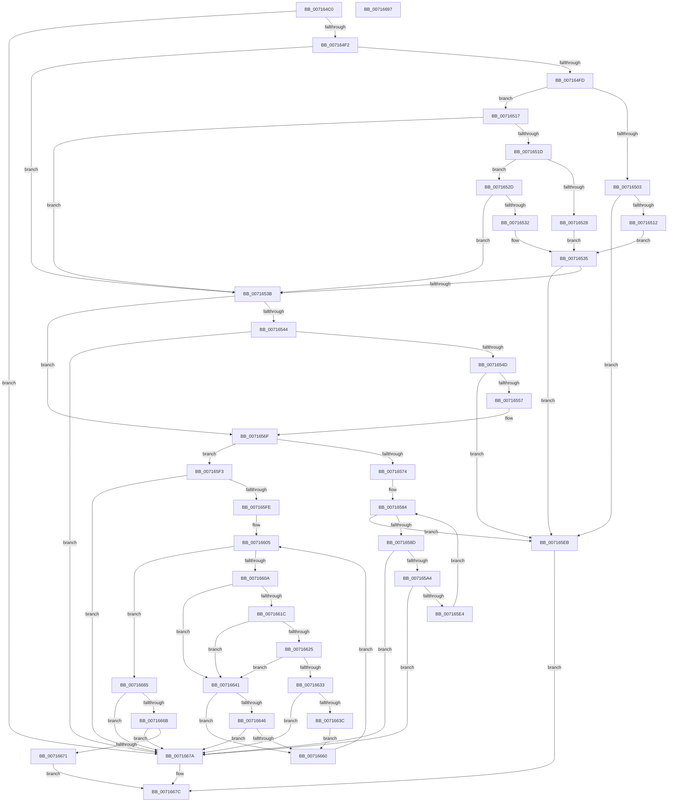

# FsRtlIsHpfsDbcsLegal

- RVA: `0x007164C0`–`0x00716698` (길이 `472` bytes)
- VA: `0x00000001407164C0`
- 실행 섹션: `PAGE`
- PDB 이름 있음: `예`; PDB Function 태그: `아니요`
- unwind 정보 RVA: `0x000C61C4`
- 디코드: `133`개 명령, `472/472` bytes 표시
- 미해석 바이트: `0` (있으면 어셈블리에 `.byte`로 보존)

> 이 문서는 커널 이미지의 기계어와 PDB 기호를 분석해 생성했습니다. 4번과 5번은 함수 원형과 자료형을 바이너리 사용 방식에서 추정한 C 해석이며 원본 소스 복구 결과는 아닙니다.

## 1. Dependencies

- 직접 호출 지점: **2**; 고유 호출 대상: **2**
- 직접 호출자로 확인된 함수: **1**
- RIP 상대 이미지 참조: **3**

### Outgoing calls
- `0x007165B9` → [FsRtlDissectDbcs](FsRtlDissectDbcs_function_007163E0.md) (function, `0x007163E0`)
- `0x007165D7` → [FsRtlIsHpfsDbcsLegal](FsRtlIsHpfsDbcsLegal_function_007164C0.md) (function, `0x007164C0`)

### Direct callers
- [FsRtlIsHpfsDbcsLegal](FsRtlIsHpfsDbcsLegal_function_007164C0.md) at `0x007165D7`

### Static image references
- `0x0071661C` → RVA `0x00FD8000` (`PAGEDATA`; read)
- `0x00716625` → RVA `0x00FD8090` (`PAGEDATA`; read)
- `0x00716649` → RVA `0x00013E90` (`.rdata`; read)

## 2. Other-region calls and transfers

- 다른 실행 섹션으로 향하는 call: **0**
- 별도 외부 분기/꼬리 이동을 확인하지 못했습니다.

## 3. Assembly (complete function range)

```asm
007164C0  48 8B C4                        mov rax, rsp
007164C3  48 89 58 08                     mov qword ptr [rax + 8], rbx
007164C7  48 89 68 10                     mov qword ptr [rax + 0x10], rbp
007164CB  48 89 70 18                     mov qword ptr [rax + 0x18], rsi
007164CF  48 89 78 20                     mov qword ptr [rax + 0x20], rdi
007164D3  41 54                           push r12
007164D5  48 83 EC 50                     sub rsp, 0x50
007164D9  44 0F B7 19                     movzx r11d, word ptr [rcx]
007164DD  33 F6                           xor esi, esi
007164DF  40 8A FA                        mov dil, dl
007164E2  48 8B D9                        mov rbx, rcx
007164E5  44 8A D6                        mov r10b, sil
007164E8  66 45 85 DB                     test r11w, r11w
007164EC  0F 84 88 01 00 00               je 0x14071667a
007164F2  8D 6E 01                        lea ebp, [rsi + 1]
007164F5  44 8D 66 02                     lea r12d, [rsi + 2]
007164F9  84 D2                           test dl, dl
007164FB  74 3E                           je 0x14071653b
007164FD  66 44 3B DD                     cmp r11w, bp
00716501  75 14                           jne 0x140716517
00716503  48 8B 41 08                     mov rax, qword ptr [rcx + 8]
00716507  8A 08                           mov cl, byte ptr [rax]
00716509  80 F9 2E                        cmp cl, 0x2e
0071650C  0F 84 D9 00 00 00               je 0x1407165eb
00716512  80 F9 22                        cmp cl, 0x22
00716515  EB 1E                           jmp 0x140716535
00716517  66 45 3B DC                     cmp r11w, r12w
0071651B  75 1E                           jne 0x14071653b
0071651D  48 8B 41 08                     mov rax, qword ptr [rcx + 8]
00716521  8A 08                           mov cl, byte ptr [rax]
00716523  80 F9 2E                        cmp cl, 0x2e
00716526  75 05                           jne 0x14071652d
00716528  38 48 01                        cmp byte ptr [rax + 1], cl
0071652B  EB 08                           jmp 0x140716535
0071652D  80 F9 22                        cmp cl, 0x22
00716530  75 09                           jne 0x14071653b
00716532  38 48 01                        cmp byte ptr [rax + 1], cl
00716535  0F 84 B0 00 00 00               je 0x1407165eb
0071653B  48 8B 43 08                     mov rax, qword ptr [rbx + 8]
0071653F  80 38 5C                        cmp byte ptr [rax], 0x5c
00716542  75 2B                           jne 0x14071656f
00716544  45 84 C9                        test r9b, r9b
00716547  0F 84 2D 01 00 00               je 0x14071667a
0071654D  66 44 3B DD                     cmp r11w, bp
00716551  0F 86 94 00 00 00               jbe 0x1407165eb
00716557  48 FF C0                        inc rax
0071655A  66 44 2B DD                     sub r11w, bp
0071655E  48 89 43 08                     mov qword ptr [rbx + 8], rax
00716562  B8 FF FF 00 00                  mov eax, 0xffff
00716567  66 01 43 02                     add word ptr [rbx + 2], ax
0071656B  66 44 89 1B                     mov word ptr [rbx], r11w
0071656F  45 84 C0                        test r8b, r8b
00716572  74 7F                           je 0x1407165f3
00716574  0F 10 0B                        movups xmm1, xmmword ptr [rbx]
00716577  0F 57 C0                        xorps xmm0, xmm0
0071657A  0F 29 4C 24 30                  movaps xmmword ptr [rsp + 0x30], xmm1
0071657F  0F 11 44 24 20                  movups xmmword ptr [rsp + 0x20], xmm0
00716584  66 0F 7E C8                     movd eax, xmm1
00716588  66 85 C0                        test ax, ax
0071658B  74 5E                           je 0x1407165eb
0071658D  66 0F 6F C1                     movdqa xmm0, xmm1
00716591  66 0F 73 D8 08                  psrldq xmm0, 8
00716596  66 48 0F 7E C0                  movq rax, xmm0
0071659B  80 38 5C                        cmp byte ptr [rax], 0x5c
0071659E  0F 84 D6 00 00 00               je 0x14071667a
007165A4  4C 8D 44 24 30                  lea r8, [rsp + 0x30]
007165A9  66 0F 7F 4C 24 40               movdqa xmmword ptr [rsp + 0x40], xmm1
007165AF  48 8D 54 24 20                  lea rdx, [rsp + 0x20]
007165B4  48 8D 4C 24 40                  lea rcx, [rsp + 0x40]
007165B9  E8 22 FE FF FF                  call 0x1407163e0
007165BE  0F 28 44 24 20                  movaps xmm0, xmmword ptr [rsp + 0x20]
007165C3  48 8D 4C 24 40                  lea rcx, [rsp + 0x40]
007165C8  45 33 C9                        xor r9d, r9d
007165CB  66 0F 7F 44 24 40               movdqa xmmword ptr [rsp + 0x40], xmm0
007165D1  45 33 C0                        xor r8d, r8d
007165D4  40 8A D7                        mov dl, dil
007165D7  E8 E4 FE FF FF                  call 0x1407164c0
007165DC  84 C0                           test al, al
007165DE  0F 84 96 00 00 00               je 0x14071667a
007165E4  0F 28 4C 24 30                  movaps xmm1, xmmword ptr [rsp + 0x30]
007165E9  EB 99                           jmp 0x140716584
007165EB  40 8A C5                        mov al, bpl
007165EE  E9 89 00 00 00                  jmp 0x14071667c
007165F3  B8 FF 00 00 00                  mov eax, 0xff
007165F8  66 44 3B D8                     cmp r11w, ax
007165FC  77 7C                           ja 0x14071667a
007165FE  44 8B C6                        mov r8d, esi
00716601  45 0F B7 CB                     movzx r9d, r11w
00716605  45 3B C1                        cmp r8d, r9d
00716608  73 5B                           jae 0x140716665
0071660A  48 8B 43 08                     mov rax, qword ptr [rbx + 8]
0071660E  41 8B C8                        mov ecx, r8d
00716611  44 0F B6 14 01                  movzx r10d, byte ptr [rcx + rax]
00716616  41 80 FA 80                     cmp r10b, 0x80
0071661A  72 25                           jb 0x140716641
0071661C  40 38 35 DD 19 8C 00            cmp byte ptr [rip + 0x8c19dd], sil
00716623  74 1C                           je 0x140716641
00716625  48 8B 05 64 1A 8C 00            mov rax, qword ptr [rip + 0x8c1a64]
0071662C  66 42 39 34 50                  cmp word ptr [rax + r10*2], si
00716631  74 0E                           je 0x140716641
00716633  41 8D 41 FF                     lea eax, [r9 - 1]
00716637  44 3B C0                        cmp r8d, eax
0071663A  74 3E                           je 0x14071667a
0071663C  44 03 C5                        add r8d, ebp
0071663F  EB 1F                           jmp 0x140716660
00716641  45 84 D2                        test r10b, r10b
00716644  78 1A                           js 0x140716660
00716646  40 8A C7                        mov al, dil
00716649  48 8D 15 40 D8 8F FF            lea rdx, [rip - 0x7027c0]
00716650  F6 D8                           neg al
00716652  1B C9                           sbb ecx, ecx
00716654  83 E1 08                        and ecx, 8
00716657  41 03 CC                        add ecx, r12d
0071665A  41 84 0C 12                     test byte ptr [r10 + rdx], cl
0071665E  74 1A                           je 0x14071667a
00716660  44 03 C5                        add r8d, ebp
00716663  EB A0                           jmp 0x140716605
00716665  41 80 FA 20                     cmp r10b, 0x20
00716669  74 0F                           je 0x14071667a
0071666B  41 80 FA 2E                     cmp r10b, 0x2e
0071666F  74 09                           je 0x14071667a
00716671  41 80 FA 22                     cmp r10b, 0x22
00716675  0F 95 C0                        setne al
00716678  EB 02                           jmp 0x14071667c
0071667A  32 C0                           xor al, al
0071667C  48 8B 5C 24 60                  mov rbx, qword ptr [rsp + 0x60]
00716681  48 8B 6C 24 68                  mov rbp, qword ptr [rsp + 0x68]
00716686  48 8B 74 24 70                  mov rsi, qword ptr [rsp + 0x70]
0071668B  48 8B 7C 24 78                  mov rdi, qword ptr [rsp + 0x78]
00716690  48 83 C4 50                     add rsp, 0x50
00716694  41 5C                           pop r12
00716696  C3                              ret
00716697  CC                              int3
```

## 4. C-style interpretation (structured pseudocode)

```c
__int64 __fastcall FsRtlIsHpfsDbcsLegal(__int64 a1, unsigned __int8 a2, unsigned __int8 a3, int a4)
{
    __int64 result;
    __int64 v_r11;
    __int64 v_rsi;
    __int64 v_rsp;
    unsigned __int64 v_stack_m18;
    unsigned __int64 v_stack_m28;
    unsigned __int64 v_stack_m38;
    unsigned __int64 v_stack_p10;
    unsigned __int64 v_stack_p18;
    unsigned __int64 v_stack_p20;
    unsigned __int64 v_stack_p8;

    *(unsigned __int64 *)(v_rsp + 8) = v_rbx;
    *(unsigned __int64 *)(v_rsp + 16) = v_rbp;
    *(unsigned __int64 *)(v_rsp + 24) = v_rsi;
    *(unsigned __int64 *)(v_rsp + 32) = v_rdi;
    v_rsp = (v_rsp) - (80);
    v_rsi = 0;
    if ((unsigned __int16)(*(unsigned __int16 *)(a1)) == 0) goto loc_0071667A;
    if (a2 == 0) goto loc_0071653B;
    if (((unsigned __int16)(*(unsigned __int16 *)(a1))) != ((unsigned __int16)(v_rsi + 1))) goto loc_00716517;
    if (((unsigned __int8)(*(unsigned __int8 *)(*(unsigned __int64 *)(a1 + 8)))) == 46) goto loc_007165EB;
    goto loc_00716535;
loc_00716517:
    if (((unsigned __int16)(*(unsigned __int16 *)(a1))) != ((unsigned __int16)(v_rsi + 2))) goto loc_0071653B;
    if (((unsigned __int8)(*(unsigned __int8 *)(*(unsigned __int64 *)(*(unsigned __int8 *)(*(unsigned __int64 *)(a1 + 8)) + 8)))) != 46) goto loc_0071652D;
    goto loc_00716535;
loc_0071652D:
    if (((unsigned __int8)(*(unsigned __int8 *)(*(unsigned __int64 *)(*(unsigned __int8 *)(*(unsigned __int64 *)(a1 + 8)) + 8)))) != 34) goto loc_0071653B;
loc_00716535:
    if ((*(unsigned __int8 *)(*(unsigned __int64 *)(*(unsigned __int8 *)(*(unsigned __int64 *)(a1 + 8)) + 8) + 1)) == ((unsigned __int8)(*(unsigned __int8 *)(*(unsigned __int64 *)(*(unsigned __int8 *)(*(unsigned __int64 *)(a1 + 8)) + 8))))) goto loc_007165EB;
loc_0071653B:
    if ((*(unsigned __int8 *)(*(unsigned __int64 *)(a1 + 8))) != 92) goto loc_0071656F;
    if ((unsigned __int8)(a4) == 0) goto loc_0071667A;
    if (((unsigned __int16)(*(unsigned __int16 *)(a1))) <= ((unsigned __int16)(v_rsi + 1))) goto loc_007165EB;
    result = (*(unsigned __int64 *)(a1 + 8)) + 1;
    v_r11 = (unsigned __int16)((*(unsigned __int16 *)(a1)) - ((unsigned __int16)(v_rsi + 1)));
    *(unsigned __int64 *)(a1 + 8) = result;
    *(unsigned __int16 *)(a1) = (unsigned __int16)(v_r11);
loc_0071656F:
    if (a3 == 0) goto loc_007165F3;
    v_stack_m28 = v_xmm1;
    v_stack_m38 = v_xmm0;
loc_00716584:
    if ((unsigned __int16)((unsigned int)(0xFFFFULL)) == 0) goto loc_007165EB;
    if ((*(unsigned __int8 *)((unsigned int)(0xFFFFULL))) == 92) goto loc_0071667A;
    v_stack_m18 = v_xmm1;
    result = FsRtlDissectDbcs(v_stack_m18, v_stack_m38, v_stack_m28, a4);
    a4 = 0;
    v_stack_m18 = v_xmm0;
    a3 = 0;
    result = FsRtlIsHpfsDbcsLegal(v_stack_m18, a2, a3, a4);
    if ((unsigned __int8)(result) == 0) goto loc_0071667A;
    goto loc_00716584;
loc_007165EB:
    goto loc_0071667C;
loc_007165F3:
    if (((unsigned __int16)(v_r11)) > 255) goto loc_0071667A;
loc_00716605:
    if (0 >= ((unsigned int)((unsigned __int16)(v_r11)))) goto loc_00716665;
    if (((unsigned __int8)(*(unsigned __int8 *)(0 + *(unsigned __int64 *)(a1 + 8) * 1))) < 128) goto loc_00716641;
    if ((*(unsigned __int8 *)(v_rip + 9181661)) == 0) goto loc_00716641;
    if ((*(unsigned __int16 *)(*(unsigned __int64 *)(v_rip + 9181796) + *(unsigned __int8 *)(0 + *(unsigned __int64 *)(a1 + 8) * 1) * 2)) == 0) goto loc_00716641;
    if (0 == ((unsigned int)((unsigned __int16)(v_r11) - 1))) goto loc_0071667A;
    a3 = (unsigned int)((0) + ((unsigned int)(v_rsi + 1)));
    goto loc_00716660;
loc_00716641:
    if (sign_flag) goto loc_00716660;
    result = (unsigned __int8)(-(a2));
    a1 = (unsigned int)((0) & (8));
    a1 = (unsigned int)((a1) + ((unsigned int)(v_rsi + 2)));
    if (((*(unsigned __int8 *)(*(unsigned __int8 *)(0 + *(unsigned __int64 *)(a1 + 8) * 1) + v_rip - 7350208 * 1)) & ((unsigned __int8)(a1))) == 0) goto loc_0071667A;
loc_00716660:
    a3 = (unsigned int)((a3) + ((unsigned int)(v_rsi + 1)));
    goto loc_00716605;
loc_00716665:
    if (((unsigned __int8)(*(unsigned __int8 *)(0 + *(unsigned __int64 *)(a1 + 8) * 1))) == 32) goto loc_0071667A;
    if (((unsigned __int8)(*(unsigned __int8 *)(0 + *(unsigned __int64 *)(a1 + 8) * 1))) == 46) goto loc_0071667A;
    result = (((unsigned __int8)(*(unsigned __int8 *)(0 + *(unsigned __int64 *)(a1 + 8) * 1))) != 34) ? 1 : 0;
    goto loc_0071667C;
loc_0071667A:
    result = 0;
loc_0071667C:
    v_rsp = (v_rsp) + (80);
    return result;
}
```

## 5. (Beta) C Style

```c
int64_t FsRtlIsHpfsDbcsLegal(void *Arg1, uint8_t Arg2, uint8_t Arg3, int32_t Arg4)
{
    uint8_t *arg1 = (uint8_t *)Arg1;

    int64_t result;
    int64_t local_r11;
    int64_t local_rsi;
    int64_t local_rsp;
    uint64_t v_stack_m18;
    uint64_t v_stack_m28;
    uint64_t v_stack_m38;
    uint64_t v_stack_p10;
    uint64_t v_stack_p18;
    uint64_t v_stack_p20;
    uint64_t v_stack_p8;

    *(uint64_t *)(local_rsp + 0x8) = local_rbx;
    *(uint64_t *)(local_rsp + 0x10) = local_rbp;
    *(uint64_t *)(local_rsp + 0x18) = local_rsi;
    *(uint64_t *)(local_rsp + 0x20) = local_rdi;
    local_rsp = (local_rsp) - (80);
    local_rsi = 0;
    if ((uint16_t)(*(uint16_t *)(arg1)) == 0) goto loc_0071667A;
    if (Arg2 == 0) goto loc_0071653B;
    if (((uint16_t)(*(uint16_t *)(arg1))) != ((uint16_t)(local_rsi + 1))) goto loc_00716517;
    if (((uint8_t)(*(uint8_t *)(*(uint64_t *)(arg1 + 0x8)))) == 46) goto loc_007165EB;
    goto loc_00716535;
loc_00716517:
    if (((uint16_t)(*(uint16_t *)(arg1))) != ((uint16_t)(local_rsi + 2))) goto loc_0071653B;
    if (((uint8_t)(*(uint8_t *)(*(uint64_t *)(*(uint8_t *)(*(uint64_t *)(arg1 + 0x8)) + 0x8)))) != 46) goto loc_0071652D;
    goto loc_00716535;
loc_0071652D:
    if (((uint8_t)(*(uint8_t *)(*(uint64_t *)(*(uint8_t *)(*(uint64_t *)(arg1 + 0x8)) + 0x8)))) != 34) goto loc_0071653B;
loc_00716535:
    if ((*(uint8_t *)(*(uint64_t *)(*(uint8_t *)(*(uint64_t *)(arg1 + 0x8)) + 0x8) + 0x1)) == ((uint8_t)(*(uint8_t *)(*(uint64_t *)(*(uint8_t *)(*(uint64_t *)(arg1 + 0x8)) + 0x8))))) goto loc_007165EB;
loc_0071653B:
    if ((*(uint8_t *)(*(uint64_t *)(arg1 + 0x8))) != 92) goto loc_0071656F;
    if ((uint8_t)(Arg4) == 0) goto loc_0071667A;
    if (((uint16_t)(*(uint16_t *)(arg1))) <= ((uint16_t)(local_rsi + 1))) goto loc_007165EB;
    result = (*(uint64_t *)(arg1 + 0x8)) + 1;
    local_r11 = (uint16_t)((*(uint16_t *)(arg1)) - ((uint16_t)(local_rsi + 1)));
    *(uint64_t *)(arg1 + 0x8) = result;
    *(uint16_t *)(arg1) = (uint16_t)(local_r11);
loc_0071656F:
    if (Arg3 == 0) goto loc_007165F3;
    v_stack_m28 = v_xmm1;
    v_stack_m38 = v_xmm0;
loc_00716584:
    if ((uint16_t)((uint32_t)(0xFFFFULL)) == 0) goto loc_007165EB;
    if ((*(uint8_t *)((uint32_t)(0xFFFFULL))) == 92) goto loc_0071667A;
    v_stack_m18 = v_xmm1;
    result = FsRtlDissectDbcs(v_stack_m18, v_stack_m38, v_stack_m28, Arg4);
    Arg4 = 0;
    v_stack_m18 = v_xmm0;
    Arg3 = 0;
    result = FsRtlIsHpfsDbcsLegal(v_stack_m18, Arg2, Arg3, Arg4);
    if ((uint8_t)(result) == 0) goto loc_0071667A;
    goto loc_00716584;
loc_007165EB:
    goto loc_0071667C;
loc_007165F3:
    if (((uint16_t)(local_r11)) > 255) goto loc_0071667A;
loc_00716605:
    if (0 >= ((uint32_t)((uint16_t)(local_r11)))) goto loc_00716665;
    if (((uint8_t)(*(uint8_t *)(0 + *(uint64_t *)(arg1 + 0x8) * 1))) < 128) goto loc_00716641;
    if ((*(uint8_t *)(v_rip + 0x8C19DD)) == 0) goto loc_00716641;
    if ((*(uint16_t *)(*(uint64_t *)(v_rip + 0x8C1A64) + *(uint8_t *)(0 + *(uint64_t *)(arg1 + 0x8) * 1) * 2)) == 0) goto loc_00716641;
    if (0 == ((uint32_t)((uint16_t)(local_r11) - 1))) goto loc_0071667A;
    Arg3 = (uint32_t)((0) + ((uint32_t)(local_rsi + 1)));
    goto loc_00716660;
loc_00716641:
    if (sign_flag) goto loc_00716660;
    result = (uint8_t)(-(Arg2));
    Arg1 = (uint32_t)((0) & (8));
    Arg1 = (uint32_t)((Arg1) + ((uint32_t)(local_rsi + 2)));
    if (((*(uint8_t *)(*(uint8_t *)(0 + *(uint64_t *)(arg1 + 0x8) * 1) + v_rip - 0x7027C0 * 1)) & ((uint8_t)(Arg1))) == 0) goto loc_0071667A;
loc_00716660:
    Arg3 = (uint32_t)((Arg3) + ((uint32_t)(local_rsi + 1)));
    goto loc_00716605;
loc_00716665:
    if (((uint8_t)(*(uint8_t *)(0 + *(uint64_t *)(arg1 + 0x8) * 1))) == 32) goto loc_0071667A;
    if (((uint8_t)(*(uint8_t *)(0 + *(uint64_t *)(arg1 + 0x8) * 1))) == 46) goto loc_0071667A;
    result = (((uint8_t)(*(uint8_t *)(0 + *(uint64_t *)(arg1 + 0x8) * 1))) != 34) ? 1 : 0;
    goto loc_0071667C;
loc_0071667A:
    result = 0;
loc_0071667C:
    local_rsp = (local_rsp) + (80);
    return result;
}
```

### 관측된 메모리 오프셋

구조체 형식이 확인되지 않은 접근은 인자 기준의 오프셋으로만 기록했습니다.

| 기준 인자 | 오프셋 표현 | 폭 (bit) | 접근 |
|---|---:|---:|---|
| `Arg1` | `+ 0x0` | `16` | `R` |
| `Arg1` | `+ 0x0` | `16` | `W` |
| `Arg1` | `+ 0x0` | `128` | `R` |
| `Arg1` | `+ 0x2` | `16` | `R/W` |
| `Arg1` | `+ 0x8` | `64` | `R` |
| `Arg1` | `+ 0x8` | `64` | `W` |

## 6. Execution-region graph

[열기: 2D/3D 그래프와 함수 탐색 컨트롤 패널](../../../control-panel.html?section=page&rva=0x007164C0&view=graph)

- 2D 그래프는 위에서 아래로 흐르고, 3D 그래프는 빈 공간을 드래그해 회전합니다. Shift+드래그는 이동, 휠은 확대·축소, 함수 노드 선택은 대상 보고서 이동입니다.

### Static fallback


