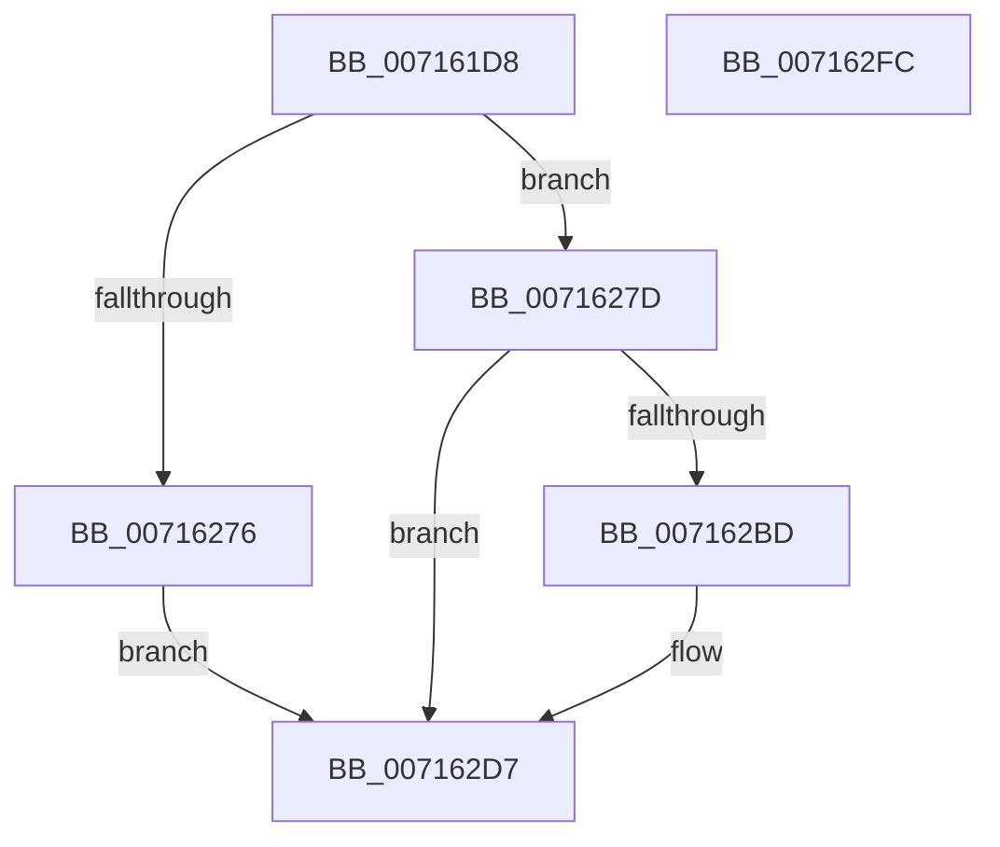

# FsRtlIssueFileNotificationFsctl

- RVA: `0x007161D8`–`0x007162FD` (길이 `293` bytes)
- VA: `0x00000001407161D8`
- 실행 섹션: `PAGE`
- PDB 이름 있음: `예`; PDB Function 태그: `아니요`
- unwind 정보 RVA: `0x000C61A0`
- 디코드: `76`개 명령, `293/293` bytes 표시
- 미해석 바이트: `0` (있으면 어셈블리에 `.byte`로 보존)

> 이 문서는 커널 이미지의 기계어와 PDB 기호를 분석해 생성했습니다. 4번과 5번은 함수 원형과 자료형을 바이너리 사용 방식에서 추정한 C 해석이며 원본 소스 복구 결과는 아닙니다.

## 1. Dependencies

- 직접 호출 지점: **6**; 고유 호출 대상: **6**
- 직접 호출자로 확인된 함수: **4**
- RIP 상대 이미지 참조: **1**

### Outgoing calls
- `0x00716229` → [KeInitializeEvent](../../text/40/KeInitializeEvent_function_0040DD10.md) (function, `0x0040DD10`)
- `0x00716231` → [IoGetRelatedDeviceObject](../../text/29/IoGetRelatedDeviceObject_function_0029B120.md) (function, `0x0029B120`)
- `0x00716269` → [IoBuildDeviceIoControlRequest](../../text/20/IoBuildDeviceIoControlRequest_function_00204FD0.md) (function, `0x00204FD0`)
- `0x007162B1` → [IofCallDriver](../../text/29/IofCallDriver_function_0029B4B0.md) (function, `0x0029B4B0`)
- `0x007162CF` → [KeWaitForSingleObject](../../text/20/KeWaitForSingleObject_function_0020E6B0.md) (function, `0x0020E6B0`)
- `0x007162DE` → [_security_check_cookie](../../text/6A/_security_check_cookie_function_006AC640.md) (function, `0x006AC640`)

### Direct callers
- [IopInitializeCrashDump](IopInitializeCrashDump_function_0071A270.md) at `0x0071A3FC`
- [PopCreateHiberFile](../75/PopCreateHiberFile_function_0075CE70.md) at `0x0075D34F`
- [MiCreatePagingFile](../7F/MiCreatePagingFile_function_007FEFF4.md) at `0x007FF6A3`
- [PopResizeHiberFile](../A9/PopResizeHiberFile_function_00A90410.md) at `0x00A905C7`

### Static image references
- `0x007161F3` → RVA `0x00E0A740` (`.data`; read)

## 2. Other-region calls and transfers

- 다른 실행 섹션으로 향하는 call: **6**
  - `0x00716229` → [KeInitializeEvent](../../text/40/KeInitializeEvent_function_0040DD10.md) (`PAGE` → `.text`)
  - `0x00716231` → [IoGetRelatedDeviceObject](../../text/29/IoGetRelatedDeviceObject_function_0029B120.md) (`PAGE` → `.text`)
  - `0x00716269` → [IoBuildDeviceIoControlRequest](../../text/20/IoBuildDeviceIoControlRequest_function_00204FD0.md) (`PAGE` → `.text`)
  - `0x007162B1` → [IofCallDriver](../../text/29/IofCallDriver_function_0029B4B0.md) (`PAGE` → `.text`)
  - `0x007162CF` → [KeWaitForSingleObject](../../text/20/KeWaitForSingleObject_function_0020E6B0.md) (`PAGE` → `.text`)
  - `0x007162DE` → [_security_check_cookie](../../text/6A/_security_check_cookie_function_006AC640.md) (`PAGE` → `.text`)
- 별도 외부 분기/꼬리 이동을 확인하지 못했습니다.

## 3. Assembly (complete function range)

```asm
007161D8  48 8B C4                        mov rax, rsp
007161DB  48 89 58 10                     mov qword ptr [rax + 0x10], rbx
007161DF  48 89 70 18                     mov qword ptr [rax + 0x18], rsi
007161E3  48 89 78 20                     mov qword ptr [rax + 0x20], rdi
007161E7  55                              push rbp
007161E8  48 8D 68 A1                     lea rbp, [rax - 0x5f]
007161EC  48 81 EC A0 00 00 00            sub rsp, 0xa0
007161F3  48 8B 05 46 45 6F 00            mov rax, qword ptr [rip + 0x6f4546]
007161FA  48 33 C4                        xor rax, rsp
007161FD  48 89 45 47                     mov qword ptr [rbp + 0x47], rax
00716201  0F 57 C0                        xorps xmm0, xmm0
00716204  49 8B F0                        mov rsi, r8
00716207  48 8B D9                        mov rbx, rcx
0071620A  33 C0                           xor eax, eax
0071620C  0F 57 C9                        xorps xmm1, xmm1
0071620F  48 89 45 17                     mov qword ptr [rbp + 0x17], rax
00716213  45 33 C0                        xor r8d, r8d
00716216  48 8D 4D 07                     lea rcx, [rbp + 7]
0071621A  33 D2                           xor edx, edx
0071621C  0F 11 45 07                     movups xmmword ptr [rbp + 7], xmm0
00716220  0F 11 45 1F                     movups xmmword ptr [rbp + 0x1f], xmm0
00716224  F3 0F 7F 4D 37                  movdqu xmmword ptr [rbp + 0x37], xmm1
00716229  E8 E2 7A CF FF                  call 0x14040dd10
0071622E  48 8B CB                        mov rcx, rbx
00716231  E8 EA 4E B8 FF                  call 0x14029b120
00716236  48 8B F8                        mov rdi, rax
00716239  45 33 C9                        xor r9d, r9d
0071623C  48 8D 45 1F                     lea rax, [rbp + 0x1f]
00716240  45 33 C0                        xor r8d, r8d
00716243  48 89 44 24 40                  mov qword ptr [rsp + 0x40], rax
00716248  48 8B D7                        mov rdx, rdi
0071624B  48 8D 45 07                     lea rax, [rbp + 7]
0071624F  B9 04 02 09 00                  mov ecx, 0x90204
00716254  48 89 44 24 38                  mov qword ptr [rsp + 0x38], rax
00716259  C6 44 24 30 00                  mov byte ptr [rsp + 0x30], 0
0071625E  83 64 24 28 00                  and dword ptr [rsp + 0x28], 0
00716263  48 83 64 24 20 00               and qword ptr [rsp + 0x20], 0
00716269  E8 62 ED AE FF                  call 0x140204fd0
0071626E  48 8B D0                        mov rdx, rax
00716271  48 85 C0                        test rax, rax
00716274  75 07                           jne 0x14071627d
00716276  B8 9A 00 00 C0                  mov eax, 0xc000009a
0071627B  EB 5A                           jmp 0x1407162d7
0071627D  0F 10 06                        movups xmm0, xmmword ptr [rsi]
00716280  B8 01 00 00 00                  mov eax, 1
00716285  48 8B CF                        mov rcx, rdi
00716288  89 45 2F                        mov dword ptr [rbp + 0x2f], eax
0071628B  89 45 33                        mov dword ptr [rbp + 0x33], eax
0071628E  48 8D 45 2F                     lea rax, [rbp + 0x2f]
00716292  F3 0F 7F 45 37                  movdqu xmmword ptr [rbp + 0x37], xmm0
00716297  48 89 42 18                     mov qword ptr [rdx + 0x18], rax
0071629B  48 8B 82 B8 00 00 00            mov rax, qword ptr [rdx + 0xb8]
007162A2  48 89 58 E8                     mov qword ptr [rax - 0x18], rbx
007162A6  C6 40 B8 0D                     mov byte ptr [rax - 0x48], 0xd
007162AA  C7 40 C8 18 00 00 00            mov dword ptr [rax - 0x38], 0x18
007162B1  E8 FA 51 B8 FF                  call 0x14029b4b0
007162B6  3D 03 01 00 00                  cmp eax, 0x103
007162BB  75 1A                           jne 0x1407162d7
007162BD  48 83 64 24 20 00               and qword ptr [rsp + 0x20], 0
007162C3  48 8D 4D 07                     lea rcx, [rbp + 7]
007162C7  45 33 C9                        xor r9d, r9d
007162CA  45 33 C0                        xor r8d, r8d
007162CD  33 D2                           xor edx, edx
007162CF  E8 DC 83 AF FF                  call 0x14020e6b0
007162D4  8B 45 1F                        mov eax, dword ptr [rbp + 0x1f]
007162D7  48 8B 4D 47                     mov rcx, qword ptr [rbp + 0x47]
007162DB  48 33 CC                        xor rcx, rsp
007162DE  E8 5D 63 F9 FF                  call 0x1406ac640
007162E3  4C 8D 9C 24 A0 00 00 00         lea r11, [rsp + 0xa0]
007162EB  49 8B 5B 18                     mov rbx, qword ptr [r11 + 0x18]
007162EF  49 8B 73 20                     mov rsi, qword ptr [r11 + 0x20]
007162F3  49 8B 7B 28                     mov rdi, qword ptr [r11 + 0x28]
007162F7  49 8B E3                        mov rsp, r11
007162FA  5D                              pop rbp
007162FB  C3                              ret
007162FC  CC                              int3
```

## 4. C-style interpretation (structured pseudocode)

```c
__int64 __fastcall FsRtlIssueFileNotificationFsctl(__int64 a1, int a2, __int64 a3, int a4)
{
    __int64 result;
    __int64 v_rsp;
    unsigned __int64 v_stack_m68;
    unsigned __int64 v_stack_m70;
    unsigned __int8 v_stack_m78;
    unsigned __int64 v_stack_m8;
    unsigned int v_stack_m80;
    unsigned __int64 v_stack_m88;

    *(unsigned __int64 *)(v_rsp + 16) = v_rbx;
    *(unsigned __int64 *)(v_rsp + 24) = v_rsi;
    *(unsigned __int64 *)(v_rsp + 32) = v_rdi;
    v_rsp = (v_rsp) - (160);
    result = (*(unsigned __int64 *)(v_rip + 7292230)) ^ (v_rsp);
    *(unsigned __int64 *)(v_rsp - 95 + 71) = result;
    result = 0;
    *(unsigned __int64 *)(v_rsp - 95 + 23) = 0;
    a3 = 0;
    a2 = 0;
    *(unsigned __int64 *)(v_rsp - 95 + 7) = v_xmm0;
    *(unsigned __int64 *)(v_rsp - 95 + 31) = v_xmm0;
    *(unsigned __int64 *)(v_rsp - 95 + 55) = v_xmm1;
    result = KeInitializeEvent(v_rsp - 95 + 7, a2, a3, a4);
    result = IoGetRelatedDeviceObject(a1, a2, a3, a4);
    a4 = 0;
    a3 = 0;
    v_stack_m68 = v_rsp - 95 + 31;
    v_stack_m70 = v_rsp - 95 + 7;
    v_stack_m78 = 0;
    result = IoBuildDeviceIoControlRequest((unsigned int)(0x90204ULL), result, a3, a4);
    if (result != 0) goto loc_0071627D;
    goto loc_007162D7;
loc_0071627D:
    *(unsigned int *)(v_rsp - 95 + 47) = 1;
    *(unsigned int *)(v_rsp - 95 + 51) = 1;
    *(unsigned __int64 *)(v_rsp - 95 + 55) = v_xmm0;
    *(unsigned __int64 *)(result + 24) = v_rsp - 95 + 47;
    *(unsigned __int64 *)(*(unsigned __int64 *)(result + 184) - 24) = a1;
    *(unsigned __int8 *)(*(unsigned __int64 *)(result + 184) - 72) = 13;
    *(unsigned int *)(*(unsigned __int64 *)(result + 184) - 56) = 24;
    result = IofCallDriver(result, result, a3, a4);
    if (((unsigned int)(result)) == 259) {
        a1 = v_rsp - 95 + 7;
        a4 = 0;
        a3 = 0;
        a2 = 0;
        result = KeWaitForSingleObject(a1, a2, a3, a4);
        result = *(unsigned int *)(v_rsp - 95 + 31);
    }
    a1 = (*(unsigned __int64 *)(v_rsp - 95 + 71)) ^ (v_rsp);
    result = _security_check_cookie(a1, a2, a3, a4);
    return result;
}
```

## 5. (Beta) C Style

```c
int64_t FsRtlIssueFileNotificationFsctl(int64_t Arg1, int32_t Arg2, void *Arg3, int32_t Arg4)
{
    uint8_t *arg3 = (uint8_t *)Arg3;

    int64_t result;
    int64_t local_rsp;
    uint64_t v_stack_m68;
    uint64_t v_stack_m70;
    uint8_t v_stack_m78;
    uint64_t v_stack_m8;
    uint32_t v_stack_m80;
    uint64_t v_stack_m88;

    *(uint64_t *)(local_rsp + 0x10) = local_rbx;
    *(uint64_t *)(local_rsp + 0x18) = local_rsi;
    *(uint64_t *)(local_rsp + 0x20) = local_rdi;
    local_rsp = (local_rsp) - (160);
    result = (*(uint64_t *)(v_rip + 0x6F4546)) ^ (local_rsp);
    *(uint64_t *)(local_rsp - 0x5F + 0x47) = result;
    result = 0;
    *(uint64_t *)(local_rsp - 0x5F + 0x17) = 0;
    Arg3 = 0;
    Arg2 = 0;
    *(uint64_t *)(local_rsp - 0x5F + 0x7) = v_xmm0;
    *(uint64_t *)(local_rsp - 0x5F + 0x1F) = v_xmm0;
    *(uint64_t *)(local_rsp - 0x5F + 0x37) = v_xmm1;
    result = KeInitializeEvent(local_rsp - 95 + 7, Arg2, Arg3, Arg4);
    result = IoGetRelatedDeviceObject(Arg1, Arg2, Arg3, Arg4);
    Arg4 = 0;
    Arg3 = 0;
    v_stack_m68 = local_rsp - 95 + 31;
    v_stack_m70 = local_rsp - 95 + 7;
    v_stack_m78 = 0;
    result = IoBuildDeviceIoControlRequest((uint32_t)(0x90204ULL), result, Arg3, Arg4);
    if (result != 0) goto loc_0071627D;
    goto loc_007162D7;
loc_0071627D:
    *(uint32_t *)(local_rsp - 0x5F + 0x2F) = 1;
    *(uint32_t *)(local_rsp - 0x5F + 0x33) = 1;
    *(uint64_t *)(local_rsp - 0x5F + 0x37) = v_xmm0;
    *(uint64_t *)(result + 0x18) = local_rsp - 95 + 47;
    *(uint64_t *)(*(uint64_t *)(result + 0xB8) - 0x18) = Arg1;
    *(uint8_t *)(*(uint64_t *)(result + 0xB8) - 0x48) = 13;
    *(uint32_t *)(*(uint64_t *)(result + 0xB8) - 0x38) = 24;
    result = IofCallDriver(result, result, Arg3, Arg4);
    if (((uint32_t)(result)) == 259) {
        Arg1 = local_rsp - 95 + 7;
        Arg4 = 0;
        Arg3 = 0;
        Arg2 = 0;
        result = KeWaitForSingleObject(Arg1, Arg2, Arg3, Arg4);
        result = *(uint32_t *)(local_rsp - 0x5F + 0x1F);
    }
    Arg1 = (*(uint64_t *)(local_rsp - 0x5F + 0x47)) ^ (local_rsp);
    result = _security_check_cookie(Arg1, Arg2, Arg3, Arg4);
    return result;
}
```

### 관측된 메모리 오프셋

구조체 형식이 확인되지 않은 접근은 인자 기준의 오프셋으로만 기록했습니다.

| 기준 인자 | 오프셋 표현 | 폭 (bit) | 접근 |
|---|---:|---:|---|
| `Arg3` | `+ 0x0` | `128` | `R` |

## 6. Execution-region graph

[열기: 2D/3D 그래프와 함수 탐색 컨트롤 패널](../../../control-panel.html?section=page&rva=0x007161D8&view=graph)

- 2D 그래프는 위에서 아래로 흐르고, 3D 그래프는 빈 공간을 드래그해 회전합니다. Shift+드래그는 이동, 휠은 확대·축소, 함수 노드 선택은 대상 보고서 이동입니다.

### Static fallback


