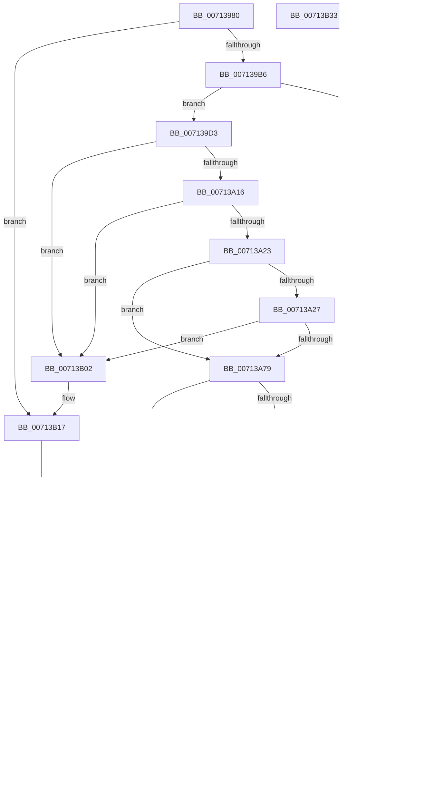

# FsRtlMdlReadDev

- RVA: `0x00713980`–`0x00713B34` (길이 `436` bytes)
- VA: `0x0000000140713980`
- 실행 섹션: `PAGE`
- PDB 이름 있음: `예`; PDB Function 태그: `아니요`
- unwind 정보 RVA: `0x000C5D04`
- 디코드: `109`개 명령, `436/436` bytes 표시
- 미해석 바이트: `0` (있으면 어셈블리에 `.byte`로 보존)

> 이 문서는 커널 이미지의 기계어와 PDB 기호를 분석해 생성했습니다. 4번과 5번은 함수 원형과 자료형을 바이너리 사용 방식에서 추정한 C 해석이며 원본 소스 복구 결과는 아닙니다.

## 1. Dependencies

- 직접 호출 지점: **10**; 고유 호출 대상: **7**
- 직접 호출자로 확인된 함수: **0**
- RIP 상대 이미지 참조: **0**

### Outgoing calls
- `0x007139A8` → [IoGetTopLevelIrp](../../text/41/IoGetTopLevelIrp_function_0041D910.md) (function, `0x0041D910`)
- `0x00713A06` → [ExAcquireResourceSharedLite](../../text/21/ExAcquireResourceSharedLite_function_00211BC0.md) (function, `0x00211BC0`)
- `0x00713A6C` → [guard_dispatch_icall](../../text/6B/guard_dispatch_icall_function_006BAAD0.md) (function, `0x006BAAD0`)
- `0x00713A9E` → [ExReleaseResourceLite](../../text/25/ExReleaseResourceLite_function_0025FA10.md) (function, `0x0025FA10`)
- `0x00713AA3` → [KeLeaveCriticalRegion](../../text/25/KeLeaveCriticalRegion_function_0025D8B0.md) (function, `0x0025D8B0`)
- `0x00713ABA` → [IoSetTopLevelIrp](../../text/42/IoSetTopLevelIrp_function_0042A7D0.md) (function, `0x0042A7D0`)
- `0x00713ADE` → [CcMdlRead](../AB/CcMdlRead_function_00ABA520.md) (function, `0x00ABA520`)
- `0x00713AFB` → [IoSetTopLevelIrp](../../text/42/IoSetTopLevelIrp_function_0042A7D0.md) (function, `0x0042A7D0`)
- `0x00713B05` → [ExReleaseResourceLite](../../text/25/ExReleaseResourceLite_function_0025FA10.md) (function, `0x0025FA10`)
- `0x00713B0A` → [KeLeaveCriticalRegion](../../text/25/KeLeaveCriticalRegion_function_0025D8B0.md) (function, `0x0025D8B0`)

### Direct callers
- 이 함수 시작 RVA로 연결되는 직접 call은 확인되지 않았습니다. 간접 호출은 완전히 역산할 수 없습니다.

### Static image references
- 디코드된 RIP-relative 메모리 참조가 없습니다.

## 2. Other-region calls and transfers

- 다른 실행 섹션으로 향하는 call: **9**
  - `0x007139A8` → [IoGetTopLevelIrp](../../text/41/IoGetTopLevelIrp_function_0041D910.md) (`PAGE` → `.text`)
  - `0x00713A06` → [ExAcquireResourceSharedLite](../../text/21/ExAcquireResourceSharedLite_function_00211BC0.md) (`PAGE` → `.text`)
  - `0x00713A6C` → [guard_dispatch_icall](../../text/6B/guard_dispatch_icall_function_006BAAD0.md) (`PAGE` → `.text`)
  - `0x00713A9E` → [ExReleaseResourceLite](../../text/25/ExReleaseResourceLite_function_0025FA10.md) (`PAGE` → `.text`)
  - `0x00713AA3` → [KeLeaveCriticalRegion](../../text/25/KeLeaveCriticalRegion_function_0025D8B0.md) (`PAGE` → `.text`)
  - `0x00713ABA` → [IoSetTopLevelIrp](../../text/42/IoSetTopLevelIrp_function_0042A7D0.md) (`PAGE` → `.text`)
  - `0x00713AFB` → [IoSetTopLevelIrp](../../text/42/IoSetTopLevelIrp_function_0042A7D0.md) (`PAGE` → `.text`)
  - `0x00713B05` → [ExReleaseResourceLite](../../text/25/ExReleaseResourceLite_function_0025FA10.md) (`PAGE` → `.text`)
  - `0x00713B0A` → [KeLeaveCriticalRegion](../../text/25/KeLeaveCriticalRegion_function_0025D8B0.md) (`PAGE` → `.text`)
- 별도 외부 분기/꼬리 이동을 확인하지 못했습니다.

## 3. Assembly (complete function range)

```asm
00713980  48 89 5C 24 08                  mov qword ptr [rsp + 8], rbx
00713985  48 89 74 24 10                  mov qword ptr [rsp + 0x10], rsi
0071398A  44 89 4C 24 20                  mov dword ptr [rsp + 0x20], r9d
0071398F  57                              push rdi
00713990  41 54                           push r12
00713992  41 55                           push r13
00713994  41 56                           push r14
00713996  41 57                           push r15
00713998  48 83 EC 60                     sub rsp, 0x60
0071399C  45 8B F0                        mov r14d, r8d
0071399F  4C 8B FA                        mov r15, rdx
007139A2  4C 8B E9                        mov r13, rcx
007139A5  40 B6 01                        mov sil, 1
007139A8  E8 63 9F D0 FF                  call 0x14041d910
007139AD  48 85 C0                        test rax, rax
007139B0  0F 85 61 01 00 00               jne 0x140713b17
007139B6  45 85 F6                        test r14d, r14d
007139B9  75 18                           jne 0x1407139d3
007139BB  48 8B 84 24 B8 00 00 00         mov rax, qword ptr [rsp + 0xb8]
007139C3  44 21 30                        and dword ptr [rax], r14d
007139C6  48 83 60 08 00                  and qword ptr [rax + 8], 0
007139CB  40 8A C6                        mov al, sil
007139CE  E9 46 01 00 00                  jmp 0x140713b19
007139D3  49 8B DE                        mov rbx, r14
007139D6  49 03 1F                        add rbx, qword ptr [r15]
007139D9  4D 8B 65 18                     mov r12, qword ptr [r13 + 0x18]
007139DD  65 48 8B 04 25 88 01 00 00      mov rax, qword ptr gs:[0x188]
007139E6  66 FF 88 E4 01 00 00            dec word ptr [rax + 0x1e4]
007139ED  90                              nop
007139EE  65 FF 04 25 44 89 00 00         inc dword ptr gs:[0x8944]
007139F6  49 8D 7C 24 08                  lea rdi, [r12 + 8]
007139FB  48 89 7C 24 50                  mov qword ptr [rsp + 0x50], rdi
00713A00  40 8A D6                        mov dl, sil
00713A03  48 8B 0F                        mov rcx, qword ptr [rdi]
00713A06  E8 B5 E1 AF FF                  call 0x140211bc0
00713A0B  49 83 7D 30 00                  cmp qword ptr [r13 + 0x30], 0
00713A10  0F 84 EC 00 00 00               je 0x140713b02
00713A16  41 8A 44 24 05                  mov al, byte ptr [r12 + 5]
00713A1B  84 C0                           test al, al
00713A1D  0F 84 DF 00 00 00               je 0x140713b02
00713A23  3C 02                           cmp al, 2
00713A25  75 52                           jne 0x140713a79
00713A27  48 8B 94 24 C0 00 00 00         mov rdx, qword ptr [rsp + 0xc0]
00713A2F  48 8B 42 08                     mov rax, qword ptr [rdx + 8]
00713A33  48 8B 48 50                     mov rcx, qword ptr [rax + 0x50]
00713A37  4C 8B 51 08                     mov r10, qword ptr [rcx + 8]
00713A3B  48 89 54 24 38                  mov qword ptr [rsp + 0x38], rdx
00713A40  48 8B 84 24 B8 00 00 00         mov rax, qword ptr [rsp + 0xb8]
00713A48  48 89 44 24 30                  mov qword ptr [rsp + 0x30], rax
00713A4D  40 88 74 24 28                  mov byte ptr [rsp + 0x28], sil
00713A52  8B 84 24 A8 00 00 00            mov eax, dword ptr [rsp + 0xa8]
00713A59  89 44 24 20                     mov dword ptr [rsp + 0x20], eax
00713A5D  44 8A CE                        mov r9b, sil
00713A60  45 8B C6                        mov r8d, r14d
00713A63  49 8B D7                        mov rdx, r15
00713A66  49 8B CD                        mov rcx, r13
00713A69  49 8B C2                        mov rax, r10
00713A6C  E8 5F 70 FA FF                  call 0x1406baad0
00713A71  84 C0                           test al, al
00713A73  0F 84 89 00 00 00               je 0x140713b02
00713A79  49 8B 44 24 20                  mov rax, qword ptr [r12 + 0x20]
00713A7E  48 3B D8                        cmp rbx, rax
00713A81  7E 32                           jle 0x140713ab5
00713A83  49 39 07                        cmp qword ptr [r15], rax
00713A86  7C 25                           jl 0x140713aad
00713A88  48 8B 84 24 B8 00 00 00         mov rax, qword ptr [rsp + 0xb8]
00713A90  C7 00 11 00 00 C0               mov dword ptr [rax], 0xc0000011
00713A96  48 83 60 08 00                  and qword ptr [rax + 8], 0
00713A9B  48 8B 0F                        mov rcx, qword ptr [rdi]
00713A9E  E8 6D BF B4 FF                  call 0x14025fa10
00713AA3  E8 08 9E B4 FF                  call 0x14025d8b0
00713AA8  E9 1E FF FF FF                  jmp 0x1407139cb
00713AAD  45 8B 74 24 20                  mov r14d, dword ptr [r12 + 0x20]
00713AB2  45 2B 37                        sub r14d, dword ptr [r15]
00713AB5  B9 04 00 00 00                  mov ecx, 4
00713ABA  E8 11 6D D1 FF                  call 0x14042a7d0
00713ABF  90                              nop
00713AC0  48 8B 84 24 B8 00 00 00         mov rax, qword ptr [rsp + 0xb8]
00713AC8  48 89 44 24 20                  mov qword ptr [rsp + 0x20], rax
00713ACD  4C 8B 8C 24 B0 00 00 00         mov r9, qword ptr [rsp + 0xb0]
00713AD5  45 8B C6                        mov r8d, r14d
00713AD8  49 8B D7                        mov rdx, r15
00713ADB  49 8B CD                        mov rcx, r13
00713ADE  E8 3D 6A 3A 00                  call 0x140aba520
00713AE3  41 8B 45 50                     mov eax, dword ptr [r13 + 0x50]
00713AE7  0F BA E8 13                     bts eax, 0x13
00713AEB  41 89 45 50                     mov dword ptr [r13 + 0x50], eax
00713AEF  EB 08                           jmp 0x140713af9
00713AF1  40 32 F6                        xor sil, sil
00713AF4  48 8B 7C 24 50                  mov rdi, qword ptr [rsp + 0x50]
00713AF9  33 C9                           xor ecx, ecx
00713AFB  E8 D0 6C D1 FF                  call 0x14042a7d0
00713B00  EB 99                           jmp 0x140713a9b
00713B02  48 8B 0F                        mov rcx, qword ptr [rdi]
00713B05  E8 06 BF B4 FF                  call 0x14025fa10
00713B0A  E8 A1 9D B4 FF                  call 0x14025d8b0
00713B0F  65 FF 04 25 48 89 00 00         inc dword ptr gs:[0x8948]
00713B17  32 C0                           xor al, al
00713B19  4C 8D 5C 24 60                  lea r11, [rsp + 0x60]
00713B1E  49 8B 5B 30                     mov rbx, qword ptr [r11 + 0x30]
00713B22  49 8B 73 38                     mov rsi, qword ptr [r11 + 0x38]
00713B26  49 8B E3                        mov rsp, r11
00713B29  41 5F                           pop r15
00713B2B  41 5E                           pop r14
00713B2D  41 5D                           pop r13
00713B2F  41 5C                           pop r12
00713B31  5F                              pop rdi
00713B32  C3                              ret
00713B33  CC                              int3
```

## 4. C-style interpretation (structured pseudocode)

```c
__int64 __fastcall FsRtlMdlReadDev(__int64 a1, __int64 a2, int a3, int a4, __int64 a5, __int64 a6, __int64 a7)
{
    __int64 result;
    __int64 v_r14;
    __int64 v_rbx;
    __int64 v_rsp;
    unsigned __int64 v_stack_m28;
    unsigned __int64 v_stack_m38;
    unsigned __int64 v_stack_m50;
    unsigned __int64 v_stack_m58;
    unsigned __int8 v_stack_m60;
    unsigned int v_stack_m68;
    unsigned __int64 v_stack_p10;
    unsigned int v_stack_p20;
    unsigned __int64 v_stack_p8;

    v_stack_p8 = v_rbx;
    v_stack_p10 = v_rsi;
    v_stack_p20 = a4;
    v_rsp = (v_rsp) - (96);
    result = IoGetTopLevelIrp(a1, a2, a3, a4);
    if (result != 0) goto loc_00713B17;
    if ((unsigned int)((unsigned int)(a3)) != 0) goto loc_007139D3;
loc_007139CB:
    goto loc_00713B19;
loc_007139D3:
    v_rbx = ((unsigned int)(a3)) + (*(unsigned __int64 *)(a2));
    v_stack_m38 = *(unsigned __int64 *)(a1 + 24) + 8;
    result = ExAcquireResourceSharedLite(*(unsigned __int64 *)(*(unsigned __int64 *)(a1 + 24) + 8), 1, a3, a4);
    if ((*(unsigned __int64 *)(a1 + 48)) == 0) goto loc_00713B02;
    if ((unsigned __int8)(*(unsigned __int8 *)(*(unsigned __int64 *)(a1 + 24) + 5)) == 0) goto loc_00713B02;
    if (((unsigned __int8)(*(unsigned __int8 *)(*(unsigned __int64 *)(a1 + 24) + 5))) != 2) goto loc_00713A79;
    v_stack_m50 = a7;
    v_stack_m58 = a6;
    v_stack_m60 = 1;
    v_stack_m68 = (unsigned int)((unsigned int)(v_stack_p20));
    result = guard_dispatch_icall(a1, a2, (unsigned int)((unsigned int)((unsigned int)(a3))), 1);
    if ((unsigned __int8)(result) == 0) goto loc_00713B02;
loc_00713A79:
    if (v_rbx <= (*(unsigned __int64 *)(*(unsigned __int64 *)(a1 + 24) + 32))) goto loc_00713AB5;
    if ((*(unsigned __int64 *)(a2)) < (*(unsigned __int64 *)(*(unsigned __int64 *)(a1 + 24) + 32))) goto loc_00713AAD;
    *(unsigned int *)(a6) = 0xC0000011ULL;
loc_00713A9B:
    result = ExReleaseResourceLite(*(unsigned __int64 *)(*(unsigned __int64 *)(a1 + 24) + 8), a2, (unsigned int)((unsigned int)((unsigned int)(a3))), 1);
    result = KeLeaveCriticalRegion(*(unsigned __int64 *)(*(unsigned __int64 *)(a1 + 24) + 8), a2, (unsigned int)((unsigned int)((unsigned int)(a3))), 1);
    goto loc_007139CB;
loc_00713AAD:
    v_r14 = (unsigned int)(((unsigned int)(*(unsigned int *)(*(unsigned __int64 *)(a1 + 24) + 32))) - (*(unsigned int *)(a2)));
loc_00713AB5:
    result = IoSetTopLevelIrp(4, a2, (unsigned int)((unsigned int)((unsigned int)(a3))), 1);
    v_stack_m68 = a6;
    result = CcMdlRead(a1, a2, (unsigned int)((unsigned int)(v_r14)), a5);
    *(unsigned int *)(a1 + 80) = (unsigned int)((unsigned int)(*(unsigned int *)(a1 + 80)));
    goto loc_00713AF9;
loc_00713AF9:
    a1 = 0;
    result = IoSetTopLevelIrp(a1, a2, (unsigned int)((unsigned int)(v_r14)), a5);
    goto loc_00713A9B;
loc_00713B02:
    result = ExReleaseResourceLite(*(unsigned __int64 *)(*(unsigned __int64 *)(a1 + 24) + 8), a2, (unsigned int)((unsigned int)(v_r14)), a5);
    result = KeLeaveCriticalRegion(*(unsigned __int64 *)(*(unsigned __int64 *)(a1 + 24) + 8), a2, (unsigned int)((unsigned int)(v_r14)), a5);
loc_00713B17:
    result = 0;
loc_00713B19:
    return result;
}
```

## 5. (Beta) C Style

```c
int64_t FsRtlMdlReadDev(void *Arg1, void *Arg2, int32_t Arg3, int32_t Arg4, int64_t Arg5, void *Arg6, void *Arg7)
{
    uint8_t *arg1 = (uint8_t *)Arg1;
    uint8_t *arg2 = (uint8_t *)Arg2;
    uint8_t *arg6 = (uint8_t *)Arg6;
    uint8_t *arg7 = (uint8_t *)Arg7;

    int64_t result;
    int64_t local_r14;
    int64_t local_rbx;
    int64_t local_rsp;
    uint64_t v_stack_m28;
    uint64_t v_stack_m38;
    uint64_t v_stack_m50;
    uint64_t v_stack_m58;
    uint8_t v_stack_m60;
    uint32_t v_stack_m68;
    uint64_t v_stack_p10;
    uint32_t v_stack_p20;
    uint64_t v_stack_p8;

    v_stack_p8 = local_rbx;
    v_stack_p10 = local_rsi;
    v_stack_p20 = Arg4;
    local_rsp = (local_rsp) - (96);
    result = IoGetTopLevelIrp(Arg1, Arg2, Arg3, Arg4);
    if (result != 0) goto loc_00713B17;
    if ((uint32_t)((uint32_t)(Arg3)) != 0) goto loc_007139D3;
loc_007139CB:
    goto loc_00713B19;
loc_007139D3:
    local_rbx = ((uint32_t)(Arg3)) + (*(uint64_t *)(arg2));
    v_stack_m38 = *(uint64_t *)(arg1 + 0x18) + 8;
    result = ExAcquireResourceSharedLite(*(uint64_t *)(*(uint64_t *)(arg1 + 0x18) + 0x8), 1, Arg3, Arg4);
    if ((*(uint64_t *)(arg1 + 0x30)) == 0) goto loc_00713B02;
    if ((uint8_t)(*(uint8_t *)(*(uint64_t *)(arg1 + 0x18) + 0x5)) == 0) goto loc_00713B02;
    if (((uint8_t)(*(uint8_t *)(*(uint64_t *)(arg1 + 0x18) + 0x5))) != 2) goto loc_00713A79;
    v_stack_m50 = Arg7;
    v_stack_m58 = Arg6;
    v_stack_m60 = 1;
    v_stack_m68 = (uint32_t)((uint32_t)(v_stack_p20));
    result = guard_dispatch_icall(Arg1, Arg2, (uint32_t)((uint32_t)((uint32_t)(Arg3))), 1);
    if ((uint8_t)(result) == 0) goto loc_00713B02;
loc_00713A79:
    if (local_rbx <= (*(uint64_t *)(*(uint64_t *)(arg1 + 0x18) + 0x20))) goto loc_00713AB5;
    if ((*(uint64_t *)(arg2)) < (*(uint64_t *)(*(uint64_t *)(arg1 + 0x18) + 0x20))) goto loc_00713AAD;
    *(uint32_t *)(arg6) = 0xC0000011ULL;
loc_00713A9B:
    result = ExReleaseResourceLite(*(uint64_t *)(*(uint64_t *)(arg1 + 0x18) + 0x8), Arg2, (uint32_t)((uint32_t)((uint32_t)(Arg3))), 1);
    result = KeLeaveCriticalRegion(*(uint64_t *)(*(uint64_t *)(arg1 + 0x18) + 0x8), Arg2, (uint32_t)((uint32_t)((uint32_t)(Arg3))), 1);
    goto loc_007139CB;
loc_00713AAD:
    local_r14 = (uint32_t)(((uint32_t)(*(uint32_t *)(*(uint64_t *)(arg1 + 0x18) + 0x20))) - (*(uint32_t *)(arg2)));
loc_00713AB5:
    result = IoSetTopLevelIrp(4, Arg2, (uint32_t)((uint32_t)((uint32_t)(Arg3))), 1);
    v_stack_m68 = Arg6;
    result = CcMdlRead(Arg1, Arg2, (uint32_t)((uint32_t)(local_r14)), Arg5);
    *(uint32_t *)(arg1 + 0x50) = (uint32_t)((uint32_t)(*(uint32_t *)(arg1 + 0x50)));
    goto loc_00713AF9;
loc_00713AF9:
    Arg1 = 0;
    result = IoSetTopLevelIrp(Arg1, Arg2, (uint32_t)((uint32_t)(local_r14)), Arg5);
    goto loc_00713A9B;
loc_00713B02:
    result = ExReleaseResourceLite(*(uint64_t *)(*(uint64_t *)(arg1 + 0x18) + 0x8), Arg2, (uint32_t)((uint32_t)(local_r14)), Arg5);
    result = KeLeaveCriticalRegion(*(uint64_t *)(*(uint64_t *)(arg1 + 0x18) + 0x8), Arg2, (uint32_t)((uint32_t)(local_r14)), Arg5);
loc_00713B17:
    result = 0;
loc_00713B19:
    return result;
}
```

### 관측된 메모리 오프셋

구조체 형식이 확인되지 않은 접근은 인자 기준의 오프셋으로만 기록했습니다.

| 기준 인자 | 오프셋 표현 | 폭 (bit) | 접근 |
|---|---:|---:|---|
| `Arg1` | `+ 0x18` | `64` | `R` |
| `Arg1` | `+ 0x30` | `64` | `R` |
| `Arg1` | `+ 0x50` | `32` | `R` |
| `Arg1` | `+ 0x50` | `32` | `W` |
| `Arg2` | `+ 0x0` | `32` | `R` |
| `Arg2` | `+ 0x0` | `64` | `R` |
| `Arg6` | `+ 0x0` | `32` | `R/W` |
| `Arg6` | `+ 0x0` | `32` | `W` |
| `Arg6` | `+ 0x8` | `64` | `R/W` |
| `Arg7` | `+ 0x8` | `64` | `R` |

## 6. Execution-region graph

[열기: 2D/3D 그래프와 함수 탐색 컨트롤 패널](../../../control-panel.html?section=page&rva=0x00713980&view=graph)

- 2D 그래프는 위에서 아래로 흐르고, 3D 그래프는 빈 공간을 드래그해 회전합니다. Shift+드래그는 이동, 휠은 확대·축소, 함수 노드 선택은 대상 보고서 이동입니다.

### Static fallback


