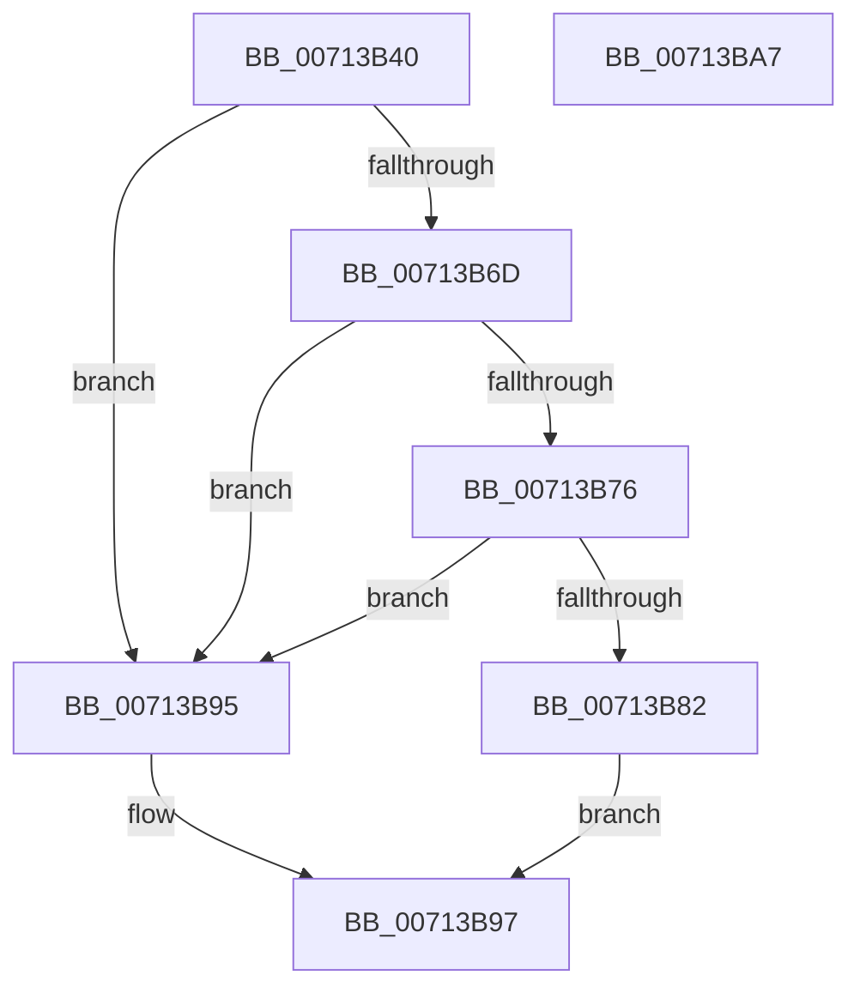

# FsRtlMdlWriteComplete

- RVA: `0x00713B40`–`0x00713BA8` (길이 `104` bytes)
- VA: `0x0000000140713B40`
- 실행 섹션: `PAGE`
- PDB 이름 있음: `예`; PDB Function 태그: `아니요`
- unwind 정보 RVA: `0x000794E0`
- 디코드: `31`개 명령, `104/104` bytes 표시
- 미해석 바이트: `0` (있으면 어셈블리에 `.byte`로 보존)

> 이 문서는 커널 이미지의 기계어와 PDB 기호를 분석해 생성했습니다. 4번과 5번은 함수 원형과 자료형을 바이너리 사용 방식에서 추정한 C 해석이며 원본 소스 복구 결과는 아닙니다.

## 1. Dependencies

- 직접 호출 지점: **2**; 고유 호출 대상: **2**
- 직접 호출자로 확인된 함수: **0**
- RIP 상대 이미지 참조: **0**

### Outgoing calls
- `0x00713B58` → [IoGetRelatedDeviceObject](../../text/29/IoGetRelatedDeviceObject_function_0029B120.md) (function, `0x0029B120`)
- `0x00713B8E` → [guard_dispatch_icall](../../text/6B/guard_dispatch_icall_function_006BAAD0.md) (function, `0x006BAAD0`)

### Direct callers
- 이 함수 시작 RVA로 연결되는 직접 call은 확인되지 않았습니다. 간접 호출은 완전히 역산할 수 없습니다.

### Static image references
- 디코드된 RIP-relative 메모리 참조가 없습니다.

## 2. Other-region calls and transfers

- 다른 실행 섹션으로 향하는 call: **2**
  - `0x00713B58` → [IoGetRelatedDeviceObject](../../text/29/IoGetRelatedDeviceObject_function_0029B120.md) (`PAGE` → `.text`)
  - `0x00713B8E` → [guard_dispatch_icall](../../text/6B/guard_dispatch_icall_function_006BAAD0.md) (`PAGE` → `.text`)
- 별도 외부 분기/꼬리 이동을 확인하지 못했습니다.

## 3. Assembly (complete function range)

```asm
00713B40  48 89 5C 24 08                  mov qword ptr [rsp + 8], rbx
00713B45  48 89 74 24 10                  mov qword ptr [rsp + 0x10], rsi
00713B4A  57                              push rdi
00713B4B  48 83 EC 30                     sub rsp, 0x30
00713B4F  49 8B F8                        mov rdi, r8
00713B52  48 8B F2                        mov rsi, rdx
00713B55  48 8B D9                        mov rbx, rcx
00713B58  E8 C3 75 B8 FF                  call 0x14029b120
00713B5D  48 8B C8                        mov rcx, rax
00713B60  4C 8B 48 08                     mov r9, qword ptr [rax + 8]
00713B64  4D 8B 51 50                     mov r10, qword ptr [r9 + 0x50]
00713B68  4D 85 D2                        test r10, r10
00713B6B  74 28                           je 0x140713b95
00713B6D  41 81 3A 98 00 00 00            cmp dword ptr [r10], 0x98
00713B74  76 1F                           jbe 0x140713b95
00713B76  49 8B 82 98 00 00 00            mov rax, qword ptr [r10 + 0x98]
00713B7D  48 85 C0                        test rax, rax
00713B80  74 13                           je 0x140713b95
00713B82  4C 8B C9                        mov r9, rcx
00713B85  4C 8B C7                        mov r8, rdi
00713B88  48 8B CB                        mov rcx, rbx
00713B8B  48 8B D6                        mov rdx, rsi
00713B8E  E8 3D 6F FA FF                  call 0x1406baad0
00713B93  EB 02                           jmp 0x140713b97
00713B95  32 C0                           xor al, al
00713B97  48 8B 5C 24 40                  mov rbx, qword ptr [rsp + 0x40]
00713B9C  48 8B 74 24 48                  mov rsi, qword ptr [rsp + 0x48]
00713BA1  48 83 C4 30                     add rsp, 0x30
00713BA5  5F                              pop rdi
00713BA6  C3                              ret
00713BA7  CC                              int3
```

## 4. C-style interpretation (structured pseudocode)

```c
__int64 __fastcall FsRtlMdlWriteComplete(__int64 a1, __int64 a2, __int64 a3)
{
    __int64 result;
    __int64 v_rsp;
    unsigned __int64 v_stack_p10;
    unsigned __int64 v_stack_p8;

    v_stack_p8 = v_rbx;
    v_stack_p10 = v_rsi;
    v_rsp = (v_rsp) - (48);
    result = IoGetRelatedDeviceObject(a1, a2, a3, a4);
    if (*(unsigned __int64 *)(*(unsigned __int64 *)(result + 8) + 80) == 0) goto loc_00713B95;
    if ((*(unsigned int *)(*(unsigned __int64 *)(*(unsigned __int64 *)(result + 8) + 80))) <= 152) goto loc_00713B95;
    if (*(unsigned __int64 *)(*(unsigned __int64 *)(*(unsigned __int64 *)(result + 8) + 80) + 152) == 0) goto loc_00713B95;
    result = guard_dispatch_icall(a1, a2, a3, result);
    goto loc_00713B97;
loc_00713B95:
    result = 0;
loc_00713B97:
    v_rsp = (v_rsp) + (48);
    return result;
}
```

## 5. (Beta) C Style

```c
int64_t FsRtlMdlWriteComplete(int64_t Arg1, int64_t Arg2, int64_t Arg3)
{
    int64_t result;
    int64_t local_rsp;
    uint64_t v_stack_p10;
    uint64_t v_stack_p8;

    v_stack_p8 = local_rbx;
    v_stack_p10 = local_rsi;
    local_rsp = (local_rsp) - (48);
    result = IoGetRelatedDeviceObject(Arg1, Arg2, Arg3, a4);
    if (*(uint64_t *)(*(uint64_t *)(result + 0x8) + 0x50) == 0) goto loc_00713B95;
    if ((*(uint32_t *)(*(uint64_t *)(*(uint64_t *)(result + 0x8) + 0x50))) <= 152) goto loc_00713B95;
    if (*(uint64_t *)(*(uint64_t *)(*(uint64_t *)(result + 0x8) + 0x50) + 0x98) == 0) goto loc_00713B95;
    result = guard_dispatch_icall(Arg1, Arg2, Arg3, result);
    goto loc_00713B97;
loc_00713B95:
    result = 0;
loc_00713B97:
    local_rsp = (local_rsp) + (48);
    return result;
}
```

## 6. Execution-region graph

[열기: 2D/3D 그래프와 함수 탐색 컨트롤 패널](../../../control-panel.html?section=page&rva=0x00713B40&view=graph)

- 2D 그래프는 위에서 아래로 흐르고, 3D 그래프는 빈 공간을 드래그해 회전합니다. Shift+드래그는 이동, 휠은 확대·축소, 함수 노드 선택은 대상 보고서 이동입니다.

### Static fallback


