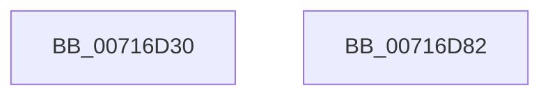

# FsRtlNotifyChangeDirectory

- RVA: `0x00716D30`–`0x00716D83` (길이 `83` bytes)
- VA: `0x0000000140716D30`
- 실행 섹션: `PAGE`
- PDB 이름 있음: `예`; PDB Function 태그: `아니요`
- unwind 정보 RVA: `0x0007A034`
- 디코드: `21`개 명령, `83/83` bytes 표시
- 미해석 바이트: `0` (있으면 어셈블리에 `.byte`로 보존)

> 이 문서는 커널 이미지의 기계어와 PDB 기호를 분석해 생성했습니다. 4번과 5번은 함수 원형과 자료형을 바이너리 사용 방식에서 추정한 C 해석이며 원본 소스 복구 결과는 아닙니다.

## 1. Dependencies

- 직접 호출 지점: **1**; 고유 호출 대상: **1**
- 직접 호출자로 확인된 함수: **0**
- RIP 상대 이미지 참조: **0**

### Outgoing calls
- `0x00716D78` → [FsRtlNotifyFilterChangeDirectory](../AA/FsRtlNotifyFilterChangeDirectory_function_00AAB9E0.md) (function, `0x00AAB9E0`)

### Direct callers
- 이 함수 시작 RVA로 연결되는 직접 call은 확인되지 않았습니다. 간접 호출은 완전히 역산할 수 없습니다.

### Static image references
- 디코드된 RIP-relative 메모리 참조가 없습니다.

## 2. Other-region calls and transfers

- 다른 실행 섹션으로 향하는 call: **0**
- 별도 외부 분기/꼬리 이동을 확인하지 못했습니다.

## 3. Assembly (complete function range)

```asm
00716D30  4C 8B DC                        mov r11, rsp
00716D33  48 83 EC 68                     sub rsp, 0x68
00716D37  33 C0                           xor eax, eax
00716D39  4D 8B D1                        mov r10, r9
00716D3C  49 89 43 E8                     mov qword ptr [r11 - 0x18], rax
00716D40  4D 8B C8                        mov r9, r8
00716D43  49 89 43 E0                     mov qword ptr [r11 - 0x20], rax
00716D47  4C 8B C2                        mov r8, rdx
00716D4A  49 89 43 D8                     mov qword ptr [r11 - 0x28], rax
00716D4E  49 8B D2                        mov rdx, r10
00716D51  48 8B 84 24 A0 00 00 00         mov rax, qword ptr [rsp + 0xa0]
00716D59  49 89 43 D0                     mov qword ptr [r11 - 0x30], rax
00716D5D  8B 84 24 98 00 00 00            mov eax, dword ptr [rsp + 0x98]
00716D64  89 44 24 30                     mov dword ptr [rsp + 0x30], eax
00716D68  8A 84 24 90 00 00 00            mov al, byte ptr [rsp + 0x90]
00716D6F  C6 44 24 28 01                  mov byte ptr [rsp + 0x28], 1
00716D74  88 44 24 20                     mov byte ptr [rsp + 0x20], al
00716D78  E8 63 4C 39 00                  call 0x140aab9e0
00716D7D  48 83 C4 68                     add rsp, 0x68
00716D81  C3                              ret
00716D82  CC                              int3
```

## 4. C-style interpretation (structured pseudocode)

```c
__int64 __fastcall FsRtlNotifyChangeDirectory(__int64 a1, __int64 a2, __int64 a3, __int64 a4, unsigned __int8 a5, unsigned int a6, __int64 a7)
{
    __int64 result;
    __int64 v_rsp;
    unsigned int v_stack_m38;
    unsigned __int8 v_stack_m40;
    unsigned __int8 v_stack_m48;

    v_rsp = (v_rsp) - (104);
    result = 0;
    *(unsigned __int64 *)(v_rsp - 24) = 0;
    *(unsigned __int64 *)(v_rsp - 32) = 0;
    *(unsigned __int64 *)(v_rsp - 40) = 0;
    *(unsigned __int64 *)(v_rsp - 48) = a7;
    v_stack_m38 = (unsigned int)((unsigned int)(a6));
    v_stack_m40 = 1;
    v_stack_m48 = a5;
    result = FsRtlNotifyFilterChangeDirectory(a1, a4, a2, a3);
    v_rsp = (v_rsp) + (104);
    return result;
}
```

## 5. (Beta) C Style

```c
int64_t FsRtlNotifyChangeDirectory(int64_t Arg1, int64_t Arg2, int64_t Arg3, int64_t Arg4, uint8_t Arg5, uint32_t Arg6, int64_t Arg7)
{
    int64_t result;
    int64_t local_rsp;
    uint32_t v_stack_m38;
    uint8_t v_stack_m40;
    uint8_t v_stack_m48;

    local_rsp = (local_rsp) - (104);
    result = 0;
    *(uint64_t *)(local_rsp - 0x18) = 0;
    *(uint64_t *)(local_rsp - 0x20) = 0;
    *(uint64_t *)(local_rsp - 0x28) = 0;
    *(uint64_t *)(local_rsp - 0x30) = Arg7;
    v_stack_m38 = (uint32_t)((uint32_t)(Arg6));
    v_stack_m40 = 1;
    v_stack_m48 = Arg5;
    result = FsRtlNotifyFilterChangeDirectory(Arg1, Arg4, Arg2, Arg3);
    local_rsp = (local_rsp) + (104);
    return result;
}
```

## 6. Execution-region graph

[열기: 2D/3D 그래프와 함수 탐색 컨트롤 패널](../../../control-panel.html?section=page&rva=0x00716D30&view=graph)

- 2D 그래프는 위에서 아래로 흐르고, 3D 그래프는 빈 공간을 드래그해 회전합니다. Shift+드래그는 이동, 휠은 확대·축소, 함수 노드 선택은 대상 보고서 이동입니다.

### Static fallback


