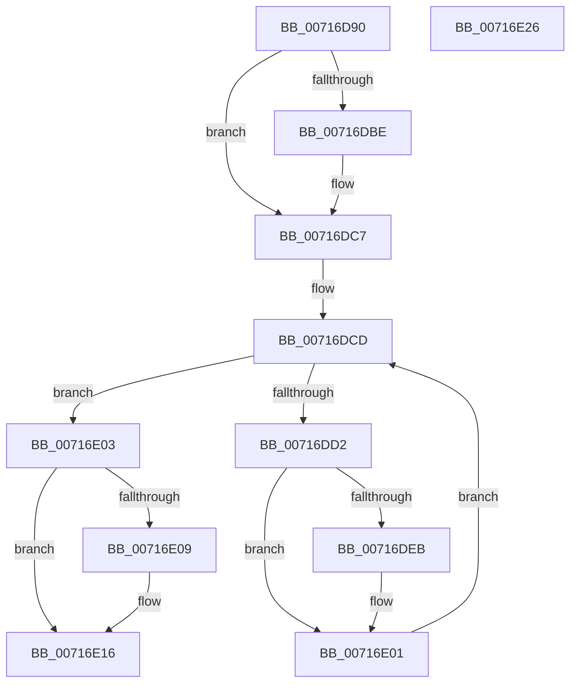

# FsRtlNotifyCleanupAll

- RVA: `0x00716D90`–`0x00716E27` (길이 `151` bytes)
- VA: `0x0000000140716D90`
- 실행 섹션: `PAGE`
- PDB 이름 있음: `예`; PDB Function 태그: `아니요`
- unwind 정보 RVA: `0x000C6210`
- 디코드: `41`개 명령, `151/151` bytes 표시
- 미해석 바이트: `0` (있으면 어셈블리에 `.byte`로 보존)

> 이 문서는 커널 이미지의 기계어와 PDB 기호를 분석해 생성했습니다. 4번과 5번은 함수 원형과 자료형을 바이너리 사용 방식에서 추정한 C 해석이며 원본 소스 복구 결과는 아닙니다.

## 1. Dependencies

- 직접 호출 지점: **5**; 고유 호출 대상: **5**
- 직접 호출자로 확인된 함수: **0**
- RIP 상대 이미지 참조: **0**

### Outgoing calls
- `0x00716DBE` → [ExAcquireFastMutexUnsafe](../../text/3F/ExAcquireFastMutexUnsafe_function_003F3720.md) (function, `0x003F3720`)
- `0x00716DDE` → [FsRtlNotifyCleanupOneEntry](../A3/FsRtlNotifyCleanupOneEntry_function_00A32908.md) (function, `0x00A32908`)
- `0x00716DF0` → [SeReleaseSubjectContext](../86/SeReleaseSubjectContext_function_0086B710.md) (function, `0x0086B710`)
- `0x00716DFC` → [ExFreePoolWithTag](../../poolcode/B8/ExFreePoolWithTag_function_00B82870.md) (function, `0x00B82870`)
- `0x00716E11` → [ExReleaseFastMutexUnsafe](../../text/25/ExReleaseFastMutexUnsafe_function_002503A0.md) (function, `0x002503A0`)

### Direct callers
- 이 함수 시작 RVA로 연결되는 직접 call은 확인되지 않았습니다. 간접 호출은 완전히 역산할 수 없습니다.

### Static image references
- 디코드된 RIP-relative 메모리 참조가 없습니다.

## 2. Other-region calls and transfers

- 다른 실행 섹션으로 향하는 call: **3**
  - `0x00716DBE` → [ExAcquireFastMutexUnsafe](../../text/3F/ExAcquireFastMutexUnsafe_function_003F3720.md) (`PAGE` → `.text`)
  - `0x00716DFC` → [ExFreePoolWithTag](../../poolcode/B8/ExFreePoolWithTag_function_00B82870.md) (`PAGE` → `POOLCODE`)
  - `0x00716E11` → [ExReleaseFastMutexUnsafe](../../text/25/ExReleaseFastMutexUnsafe_function_002503A0.md) (`PAGE` → `.text`)
- 별도 외부 분기/꼬리 이동을 확인하지 못했습니다.

## 3. Assembly (complete function range)

```asm
00716D90  48 8B C4                        mov rax, rsp
00716D93  48 89 58 10                     mov qword ptr [rax + 0x10], rbx
00716D97  48 89 70 20                     mov qword ptr [rax + 0x20], rsi
00716D9B  48 89 48 08                     mov qword ptr [rax + 8], rcx
00716D9F  57                              push rdi
00716DA0  48 83 EC 20                     sub rsp, 0x20
00716DA4  48 8B F2                        mov rsi, rdx
00716DA7  48 8B D9                        mov rbx, rcx
00716DAA  48 83 60 18 00                  and qword ptr [rax + 0x18], 0
00716DAF  65 48 8B 3C 25 88 01 00 00      mov rdi, qword ptr gs:[0x188]
00716DB8  48 3B 79 38                     cmp rdi, qword ptr [rcx + 0x38]
00716DBC  74 09                           je 0x140716dc7
00716DBE  E8 5D C9 CD FF                  call 0x1403f3720
00716DC3  48 89 7B 38                     mov qword ptr [rbx + 0x38], rdi
00716DC7  FF 43 40                        inc dword ptr [rbx + 0x40]
00716DCA  48 8B 3E                        mov rdi, qword ptr [rsi]
00716DCD  48 3B FE                        cmp rdi, rsi
00716DD0  74 31                           je 0x140716e03
00716DD2  48 8D 4F E0                     lea rcx, [rdi - 0x20]
00716DD6  48 8B 3F                        mov rdi, qword ptr [rdi]
00716DD9  48 8D 54 24 40                  lea rdx, [rsp + 0x40]
00716DDE  E8 25 BB 31 00                  call 0x140a32908
00716DE3  48 83 7C 24 40 00               cmp qword ptr [rsp + 0x40], 0
00716DE9  74 16                           je 0x140716e01
00716DEB  48 8B 4C 24 40                  mov rcx, qword ptr [rsp + 0x40]
00716DF0  E8 1B 49 15 00                  call 0x14086b710
00716DF5  33 D2                           xor edx, edx
00716DF7  48 8B 4C 24 40                  mov rcx, qword ptr [rsp + 0x40]
00716DFC  E8 6F BA 46 00                  call 0x140b82870
00716E01  EB CA                           jmp 0x140716dcd
00716E03  83 43 40 FF                     add dword ptr [rbx + 0x40], -1
00716E07  75 0D                           jne 0x140716e16
00716E09  48 83 63 38 00                  and qword ptr [rbx + 0x38], 0
00716E0E  48 8B CB                        mov rcx, rbx
00716E11  E8 8A 95 B3 FF                  call 0x1402503a0
00716E16  48 8B 5C 24 38                  mov rbx, qword ptr [rsp + 0x38]
00716E1B  48 8B 74 24 48                  mov rsi, qword ptr [rsp + 0x48]
00716E20  48 83 C4 20                     add rsp, 0x20
00716E24  5F                              pop rdi
00716E25  C3                              ret
00716E26  CC                              int3
```

## 4. C-style interpretation (structured pseudocode)

```c
__int64 __fastcall FsRtlNotifyCleanupAll(__int64 a1, __int64 a2)
{
    __int64 result;
    __int64 v_rsp;
    unsigned __int64 v_stack_p10;
    unsigned __int64 v_stack_p18;
    unsigned __int64 v_stack_p20;

    *(unsigned __int64 *)(v_rsp + 16) = v_rbx;
    *(unsigned __int64 *)(v_rsp + 32) = v_rsi;
    *(unsigned __int64 *)(v_rsp + 8) = a1;
    v_rsp = (v_rsp) - (32);
    result = v_rsp;
    if ((*(unsigned __int64 *)(gs_base + (0 + 392))) != (*(unsigned __int64 *)(a1 + 56))) {
        result = ExAcquireFastMutexUnsafe(a1, a2, a3, a4);
        *(unsigned __int64 *)(a1 + 56) = *(unsigned __int64 *)(gs_base + (0 + 392));
    }
loc_00716DCD:
    if ((*(unsigned __int64 *)(a2)) == a2) goto loc_00716E03;
    result = FsRtlNotifyCleanupOneEntry(*(unsigned __int64 *)(a2) - 32, v_stack_p18, a3, a4);
    if (v_stack_p18 != 0) {
        a1 = v_stack_p18;
        result = SeReleaseSubjectContext(a1, v_stack_p18, a3, a4);
        a2 = 0;
        a1 = v_stack_p18;
        result = ExFreePoolWithTag(a1, a2, a3, a4);
    }
    goto loc_00716DCD;
loc_00716E03:
    if (!(condition_is_not_equal)) {
        a1 = a1;
        result = ExReleaseFastMutexUnsafe(a1, a2, a3, a4);
    }
    v_rsp = (v_rsp) + (32);
    return result;
}
```

## 5. (Beta) C Style

```c
int64_t FsRtlNotifyCleanupAll(void *Arg1, void *Arg2)
{
    uint8_t *arg1 = (uint8_t *)Arg1;
    uint8_t *arg2 = (uint8_t *)Arg2;

    int64_t result;
    int64_t local_rsp;
    uint64_t v_stack_p10;
    uint64_t v_stack_p18;
    uint64_t v_stack_p20;

    *(uint64_t *)(local_rsp + 0x10) = local_rbx;
    *(uint64_t *)(local_rsp + 0x20) = local_rsi;
    *(void **)(local_rsp + 0x8) = Arg1;
    local_rsp = (local_rsp) - (32);
    result = local_rsp;
    if ((*(uint64_t *)(gs_base + (0 + 0x188))) != (*(uint64_t *)(arg1 + 0x38))) {
        result = ExAcquireFastMutexUnsafe(Arg1, Arg2, a3, a4);
        *(uint64_t *)(arg1 + 0x38) = *(uint64_t *)(gs_base + (0 + 0x188));
    }
loc_00716DCD:
    if ((*(uint64_t *)(arg2)) == Arg2) goto loc_00716E03;
    result = FsRtlNotifyCleanupOneEntry(*(uint64_t *)(arg2) - 32, v_stack_p18, a3, a4);
    if (v_stack_p18 != 0) {
        Arg1 = v_stack_p18;
        result = SeReleaseSubjectContext(Arg1, v_stack_p18, a3, a4);
        Arg2 = 0;
        Arg1 = v_stack_p18;
        result = ExFreePoolWithTag(Arg1, Arg2, a3, a4);
    }
    goto loc_00716DCD;
loc_00716E03:
    if (!(condition_is_not_equal)) {
        Arg1 = Arg1;
        result = ExReleaseFastMutexUnsafe(Arg1, Arg2, a3, a4);
    }
    local_rsp = (local_rsp) + (32);
    return result;
}
```

### 관측된 메모리 오프셋

구조체 형식이 확인되지 않은 접근은 인자 기준의 오프셋으로만 기록했습니다.

| 기준 인자 | 오프셋 표현 | 폭 (bit) | 접근 |
|---|---:|---:|---|
| `Arg1` | `+ 0x38` | `64` | `R` |
| `Arg1` | `+ 0x38` | `64` | `R/W` |
| `Arg1` | `+ 0x38` | `64` | `W` |
| `Arg1` | `+ 0x40` | `32` | `R/W` |
| `Arg2` | `+ 0x0` | `64` | `R` |

## 6. Execution-region graph

[열기: 2D/3D 그래프와 함수 탐색 컨트롤 패널](../../../control-panel.html?section=page&rva=0x00716D90&view=graph)

- 2D 그래프는 위에서 아래로 흐르고, 3D 그래프는 빈 공간을 드래그해 회전합니다. Shift+드래그는 이동, 휠은 확대·축소, 함수 노드 선택은 대상 보고서 이동입니다.

### Static fallback


