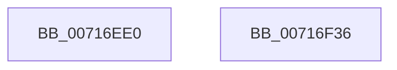

# FsRtlNotifyVolumeEvent

- RVA: `0x00716EE0`–`0x00716F37` (길이 `87` bytes)
- VA: `0x0000000140716EE0`
- 실행 섹션: `PAGE`
- PDB 이름 있음: `예`; PDB Function 태그: `아니요`
- unwind 정보 RVA: `0x00079788`
- 디코드: `21`개 명령, `87/87` bytes 표시
- 미해석 바이트: `0` (있으면 어셈블리에 `.byte`로 보존)

> 이 문서는 커널 이미지의 기계어와 PDB 기호를 분석해 생성했습니다. 4번과 5번은 함수 원형과 자료형을 바이너리 사용 방식에서 추정한 C 해석이며 원본 소스 복구 결과는 아닙니다.

## 1. Dependencies

- 직접 호출 지점: **2**; 고유 호출 대상: **2**
- 직접 호출자로 확인된 함수: **2**
- RIP 상대 이미지 참조: **1**

### Outgoing calls
- `0x00716F1F` → [FsRtlNotifyVolumeEventEx](../A6/FsRtlNotifyVolumeEventEx_function_00A66DC0.md) (function, `0x00A66DC0`)
- `0x00716F2C` → [_security_check_cookie](../../text/6A/_security_check_cookie_function_006AC640.md) (function, `0x006AC640`)

### Direct callers
- [RawCleanup](../9A/RawCleanup_function_009A3B38.md) at `0x009A3C08`
- [RawUserFsCtrl](../9A/RawUserFsCtrl_function_009A45F4.md) at `0x009A4728`
- [RawUserFsCtrl](../9A/RawUserFsCtrl_function_009A45F4.md) at `0x009A4791`
- [RawUserFsCtrl](../9A/RawUserFsCtrl_function_009A45F4.md) at `0x009A481C`

### Static image references
- `0x00716EE7` → RVA `0x00E0A740` (`.data`; read)

## 2. Other-region calls and transfers

- 다른 실행 섹션으로 향하는 call: **1**
  - `0x00716F2C` → [_security_check_cookie](../../text/6A/_security_check_cookie_function_006AC640.md) (`PAGE` → `.text`)
- 별도 외부 분기/꼬리 이동을 확인하지 못했습니다.

## 3. Assembly (complete function range)

```asm
00716EE0  4C 8B DC                        mov r11, rsp
00716EE3  48 83 EC 58                     sub rsp, 0x58
00716EE7  48 8B 05 52 38 6F 00            mov rax, qword ptr [rip + 0x6f3852]
00716EEE  48 33 C4                        xor rax, rsp
00716EF1  48 89 44 24 48                  mov qword ptr [rsp + 0x48], rax
00716EF6  45 33 C0                        xor r8d, r8d
00716EF9  0F 57 C0                        xorps xmm0, xmm0
00716EFC  F3 0F 7F 44 24 24               movdqu xmmword ptr [rsp + 0x24], xmm0
00716F02  45 89 43 DC                     mov dword ptr [r11 - 0x24], r8d
00716F06  45 89 43 EC                     mov dword ptr [r11 - 0x14], r8d
00716F0A  C7 44 24 20 01 00 24 00         mov dword ptr [rsp + 0x20], 0x240001
00716F12  4D 89 43 E0                     mov qword ptr [r11 - 0x20], r8
00716F16  4D 8D 43 C8                     lea r8, [r11 - 0x38]
00716F1A  83 4C 24 40 FF                  or dword ptr [rsp + 0x40], 0xffffffff
00716F1F  E8 9C FE 34 00                  call 0x140a66dc0
00716F24  48 8B 4C 24 48                  mov rcx, qword ptr [rsp + 0x48]
00716F29  48 33 CC                        xor rcx, rsp
00716F2C  E8 0F 57 F9 FF                  call 0x1406ac640
00716F31  48 83 C4 58                     add rsp, 0x58
00716F35  C3                              ret
00716F36  CC                              int3
```

## 4. C-style interpretation (structured pseudocode)

```c
__int64 __fastcall FsRtlNotifyVolumeEvent(__int64 a1, __int64 a2, int a3)
{
    __int64 result;
    __int64 v_rsp;
    unsigned __int64 v_stack_m10;
    unsigned int v_stack_m18;
    unsigned __int64 v_stack_m34;
    unsigned int v_stack_m38;

    v_rsp = (v_rsp) - (88);
    result = (*(unsigned __int64 *)(v_rip + 7288914)) ^ (v_rsp);
    v_stack_m10 = result;
    a3 = 0;
    v_stack_m34 = v_xmm0;
    *(unsigned int *)(v_rsp - 36) = 0;
    *(unsigned int *)(v_rsp - 20) = 0;
    v_stack_m38 = 0x240001ULL;
    *(unsigned __int64 *)(v_rsp - 32) = 0;
    result = FsRtlNotifyVolumeEventEx(a1, a2, v_rsp - 56, a4);
    a1 = (v_stack_m10) ^ (v_rsp);
    result = _security_check_cookie(a1, a2, v_rsp - 56, a4);
    v_rsp = (v_rsp) + (88);
    return result;
}
```

## 5. (Beta) C Style

```c
int64_t FsRtlNotifyVolumeEvent(int64_t Arg1, int64_t Arg2, int32_t Arg3)
{
    int64_t result;
    int64_t local_rsp;
    uint64_t v_stack_m10;
    uint32_t v_stack_m18;
    uint64_t v_stack_m34;
    uint32_t v_stack_m38;

    local_rsp = (local_rsp) - (88);
    result = (*(uint64_t *)(v_rip + 0x6F3852)) ^ (local_rsp);
    v_stack_m10 = result;
    Arg3 = 0;
    v_stack_m34 = v_xmm0;
    *(uint32_t *)(local_rsp - 0x24) = 0;
    *(uint32_t *)(local_rsp - 0x14) = 0;
    v_stack_m38 = 0x240001ULL;
    *(uint64_t *)(local_rsp - 0x20) = 0;
    result = FsRtlNotifyVolumeEventEx(Arg1, Arg2, local_rsp - 56, a4);
    Arg1 = (v_stack_m10) ^ (local_rsp);
    result = _security_check_cookie(Arg1, Arg2, local_rsp - 56, a4);
    local_rsp = (local_rsp) + (88);
    return result;
}
```

## 6. Execution-region graph

[열기: 2D/3D 그래프와 함수 탐색 컨트롤 패널](../../../control-panel.html?section=page&rva=0x00716EE0&view=graph)

- 2D 그래프는 위에서 아래로 흐르고, 3D 그래프는 빈 공간을 드래그해 회전합니다. Shift+드래그는 이동, 휠은 확대·축소, 함수 노드 선택은 대상 보고서 이동입니다.

### Static fallback


