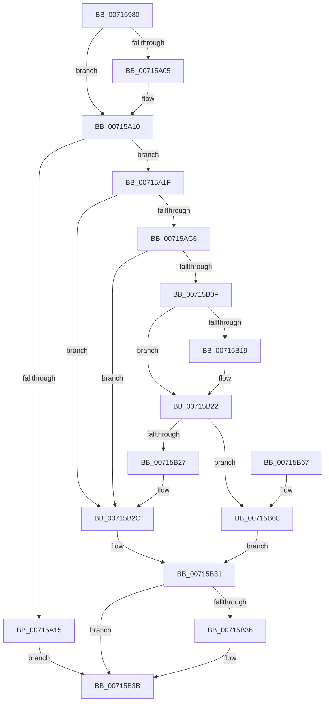

# FsRtlOpenFileSystemRegistryKeyFromFsGuid

- RVA: `0x00715980`–`0x00715B7A` (길이 `506` bytes)
- VA: `0x0000000140715980`
- 실행 섹션: `PAGE`
- PDB 이름 있음: `예`; PDB Function 태그: `아니요`
- unwind 정보 RVA: `0x000C6114`
- 디코드: `125`개 명령, `506/506` bytes 표시
- 미해석 바이트: `0` (있으면 어셈블리에 `.byte`로 보존)

> 이 문서는 커널 이미지의 기계어와 PDB 기호를 분석해 생성했습니다. 4번과 5번은 함수 원형과 자료형을 바이너리 사용 방식에서 추정한 C 해석이며 원본 소스 복구 결과는 아닙니다.

## 1. Dependencies

- 직접 호출 지점: **6**; 고유 호출 대상: **6**
- 직접 호출자로 확인된 함수: **0**
- RIP 상대 이미지 참조: **5**

### Outgoing calls
- `0x007159E9` → [memset](../../text/6C/memset_function_006C6C40.md) (function, `0x006C6C40`)
- `0x00715A86` → [RtlUnicodeStringPrintf](../../text/48/RtlUnicodeStringPrintf_function_0048B984.md) (function, `0x0048B984`)
- `0x00715ABB` → [ZwOpenKey](../../text/6A/ZwOpenKey_function_006AD310.md) (function, `0x006AD310`)
- `0x00715B04` → [RtlpQueryRegistryValues](../8C/RtlpQueryRegistryValues_function_008C9050.md) (function, `0x008C9050`)
- `0x00715B36` → [ZwClose](../../text/6A/ZwClose_function_006AD2B0.md) (function, `0x006AD2B0`)
- `0x00715B47` → [_security_check_cookie](../../text/6A/_security_check_cookie_function_006AC640.md) (function, `0x006AC640`)

### Direct callers
- 이 함수 시작 RVA로 연결되는 직접 call은 확인되지 않았습니다. 간접 호출은 완전히 역산할 수 없습니다.

### Static image references
- `0x0071599F` → RVA `0x00E0A740` (`.data`; read)
- `0x007159F8` → RVA `0x000112D0` (`.rdata`; read)
- `0x00715A09` → RVA `0x000112D8` (`.rdata`; read)
- `0x00715A64` → RVA `0x00AFBDF0` (` ?? ::NNGAKEGL::`string'`; read)
- `0x00715ACB` → RVA `0x00AFBEE0` (` ?? ::NNGAKEGL::`string'`; read)

## 2. Other-region calls and transfers

- 다른 실행 섹션으로 향하는 call: **5**
  - `0x007159E9` → [memset](../../text/6C/memset_function_006C6C40.md) (`PAGE` → `.text`)
  - `0x00715A86` → [RtlUnicodeStringPrintf](../../text/48/RtlUnicodeStringPrintf_function_0048B984.md) (`PAGE` → `.text`)
  - `0x00715ABB` → [ZwOpenKey](../../text/6A/ZwOpenKey_function_006AD310.md) (`PAGE` → `.text`)
  - `0x00715B36` → [ZwClose](../../text/6A/ZwClose_function_006AD2B0.md) (`PAGE` → `.text`)
  - `0x00715B47` → [_security_check_cookie](../../text/6A/_security_check_cookie_function_006AC640.md) (`PAGE` → `.text`)
- 별도 외부 분기/꼬리 이동을 확인하지 못했습니다.

## 3. Assembly (complete function range)

```asm
00715980  48 89 5C 24 10                  mov qword ptr [rsp + 0x10], rbx
00715985  55                              push rbp
00715986  56                              push rsi
00715987  57                              push rdi
00715988  41 54                           push r12
0071598A  41 55                           push r13
0071598C  41 56                           push r14
0071598E  41 57                           push r15
00715990  48 8D AC 24 D0 FE FF FF         lea rbp, [rsp - 0x130]
00715998  48 81 EC 30 02 00 00            sub rsp, 0x230
0071599F  48 8B 05 9A 4D 6F 00            mov rax, qword ptr [rip + 0x6f4d9a]
007159A6  48 33 C4                        xor rax, rsp
007159A9  48 89 85 20 01 00 00            mov qword ptr [rbp + 0x120], rax
007159B0  4C 8B AD 90 01 00 00            mov r13, qword ptr [rbp + 0x190]
007159B7  48 8D 45 40                     lea rax, [rbp + 0x40]
007159BB  33 DB                           xor ebx, ebx
007159BD  44 89 44 24 78                  mov dword ptr [rsp + 0x78], r8d
007159C2  4C 8B E2                        mov r12, rdx
007159C5  48 89 5C 24 70                  mov qword ptr [rsp + 0x70], rbx
007159CA  4C 8B F9                        mov r15, rcx
007159CD  89 5D 94                        mov dword ptr [rbp - 0x6c], ebx
007159D0  33 D2                           xor edx, edx
007159D2  89 5D AC                        mov dword ptr [rbp - 0x54], ebx
007159D5  44 8D 43 70                     lea r8d, [rbx + 0x70]
007159D9  48 C7 45 80 00 00 D8 00         mov qword ptr [rbp - 0x80], 0xd80000
007159E1  48 8D 4D C0                     lea rcx, [rbp - 0x40]
007159E5  48 89 45 88                     mov qword ptr [rbp - 0x78], rax
007159E9  E8 52 12 FB FF                  call 0x1406c6c40
007159EE  49 89 5D 00                     mov qword ptr [r13], rbx
007159F2  0F 57 C0                        xorps xmm0, xmm0
007159F5  49 8B 07                        mov rax, qword ptr [r15]
007159F8  48 2B 05 D1 B8 8F FF            sub rax, qword ptr [rip - 0x70472f]
007159FF  0F 11 45 30                     movups xmmword ptr [rbp + 0x30], xmm0
00715A03  75 0B                           jne 0x140715a10
00715A05  49 8B 47 08                     mov rax, qword ptr [r15 + 8]
00715A09  48 2B 05 C8 B8 8F FF            sub rax, qword ptr [rip - 0x704738]
00715A10  48 85 C0                        test rax, rax
00715A13  75 0A                           jne 0x140715a1f
00715A15  BB C6 04 00 C0                  mov ebx, 0xc00004c6
00715A1A  E9 1C 01 00 00                  jmp 0x140715b3b
00715A1F  41 0F B6 4F 0E                  movzx ecx, byte ptr [r15 + 0xe]
00715A24  41 0F B6 57 0D                  movzx edx, byte ptr [r15 + 0xd]
00715A29  41 0F B6 47 0F                  movzx eax, byte ptr [r15 + 0xf]
00715A2E  45 0F B6 57 0C                  movzx r10d, byte ptr [r15 + 0xc]
00715A33  45 0F B6 5F 0B                  movzx r11d, byte ptr [r15 + 0xb]
00715A38  41 0F B6 5F 0A                  movzx ebx, byte ptr [r15 + 0xa]
00715A3D  41 0F B6 7F 09                  movzx edi, byte ptr [r15 + 9]
00715A42  41 0F B6 77 08                  movzx esi, byte ptr [r15 + 8]
00715A47  45 0F B7 77 06                  movzx r14d, word ptr [r15 + 6]
00715A4C  45 0F B7 4F 04                  movzx r9d, word ptr [r15 + 4]
00715A51  45 8B 07                        mov r8d, dword ptr [r15]
00715A54  89 44 24 60                     mov dword ptr [rsp + 0x60], eax
00715A58  89 4C 24 58                     mov dword ptr [rsp + 0x58], ecx
00715A5C  48 8D 4D 80                     lea rcx, [rbp - 0x80]
00715A60  89 54 24 50                     mov dword ptr [rsp + 0x50], edx
00715A64  48 8D 15 85 63 3E 00            lea rdx, [rip + 0x3e6385]
00715A6B  44 89 54 24 48                  mov dword ptr [rsp + 0x48], r10d
00715A70  44 89 5C 24 40                  mov dword ptr [rsp + 0x40], r11d
00715A75  89 5C 24 38                     mov dword ptr [rsp + 0x38], ebx
00715A79  89 7C 24 30                     mov dword ptr [rsp + 0x30], edi
00715A7D  89 74 24 28                     mov dword ptr [rsp + 0x28], esi
00715A81  44 89 74 24 20                  mov dword ptr [rsp + 0x20], r14d
00715A86  E8 F9 5E D7 FF                  call 0x14048b984
00715A8B  8B 54 24 78                     mov edx, dword ptr [rsp + 0x78]
00715A8F  48 8D 45 80                     lea rax, [rbp - 0x80]
00715A93  48 83 65 98 00                  and qword ptr [rbp - 0x68], 0
00715A98  4C 8D 45 90                     lea r8, [rbp - 0x70]
00715A9C  0F 57 C0                        xorps xmm0, xmm0
00715A9F  48 89 45 A0                     mov qword ptr [rbp - 0x60], rax
00715AA3  48 8D 4C 24 70                  lea rcx, [rsp + 0x70]
00715AA8  C7 45 90 30 00 00 00            mov dword ptr [rbp - 0x70], 0x30
00715AAF  F3 0F 7F 45 B0                  movdqu xmmword ptr [rbp - 0x50], xmm0
00715AB4  C7 45 A8 40 06 00 00            mov dword ptr [rbp - 0x58], 0x640
00715ABB  E8 50 78 F9 FF                  call 0x1406ad310
00715AC0  8B D8                           mov ebx, eax
00715AC2  85 C0                           test eax, eax
00715AC4  78 66                           js 0x140715b2c
00715AC6  48 8B 54 24 70                  mov rdx, qword ptr [rsp + 0x70]
00715ACB  48 8D 05 0E 64 3E 00            lea rax, [rip + 0x3e640e]
00715AD2  48 89 45 D0                     mov qword ptr [rbp - 0x30], rax
00715AD6  4C 8D 45 C0                     lea r8, [rbp - 0x40]
00715ADA  48 8D 45 30                     lea rax, [rbp + 0x30]
00715ADE  C7 45 C8 34 01 00 00            mov dword ptr [rbp - 0x38], 0x134
00715AE5  45 33 C9                        xor r9d, r9d
00715AE8  48 89 45 D8                     mov qword ptr [rbp - 0x28], rax
00715AEC  B9 00 00 00 40                  mov ecx, 0x40000000
00715AF1  C7 45 E0 00 00 00 03            mov dword ptr [rbp - 0x20], 0x3000000
00715AF8  C7 45 30 F0 FF FF FF            mov dword ptr [rbp + 0x30], 0xfffffff0
00715AFF  C6 44 24 28 01                  mov byte ptr [rsp + 0x28], 1
00715B04  E8 47 35 1B 00                  call 0x1408c9050
00715B09  8B D8                           mov ebx, eax
00715B0B  85 C0                           test eax, eax
00715B0D  78 1D                           js 0x140715b2c
00715B0F  49 8B 04 24                     mov rax, qword ptr [r12]
00715B13  48 2B 45 30                     sub rax, qword ptr [rbp + 0x30]
00715B17  75 09                           jne 0x140715b22
00715B19  49 8B 44 24 08                  mov rax, qword ptr [r12 + 8]
00715B1E  48 2B 45 38                     sub rax, qword ptr [rbp + 0x38]
00715B22  48 85 C0                        test rax, rax
00715B25  74 41                           je 0x140715b68
00715B27  BB DE 04 00 C0                  mov ebx, 0xc00004de
00715B2C  48 8B 4C 24 70                  mov rcx, qword ptr [rsp + 0x70]
00715B31  48 85 C9                        test rcx, rcx
00715B34  74 05                           je 0x140715b3b
00715B36  E8 75 77 F9 FF                  call 0x1406ad2b0
00715B3B  8B C3                           mov eax, ebx
00715B3D  48 8B 8D 20 01 00 00            mov rcx, qword ptr [rbp + 0x120]
00715B44  48 33 CC                        xor rcx, rsp
00715B47  E8 F4 6A F9 FF                  call 0x1406ac640
00715B4C  48 8B 9C 24 78 02 00 00         mov rbx, qword ptr [rsp + 0x278]
00715B54  48 81 C4 30 02 00 00            add rsp, 0x230
00715B5B  41 5F                           pop r15
00715B5D  41 5E                           pop r14
00715B5F  41 5D                           pop r13
00715B61  41 5C                           pop r12
00715B63  5F                              pop rdi
00715B64  5E                              pop rsi
00715B65  5D                              pop rbp
00715B66  C3                              ret
00715B67  CC                              int3
00715B68  48 8B 44 24 70                  mov rax, qword ptr [rsp + 0x70]
00715B6D  33 C9                           xor ecx, ecx
00715B6F  49 89 45 00                     mov qword ptr [r13], rax
00715B73  48 89 4C 24 70                  mov qword ptr [rsp + 0x70], rcx
00715B78  EB B7                           jmp 0x140715b31
```

## 4. C-style interpretation (structured pseudocode)

```c
__int64 __fastcall FsRtlOpenFileSystemRegistryKeyFromFsGuid(__int64 a1, __int64 a2, int a3, __int64 a4, __int64 a5)
{
    __int64 result;
    __int64 v_rbx;
    __int64 v_rsp;
    unsigned __int64 v_stack_m128;
    unsigned __int64 v_stack_m130;
    unsigned __int64 v_stack_m138;
    unsigned __int64 v_stack_m168;
    unsigned int v_stack_m188;
    unsigned __int64 v_stack_m190;
    unsigned __int64 v_stack_m198;
    unsigned int v_stack_m1A0;
    unsigned __int64 v_stack_m1A8;
    unsigned __int64 v_stack_m1B8;
    unsigned int v_stack_m1BC;
    unsigned int v_stack_m1C0;
    unsigned __int64 v_stack_m1C8;
    unsigned __int64 v_stack_m1D0;
    unsigned int v_stack_m1D4;
    unsigned __int64 v_stack_m1D8;
    unsigned __int64 v_stack_m1E0;
    unsigned __int64 v_stack_m1E8;
    unsigned int v_stack_m1F0;
    unsigned __int64 v_stack_m1F8;
    unsigned int v_stack_m208;
    unsigned int v_stack_m210;
    unsigned int v_stack_m218;
    unsigned int v_stack_m220;
    unsigned int v_stack_m228;
    unsigned int v_stack_m230;
    unsigned int v_stack_m238;
    unsigned int v_stack_m240;
    unsigned int v_stack_m248;
    unsigned __int64 v_stack_m48;
    unsigned __int64 v_stack_p10;
    unsigned __int64 v_stack_p70;

    v_stack_p10 = v_rbx;
    v_rsp = (v_rsp) - (560);
    result = (*(unsigned __int64 *)(v_rip + 7294362)) ^ (v_rsp);
    v_stack_m48 = result;
    v_rbx = 0;
    v_stack_m1F0 = a3;
    v_stack_m1F8 = 0;
    v_stack_m1D4 = 0;
    a2 = 0;
    v_stack_m1BC = 0;
    v_stack_m1E8 = 0xD80000ULL;
    v_stack_m1E0 = v_stack_m128;
    result = memset(v_stack_m1A8, a2, v_rbx + 112, a4);
    *(unsigned __int64 *)(a5) = 0;
    result = (*(unsigned __int64 *)(a1)) - (*(unsigned __int64 *)(v_rip - 7358255));
    v_stack_m138 = v_xmm0;
    if (!(condition_is_not_equal)) {
        result = *(unsigned __int64 *)(a1 + 8);
        result = (result) - (*(unsigned __int64 *)(v_rip - 7358264));
    }
    if (result != 0) goto loc_00715A1F;
    goto loc_00715B3B;
loc_00715A1F:
    v_stack_m208 = (unsigned int)(*(unsigned __int8 *)(a1 + 15));
    v_stack_m210 = (unsigned int)(*(unsigned __int8 *)(a1 + 14));
    v_stack_m218 = (unsigned int)(*(unsigned __int8 *)(a1 + 13));
    v_stack_m220 = (unsigned int)(*(unsigned __int8 *)(a1 + 12));
    v_stack_m228 = (unsigned int)(*(unsigned __int8 *)(a1 + 11));
    v_stack_m230 = (unsigned int)(*(unsigned __int8 *)(a1 + 10));
    v_stack_m238 = (unsigned int)(*(unsigned __int8 *)(a1 + 9));
    v_stack_m240 = (unsigned int)(*(unsigned __int8 *)(a1 + 8));
    v_stack_m248 = (unsigned int)(*(unsigned __int16 *)(a1 + 6));
    result = RtlUnicodeStringPrintf(v_stack_m1E8, v_rip + 4088709, (unsigned int)(*(unsigned int *)(a1)), *(unsigned __int16 *)(a1 + 4));
    v_stack_m1C8 = v_stack_m1E8;
    v_stack_m1D8 = 48;
    v_stack_m1B8 = v_xmm0;
    v_stack_m1C0 = 0x640ULL;
    result = ZwOpenKey(v_stack_m1F8, (unsigned int)(v_stack_m1F0), v_stack_m1D8, *(unsigned __int16 *)(a1 + 4));
    if (sign_flag) goto loc_00715B2C;
    v_stack_m198 = v_rip + 4088846;
    v_stack_m1A0 = 308;
    a4 = 0;
    v_stack_m190 = v_stack_m138;
    v_stack_m188 = 0x3000000ULL;
    v_stack_m138 = 0xFFFFFFF0ULL;
    v_stack_m240 = 1;
    result = RtlpQueryRegistryValues((unsigned int)(0x40000000ULL), v_stack_m1F8, v_stack_m1A8, a4);
    if (sign_flag) goto loc_00715B2C;
    result = (*(unsigned __int64 *)(a2)) - (v_stack_m138);
    if (!(condition_is_not_equal)) {
        result = *(unsigned __int64 *)(a2 + 8);
        result = (result) - (v_stack_m130);
    }
    if (result == 0) goto loc_00715B68;
loc_00715B2C:
loc_00715B31:
    if (v_stack_m1F8 != 0) {
        result = ZwClose(v_stack_m1F8, v_stack_m1F8, v_stack_m1A8, a4);
    }
    a1 = (v_stack_m48) ^ (v_rsp);
    result = _security_check_cookie(a1, v_stack_m1F8, v_stack_m1A8, a4);
    v_rsp = (v_rsp) + (560);
    return result;
loc_00715B68:
    a1 = 0;
    *(unsigned __int64 *)(a5) = v_stack_p70;
    v_stack_p70 = 0;
    goto loc_00715B31;
}
```

## 5. (Beta) C Style

```c
int64_t FsRtlOpenFileSystemRegistryKeyFromFsGuid(void *Arg1, void *Arg2, int32_t Arg3, int64_t Arg4, void *Arg5)
{
    uint8_t *arg1 = (uint8_t *)Arg1;
    uint8_t *arg2 = (uint8_t *)Arg2;
    uint8_t *arg5 = (uint8_t *)Arg5;

    int64_t result;
    int64_t local_rbx;
    int64_t local_rsp;
    uint64_t v_stack_m128;
    uint64_t v_stack_m130;
    uint64_t v_stack_m138;
    uint64_t v_stack_m168;
    uint32_t v_stack_m188;
    uint64_t v_stack_m190;
    uint64_t v_stack_m198;
    uint32_t v_stack_m1A0;
    uint64_t v_stack_m1A8;
    uint64_t v_stack_m1B8;
    uint32_t v_stack_m1BC;
    uint32_t v_stack_m1C0;
    uint64_t v_stack_m1C8;
    uint64_t v_stack_m1D0;
    uint32_t v_stack_m1D4;
    uint64_t v_stack_m1D8;
    uint64_t v_stack_m1E0;
    uint64_t v_stack_m1E8;
    uint32_t v_stack_m1F0;
    uint64_t v_stack_m1F8;
    uint32_t v_stack_m208;
    uint32_t v_stack_m210;
    uint32_t v_stack_m218;
    uint32_t v_stack_m220;
    uint32_t v_stack_m228;
    uint32_t v_stack_m230;
    uint32_t v_stack_m238;
    uint32_t v_stack_m240;
    uint32_t v_stack_m248;
    uint64_t v_stack_m48;
    uint64_t v_stack_p10;
    uint64_t v_stack_p70;

    v_stack_p10 = local_rbx;
    local_rsp = (local_rsp) - (560);
    result = (*(uint64_t *)(v_rip + 0x6F4D9A)) ^ (local_rsp);
    v_stack_m48 = result;
    local_rbx = 0;
    v_stack_m1F0 = Arg3;
    v_stack_m1F8 = 0;
    v_stack_m1D4 = 0;
    Arg2 = 0;
    v_stack_m1BC = 0;
    v_stack_m1E8 = 0xD80000ULL;
    v_stack_m1E0 = v_stack_m128;
    result = memset(v_stack_m1A8, Arg2, local_rbx + 112, Arg4);
    *(uint64_t *)(arg5) = 0;
    result = (*(uint64_t *)(arg1)) - (*(uint64_t *)(v_rip - 0x70472F));
    v_stack_m138 = v_xmm0;
    if (!(condition_is_not_equal)) {
        result = *(uint64_t *)(arg1 + 0x8);
        result = (result) - (*(uint64_t *)(v_rip - 0x704738));
    }
    if (result != 0) goto loc_00715A1F;
    goto loc_00715B3B;
loc_00715A1F:
    v_stack_m208 = (uint32_t)(*(uint8_t *)(arg1 + 0xF));
    v_stack_m210 = (uint32_t)(*(uint8_t *)(arg1 + 0xE));
    v_stack_m218 = (uint32_t)(*(uint8_t *)(arg1 + 0xD));
    v_stack_m220 = (uint32_t)(*(uint8_t *)(arg1 + 0xC));
    v_stack_m228 = (uint32_t)(*(uint8_t *)(arg1 + 0xB));
    v_stack_m230 = (uint32_t)(*(uint8_t *)(arg1 + 0xA));
    v_stack_m238 = (uint32_t)(*(uint8_t *)(arg1 + 0x9));
    v_stack_m240 = (uint32_t)(*(uint8_t *)(arg1 + 0x8));
    v_stack_m248 = (uint32_t)(*(uint16_t *)(arg1 + 0x6));
    result = RtlUnicodeStringPrintf(v_stack_m1E8, v_rip + 4088709, (uint32_t)(*(uint32_t *)(arg1)), *(uint16_t *)(arg1 + 0x4));
    v_stack_m1C8 = v_stack_m1E8;
    v_stack_m1D8 = 48;
    v_stack_m1B8 = v_xmm0;
    v_stack_m1C0 = 0x640ULL;
    result = ZwOpenKey(v_stack_m1F8, (uint32_t)(v_stack_m1F0), v_stack_m1D8, *(uint16_t *)(arg1 + 0x4));
    if (sign_flag) goto loc_00715B2C;
    v_stack_m198 = v_rip + 4088846;
    v_stack_m1A0 = 308;
    Arg4 = 0;
    v_stack_m190 = v_stack_m138;
    v_stack_m188 = 0x3000000ULL;
    v_stack_m138 = 0xFFFFFFF0ULL;
    v_stack_m240 = 1;
    result = RtlpQueryRegistryValues((uint32_t)(0x40000000ULL), v_stack_m1F8, v_stack_m1A8, Arg4);
    if (sign_flag) goto loc_00715B2C;
    result = (*(uint64_t *)(arg2)) - (v_stack_m138);
    if (!(condition_is_not_equal)) {
        result = *(uint64_t *)(arg2 + 0x8);
        result = (result) - (v_stack_m130);
    }
    if (result == 0) goto loc_00715B68;
loc_00715B2C:
loc_00715B31:
    if (v_stack_m1F8 != 0) {
        result = ZwClose(v_stack_m1F8, v_stack_m1F8, v_stack_m1A8, Arg4);
    }
    Arg1 = (v_stack_m48) ^ (local_rsp);
    result = _security_check_cookie(Arg1, v_stack_m1F8, v_stack_m1A8, Arg4);
    local_rsp = (local_rsp) + (560);
    return result;
loc_00715B68:
    Arg1 = 0;
    *(uint64_t *)(arg5) = v_stack_p70;
    v_stack_p70 = 0;
    goto loc_00715B31;
}
```

### 관측된 메모리 오프셋

구조체 형식이 확인되지 않은 접근은 인자 기준의 오프셋으로만 기록했습니다.

| 기준 인자 | 오프셋 표현 | 폭 (bit) | 접근 |
|---|---:|---:|---|
| `Arg1` | `+ 0x0` | `32` | `R` |
| `Arg1` | `+ 0x0` | `64` | `R` |
| `Arg1` | `+ 0x4` | `16` | `R` |
| `Arg1` | `+ 0x6` | `16` | `R` |
| `Arg1` | `+ 0x8` | `8` | `R` |
| `Arg1` | `+ 0x8` | `64` | `R` |
| `Arg1` | `+ 0x9` | `8` | `R` |
| `Arg1` | `+ 0xA` | `8` | `R` |
| `Arg1` | `+ 0xB` | `8` | `R` |
| `Arg1` | `+ 0xC` | `8` | `R` |
| `Arg1` | `+ 0xD` | `8` | `R` |
| `Arg1` | `+ 0xE` | `8` | `R` |
| `Arg1` | `+ 0xF` | `8` | `R` |
| `Arg2` | `+ 0x0` | `64` | `R` |
| `Arg2` | `+ 0x8` | `64` | `R` |
| `Arg5` | `+ 0x0` | `64` | `W` |

## 6. Execution-region graph

[열기: 2D/3D 그래프와 함수 탐색 컨트롤 패널](../../../control-panel.html?section=page&rva=0x00715980&view=graph)

- 2D 그래프는 위에서 아래로 흐르고, 3D 그래프는 빈 공간을 드래그해 회전합니다. Shift+드래그는 이동, 휠은 확대·축소, 함수 노드 선택은 대상 보고서 이동입니다.

### Static fallback


