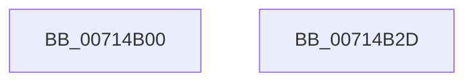

# FsRtlOplockBreakH

- RVA: `0x00714B00`–`0x00714B2E` (길이 `46` bytes)
- VA: `0x0000000140714B00`
- 실행 섹션: `PAGE`
- PDB 이름 있음: `예`; PDB Function 태그: `아니요`
- unwind 정보 RVA: `0x00082420`
- 디코드: `12`개 명령, `46/46` bytes 표시
- 미해석 바이트: `0` (있으면 어셈블리에 `.byte`로 보존)

> 이 문서는 커널 이미지의 기계어와 PDB 기호를 분석해 생성했습니다. 4번과 5번은 함수 원형과 자료형을 바이너리 사용 방식에서 추정한 C 해석이며 원본 소스 복구 결과는 아닙니다.

## 1. Dependencies

- 직접 호출 지점: **1**; 고유 호출 대상: **1**
- 직접 호출자로 확인된 함수: **0**
- RIP 상대 이미지 참조: **0**

### Outgoing calls
- `0x00714B23` → [FsRtlOplockBreakH2](../A4/FsRtlOplockBreakH2_function_00A44550.md) (function, `0x00A44550`)

### Direct callers
- 이 함수 시작 RVA로 연결되는 직접 call은 확인되지 않았습니다. 간접 호출은 완전히 역산할 수 없습니다.

### Static image references
- 디코드된 RIP-relative 메모리 참조가 없습니다.

## 2. Other-region calls and transfers

- 다른 실행 섹션으로 향하는 call: **0**
- 별도 외부 분기/꼬리 이동을 확인하지 못했습니다.

## 3. Assembly (complete function range)

```asm
00714B00  4C 8B DC                        mov r11, rsp
00714B03  48 83 EC 48                     sub rsp, 0x48
00714B07  49 83 63 F0 00                  and qword ptr [r11 - 0x10], 0
00714B0C  49 83 63 E8 00                  and qword ptr [r11 - 0x18], 0
00714B11  48 8B 44 24 78                  mov rax, qword ptr [rsp + 0x78]
00714B16  49 89 43 E0                     mov qword ptr [r11 - 0x20], rax
00714B1A  48 8B 44 24 70                  mov rax, qword ptr [rsp + 0x70]
00714B1F  49 89 43 D8                     mov qword ptr [r11 - 0x28], rax
00714B23  E8 28 FA 32 00                  call 0x140a44550
00714B28  48 83 C4 48                     add rsp, 0x48
00714B2C  C3                              ret
00714B2D  CC                              int3
```

## 4. C-style interpretation (structured pseudocode)

```c
__int64 __fastcall FsRtlOplockBreakH(__int64 a1, __int64 a2, __int64 a3, __int64 a4, __int64 a5, __int64 a6)
{
    __int64 result;
    __int64 v_rsp;

    v_rsp = (v_rsp) - (72);
    *(unsigned __int64 *)(v_rsp - 32) = a6;
    *(unsigned __int64 *)(v_rsp - 40) = a5;
    result = FsRtlOplockBreakH2(a1, a2, a3, a4);
    v_rsp = (v_rsp) + (72);
    return result;
}
```

## 5. (Beta) C Style

```c
int64_t FsRtlOplockBreakH(int64_t Arg1, int64_t Arg2, int64_t Arg3, int64_t Arg4, int64_t Arg5, int64_t Arg6)
{
    int64_t result;
    int64_t local_rsp;

    local_rsp = (local_rsp) - (72);
    *(uint64_t *)(local_rsp - 0x20) = Arg6;
    *(uint64_t *)(local_rsp - 0x28) = Arg5;
    result = FsRtlOplockBreakH2(Arg1, Arg2, Arg3, Arg4);
    local_rsp = (local_rsp) + (72);
    return result;
}
```

## 6. Execution-region graph

[열기: 2D/3D 그래프와 함수 탐색 컨트롤 패널](../../../control-panel.html?section=page&rva=0x00714B00&view=graph)

- 2D 그래프는 위에서 아래로 흐르고, 3D 그래프는 빈 공간을 드래그해 회전합니다. Shift+드래그는 이동, 휠은 확대·축소, 함수 노드 선택은 대상 보고서 이동입니다.

### Static fallback


