# FsRtlPrepareMdlWriteDev

- RVA: `0x00713BB0`–`0x00713F62` (길이 `946` bytes)
- VA: `0x0000000140713BB0`
- 실행 섹션: `PAGE`
- PDB 이름 있음: `예`; PDB Function 태그: `아니요`
- unwind 정보 RVA: `0x000C5CC8`
- 디코드: `241`개 명령, `946/946` bytes 표시
- 미해석 바이트: `0` (있으면 어셈블리에 `.byte`로 보존)

> 이 문서는 커널 이미지의 기계어와 PDB 기호를 분석해 생성했습니다. 4번과 5번은 함수 원형과 자료형을 바이너리 사용 방식에서 추정한 C 해석이며 원본 소스 복구 결과는 아닙니다.

## 1. Dependencies

- 직접 호출 지점: **21**; 고유 호출 대상: **10**
- 직접 호출자로 확인된 함수: **0**
- RIP 상대 이미지 참조: **0**

### Outgoing calls
- `0x00713C09` → [IoGetTopLevelIrp](../../text/41/IoGetTopLevelIrp_function_0041D910.md) (function, `0x0041D910`)
- `0x00713C23` → [CcCanIWrite](../../text/38/CcCanIWrite_function_00388250.md) (function, `0x00388250`)
- `0x00713C9B` → [ExAcquireResourceSharedLite](../../text/21/ExAcquireResourceSharedLite_function_00211BC0.md) (function, `0x00211BC0`)
- `0x00713CAA` → [ExAcquireResourceExclusiveLite](../../text/21/ExAcquireResourceExclusiveLite_function_00214E20.md) (function, `0x00214E20`)
- `0x00713D20` → [ExReleaseResourceLite](../../text/25/ExReleaseResourceLite_function_0025FA10.md) (function, `0x0025FA10`)
- `0x00713D2B` → [ExAcquireResourceExclusiveLite](../../text/21/ExAcquireResourceExclusiveLite_function_00214E20.md) (function, `0x00214E20`)
- `0x00713DC0` → [guard_dispatch_icall](../../text/6B/guard_dispatch_icall_function_006BAAD0.md) (function, `0x006BAAD0`)
- `0x00713E01` → [ExAcquireResourceExclusiveLite](../../text/21/ExAcquireResourceExclusiveLite_function_00214E20.md) (function, `0x00214E20`)
- `0x00713E0E` → [ExReleaseResourceLite](../../text/25/ExReleaseResourceLite_function_0025FA10.md) (function, `0x0025FA10`)
- `0x00713E1E` → [IoSetTopLevelIrp](../../text/42/IoSetTopLevelIrp_function_0042A7D0.md) (function, `0x0042A7D0`)
- `0x00713E38` → [CcZeroData](../../text/38/CcZeroData_function_00387F00.md) (function, `0x00387F00`)
- `0x00713E6D` → [CcPrepareMdlWrite](../../text/49/CcPrepareMdlWrite_function_004996D0.md) (function, `0x004996D0`)
- `0x00713E9A` → [IoSetTopLevelIrp](../../text/42/IoSetTopLevelIrp_function_0042A7D0.md) (function, `0x0042A7D0`)
- `0x00713EC1` → [ExAcquireResourceExclusiveLite](../../text/21/ExAcquireResourceExclusiveLite_function_00214E20.md) (function, `0x00214E20`)
- `0x00713ECE` → [ExReleaseResourceLite](../../text/25/ExReleaseResourceLite_function_0025FA10.md) (function, `0x0025FA10`)
- `0x00713F0C` → [ExAcquireResourceExclusiveLite](../../text/21/ExAcquireResourceExclusiveLite_function_00214E20.md) (function, `0x00214E20`)
- `0x00713F1D` → [ExReleaseResourceLite](../../text/25/ExReleaseResourceLite_function_0025FA10.md) (function, `0x0025FA10`)
- `0x00713F30` → [ExReleaseResourceLite](../../text/25/ExReleaseResourceLite_function_0025FA10.md) (function, `0x0025FA10`)
- `0x00713F35` → [KeLeaveCriticalRegion](../../text/25/KeLeaveCriticalRegion_function_0025D8B0.md) (function, `0x0025D8B0`)
- `0x00713F44` → [ExReleaseResourceLite](../../text/25/ExReleaseResourceLite_function_0025FA10.md) (function, `0x0025FA10`)
- `0x00713F49` → [KeLeaveCriticalRegion](../../text/25/KeLeaveCriticalRegion_function_0025D8B0.md) (function, `0x0025D8B0`)

### Direct callers
- 이 함수 시작 RVA로 연결되는 직접 call은 확인되지 않았습니다. 간접 호출은 완전히 역산할 수 없습니다.

### Static image references
- 디코드된 RIP-relative 메모리 참조가 없습니다.

## 2. Other-region calls and transfers

- 다른 실행 섹션으로 향하는 call: **21**
  - `0x00713C09` → [IoGetTopLevelIrp](../../text/41/IoGetTopLevelIrp_function_0041D910.md) (`PAGE` → `.text`)
  - `0x00713C23` → [CcCanIWrite](../../text/38/CcCanIWrite_function_00388250.md) (`PAGE` → `.text`)
  - `0x00713C9B` → [ExAcquireResourceSharedLite](../../text/21/ExAcquireResourceSharedLite_function_00211BC0.md) (`PAGE` → `.text`)
  - `0x00713CAA` → [ExAcquireResourceExclusiveLite](../../text/21/ExAcquireResourceExclusiveLite_function_00214E20.md) (`PAGE` → `.text`)
  - `0x00713D20` → [ExReleaseResourceLite](../../text/25/ExReleaseResourceLite_function_0025FA10.md) (`PAGE` → `.text`)
  - `0x00713D2B` → [ExAcquireResourceExclusiveLite](../../text/21/ExAcquireResourceExclusiveLite_function_00214E20.md) (`PAGE` → `.text`)
  - `0x00713DC0` → [guard_dispatch_icall](../../text/6B/guard_dispatch_icall_function_006BAAD0.md) (`PAGE` → `.text`)
  - `0x00713E01` → [ExAcquireResourceExclusiveLite](../../text/21/ExAcquireResourceExclusiveLite_function_00214E20.md) (`PAGE` → `.text`)
  - `0x00713E0E` → [ExReleaseResourceLite](../../text/25/ExReleaseResourceLite_function_0025FA10.md) (`PAGE` → `.text`)
  - `0x00713E1E` → [IoSetTopLevelIrp](../../text/42/IoSetTopLevelIrp_function_0042A7D0.md) (`PAGE` → `.text`)
  - `0x00713E38` → [CcZeroData](../../text/38/CcZeroData_function_00387F00.md) (`PAGE` → `.text`)
  - `0x00713E6D` → [CcPrepareMdlWrite](../../text/49/CcPrepareMdlWrite_function_004996D0.md) (`PAGE` → `.text`)
  - `0x00713E9A` → [IoSetTopLevelIrp](../../text/42/IoSetTopLevelIrp_function_0042A7D0.md) (`PAGE` → `.text`)
  - `0x00713EC1` → [ExAcquireResourceExclusiveLite](../../text/21/ExAcquireResourceExclusiveLite_function_00214E20.md) (`PAGE` → `.text`)
  - `0x00713ECE` → [ExReleaseResourceLite](../../text/25/ExReleaseResourceLite_function_0025FA10.md) (`PAGE` → `.text`)
  - `0x00713F0C` → [ExAcquireResourceExclusiveLite](../../text/21/ExAcquireResourceExclusiveLite_function_00214E20.md) (`PAGE` → `.text`)
  - `0x00713F1D` → [ExReleaseResourceLite](../../text/25/ExReleaseResourceLite_function_0025FA10.md) (`PAGE` → `.text`)
  - `0x00713F30` → [ExReleaseResourceLite](../../text/25/ExReleaseResourceLite_function_0025FA10.md) (`PAGE` → `.text`)
  - `0x00713F35` → [KeLeaveCriticalRegion](../../text/25/KeLeaveCriticalRegion_function_0025D8B0.md) (`PAGE` → `.text`)
  - `0x00713F44` → [ExReleaseResourceLite](../../text/25/ExReleaseResourceLite_function_0025FA10.md) (`PAGE` → `.text`)
  - `0x00713F49` → [KeLeaveCriticalRegion](../../text/25/KeLeaveCriticalRegion_function_0025D8B0.md) (`PAGE` → `.text`)
- 별도 외부 분기/꼬리 이동을 확인하지 못했습니다.

## 3. Assembly (complete function range)

```asm
00713BB0  48 8B C4                        mov rax, rsp
00713BB3  44 89 48 20                     mov dword ptr [rax + 0x20], r9d
00713BB7  44 89 40 18                     mov dword ptr [rax + 0x18], r8d
00713BBB  48 89 50 10                     mov qword ptr [rax + 0x10], rdx
00713BBF  48 89 48 08                     mov qword ptr [rax + 8], rcx
00713BC3  53                              push rbx
00713BC4  56                              push rsi
00713BC5  57                              push rdi
00713BC6  41 55                           push r13
00713BC8  41 56                           push r14
00713BCA  41 57                           push r15
00713BCC  48 81 EC 98 00 00 00            sub rsp, 0x98
00713BD3  45 8B F8                        mov r15d, r8d
00713BD6  4C 8B E9                        mov r13, rcx
00713BD9  33 F6                           xor esi, esi
00713BDB  48 89 70 A8                     mov qword ptr [rax - 0x58], rsi
00713BDF  45 33 F6                        xor r14d, r14d
00713BE2  4C 89 70 B0                     mov qword ptr [rax - 0x50], r14
00713BE6  C6 40 88 01                     mov byte ptr [rax - 0x78], 1
00713BEA  40 88 74 24 51                  mov byte ptr [rsp + 0x51], sil
00713BEF  83 CB FF                        or ebx, 0xffffffff
00713BF2  83 3A FF                        cmp dword ptr [rdx], -1
00713BF5  75 0A                           jne 0x140713c01
00713BF7  39 5A 04                        cmp dword ptr [rdx + 4], ebx
00713BFA  75 05                           jne 0x140713c01
00713BFC  40 B7 01                        mov dil, 1
00713BFF  EB 03                           jmp 0x140713c04
00713C01  40 32 FF                        xor dil, dil
00713C04  40 88 7C 24 52                  mov byte ptr [rsp + 0x52], dil
00713C09  E8 02 9D D0 FF                  call 0x14041d910
00713C0E  48 85 C0                        test rax, rax
00713C11  0F 85 37 03 00 00               jne 0x140713f4e
00713C17  45 33 C9                        xor r9d, r9d
00713C1A  41 B0 01                        mov r8b, 1
00713C1D  41 8B D7                        mov edx, r15d
00713C20  49 8B CD                        mov rcx, r13
00713C23  E8 28 46 C7 FF                  call 0x140388250
00713C28  84 C0                           test al, al
00713C2A  0F 84 1E 03 00 00               je 0x140713f4e
00713C30  41 8B 4D 50                     mov ecx, dword ptr [r13 + 0x50]
00713C34  F6 C1 10                        test cl, 0x10
00713C37  0F 85 11 03 00 00               jne 0x140713f4e
00713C3D  48 8B 84 24 F8 00 00 00         mov rax, qword ptr [rsp + 0xf8]
00713C45  21 30                           and dword ptr [rax], esi
00713C47  45 85 FF                        test r15d, r15d
00713C4A  75 07                           jne 0x140713c53
00713C4C  B0 01                           mov al, 1
00713C4E  E9 FD 02 00 00                  jmp 0x140713f50
00713C53  4D 8B 7D 18                     mov r15, qword ptr [r13 + 0x18]
00713C57  4C 89 BC 24 80 00 00 00         mov qword ptr [rsp + 0x80], r15
00713C5F  65 48 8B 04 25 88 01 00 00      mov rax, qword ptr gs:[0x188]
00713C68  66 01 98 E4 01 00 00            add word ptr [rax + 0x1e4], bx
00713C6F  90                              nop
00713C70  8B 9C 24 E0 00 00 00            mov ebx, dword ptr [rsp + 0xe0]
00713C77  40 84 FF                        test dil, dil
00713C7A  75 28                           jne 0x140713ca4
00713C7C  48 89 5C 24 68                  mov qword ptr [rsp + 0x68], rbx
00713C81  48 8B 84 24 D8 00 00 00         mov rax, qword ptr [rsp + 0xd8]
00713C89  48 8B 08                        mov rcx, qword ptr [rax]
00713C8C  48 03 CB                        add rcx, rbx
00713C8F  49 3B 4F 28                     cmp rcx, qword ptr [r15 + 0x28]
00713C93  7F 0F                           jg 0x140713ca4
00713C95  B2 01                           mov dl, 1
00713C97  49 8B 4F 08                     mov rcx, qword ptr [r15 + 8]
00713C9B  E8 20 DF AF FF                  call 0x140211bc0
00713CA0  B2 01                           mov dl, 1
00713CA2  EB 13                           jmp 0x140713cb7
00713CA4  B2 01                           mov dl, 1
00713CA6  49 8B 4F 08                     mov rcx, qword ptr [r15 + 8]
00713CAA  E8 71 11 B0 FF                  call 0x140214e20
00713CAF  48 89 5C 24 68                  mov qword ptr [rsp + 0x68], rbx
00713CB4  40 8A D6                        mov dl, sil
00713CB7  40 84 FF                        test dil, dil
00713CBA  74 06                           je 0x140713cc2
00713CBC  49 8B 7F 20                     mov rdi, qword ptr [r15 + 0x20]
00713CC0  EB 0B                           jmp 0x140713ccd
00713CC2  48 8B 84 24 D8 00 00 00         mov rax, qword ptr [rsp + 0xd8]
00713CCA  48 8B 38                        mov rdi, qword ptr [rax]
00713CCD  48 03 DF                        add rbx, rdi
00713CD0  48 89 5C 24 58                  mov qword ptr [rsp + 0x58], rbx
00713CD5  48 89 7C 24 60                  mov qword ptr [rsp + 0x60], rdi
00713CDA  49 39 75 30                     cmp qword ptr [r13 + 0x30], rsi
00713CDE  0F 84 5C 02 00 00               je 0x140713f40
00713CE4  41 8A 4F 05                     mov cl, byte ptr [r15 + 5]
00713CE8  84 C9                           test cl, cl
00713CEA  0F 84 50 02 00 00               je 0x140713f40
00713CF0  48 B8 FF FF FF FF FF FF FF 7F   movabs rax, 0x7fffffffffffffff
00713CFA  48 2B C7                        sub rax, rdi
00713CFD  48 3B 44 24 68                  cmp rax, qword ptr [rsp + 0x68]
00713D02  0F 8C 38 02 00 00               jl 0x140713f40
00713D08  49 3B 5F 18                     cmp rbx, qword ptr [r15 + 0x18]
00713D0C  0F 8F 2E 02 00 00               jg 0x140713f40
00713D12  84 D2                           test dl, dl
00713D14  74 59                           je 0x140713d6f
00713D16  49 3B 5F 28                     cmp rbx, qword ptr [r15 + 0x28]
00713D1A  7E 53                           jle 0x140713d6f
00713D1C  49 8B 4F 08                     mov rcx, qword ptr [r15 + 8]
00713D20  E8 EB BC B4 FF                  call 0x14025fa10
00713D25  B2 01                           mov dl, 1
00713D27  49 8B 4F 08                     mov rcx, qword ptr [r15 + 8]
00713D2B  E8 F0 10 B0 FF                  call 0x140214e20
00713D30  40 38 74 24 52                  cmp byte ptr [rsp + 0x52], sil
00713D35  74 18                           je 0x140713d4f
00713D37  49 8B 7F 20                     mov rdi, qword ptr [r15 + 0x20]
00713D3B  48 89 7C 24 60                  mov qword ptr [rsp + 0x60], rdi
00713D40  8B 9C 24 E0 00 00 00            mov ebx, dword ptr [rsp + 0xe0]
00713D47  48 03 DF                        add rbx, rdi
00713D4A  48 89 5C 24 58                  mov qword ptr [rsp + 0x58], rbx
00713D4F  49 39 75 30                     cmp qword ptr [r13 + 0x30], rsi
00713D53  0F 84 E7 01 00 00               je 0x140713f40
00713D59  41 8A 4F 05                     mov cl, byte ptr [r15 + 5]
00713D5D  84 C9                           test cl, cl
00713D5F  0F 84 DB 01 00 00               je 0x140713f40
00713D65  49 3B 5F 18                     cmp rbx, qword ptr [r15 + 0x18]
00713D69  0F 8F D1 01 00 00               jg 0x140713f40
00713D6F  80 F9 02                        cmp cl, 2
00713D72  75 59                           jne 0x140713dcd
00713D74  48 8B 94 24 00 01 00 00         mov rdx, qword ptr [rsp + 0x100]
00713D7C  48 8B 42 08                     mov rax, qword ptr [rdx + 8]
00713D80  48 8B 48 50                     mov rcx, qword ptr [rax + 0x50]
00713D84  48 8B 41 08                     mov rax, qword ptr [rcx + 8]
00713D88  48 89 54 24 38                  mov qword ptr [rsp + 0x38], rdx
00713D8D  48 8B 8C 24 F8 00 00 00         mov rcx, qword ptr [rsp + 0xf8]
00713D95  48 89 4C 24 30                  mov qword ptr [rsp + 0x30], rcx
00713D9A  40 88 74 24 28                  mov byte ptr [rsp + 0x28], sil
00713D9F  8B 8C 24 E8 00 00 00            mov ecx, dword ptr [rsp + 0xe8]
00713DA6  89 4C 24 20                     mov dword ptr [rsp + 0x20], ecx
00713DAA  41 B1 01                        mov r9b, 1
00713DAD  44 8B 84 24 E0 00 00 00         mov r8d, dword ptr [rsp + 0xe0]
00713DB5  48 8B 94 24 D8 00 00 00         mov rdx, qword ptr [rsp + 0xd8]
00713DBD  49 8B CD                        mov rcx, r13
00713DC0  E8 0B 6D FA FF                  call 0x1406baad0
00713DC5  84 C0                           test al, al
00713DC7  0F 84 73 01 00 00               je 0x140713f40
00713DCD  49 8B 47 20                     mov rax, qword ptr [r15 + 0x20]
00713DD1  48 3B D8                        cmp rbx, rax
00713DD4  7E 43                           jle 0x140713e19
00713DD6  C6 44 24 51 01                  mov byte ptr [rsp + 0x51], 1
00713DDB  48 8B F0                        mov rsi, rax
00713DDE  48 89 44 24 70                  mov qword ptr [rsp + 0x70], rax
00713DE3  4D 8B 77 28                     mov r14, qword ptr [r15 + 0x28]
00713DE7  4C 89 74 24 78                  mov qword ptr [rsp + 0x78], r14
00713DEC  8B 44 24 5C                     mov eax, dword ptr [rsp + 0x5c]
00713DF0  41 39 47 24                     cmp dword ptr [r15 + 0x24], eax
00713DF4  74 1F                           je 0x140713e15
00713DF6  49 8B 4F 10                     mov rcx, qword ptr [r15 + 0x10]
00713DFA  48 85 C9                        test rcx, rcx
00713DFD  74 16                           je 0x140713e15
00713DFF  B2 01                           mov dl, 1
00713E01  E8 1A 10 B0 FF                  call 0x140214e20
00713E06  49 89 5F 20                     mov qword ptr [r15 + 0x20], rbx
00713E0A  49 8B 4F 10                     mov rcx, qword ptr [r15 + 0x10]
00713E0E  E8 FD BB B4 FF                  call 0x14025fa10
00713E13  EB 04                           jmp 0x140713e19
00713E15  49 89 5F 20                     mov qword ptr [r15 + 0x20], rbx
00713E19  B9 04 00 00 00                  mov ecx, 4
00713E1E  E8 AD 69 D1 FF                  call 0x14042a7d0
00713E23  90                              nop
00713E24  49 8D 57 28                     lea rdx, [r15 + 0x28]
00713E28  48 3B 3A                        cmp rdi, qword ptr [rdx]
00713E2B  7E 14                           jle 0x140713e41
00713E2D  41 B1 01                        mov r9b, 1
00713E30  4C 8D 44 24 60                  lea r8, [rsp + 0x60]
00713E35  49 8B CD                        mov rcx, r13
00713E38  E8 C3 40 C7 FF                  call 0x140387f00
00713E3D  88 44 24 50                     mov byte ptr [rsp + 0x50], al
00713E41  80 7C 24 50 00                  cmp byte ptr [rsp + 0x50], 0
00713E46  74 2A                           je 0x140713e72
00713E48  48 8B 84 24 F8 00 00 00         mov rax, qword ptr [rsp + 0xf8]
00713E50  48 89 44 24 20                  mov qword ptr [rsp + 0x20], rax
00713E55  4C 8B 8C 24 F0 00 00 00         mov r9, qword ptr [rsp + 0xf0]
00713E5D  44 8B 84 24 E0 00 00 00         mov r8d, dword ptr [rsp + 0xe0]
00713E65  48 8D 54 24 60                  lea rdx, [rsp + 0x60]
00713E6A  49 8B CD                        mov rcx, r13
00713E6D  E8 5E 58 D8 FF                  call 0x1404996d0
00713E72  EB 24                           jmp 0x140713e98
00713E74  C6 44 24 50 00                  mov byte ptr [rsp + 0x50], 0
00713E79  4C 8B AC 24 D0 00 00 00         mov r13, qword ptr [rsp + 0xd0]
00713E81  4C 8B BC 24 80 00 00 00         mov r15, qword ptr [rsp + 0x80]
00713E89  48 8B 5C 24 58                  mov rbx, qword ptr [rsp + 0x58]
00713E8E  48 8B 74 24 70                  mov rsi, qword ptr [rsp + 0x70]
00713E93  4C 8B 74 24 78                  mov r14, qword ptr [rsp + 0x78]
00713E98  33 C9                           xor ecx, ecx
00713E9A  E8 31 69 D1 FF                  call 0x14042a7d0
00713E9F  80 7C 24 50 00                  cmp byte ptr [rsp + 0x50], 0
00713EA4  74 54                           je 0x140713efa
00713EA6  49 3B 5F 28                     cmp rbx, qword ptr [r15 + 0x28]
00713EAA  7E 2D                           jle 0x140713ed9
00713EAC  8B 44 24 5C                     mov eax, dword ptr [rsp + 0x5c]
00713EB0  41 39 47 2C                     cmp dword ptr [r15 + 0x2c], eax
00713EB4  74 1F                           je 0x140713ed5
00713EB6  49 8B 4F 10                     mov rcx, qword ptr [r15 + 0x10]
00713EBA  48 85 C9                        test rcx, rcx
00713EBD  74 16                           je 0x140713ed5
00713EBF  B2 01                           mov dl, 1
00713EC1  E8 5A 0F B0 FF                  call 0x140214e20
00713EC6  49 89 5F 28                     mov qword ptr [r15 + 0x28], rbx
00713ECA  49 8B 4F 10                     mov rcx, qword ptr [r15 + 0x10]
00713ECE  E8 3D BB B4 FF                  call 0x14025fa10
00713ED3  EB 04                           jmp 0x140713ed9
00713ED5  49 89 5F 28                     mov qword ptr [r15 + 0x28], rbx
00713ED9  41 0F BA 6D 50 0C               bts dword ptr [r13 + 0x50], 0xc
00713EDF  80 7C 24 51 00                  cmp byte ptr [rsp + 0x51], 0
00713EE4  74 46                           je 0x140713f2c
00713EE6  49 8B 45 28                     mov rax, qword ptr [r13 + 0x28]
00713EEA  48 8B 48 08                     mov rcx, qword ptr [rax + 8]
00713EEE  48 89 59 08                     mov qword ptr [rcx + 8], rbx
00713EF2  41 0F BA 6D 50 0D               bts dword ptr [r13 + 0x50], 0xd
00713EF8  EB 32                           jmp 0x140713f2c
00713EFA  80 7C 24 51 00                  cmp byte ptr [rsp + 0x51], 0
00713EFF  74 2B                           je 0x140713f2c
00713F01  49 8B 4F 10                     mov rcx, qword ptr [r15 + 0x10]
00713F05  48 85 C9                        test rcx, rcx
00713F08  74 1A                           je 0x140713f24
00713F0A  B2 01                           mov dl, 1
00713F0C  E8 0F 0F B0 FF                  call 0x140214e20
00713F11  49 89 77 20                     mov qword ptr [r15 + 0x20], rsi
00713F15  4D 89 77 28                     mov qword ptr [r15 + 0x28], r14
00713F19  49 8B 4F 10                     mov rcx, qword ptr [r15 + 0x10]
00713F1D  E8 EE BA B4 FF                  call 0x14025fa10
00713F22  EB 08                           jmp 0x140713f2c
00713F24  49 89 77 20                     mov qword ptr [r15 + 0x20], rsi
00713F28  4D 89 77 28                     mov qword ptr [r15 + 0x28], r14
00713F2C  49 8B 4F 08                     mov rcx, qword ptr [r15 + 8]
00713F30  E8 DB BA B4 FF                  call 0x14025fa10
00713F35  E8 76 99 B4 FF                  call 0x14025d8b0
00713F3A  8A 44 24 50                     mov al, byte ptr [rsp + 0x50]
00713F3E  EB 10                           jmp 0x140713f50
00713F40  49 8B 4F 08                     mov rcx, qword ptr [r15 + 8]
00713F44  E8 C7 BA B4 FF                  call 0x14025fa10
00713F49  E8 62 99 B4 FF                  call 0x14025d8b0
00713F4E  32 C0                           xor al, al
00713F50  48 81 C4 98 00 00 00            add rsp, 0x98
00713F57  41 5F                           pop r15
00713F59  41 5E                           pop r14
00713F5B  41 5D                           pop r13
00713F5D  5F                              pop rdi
00713F5E  5E                              pop rsi
00713F5F  5B                              pop rbx
00713F60  C3                              ret
00713F61  CC                              int3
```

## 4. C-style interpretation (structured pseudocode)

```c
__int64 __fastcall FsRtlPrepareMdlWriteDev(__int64 a1, __int64 a2, int a3, int a4, __int64 a5, __int64 a6, __int64 a7)
{
    __int64 result;
    __int64 v_r14;
    __int64 v_rbx;
    __int64 v_rdi;
    __int64 v_rsi;
    __int64 v_rsp;
    unsigned __int64 v_stack_m48;
    unsigned __int64 v_stack_m50;
    unsigned __int64 v_stack_m58;
    unsigned __int64 v_stack_m60;
    unsigned __int64 v_stack_m68;
    unsigned int v_stack_m6C;
    unsigned __int64 v_stack_m70;
    unsigned __int8 v_stack_m76;
    unsigned __int8 v_stack_m77;
    unsigned __int8 v_stack_m78;
    unsigned __int64 v_stack_m90;
    unsigned __int64 v_stack_m98;
    unsigned __int8 v_stack_mA0;
    unsigned int v_stack_mA8;
    unsigned __int64 v_stack_p10;
    unsigned int v_stack_p18;
    unsigned int v_stack_p20;
    unsigned __int64 v_stack_p8;

    *(unsigned int *)(v_rsp + 32) = a4;
    *(unsigned int *)(v_rsp + 24) = a3;
    *(unsigned __int64 *)(v_rsp + 16) = a2;
    *(unsigned __int64 *)(v_rsp + 8) = a1;
    v_rsp = (v_rsp) - (152);
    v_rsi = 0;
    *(unsigned __int64 *)(v_rsp - 88) = 0;
    v_r14 = 0;
    *(unsigned __int64 *)(v_rsp - 80) = 0;
    *(unsigned __int8 *)(v_rsp - 120) = 1;
    v_stack_m77 = 0;
    v_rbx = (unsigned int)((v_rbx) | (0xFFFFFFFFULL));
    if ((*(unsigned int *)(a2)) != -1) goto loc_00713C01;
    if ((*(unsigned int *)(a2 + 4)) != ((unsigned int)(v_rbx))) goto loc_00713C01;
    goto loc_00713C04;
loc_00713C01:
    v_rdi = 0;
loc_00713C04:
    v_stack_m76 = 0;
    result = IoGetTopLevelIrp(a1, a2, a3, a4);
    if (result != 0) goto loc_00713F4E;
    a4 = 0;
    result = CcCanIWrite(a1, (unsigned int)((unsigned int)((unsigned int)(a3))), 1, a4);
    if ((unsigned __int8)(result) == 0) goto loc_00713F4E;
    if ((((unsigned __int8)((unsigned int)(*(unsigned int *)(a1 + 80)))) & (16)) != 0) goto loc_00713F4E;
    if ((unsigned int)((unsigned int)(a3)) != 0) goto loc_00713C53;
    goto loc_00713F50;
loc_00713C53:
    v_stack_m48 = *(unsigned __int64 *)(a1 + 24);
    if (0 != 0) goto loc_00713CA4;
    v_stack_m60 = (unsigned int)(v_stack_p18);
    a1 = (*(unsigned __int64 *)(v_stack_p10)) + ((unsigned int)(v_stack_p18));
    if (a1 > (*(unsigned __int64 *)(*(unsigned __int64 *)(a1 + 24) + 40))) goto loc_00713CA4;
    result = ExAcquireResourceSharedLite(*(unsigned __int64 *)(*(unsigned __int64 *)(a1 + 24) + 8), 1, 1, a4);
    goto loc_00713CB7;
loc_00713CA4:
    result = ExAcquireResourceExclusiveLite(*(unsigned __int64 *)(*(unsigned __int64 *)(a1 + 24) + 8), 1, 1, a4);
    v_stack_m60 = (unsigned int)(v_stack_p18);
loc_00713CB7:
    if (0 == 0) goto loc_00713CC2;
    goto loc_00713CCD;
loc_00713CC2:
loc_00713CCD:
    v_rbx = ((unsigned int)(v_stack_p18)) + (*(unsigned __int64 *)(v_stack_p10));
    v_stack_m70 = v_rbx;
    v_stack_m68 = *(unsigned __int64 *)(v_stack_p10);
    if ((*(unsigned __int64 *)(a1 + 48)) == 0) goto loc_00713F40;
    if ((unsigned __int8)(*(unsigned __int8 *)(*(unsigned __int64 *)(a1 + 24) + 5)) == 0) goto loc_00713F40;
    result = (v_stack_p10) - (*(unsigned __int64 *)(v_stack_p10));
    if (result < v_stack_m60) goto loc_00713F40;
    if (v_rbx > (*(unsigned __int64 *)(*(unsigned __int64 *)(a1 + 24) + 24))) goto loc_00713F40;
    if (0 == 0) goto loc_00713D6F;
    if (v_rbx <= (*(unsigned __int64 *)(*(unsigned __int64 *)(a1 + 24) + 40))) goto loc_00713D6F;
    result = ExReleaseResourceLite(*(unsigned __int64 *)(*(unsigned __int64 *)(a1 + 24) + 8), 0, 1, a4);
    result = ExAcquireResourceExclusiveLite(*(unsigned __int64 *)(*(unsigned __int64 *)(a1 + 24) + 8), 1, 1, a4);
    v_rdi = *(unsigned __int64 *)(v_stack_p10);
    if (v_stack_m76 != 0) {
        v_rdi = *(unsigned __int64 *)(*(unsigned __int64 *)(a1 + 24) + 32);
        v_stack_m68 = v_rdi;
        v_rbx = v_stack_p18;
        v_rbx = (v_rbx) + (v_rdi);
        v_stack_m70 = v_rbx;
    }
    if ((*(unsigned __int64 *)(a1 + 48)) == 0) goto loc_00713F40;
    if ((unsigned __int8)(*(unsigned __int8 *)(*(unsigned __int64 *)(a1 + 24) + 5)) == 0) goto loc_00713F40;
    if (v_rbx > (*(unsigned __int64 *)(*(unsigned __int64 *)(a1 + 24) + 24))) goto loc_00713F40;
loc_00713D6F:
    if (((unsigned __int8)(*(unsigned __int8 *)(*(unsigned __int64 *)(a1 + 24) + 5))) != 2) goto loc_00713DCD;
    v_stack_m90 = a7;
    v_stack_m98 = a6;
    v_stack_mA0 = 0;
    v_stack_mA8 = (unsigned int)((unsigned int)(v_stack_p20));
    result = guard_dispatch_icall(a1, v_stack_p10, (unsigned int)(v_stack_p18), 1);
    if ((unsigned __int8)(result) == 0) goto loc_00713F40;
loc_00713DCD:
    if (v_rbx <= (*(unsigned __int64 *)(*(unsigned __int64 *)(a1 + 24) + 32))) goto loc_00713E19;
    v_stack_m77 = 1;
    v_stack_m58 = *(unsigned __int64 *)(*(unsigned __int64 *)(a1 + 24) + 32);
    v_stack_m50 = *(unsigned __int64 *)(*(unsigned __int64 *)(a1 + 24) + 40);
    if ((*(unsigned int *)(*(unsigned __int64 *)(a1 + 24) + 36)) == ((unsigned int)((unsigned int)(v_stack_m6C)))) goto loc_00713E15;
    if (*(unsigned __int64 *)(*(unsigned __int64 *)(a1 + 24) + 16) == 0) goto loc_00713E15;
    result = ExAcquireResourceExclusiveLite(*(unsigned __int64 *)(*(unsigned __int64 *)(a1 + 24) + 16), 1, (unsigned int)(v_stack_p18), 1);
    *(unsigned __int64 *)(*(unsigned __int64 *)(a1 + 24) + 32) = v_rbx;
    result = ExReleaseResourceLite(*(unsigned __int64 *)(*(unsigned __int64 *)(a1 + 24) + 16), 1, (unsigned int)(v_stack_p18), 1);
    goto loc_00713E19;
loc_00713E15:
    *(unsigned __int64 *)(*(unsigned __int64 *)(a1 + 24) + 32) = v_rbx;
loc_00713E19:
    result = IoSetTopLevelIrp(4, 1, (unsigned int)(v_stack_p18), 1);
    if (v_rdi >= = (*(unsigned __int64 *)(*(unsigned __int64 *)(a1 + 24) + 40))) {
        a4 = 1;
        a3 = v_stack_m68;
        a1 = a1;
        result = CcZeroData(a1, *(unsigned __int64 *)(a1 + 24) + 40, a3, a4);
        v_stack_m78 = (unsigned __int8)(result);
    }
    if (v_stack_m78 != 0) {
        result = a6;
        v_stack_mA8 = result;
        a4 = a5;
        a3 = v_stack_p18;
        a2 = v_stack_m68;
        a1 = a1;
        result = CcPrepareMdlWrite(a1, a2, a3, a4);
    }
    goto loc_00713E98;
loc_00713E98:
    a1 = 0;
    result = IoSetTopLevelIrp(a1, a2, a3, a4);
    if (v_stack_m78 == 0) goto loc_00713EFA;
    if (v_rbx <= (*(unsigned __int64 *)(*(unsigned __int64 *)(a1 + 24) + 40))) goto loc_00713ED9;
    if ((*(unsigned int *)(*(unsigned __int64 *)(a1 + 24) + 44)) == ((unsigned int)((unsigned int)(v_stack_m6C)))) goto loc_00713ED5;
    if (*(unsigned __int64 *)(*(unsigned __int64 *)(a1 + 24) + 16) == 0) goto loc_00713ED5;
    result = ExAcquireResourceExclusiveLite(*(unsigned __int64 *)(*(unsigned __int64 *)(a1 + 24) + 16), 1, a3, a4);
    *(unsigned __int64 *)(*(unsigned __int64 *)(a1 + 24) + 40) = v_rbx;
    result = ExReleaseResourceLite(*(unsigned __int64 *)(*(unsigned __int64 *)(a1 + 24) + 16), 1, a3, a4);
    goto loc_00713ED9;
loc_00713ED5:
    *(unsigned __int64 *)(*(unsigned __int64 *)(a1 + 24) + 40) = v_rbx;
loc_00713ED9:
    if (v_stack_m77 == 0) goto loc_00713F2C;
    *(unsigned __int64 *)(*(unsigned __int64 *)(*(unsigned __int64 *)(a1 + 40) + 8) + 8) = v_rbx;
    goto loc_00713F2C;
loc_00713EFA:
    if (v_stack_m77 == 0) goto loc_00713F2C;
    if (*(unsigned __int64 *)(*(unsigned __int64 *)(a1 + 24) + 16) == 0) goto loc_00713F24;
    result = ExAcquireResourceExclusiveLite(*(unsigned __int64 *)(*(unsigned __int64 *)(a1 + 24) + 16), 1, a3, a4);
    *(unsigned __int64 *)(*(unsigned __int64 *)(a1 + 24) + 32) = *(unsigned __int64 *)(*(unsigned __int64 *)(a1 + 24) + 32);
    *(unsigned __int64 *)(*(unsigned __int64 *)(a1 + 24) + 40) = *(unsigned __int64 *)(*(unsigned __int64 *)(a1 + 24) + 40);
    result = ExReleaseResourceLite(*(unsigned __int64 *)(*(unsigned __int64 *)(a1 + 24) + 16), 1, a3, a4);
    goto loc_00713F2C;
loc_00713F24:
    *(unsigned __int64 *)(*(unsigned __int64 *)(a1 + 24) + 32) = *(unsigned __int64 *)(*(unsigned __int64 *)(a1 + 24) + 32);
    *(unsigned __int64 *)(*(unsigned __int64 *)(a1 + 24) + 40) = *(unsigned __int64 *)(*(unsigned __int64 *)(a1 + 24) + 40);
loc_00713F2C:
    result = ExReleaseResourceLite(*(unsigned __int64 *)(*(unsigned __int64 *)(a1 + 24) + 8), 1, a3, a4);
    result = KeLeaveCriticalRegion(*(unsigned __int64 *)(*(unsigned __int64 *)(a1 + 24) + 8), 1, a3, a4);
    goto loc_00713F50;
loc_00713F40:
    result = ExReleaseResourceLite(*(unsigned __int64 *)(*(unsigned __int64 *)(a1 + 24) + 8), 1, a3, a4);
    result = KeLeaveCriticalRegion(*(unsigned __int64 *)(*(unsigned __int64 *)(a1 + 24) + 8), 1, a3, a4);
loc_00713F4E:
    result = 0;
loc_00713F50:
    v_rsp = (v_rsp) + (152);
    return result;
}
```

## 5. (Beta) C Style

```c
int64_t FsRtlPrepareMdlWriteDev(void *Arg1, void *Arg2, int32_t Arg3, int32_t Arg4, int64_t Arg5, void *Arg6, void *Arg7)
{
    uint8_t *arg1 = (uint8_t *)Arg1;
    uint8_t *arg2 = (uint8_t *)Arg2;
    uint8_t *arg6 = (uint8_t *)Arg6;
    uint8_t *arg7 = (uint8_t *)Arg7;

    int64_t result;
    int64_t local_r14;
    int64_t local_rbx;
    int64_t local_rdi;
    int64_t local_rsi;
    int64_t local_rsp;
    uint64_t v_stack_m48;
    uint64_t v_stack_m50;
    uint64_t v_stack_m58;
    uint64_t v_stack_m60;
    uint64_t v_stack_m68;
    uint32_t v_stack_m6C;
    uint64_t v_stack_m70;
    uint8_t v_stack_m76;
    uint8_t v_stack_m77;
    uint8_t v_stack_m78;
    uint64_t v_stack_m90;
    uint64_t v_stack_m98;
    uint8_t v_stack_mA0;
    uint32_t v_stack_mA8;
    uint64_t v_stack_p10;
    uint32_t v_stack_p18;
    uint32_t v_stack_p20;
    uint64_t v_stack_p8;

    *(uint32_t *)(local_rsp + 0x20) = Arg4;
    *(uint32_t *)(local_rsp + 0x18) = Arg3;
    *(void **)(local_rsp + 0x10) = Arg2;
    *(void **)(local_rsp + 0x8) = Arg1;
    local_rsp = (local_rsp) - (152);
    local_rsi = 0;
    *(uint64_t *)(local_rsp - 0x58) = 0;
    local_r14 = 0;
    *(uint64_t *)(local_rsp - 0x50) = 0;
    *(uint8_t *)(local_rsp - 0x78) = 1;
    v_stack_m77 = 0;
    local_rbx = (uint32_t)((local_rbx) | (0xFFFFFFFFULL));
    if ((*(uint32_t *)(arg2)) != -1) goto loc_00713C01;
    if ((*(uint32_t *)(arg2 + 0x4)) != ((uint32_t)(local_rbx))) goto loc_00713C01;
    goto loc_00713C04;
loc_00713C01:
    local_rdi = 0;
loc_00713C04:
    v_stack_m76 = 0;
    result = IoGetTopLevelIrp(Arg1, Arg2, Arg3, Arg4);
    if (result != 0) goto loc_00713F4E;
    Arg4 = 0;
    result = CcCanIWrite(Arg1, (uint32_t)((uint32_t)((uint32_t)(Arg3))), 1, Arg4);
    if ((uint8_t)(result) == 0) goto loc_00713F4E;
    if ((((uint8_t)((uint32_t)(*(uint32_t *)(arg1 + 0x50)))) & (16)) != 0) goto loc_00713F4E;
    if ((uint32_t)((uint32_t)(Arg3)) != 0) goto loc_00713C53;
    goto loc_00713F50;
loc_00713C53:
    v_stack_m48 = *(uint64_t *)(arg1 + 0x18);
    if (0 != 0) goto loc_00713CA4;
    v_stack_m60 = (uint32_t)(v_stack_p18);
    Arg1 = (*(uint64_t *)(v_stack_p10)) + ((uint32_t)(v_stack_p18));
    if (Arg1 > (*(uint64_t *)(*(uint64_t *)(arg1 + 0x18) + 0x28))) goto loc_00713CA4;
    result = ExAcquireResourceSharedLite(*(uint64_t *)(*(uint64_t *)(arg1 + 0x18) + 0x8), 1, 1, Arg4);
    goto loc_00713CB7;
loc_00713CA4:
    result = ExAcquireResourceExclusiveLite(*(uint64_t *)(*(uint64_t *)(arg1 + 0x18) + 0x8), 1, 1, Arg4);
    v_stack_m60 = (uint32_t)(v_stack_p18);
loc_00713CB7:
    if (0 == 0) goto loc_00713CC2;
    goto loc_00713CCD;
loc_00713CC2:
loc_00713CCD:
    local_rbx = ((uint32_t)(v_stack_p18)) + (*(uint64_t *)(v_stack_p10));
    v_stack_m70 = local_rbx;
    v_stack_m68 = *(uint64_t *)(v_stack_p10);
    if ((*(uint64_t *)(arg1 + 0x30)) == 0) goto loc_00713F40;
    if ((uint8_t)(*(uint8_t *)(*(uint64_t *)(arg1 + 0x18) + 0x5)) == 0) goto loc_00713F40;
    result = (v_stack_p10) - (*(uint64_t *)(v_stack_p10));
    if (result < v_stack_m60) goto loc_00713F40;
    if (local_rbx > (*(uint64_t *)(*(uint64_t *)(arg1 + 0x18) + 0x18))) goto loc_00713F40;
    if (0 == 0) goto loc_00713D6F;
    if (local_rbx <= (*(uint64_t *)(*(uint64_t *)(arg1 + 0x18) + 0x28))) goto loc_00713D6F;
    result = ExReleaseResourceLite(*(uint64_t *)(*(uint64_t *)(arg1 + 0x18) + 0x8), 0, 1, Arg4);
    result = ExAcquireResourceExclusiveLite(*(uint64_t *)(*(uint64_t *)(arg1 + 0x18) + 0x8), 1, 1, Arg4);
    local_rdi = *(uint64_t *)(v_stack_p10);
    if (v_stack_m76 != 0) {
        local_rdi = *(uint64_t *)(*(uint64_t *)(arg1 + 0x18) + 0x20);
        v_stack_m68 = local_rdi;
        local_rbx = v_stack_p18;
        local_rbx = (local_rbx) + (local_rdi);
        v_stack_m70 = local_rbx;
    }
    if ((*(uint64_t *)(arg1 + 0x30)) == 0) goto loc_00713F40;
    if ((uint8_t)(*(uint8_t *)(*(uint64_t *)(arg1 + 0x18) + 0x5)) == 0) goto loc_00713F40;
    if (local_rbx > (*(uint64_t *)(*(uint64_t *)(arg1 + 0x18) + 0x18))) goto loc_00713F40;
loc_00713D6F:
    if (((uint8_t)(*(uint8_t *)(*(uint64_t *)(arg1 + 0x18) + 0x5))) != 2) goto loc_00713DCD;
    v_stack_m90 = Arg7;
    v_stack_m98 = Arg6;
    v_stack_mA0 = 0;
    v_stack_mA8 = (uint32_t)((uint32_t)(v_stack_p20));
    result = guard_dispatch_icall(Arg1, v_stack_p10, (uint32_t)(v_stack_p18), 1);
    if ((uint8_t)(result) == 0) goto loc_00713F40;
loc_00713DCD:
    if (local_rbx <= (*(uint64_t *)(*(uint64_t *)(arg1 + 0x18) + 0x20))) goto loc_00713E19;
    v_stack_m77 = 1;
    v_stack_m58 = *(uint64_t *)(*(uint64_t *)(arg1 + 0x18) + 0x20);
    v_stack_m50 = *(uint64_t *)(*(uint64_t *)(arg1 + 0x18) + 0x28);
    if ((*(uint32_t *)(*(uint64_t *)(arg1 + 0x18) + 0x24)) == ((uint32_t)((uint32_t)(v_stack_m6C)))) goto loc_00713E15;
    if (*(uint64_t *)(*(uint64_t *)(arg1 + 0x18) + 0x10) == 0) goto loc_00713E15;
    result = ExAcquireResourceExclusiveLite(*(uint64_t *)(*(uint64_t *)(arg1 + 0x18) + 0x10), 1, (uint32_t)(v_stack_p18), 1);
    *(uint64_t *)(*(uint64_t *)(arg1 + 0x18) + 0x20) = local_rbx;
    result = ExReleaseResourceLite(*(uint64_t *)(*(uint64_t *)(arg1 + 0x18) + 0x10), 1, (uint32_t)(v_stack_p18), 1);
    goto loc_00713E19;
loc_00713E15:
    *(uint64_t *)(*(uint64_t *)(arg1 + 0x18) + 0x20) = local_rbx;
loc_00713E19:
    result = IoSetTopLevelIrp(4, 1, (uint32_t)(v_stack_p18), 1);
    if (local_rdi >= = (*(uint64_t *)(*(uint64_t *)(arg1 + 0x18) + 0x28))) {
        Arg4 = 1;
        Arg3 = v_stack_m68;
        Arg1 = Arg1;
        result = CcZeroData(Arg1, *(uint64_t *)(arg1 + 0x18) + 40, Arg3, Arg4);
        v_stack_m78 = (uint8_t)(result);
    }
    if (v_stack_m78 != 0) {
        result = Arg6;
        v_stack_mA8 = result;
        Arg4 = Arg5;
        Arg3 = v_stack_p18;
        Arg2 = v_stack_m68;
        Arg1 = Arg1;
        result = CcPrepareMdlWrite(Arg1, Arg2, Arg3, Arg4);
    }
    goto loc_00713E98;
loc_00713E98:
    Arg1 = 0;
    result = IoSetTopLevelIrp(Arg1, Arg2, Arg3, Arg4);
    if (v_stack_m78 == 0) goto loc_00713EFA;
    if (local_rbx <= (*(uint64_t *)(*(uint64_t *)(arg1 + 0x18) + 0x28))) goto loc_00713ED9;
    if ((*(uint32_t *)(*(uint64_t *)(arg1 + 0x18) + 0x2C)) == ((uint32_t)((uint32_t)(v_stack_m6C)))) goto loc_00713ED5;
    if (*(uint64_t *)(*(uint64_t *)(arg1 + 0x18) + 0x10) == 0) goto loc_00713ED5;
    result = ExAcquireResourceExclusiveLite(*(uint64_t *)(*(uint64_t *)(arg1 + 0x18) + 0x10), 1, Arg3, Arg4);
    *(uint64_t *)(*(uint64_t *)(arg1 + 0x18) + 0x28) = local_rbx;
    result = ExReleaseResourceLite(*(uint64_t *)(*(uint64_t *)(arg1 + 0x18) + 0x10), 1, Arg3, Arg4);
    goto loc_00713ED9;
loc_00713ED5:
    *(uint64_t *)(*(uint64_t *)(arg1 + 0x18) + 0x28) = local_rbx;
loc_00713ED9:
    if (v_stack_m77 == 0) goto loc_00713F2C;
    *(uint64_t *)(*(uint64_t *)(*(uint64_t *)(arg1 + 0x28) + 0x8) + 0x8) = local_rbx;
    goto loc_00713F2C;
loc_00713EFA:
    if (v_stack_m77 == 0) goto loc_00713F2C;
    if (*(uint64_t *)(*(uint64_t *)(arg1 + 0x18) + 0x10) == 0) goto loc_00713F24;
    result = ExAcquireResourceExclusiveLite(*(uint64_t *)(*(uint64_t *)(arg1 + 0x18) + 0x10), 1, Arg3, Arg4);
    *(uint64_t *)(*(uint64_t *)(arg1 + 0x18) + 0x20) = *(uint64_t *)(*(uint64_t *)(arg1 + 0x18) + 0x20);
    *(uint64_t *)(*(uint64_t *)(arg1 + 0x18) + 0x28) = *(uint64_t *)(*(uint64_t *)(arg1 + 0x18) + 0x28);
    result = ExReleaseResourceLite(*(uint64_t *)(*(uint64_t *)(arg1 + 0x18) + 0x10), 1, Arg3, Arg4);
    goto loc_00713F2C;
loc_00713F24:
    *(uint64_t *)(*(uint64_t *)(arg1 + 0x18) + 0x20) = *(uint64_t *)(*(uint64_t *)(arg1 + 0x18) + 0x20);
    *(uint64_t *)(*(uint64_t *)(arg1 + 0x18) + 0x28) = *(uint64_t *)(*(uint64_t *)(arg1 + 0x18) + 0x28);
loc_00713F2C:
    result = ExReleaseResourceLite(*(uint64_t *)(*(uint64_t *)(arg1 + 0x18) + 0x8), 1, Arg3, Arg4);
    result = KeLeaveCriticalRegion(*(uint64_t *)(*(uint64_t *)(arg1 + 0x18) + 0x8), 1, Arg3, Arg4);
    goto loc_00713F50;
loc_00713F40:
    result = ExReleaseResourceLite(*(uint64_t *)(*(uint64_t *)(arg1 + 0x18) + 0x8), 1, Arg3, Arg4);
    result = KeLeaveCriticalRegion(*(uint64_t *)(*(uint64_t *)(arg1 + 0x18) + 0x8), 1, Arg3, Arg4);
loc_00713F4E:
    result = 0;
loc_00713F50:
    local_rsp = (local_rsp) + (152);
    return result;
}
```

### 관측된 메모리 오프셋

구조체 형식이 확인되지 않은 접근은 인자 기준의 오프셋으로만 기록했습니다.

| 기준 인자 | 오프셋 표현 | 폭 (bit) | 접근 |
|---|---:|---:|---|
| `Arg1` | `+ 0x18` | `64` | `R` |
| `Arg1` | `+ 0x28` | `64` | `R` |
| `Arg1` | `+ 0x30` | `64` | `R` |
| `Arg1` | `+ 0x50` | `32` | `R` |
| `Arg1` | `+ 0x50` | `32` | `R/W` |
| `Arg2` | `+ 0x0` | `32` | `R` |
| `Arg2` | `+ 0x4` | `32` | `R` |
| `Arg6` | `+ 0x0` | `32` | `R/W` |
| `Arg7` | `+ 0x8` | `64` | `R` |

## 6. Execution-region graph

[열기: 2D/3D 그래프와 함수 탐색 컨트롤 패널](../../../control-panel.html?section=page&rva=0x00713BB0&view=graph)

- 2D 그래프는 위에서 아래로 흐르고, 3D 그래프는 빈 공간을 드래그해 회전합니다. Shift+드래그는 이동, 휠은 확대·축소, 함수 노드 선택은 대상 보고서 이동입니다.

### Static fallback

```mermaid
flowchart TD
  bb_00713BB0[BB_00713BB0]
  bb_00713BF7[BB_00713BF7]
  bb_00713BFC[BB_00713BFC]
  bb_00713C01[BB_00713C01]
  bb_00713C04[BB_00713C04]
  bb_00713C17[BB_00713C17]
  bb_00713C30[BB_00713C30]
  bb_00713C3D[BB_00713C3D]
  bb_00713C4C[BB_00713C4C]
  bb_00713C53[BB_00713C53]
  bb_00713C7C[BB_00713C7C]
  bb_00713C95[BB_00713C95]
  bb_00713CA4[BB_00713CA4]
  bb_00713CB7[BB_00713CB7]
  bb_00713CBC[BB_00713CBC]
  bb_00713CC2[BB_00713CC2]
  bb_00713CCD[BB_00713CCD]
  bb_00713CE4[BB_00713CE4]
  bb_00713CF0[BB_00713CF0]
  bb_00713D08[BB_00713D08]
  bb_00713D12[BB_00713D12]
  bb_00713D16[BB_00713D16]
  bb_00713D1C[BB_00713D1C]
  bb_00713D37[BB_00713D37]
  bb_00713D4F[BB_00713D4F]
  bb_00713D59[BB_00713D59]
  bb_00713D65[BB_00713D65]
  bb_00713D6F[BB_00713D6F]
  bb_00713D74[BB_00713D74]
  bb_00713DCD[BB_00713DCD]
  bb_00713DD6[BB_00713DD6]
  bb_00713DF6[BB_00713DF6]
  bb_00713DFF[BB_00713DFF]
  bb_00713E15[BB_00713E15]
  bb_00713E19[BB_00713E19]
  bb_00713E2D[BB_00713E2D]
  bb_00713E41[BB_00713E41]
  bb_00713E48[BB_00713E48]
  bb_00713E72[BB_00713E72]
  bb_00713E74[BB_00713E74]
  bb_00713E98[BB_00713E98]
  bb_00713EA6[BB_00713EA6]
  bb_00713EAC[BB_00713EAC]
  bb_00713EB6[BB_00713EB6]
  bb_00713EBF[BB_00713EBF]
  bb_00713ED5[BB_00713ED5]
  bb_00713ED9[BB_00713ED9]
  bb_00713EE6[BB_00713EE6]
  bb_00713EFA[BB_00713EFA]
  bb_00713F01[BB_00713F01]
  bb_00713F0A[BB_00713F0A]
  bb_00713F24[BB_00713F24]
  bb_00713F2C[BB_00713F2C]
  bb_00713F40[BB_00713F40]
  bb_00713F4E[BB_00713F4E]
  bb_00713F50[BB_00713F50]
  bb_00713F61[BB_00713F61]
  bb_00713BB0 -->|branch| bb_00713C01
  bb_00713BB0 -->|fallthrough| bb_00713BF7
  bb_00713BF7 -->|branch| bb_00713C01
  bb_00713BF7 -->|fallthrough| bb_00713BFC
  bb_00713BFC -->|branch| bb_00713C04
  bb_00713C01 -->|flow| bb_00713C04
  bb_00713C04 -->|branch| bb_00713F4E
  bb_00713C04 -->|fallthrough| bb_00713C17
  bb_00713C17 -->|branch| bb_00713F4E
  bb_00713C17 -->|fallthrough| bb_00713C30
  bb_00713C30 -->|branch| bb_00713F4E
  bb_00713C30 -->|fallthrough| bb_00713C3D
  bb_00713C3D -->|branch| bb_00713C53
  bb_00713C3D -->|fallthrough| bb_00713C4C
  bb_00713C4C -->|branch| bb_00713F50
  bb_00713C53 -->|branch| bb_00713CA4
  bb_00713C53 -->|fallthrough| bb_00713C7C
  bb_00713C7C -->|branch| bb_00713CA4
  bb_00713C7C -->|fallthrough| bb_00713C95
  bb_00713C95 -->|branch| bb_00713CB7
  bb_00713CA4 -->|flow| bb_00713CB7
  bb_00713CB7 -->|branch| bb_00713CC2
  bb_00713CB7 -->|fallthrough| bb_00713CBC
  bb_00713CBC -->|branch| bb_00713CCD
  bb_00713CC2 -->|flow| bb_00713CCD
  bb_00713CCD -->|branch| bb_00713F40
  bb_00713CCD -->|fallthrough| bb_00713CE4
  bb_00713CE4 -->|branch| bb_00713F40
  bb_00713CE4 -->|fallthrough| bb_00713CF0
  bb_00713CF0 -->|branch| bb_00713F40
  bb_00713CF0 -->|fallthrough| bb_00713D08
  bb_00713D08 -->|branch| bb_00713F40
  bb_00713D08 -->|fallthrough| bb_00713D12
  bb_00713D12 -->|branch| bb_00713D6F
  bb_00713D12 -->|fallthrough| bb_00713D16
  bb_00713D16 -->|branch| bb_00713D6F
  bb_00713D16 -->|fallthrough| bb_00713D1C
  bb_00713D1C -->|branch| bb_00713D4F
  bb_00713D1C -->|fallthrough| bb_00713D37
  bb_00713D37 -->|flow| bb_00713D4F
  bb_00713D4F -->|branch| bb_00713F40
  bb_00713D4F -->|fallthrough| bb_00713D59
  bb_00713D59 -->|branch| bb_00713F40
  bb_00713D59 -->|fallthrough| bb_00713D65
  bb_00713D65 -->|branch| bb_00713F40
  bb_00713D65 -->|fallthrough| bb_00713D6F
  bb_00713D6F -->|branch| bb_00713DCD
  bb_00713D6F -->|fallthrough| bb_00713D74
  bb_00713D74 -->|branch| bb_00713F40
  bb_00713D74 -->|fallthrough| bb_00713DCD
  bb_00713DCD -->|branch| bb_00713E19
  bb_00713DCD -->|fallthrough| bb_00713DD6
  bb_00713DD6 -->|branch| bb_00713E15
  bb_00713DD6 -->|fallthrough| bb_00713DF6
  bb_00713DF6 -->|branch| bb_00713E15
  bb_00713DF6 -->|fallthrough| bb_00713DFF
  bb_00713DFF -->|branch| bb_00713E19
  bb_00713E15 -->|flow| bb_00713E19
  bb_00713E19 -->|branch| bb_00713E41
  bb_00713E19 -->|fallthrough| bb_00713E2D
  bb_00713E2D -->|flow| bb_00713E41
  bb_00713E41 -->|branch| bb_00713E72
  bb_00713E41 -->|fallthrough| bb_00713E48
  bb_00713E48 -->|flow| bb_00713E72
  bb_00713E72 -->|branch| bb_00713E98
  bb_00713E74 -->|flow| bb_00713E98
  bb_00713E98 -->|branch| bb_00713EFA
  bb_00713E98 -->|fallthrough| bb_00713EA6
  bb_00713EA6 -->|branch| bb_00713ED9
  bb_00713EA6 -->|fallthrough| bb_00713EAC
  bb_00713EAC -->|branch| bb_00713ED5
  bb_00713EAC -->|fallthrough| bb_00713EB6
  bb_00713EB6 -->|branch| bb_00713ED5
  bb_00713EB6 -->|fallthrough| bb_00713EBF
  bb_00713EBF -->|branch| bb_00713ED9
  bb_00713ED5 -->|flow| bb_00713ED9
  bb_00713ED9 -->|branch| bb_00713F2C
  bb_00713ED9 -->|fallthrough| bb_00713EE6
  bb_00713EE6 -->|branch| bb_00713F2C
  bb_00713EFA -->|branch| bb_00713F2C
  bb_00713EFA -->|fallthrough| bb_00713F01
  bb_00713F01 -->|branch| bb_00713F24
  bb_00713F01 -->|fallthrough| bb_00713F0A
  bb_00713F0A -->|branch| bb_00713F2C
  bb_00713F24 -->|flow| bb_00713F2C
  bb_00713F2C -->|branch| bb_00713F50
  bb_00713F40 -->|flow| bb_00713F4E
  bb_00713F4E -->|flow| bb_00713F50
```


