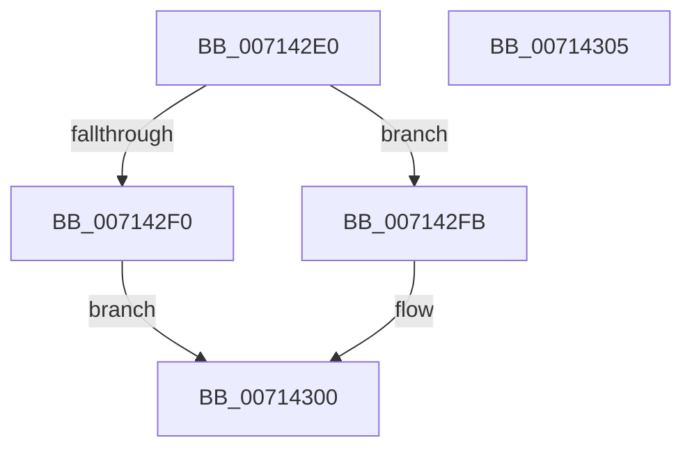

# FsRtlRegisterUncProviderEx2

- RVA: `0x007142E0`–`0x00714306` (길이 `38` bytes)
- VA: `0x00000001407142E0`
- 실행 섹션: `PAGE`
- PDB 이름 있음: `예`; PDB Function 태그: `아니요`
- unwind 정보 RVA: `0x0005C788`
- 디코드: `11`개 명령, `38/38` bytes 표시
- 미해석 바이트: `0` (있으면 어셈블리에 `.byte`로 보존)

> 이 문서는 커널 이미지의 기계어와 PDB 기호를 분석해 생성했습니다. 4번과 5번은 함수 원형과 자료형을 바이너리 사용 방식에서 추정한 C 해석이며 원본 소스 복구 결과는 아닙니다.

## 1. Dependencies

- 직접 호출 지점: **1**; 고유 호출 대상: **1**
- 직접 호출자로 확인된 함수: **0**
- RIP 상대 이미지 참조: **0**

### Outgoing calls
- `0x007142FB` → [FsRtlpRegisterUncProvider](FsRtlpRegisterUncProvider_function_007144D0.md) (function, `0x007144D0`)

### Direct callers
- 이 함수 시작 RVA로 연결되는 직접 call은 확인되지 않았습니다. 간접 호출은 완전히 역산할 수 없습니다.

### Static image references
- 디코드된 RIP-relative 메모리 참조가 없습니다.

## 2. Other-region calls and transfers

- 다른 실행 섹션으로 향하는 call: **0**
- 별도 외부 분기/꼬리 이동을 확인하지 못했습니다.

## 3. Assembly (complete function range)

```asm
007142E0  48 83 EC 28                     sub rsp, 0x28
007142E4  B8 00 02 00 00                  mov eax, 0x200
007142E9  66 41 39 40 02                  cmp word ptr [r8 + 2], ax
007142EE  73 0B                           jae 0x1407142fb
007142F0  49 83 09 FF                     or qword ptr [r9], 0xffffffffffffffff
007142F4  B8 0D 00 00 C0                  mov eax, 0xc000000d
007142F9  EB 05                           jmp 0x140714300
007142FB  E8 D0 01 00 00                  call 0x1407144d0
00714300  48 83 C4 28                     add rsp, 0x28
00714304  C3                              ret
00714305  CC                              int3
```

## 4. C-style interpretation (structured pseudocode)

```c
__int64 __fastcall FsRtlRegisterUncProviderEx2(__int64 a1, __int64 a2, __int64 a3, __int64 a4)
{
    __int64 result;
    __int64 v_rsp;

    v_rsp = (v_rsp) - (40);
    if ((*(unsigned __int16 *)(a3 + 2)) >= 512) goto loc_007142FB;
    goto loc_00714300;
loc_007142FB:
    result = FsRtlpRegisterUncProvider(a1, a2, a3, a4);
loc_00714300:
    v_rsp = (v_rsp) + (40);
    return result;
}
```

## 5. (Beta) C Style

```c
int64_t FsRtlRegisterUncProviderEx2(int64_t Arg1, int64_t Arg2, void *Arg3, void *Arg4)
{
    uint8_t *arg3 = (uint8_t *)Arg3;
    uint8_t *arg4 = (uint8_t *)Arg4;

    int64_t result;
    int64_t local_rsp;

    local_rsp = (local_rsp) - (40);
    if ((*(uint16_t *)(arg3 + 0x2)) >= 512) goto loc_007142FB;
    goto loc_00714300;
loc_007142FB:
    result = FsRtlpRegisterUncProvider(Arg1, Arg2, Arg3, Arg4);
loc_00714300:
    local_rsp = (local_rsp) + (40);
    return result;
}
```

### 관측된 메모리 오프셋

구조체 형식이 확인되지 않은 접근은 인자 기준의 오프셋으로만 기록했습니다.

| 기준 인자 | 오프셋 표현 | 폭 (bit) | 접근 |
|---|---:|---:|---|
| `Arg3` | `+ 0x2` | `16` | `R` |
| `Arg4` | `+ 0x0` | `64` | `R/W` |

## 6. Execution-region graph

[열기: 2D/3D 그래프와 함수 탐색 컨트롤 패널](../../../control-panel.html?section=page&rva=0x007142E0&view=graph)

- 2D 그래프는 위에서 아래로 흐르고, 3D 그래프는 빈 공간을 드래그해 회전합니다. Shift+드래그는 이동, 휠은 확대·축소, 함수 노드 선택은 대상 보고서 이동입니다.

### Static fallback


