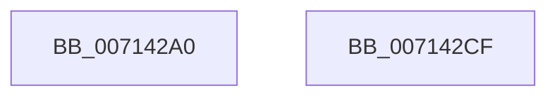

# FsRtlRegisterUncProviderEx

- RVA: `0x007142A0`–`0x007142D0` (길이 `48` bytes)
- VA: `0x00000001407142A0`
- 실행 섹션: `PAGE`
- PDB 이름 있음: `예`; PDB Function 태그: `아니요`
- unwind 정보 RVA: `0x0005D2F4`
- 디코드: `13`개 명령, `48/48` bytes 표시
- 미해석 바이트: `0` (있으면 어셈블리에 `.byte`로 보존)

> 이 문서는 커널 이미지의 기계어와 PDB 기호를 분석해 생성했습니다. 4번과 5번은 함수 원형과 자료형을 바이너리 사용 방식에서 추정한 C 해석이며 원본 소스 복구 결과는 아닙니다.

## 1. Dependencies

- 직접 호출 지점: **1**; 고유 호출 대상: **1**
- 직접 호출자로 확인된 함수: **0**
- RIP 상대 이미지 참조: **0**

### Outgoing calls
- `0x007142C5` → [FsRtlpRegisterUncProvider](FsRtlpRegisterUncProvider_function_007144D0.md) (function, `0x007144D0`)

### Direct callers
- 이 함수 시작 RVA로 연결되는 직접 call은 확인되지 않았습니다. 간접 호출은 완전히 역산할 수 없습니다.

### Static image references
- 디코드된 RIP-relative 메모리 참조가 없습니다.

## 2. Other-region calls and transfers

- 다른 실행 섹션으로 향하는 call: **0**
- 별도 외부 분기/꼬리 이동을 확인하지 못했습니다.

## 3. Assembly (complete function range)

```asm
007142A0  48 83 EC 38                     sub rsp, 0x38
007142A4  49 8B C0                        mov rax, r8
007142A7  44 89 4C 24 24                  mov dword ptr [rsp + 0x24], r9d
007142AC  4C 8B D2                        mov r10, rdx
007142AF  C7 44 24 20 08 00 01 01         mov dword ptr [rsp + 0x20], 0x1010008
007142B7  4C 8B C9                        mov r9, rcx
007142BA  4C 8D 44 24 20                  lea r8, [rsp + 0x20]
007142BF  48 8B D0                        mov rdx, rax
007142C2  49 8B CA                        mov rcx, r10
007142C5  E8 06 02 00 00                  call 0x1407144d0
007142CA  48 83 C4 38                     add rsp, 0x38
007142CE  C3                              ret
007142CF  CC                              int3
```

## 4. C-style interpretation (structured pseudocode)

```c
__int64 __fastcall FsRtlRegisterUncProviderEx(__int64 a1, __int64 a2, __int64 a3, int a4)
{
    __int64 result;
    __int64 v_rsp;
    unsigned int v_stack_m14;
    unsigned int v_stack_m18;

    v_rsp = (v_rsp) - (56);
    v_stack_m14 = a4;
    v_stack_m18 = 0x1010008ULL;
    result = FsRtlpRegisterUncProvider(a2, a3, v_stack_m18, a1);
    v_rsp = (v_rsp) + (56);
    return result;
}
```

## 5. (Beta) C Style

```c
int64_t FsRtlRegisterUncProviderEx(int64_t Arg1, int64_t Arg2, int64_t Arg3, int32_t Arg4)
{
    int64_t result;
    int64_t local_rsp;
    uint32_t v_stack_m14;
    uint32_t v_stack_m18;

    local_rsp = (local_rsp) - (56);
    v_stack_m14 = Arg4;
    v_stack_m18 = 0x1010008ULL;
    result = FsRtlpRegisterUncProvider(Arg2, Arg3, v_stack_m18, Arg1);
    local_rsp = (local_rsp) + (56);
    return result;
}
```

## 6. Execution-region graph

[열기: 2D/3D 그래프와 함수 탐색 컨트롤 패널](../../../control-panel.html?section=page&rva=0x007142A0&view=graph)

- 2D 그래프는 위에서 아래로 흐르고, 3D 그래프는 빈 공간을 드래그해 회전합니다. Shift+드래그는 이동, 휠은 확대·축소, 함수 노드 선택은 대상 보고서 이동입니다.

### Static fallback


