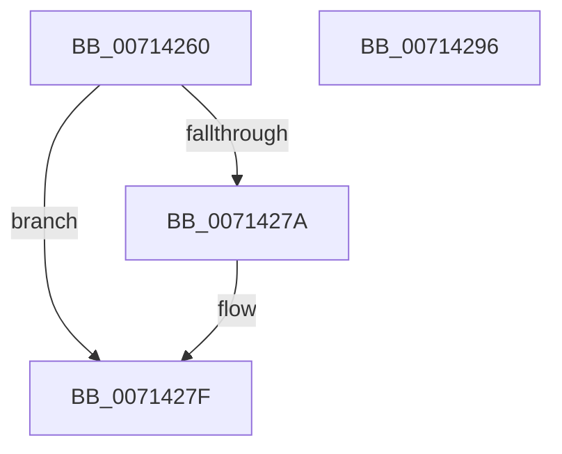

# FsRtlRegisterUncProvider

- RVA: `0x00714260`–`0x00714297` (길이 `55` bytes)
- VA: `0x0000000140714260`
- 실행 섹션: `PAGE`
- PDB 이름 있음: `예`; PDB Function 태그: `아니요`
- unwind 정보 RVA: `0x0005C788`
- 디코드: `15`개 명령, `55/55` bytes 표시
- 미해석 바이트: `0` (있으면 어셈블리에 `.byte`로 보존)

> 이 문서는 커널 이미지의 기계어와 PDB 기호를 분석해 생성했습니다. 4번과 5번은 함수 원형과 자료형을 바이너리 사용 방식에서 추정한 C 해석이며 원본 소스 복구 결과는 아닙니다.

## 1. Dependencies

- 직접 호출 지점: **1**; 고유 호출 대상: **1**
- 직접 호출자로 확인된 함수: **0**
- RIP 상대 이미지 참조: **0**

### Outgoing calls
- `0x0071428C` → [FsRtlpRegisterUncProvider](FsRtlpRegisterUncProvider_function_007144D0.md) (function, `0x007144D0`)

### Direct callers
- 이 함수 시작 RVA로 연결되는 직접 call은 확인되지 않았습니다. 간접 호출은 완전히 역산할 수 없습니다.

### Static image references
- 디코드된 RIP-relative 메모리 참조가 없습니다.

## 2. Other-region calls and transfers

- 다른 실행 섹션으로 향하는 call: **0**
- 별도 외부 분기/꼬리 이동을 확인하지 못했습니다.

## 3. Assembly (complete function range)

```asm
00714260  48 83 EC 28                     sub rsp, 0x28
00714264  48 83 64 24 48 00               and qword ptr [rsp + 0x48], 0
0071426A  48 8B C2                        mov rax, rdx
0071426D  C7 44 24 48 08 00 00 01         mov dword ptr [rsp + 0x48], 0x1000008
00714275  45 84 C0                        test r8b, r8b
00714278  74 05                           je 0x14071427f
0071427A  83 4C 24 4C 01                  or dword ptr [rsp + 0x4c], 1
0071427F  4C 8B C9                        mov r9, rcx
00714282  4C 8D 44 24 48                  lea r8, [rsp + 0x48]
00714287  48 8B C8                        mov rcx, rax
0071428A  33 D2                           xor edx, edx
0071428C  E8 3F 02 00 00                  call 0x1407144d0
00714291  48 83 C4 28                     add rsp, 0x28
00714295  C3                              ret
00714296  CC                              int3
```

## 4. C-style interpretation (structured pseudocode)

```c
__int64 __fastcall FsRtlRegisterUncProvider(__int64 a1, __int64 a2, unsigned __int8 a3)
{
    __int64 result;
    __int64 v_rsp;
    unsigned __int64 v_stack_p20;
    unsigned int v_stack_p24;

    v_rsp = (v_rsp) - (40);
    v_stack_p20 = 0x1000008ULL;
    if (a3 != 0) {
    }
    a2 = 0;
    result = FsRtlpRegisterUncProvider(a2, a2, v_stack_p20, a1);
    v_rsp = (v_rsp) + (40);
    return result;
}
```

## 5. (Beta) C Style

```c
int64_t FsRtlRegisterUncProvider(int64_t Arg1, int64_t Arg2, uint8_t Arg3)
{
    int64_t result;
    int64_t local_rsp;
    uint64_t v_stack_p20;
    uint32_t v_stack_p24;

    local_rsp = (local_rsp) - (40);
    v_stack_p20 = 0x1000008ULL;
    if (Arg3 != 0) {
    }
    Arg2 = 0;
    result = FsRtlpRegisterUncProvider(Arg2, Arg2, v_stack_p20, Arg1);
    local_rsp = (local_rsp) + (40);
    return result;
}
```

## 6. Execution-region graph

[열기: 2D/3D 그래프와 함수 탐색 컨트롤 패널](../../../control-panel.html?section=page&rva=0x00714260&view=graph)

- 2D 그래프는 위에서 아래로 흐르고, 3D 그래프는 빈 공간을 드래그해 회전합니다. Shift+드래그는 이동, 휠은 확대·축소, 함수 노드 선택은 대상 보고서 이동입니다.

### Static fallback


