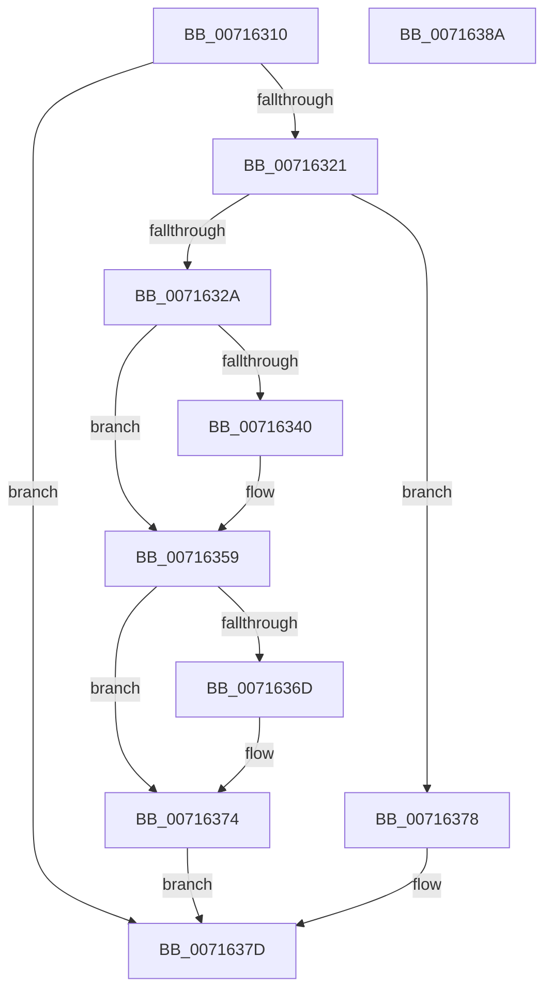

# FsRtlSetDriverBacking

- RVA: `0x00716310`–`0x0071638B` (길이 `123` bytes)
- VA: `0x0000000140716310`
- 실행 섹션: `PAGE`
- PDB 이름 있음: `예`; PDB Function 태그: `아니요`
- unwind 정보 RVA: `0x0006E5F8`
- 디코드: `39`개 명령, `123/123` bytes 표시
- 미해석 바이트: `0` (있으면 어셈블리에 `.byte`로 보존)

> 이 문서는 커널 이미지의 기계어와 PDB 기호를 분석해 생성했습니다. 4번과 5번은 함수 원형과 자료형을 바이너리 사용 방식에서 추정한 C 해석이며 원본 소스 복구 결과는 아닙니다.

## 1. Dependencies

- 직접 호출 지점: **4**; 고유 호출 대상: **4**
- 직접 호출자로 확인된 함수: **2**
- RIP 상대 이미지 참조: **0**

### Outgoing calls
- `0x00716336` → [MiLockLoadedDataTableEntryIfNecessary](../../text/2A/MiLockLoadedDataTableEntryIfNecessary_function_002A38B4.md) (function, `0x002A38B4`)
- `0x00716353` → [KeBugCheckEx](../../text/4F/KeBugCheckEx_function_004FD660.md) (function, `0x004FD660`)
- `0x00716360` → [MiBackSystemImageWithPagefile](../7F/MiBackSystemImageWithPagefile_function_007F86E8.md) (function, `0x007F86E8`)
- `0x0071636F` → [MmReleaseLoadLockShared](../../text/2A/MmReleaseLoadLockShared_function_002A3FB0.md) (function, `0x002A3FB0`)

### Direct callers
- [IoRegisterFileSystem](IoRegisterFileSystem_function_0071D6C0.md) at `0x0071D6DB`
- [IoRegisterFsRegistrationChangeMountAware](IoRegisterFsRegistrationChangeMountAware_function_0071D890.md) at `0x0071D904`

### Static image references
- 디코드된 RIP-relative 메모리 참조가 없습니다.

## 2. Other-region calls and transfers

- 다른 실행 섹션으로 향하는 call: **3**
  - `0x00716336` → [MiLockLoadedDataTableEntryIfNecessary](../../text/2A/MiLockLoadedDataTableEntryIfNecessary_function_002A38B4.md) (`PAGE` → `.text`)
  - `0x00716353` → [KeBugCheckEx](../../text/4F/KeBugCheckEx_function_004FD660.md) (`PAGE` → `.text`)
  - `0x0071636F` → [MmReleaseLoadLockShared](../../text/2A/MmReleaseLoadLockShared_function_002A3FB0.md) (`PAGE` → `.text`)
- 별도 외부 분기/꼬리 이동을 확인하지 못했습니다.

## 3. Assembly (complete function range)

```asm
00716310  48 89 5C 24 08                  mov qword ptr [rsp + 8], rbx
00716315  57                              push rdi
00716316  48 83 EC 30                     sub rsp, 0x30
0071631A  33 DB                           xor ebx, ebx
0071631C  F6 C2 01                        test dl, 1
0071631F  74 5C                           je 0x14071637d
00716321  48 8B 79 58                     mov rdi, qword ptr [rcx + 0x58]
00716325  48 85 FF                        test rdi, rdi
00716328  74 4E                           je 0x140716378
0071632A  48 8D 54 24 48                  lea rdx, [rsp + 0x48]
0071632F  89 5C 24 48                     mov dword ptr [rsp + 0x48], ebx
00716333  48 8B CF                        mov rcx, rdi
00716336  E8 79 D5 B8 FF                  call 0x1402a38b4
0071633B  48 85 C0                        test rax, rax
0071633E  75 19                           jne 0x140716359
00716340  45 33 C9                        xor r9d, r9d
00716343  48 89 5C 24 20                  mov qword ptr [rsp + 0x20], rbx
00716348  4C 8B C7                        mov r8, rdi
0071634B  8D 4B 1A                        lea ecx, [rbx + 0x1a]
0071634E  BA 1F 10 00 00                  mov edx, 0x101f
00716353  E8 08 73 DE FF                  call 0x1404fd660
00716358  CC                              int3
00716359  8B 54 24 48                     mov edx, dword ptr [rsp + 0x48]
0071635D  48 8B C8                        mov rcx, rax
00716360  E8 83 23 0E 00                  call 0x1407f86e8
00716365  8B F8                           mov edi, eax
00716367  39 5C 24 48                     cmp dword ptr [rsp + 0x48], ebx
0071636B  74 07                           je 0x140716374
0071636D  33 C9                           xor ecx, ecx
0071636F  E8 3C DC B8 FF                  call 0x1402a3fb0
00716374  8B DF                           mov ebx, edi
00716376  EB 05                           jmp 0x14071637d
00716378  BB 63 02 00 C0                  mov ebx, 0xc0000263
0071637D  8B C3                           mov eax, ebx
0071637F  48 8B 5C 24 40                  mov rbx, qword ptr [rsp + 0x40]
00716384  48 83 C4 30                     add rsp, 0x30
00716388  5F                              pop rdi
00716389  C3                              ret
0071638A  CC                              int3
```

## 4. C-style interpretation (structured pseudocode)

```c
__int64 __fastcall FsRtlSetDriverBacking(__int64 a1, unsigned __int8 a2, __int64 a3, int a4)
{
    __int64 result;
    __int64 v_rbx;
    __int64 v_rsp;
    unsigned __int64 v_stack_m18;
    unsigned __int64 v_stack_p10;
    unsigned __int64 v_stack_p8;

    v_stack_p8 = v_rbx;
    v_rsp = (v_rsp) - (48);
    v_rbx = 0;
    if (((a2) & (1)) == 0) goto loc_0071637D;
    if (*(unsigned __int64 *)(a1 + 88) == 0) goto loc_00716378;
    v_stack_p10 = 0;
    result = MiLockLoadedDataTableEntryIfNecessary(*(unsigned __int64 *)(a1 + 88), v_stack_p10, a3, a4);
    if (result == 0) {
        a4 = 0;
        v_stack_m18 = 0;
        a3 = *(unsigned __int64 *)(a1 + 88);
        a1 = v_rbx + 26;
        a2 = 0x101FULL;
        result = KeBugCheckEx(a1, a2, a3, a4);
    }
    result = MiBackSystemImageWithPagefile(result, (unsigned int)(v_stack_p10), a3, a4);
    if (v_stack_p10 != 0) {
        a1 = 0;
        result = MmReleaseLoadLockShared(a1, (unsigned int)(v_stack_p10), a3, a4);
    }
    goto loc_0071637D;
loc_00716378:
loc_0071637D:
    v_rsp = (v_rsp) + (48);
    return (unsigned int)((unsigned int)((unsigned int)(0xC0000263ULL)));
}
```

## 5. (Beta) C Style

```c
int64_t FsRtlSetDriverBacking(void *Arg1, uint8_t Arg2, int64_t Arg3, int32_t Arg4)
{
    uint8_t *arg1 = (uint8_t *)Arg1;

    int64_t result;
    int64_t local_rbx;
    int64_t local_rsp;
    uint64_t v_stack_m18;
    uint64_t v_stack_p10;
    uint64_t v_stack_p8;

    v_stack_p8 = local_rbx;
    local_rsp = (local_rsp) - (48);
    local_rbx = 0;
    if (((Arg2) & (1)) == 0) goto loc_0071637D;
    if (*(uint64_t *)(arg1 + 0x58) == 0) goto loc_00716378;
    v_stack_p10 = 0;
    result = MiLockLoadedDataTableEntryIfNecessary(*(uint64_t *)(arg1 + 0x58), v_stack_p10, Arg3, Arg4);
    if (result == 0) {
        Arg4 = 0;
        v_stack_m18 = 0;
        Arg3 = *(uint64_t *)(arg1 + 0x58);
        Arg1 = local_rbx + 26;
        Arg2 = 0x101FULL;
        result = KeBugCheckEx(Arg1, Arg2, Arg3, Arg4);
    }
    result = MiBackSystemImageWithPagefile(result, (uint32_t)(v_stack_p10), Arg3, Arg4);
    if (v_stack_p10 != 0) {
        Arg1 = 0;
        result = MmReleaseLoadLockShared(Arg1, (uint32_t)(v_stack_p10), Arg3, Arg4);
    }
    goto loc_0071637D;
loc_00716378:
loc_0071637D:
    local_rsp = (local_rsp) + (48);
    return (uint32_t)((uint32_t)((uint32_t)(0xC0000263ULL)));
}
```

### 관측된 메모리 오프셋

구조체 형식이 확인되지 않은 접근은 인자 기준의 오프셋으로만 기록했습니다.

| 기준 인자 | 오프셋 표현 | 폭 (bit) | 접근 |
|---|---:|---:|---|
| `Arg1` | `+ 0x58` | `64` | `R` |

## 6. Execution-region graph

[열기: 2D/3D 그래프와 함수 탐색 컨트롤 패널](../../../control-panel.html?section=page&rva=0x00716310&view=graph)

- 2D 그래프는 위에서 아래로 흐르고, 3D 그래프는 빈 공간을 드래그해 회전합니다. Shift+드래그는 이동, 휠은 확대·축소, 함수 노드 선택은 대상 보고서 이동입니다.

### Static fallback


