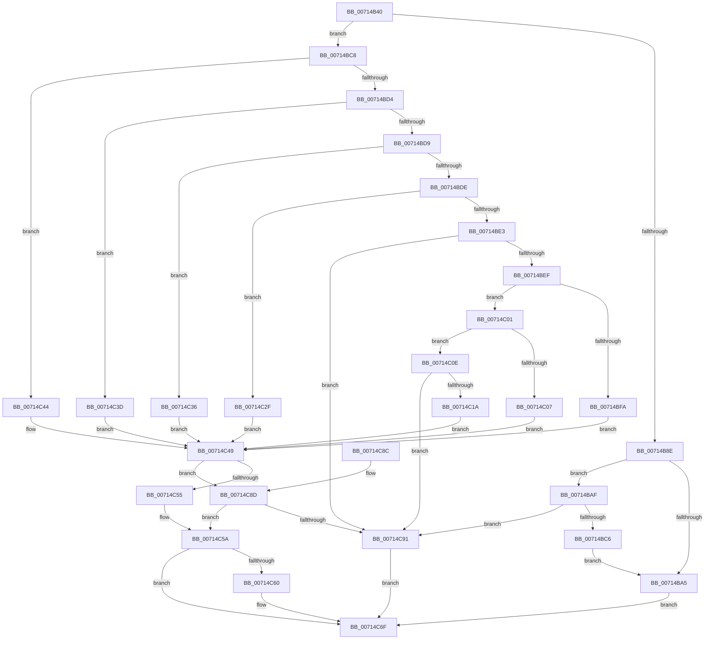

# FsRtlUpperOplockFsctrl

- RVA: `0x00714B40`–`0x00714CAD` (길이 `365` bytes)
- VA: `0x0000000140714B40`
- 실행 섹션: `PAGE`
- PDB 이름 있음: `예`; PDB Function 태그: `아니요`
- unwind 정보 RVA: `0x000C602C`
- 디코드: `108`개 명령, `365/365` bytes 표시
- 미해석 바이트: `0` (있으면 어셈블리에 `.byte`로 보존)

> 이 문서는 커널 이미지의 기계어와 PDB 기호를 분석해 생성했습니다. 4번과 5번은 함수 원형과 자료형을 바이너리 사용 방식에서 추정한 C 해석이며 원본 소스 복구 결과는 아닙니다.

## 1. Dependencies

- 직접 호출 지점: **3**; 고유 호출 대상: **3**
- 직접 호출자로 확인된 함수: **0**
- RIP 상대 이미지 참조: **0**

### Outgoing calls
- `0x00714C4C` → [FsRtlpOplockUpperLowerCompatible](../A2/FsRtlpOplockUpperLowerCompatible_function_00A21E04.md) (function, `0x00A21E04`)
- `0x00714C6A` → [IofCompleteRequest](../../text/29/IofCompleteRequest_function_0029B5C0.md) (function, `0x0029B5C0`)
- `0x00714CA4` → [FsRtlpOplockFsctrlInternal](../9F/FsRtlpOplockFsctrlInternal_function_009F1640.md) (function, `0x009F1640`)

### Direct callers
- 이 함수 시작 RVA로 연결되는 직접 call은 확인되지 않았습니다. 간접 호출은 완전히 역산할 수 없습니다.

### Static image references
- 디코드된 RIP-relative 메모리 참조가 없습니다.

## 2. Other-region calls and transfers

- 다른 실행 섹션으로 향하는 call: **1**
  - `0x00714C6A` → [IofCompleteRequest](../../text/29/IofCompleteRequest_function_0029B5C0.md) (`PAGE` → `.text`)
- 별도 외부 분기/꼬리 이동을 확인하지 못했습니다.

## 3. Assembly (complete function range)

```asm
00714B40  48 8B C4                        mov rax, rsp
00714B43  48 89 58 08                     mov qword ptr [rax + 8], rbx
00714B47  48 89 68 10                     mov qword ptr [rax + 0x10], rbp
00714B4B  48 89 70 18                     mov qword ptr [rax + 0x18], rsi
00714B4F  48 89 78 20                     mov qword ptr [rax + 0x20], rdi
00714B53  41 56                           push r14
00714B55  48 83 EC 30                     sub rsp, 0x30
00714B59  45 8B D1                        mov r10d, r9d
00714B5C  33 DB                           xor ebx, ebx
00714B5E  41 83 E1 06                     and r9d, 6
00714B62  41 8B F0                        mov esi, r8d
00714B65  4C 8B 82 B8 00 00 00            mov r8, qword ptr [rdx + 0xb8]
00714B6C  48 8B E9                        mov rbp, rcx
00714B6F  41 C1 E1 0C                     shl r9d, 0xc
00714B73  33 C9                           xor ecx, ecx
00714B75  44 8D 73 01                     lea r14d, [rbx + 1]
00714B79  4C 8B DA                        mov r11, rdx
00714B7C  45 23 D6                        and r10d, r14d
00714B7F  41 8A 38                        mov dil, byte ptr [r8]
00714B82  41 C1 E2 0C                     shl r10d, 0xc
00714B86  45 0B D1                        or r10d, r9d
00714B89  40 84 FF                        test dil, dil
00714B8C  75 3A                           jne 0x140714bc8
00714B8E  41 8B 50 10                     mov edx, dword ptr [r8 + 0x10]
00714B92  0F BA E2 14                     bt edx, 0x14
00714B96  0F 92 C1                        setb cl
00714B99  41 0F BA E2 0E                  bt r10d, 0xe
00714B9E  0F 93 C0                        setae al
00714BA1  84 C8                           test al, cl
00714BA3  74 0A                           je 0x140714baf
00714BA5  BB E2 00 00 C0                  mov ebx, 0xc00000e2
00714BAA  E9 C0 00 00 00                  jmp 0x140714c6f
00714BAF  0F BA E2 10                     bt edx, 0x10
00714BB3  0F 92 C1                        setb cl
00714BB6  41 0F BA E2 0D                  bt r10d, 0xd
00714BBB  0F 93 C0                        setae al
00714BBE  84 C8                           test al, cl
00714BC0  0F 84 CB 00 00 00               je 0x140714c91
00714BC6  EB DD                           jmp 0x140714ba5
00714BC8  41 8B 50 18                     mov edx, dword ptr [r8 + 0x18]
00714BCC  81 EA 00 00 09 00               sub edx, 0x90000
00714BD2  74 70                           je 0x140714c44
00714BD4  83 EA 04                        sub edx, 4
00714BD7  74 64                           je 0x140714c3d
00714BD9  83 EA 04                        sub edx, 4
00714BDC  74 58                           je 0x140714c36
00714BDE  83 EA 54                        sub edx, 0x54
00714BE1  74 4C                           je 0x140714c2f
00714BE3  81 FA E4 01 00 00               cmp edx, 0x1e4
00714BE9  0F 85 A2 00 00 00               jne 0x140714c91
00714BEF  41 83 78 10 0C                  cmp dword ptr [r8 + 0x10], 0xc
00714BF4  49 8B 53 18                     mov rdx, qword ptr [r11 + 0x18]
00714BF8  73 07                           jae 0x140714c01
00714BFA  BB 23 00 00 C0                  mov ebx, 0xc0000023
00714BFF  EB 48                           jmp 0x140714c49
00714C01  66 44 39 32                     cmp word ptr [rdx], r14w
00714C05  76 07                           jbe 0x140714c0e
00714C07  BB 0D 00 00 C0                  mov ebx, 0xc000000d
00714C0C  EB 3B                           jmp 0x140714c49
00714C0E  8B 42 08                        mov eax, dword ptr [rdx + 8]
00714C11  B9 02 00 00 00                  mov ecx, 2
00714C16  84 C1                           test cl, al
00714C18  75 77                           jne 0x140714c91
00714C1A  8B 42 04                        mov eax, dword ptr [rdx + 4]
00714C1D  8B C8                           mov ecx, eax
00714C1F  41 23 CE                        and ecx, r14d
00714C22  83 E0 06                        and eax, 6
00714C25  C1 E1 0C                        shl ecx, 0xc
00714C28  C1 E0 0C                        shl eax, 0xc
00714C2B  0B C8                           or ecx, eax
00714C2D  EB 1A                           jmp 0x140714c49
00714C2F  B9 08 00 00 00                  mov ecx, 8
00714C34  EB 13                           jmp 0x140714c49
00714C36  B9 04 00 00 00                  mov ecx, 4
00714C3B  EB 0C                           jmp 0x140714c49
00714C3D  B9 10 00 00 00                  mov ecx, 0x10
00714C42  EB 05                           jmp 0x140714c49
00714C44  B9 02 00 00 00                  mov ecx, 2
00714C49  41 8B D2                        mov edx, r10d
00714C4C  E8 B3 D1 30 00                  call 0x140a21e04
00714C51  84 C0                           test al, al
00714C53  75 38                           jne 0x140714c8d
00714C55  BB E2 00 00 C0                  mov ebx, 0xc00000e2
00714C5A  40 80 FF 0D                     cmp dil, 0xd
00714C5E  75 0F                           jne 0x140714c6f
00714C60  41 8A D6                        mov dl, r14b
00714C63  41 89 5B 30                     mov dword ptr [r11 + 0x30], ebx
00714C67  49 8B CB                        mov rcx, r11
00714C6A  E8 51 69 B8 FF                  call 0x14029b5c0
00714C6F  48 8B 6C 24 48                  mov rbp, qword ptr [rsp + 0x48]
00714C74  8B C3                           mov eax, ebx
00714C76  48 8B 5C 24 40                  mov rbx, qword ptr [rsp + 0x40]
00714C7B  48 8B 74 24 50                  mov rsi, qword ptr [rsp + 0x50]
00714C80  48 8B 7C 24 58                  mov rdi, qword ptr [rsp + 0x58]
00714C85  48 83 C4 30                     add rsp, 0x30
00714C89  41 5E                           pop r14
00714C8B  C3                              ret
00714C8C  CC                              int3
00714C8D  85 DB                           test ebx, ebx
00714C8F  75 C9                           jne 0x140714c5a
00714C91  44 8B 4C 24 60                  mov r9d, dword ptr [rsp + 0x60]
00714C96  44 8B C6                        mov r8d, esi
00714C99  49 8B D3                        mov rdx, r11
00714C9C  44 89 54 24 20                  mov dword ptr [rsp + 0x20], r10d
00714CA1  48 8B CD                        mov rcx, rbp
00714CA4  E8 97 C9 2D 00                  call 0x1409f1640
00714CA9  8B D8                           mov ebx, eax
00714CAB  EB C2                           jmp 0x140714c6f
```

## 4. C-style interpretation (structured pseudocode)

```c
__int64 __fastcall FsRtlUpperOplockFsctrl(__int64 a1, __int64 a2, int a3, int a4, unsigned int a5)
{
    __int64 result;
    __int64 v_r10;
    __int64 v_rbx;
    __int64 v_rsp;
    unsigned __int64 v_stack_p10;
    unsigned __int64 v_stack_p18;
    unsigned __int64 v_stack_p20;
    unsigned __int64 v_stack_p8;

    *(unsigned __int64 *)(v_rsp + 8) = v_rbx;
    *(unsigned __int64 *)(v_rsp + 16) = v_rbp;
    *(unsigned __int64 *)(v_rsp + 24) = v_rsi;
    *(unsigned __int64 *)(v_rsp + 32) = v_rdi;
    v_rsp = (v_rsp) - (48);
    v_rbx = 0;
    a4 = (unsigned int)((a4) & (6));
    a4 = (unsigned int)((a4) << (12));
    a1 = 0;
    v_r10 = (unsigned int)(((unsigned int)(a4)) & ((unsigned int)(v_rbx + 1)));
    v_r10 = (unsigned int)((v_r10) << (12));
    v_r10 = (unsigned int)((v_r10) | (a4));
    if ((unsigned __int8)(*(unsigned __int8 *)(*(unsigned __int64 *)(a2 + 184))) != 0) goto loc_00714BC8;
    a1 = (condition_is_below) ? 1 : 0;
    result = (condition_is_above_or_equal) ? 1 : 0;
    if ((((unsigned __int8)(result)) & ((unsigned __int8)(a1))) == 0) goto loc_00714BAF;
loc_00714BA5:
    goto loc_00714C6F;
loc_00714BAF:
    a1 = (condition_is_below) ? 1 : 0;
    result = (condition_is_above_or_equal) ? 1 : 0;
    if ((((unsigned __int8)(result)) & ((unsigned __int8)(a1))) == 0) goto loc_00714C91;
    goto loc_00714BA5;
loc_00714BC8:
    a2 = (unsigned int)(((unsigned int)(*(unsigned int *)(*(unsigned __int64 *)(a2 + 184) + 24))) - (0x90000ULL));
    if (condition_is_equal) goto loc_00714C44;
    a2 = (unsigned int)((a2) - (4));
    if (condition_is_equal) goto loc_00714C3D;
    a2 = (unsigned int)((a2) - (4));
    if (condition_is_equal) goto loc_00714C36;
    a2 = (unsigned int)((a2) - (84));
    if (condition_is_equal) goto loc_00714C2F;
    if (((unsigned int)(a2)) != 484) goto loc_00714C91;
    if ((*(unsigned int *)(*(unsigned __int64 *)(a2 + 184) + 16)) >= 12) goto loc_00714C01;
    goto loc_00714C49;
loc_00714C01:
    if ((*(unsigned __int16 *)(*(unsigned __int64 *)(a2 + 24))) <= ((unsigned __int16)(v_rbx + 1))) goto loc_00714C0E;
    goto loc_00714C49;
loc_00714C0E:
    if (((2) & ((unsigned __int8)((unsigned int)(*(unsigned int *)(*(unsigned __int64 *)(a2 + 24) + 8))))) != 0) goto loc_00714C91;
    a1 = (unsigned int)(((unsigned int)((unsigned int)((unsigned int)(*(unsigned int *)(*(unsigned __int64 *)(a2 + 24) + 4))))) & ((unsigned int)(v_rbx + 1)));
    result = (unsigned int)(((unsigned int)(*(unsigned int *)(*(unsigned __int64 *)(a2 + 24) + 4))) & (6));
    a1 = (unsigned int)((a1) << (12));
    result = (unsigned int)((result) << (12));
    a1 = (unsigned int)((a1) | ((unsigned int)(result)));
    goto loc_00714C49;
loc_00714C2F:
    goto loc_00714C49;
loc_00714C36:
    goto loc_00714C49;
loc_00714C3D:
    goto loc_00714C49;
loc_00714C44:
loc_00714C49:
    result = FsRtlpOplockUpperLowerCompatible(2, (unsigned int)((unsigned int)(v_r10)), *(unsigned __int64 *)(a2 + 184), a4);
    if ((unsigned __int8)(result) != 0) goto loc_00714C8D;
loc_00714C5A:
    if (((unsigned __int8)(*(unsigned __int8 *)(*(unsigned __int64 *)(a2 + 184)))) == 13) {
        a2 = (unsigned __int8)(v_rbx + 1);
        *(unsigned int *)(a2 + 48) = (unsigned int)((unsigned int)(0xC00000E2ULL));
        a1 = a2;
        result = IofCompleteRequest(a1, a2, *(unsigned __int64 *)(a2 + 184), a4);
    }
    v_rsp = (v_rsp) + (48);
    return (unsigned int)((unsigned int)((unsigned int)(0xC00000E2ULL)));
loc_00714C8D:
    if ((unsigned int)(v_stack_p8) != 0) goto loc_00714C5A;
loc_00714C91:
    v_stack_p20 = (unsigned int)(v_r10);
    result = FsRtlpOplockFsctrlInternal(v_stack_p10, a2, (unsigned int)((unsigned int)(v_stack_p18)), (unsigned int)(a5));
    goto loc_00714C6F;
}
```

## 5. (Beta) C Style

```c
int64_t FsRtlUpperOplockFsctrl(int64_t Arg1, void *Arg2, int32_t Arg3, int32_t Arg4, uint32_t Arg5)
{
    uint8_t *arg2 = (uint8_t *)Arg2;

    int64_t result;
    int64_t local_r10;
    int64_t local_rbx;
    int64_t local_rsp;
    uint64_t v_stack_p10;
    uint64_t v_stack_p18;
    uint64_t v_stack_p20;
    uint64_t v_stack_p8;

    *(uint64_t *)(local_rsp + 0x8) = local_rbx;
    *(uint64_t *)(local_rsp + 0x10) = local_rbp;
    *(uint64_t *)(local_rsp + 0x18) = local_rsi;
    *(uint64_t *)(local_rsp + 0x20) = local_rdi;
    local_rsp = (local_rsp) - (48);
    local_rbx = 0;
    Arg4 = (uint32_t)((Arg4) & (6));
    Arg4 = (uint32_t)((Arg4) << (12));
    Arg1 = 0;
    local_r10 = (uint32_t)(((uint32_t)(Arg4)) & ((uint32_t)(local_rbx + 1)));
    local_r10 = (uint32_t)((local_r10) << (12));
    local_r10 = (uint32_t)((local_r10) | (Arg4));
    if ((uint8_t)(*(uint8_t *)(*(uint64_t *)(arg2 + 0xB8))) != 0) goto loc_00714BC8;
    Arg1 = (condition_is_below) ? 1 : 0;
    result = (condition_is_above_or_equal) ? 1 : 0;
    if ((((uint8_t)(result)) & ((uint8_t)(Arg1))) == 0) goto loc_00714BAF;
loc_00714BA5:
    goto loc_00714C6F;
loc_00714BAF:
    Arg1 = (condition_is_below) ? 1 : 0;
    result = (condition_is_above_or_equal) ? 1 : 0;
    if ((((uint8_t)(result)) & ((uint8_t)(Arg1))) == 0) goto loc_00714C91;
    goto loc_00714BA5;
loc_00714BC8:
    Arg2 = (uint32_t)(((uint32_t)(*(uint32_t *)(*(uint64_t *)(arg2 + 0xB8) + 0x18))) - (0x90000ULL));
    if (condition_is_equal) goto loc_00714C44;
    Arg2 = (uint32_t)((Arg2) - (4));
    if (condition_is_equal) goto loc_00714C3D;
    Arg2 = (uint32_t)((Arg2) - (4));
    if (condition_is_equal) goto loc_00714C36;
    Arg2 = (uint32_t)((Arg2) - (84));
    if (condition_is_equal) goto loc_00714C2F;
    if (((uint32_t)(Arg2)) != 484) goto loc_00714C91;
    if ((*(uint32_t *)(*(uint64_t *)(arg2 + 0xB8) + 0x10)) >= 12) goto loc_00714C01;
    goto loc_00714C49;
loc_00714C01:
    if ((*(uint16_t *)(*(uint64_t *)(arg2 + 0x18))) <= ((uint16_t)(local_rbx + 1))) goto loc_00714C0E;
    goto loc_00714C49;
loc_00714C0E:
    if (((2) & ((uint8_t)((uint32_t)(*(uint32_t *)(*(uint64_t *)(arg2 + 0x18) + 0x8))))) != 0) goto loc_00714C91;
    Arg1 = (uint32_t)(((uint32_t)((uint32_t)((uint32_t)(*(uint32_t *)(*(uint64_t *)(arg2 + 0x18) + 0x4))))) & ((uint32_t)(local_rbx + 1)));
    result = (uint32_t)(((uint32_t)(*(uint32_t *)(*(uint64_t *)(arg2 + 0x18) + 0x4))) & (6));
    Arg1 = (uint32_t)((Arg1) << (12));
    result = (uint32_t)((result) << (12));
    Arg1 = (uint32_t)((Arg1) | ((uint32_t)(result)));
    goto loc_00714C49;
loc_00714C2F:
    goto loc_00714C49;
loc_00714C36:
    goto loc_00714C49;
loc_00714C3D:
    goto loc_00714C49;
loc_00714C44:
loc_00714C49:
    result = FsRtlpOplockUpperLowerCompatible(2, (uint32_t)((uint32_t)(local_r10)), *(uint64_t *)(arg2 + 0xB8), Arg4);
    if ((uint8_t)(result) != 0) goto loc_00714C8D;
loc_00714C5A:
    if (((uint8_t)(*(uint8_t *)(*(uint64_t *)(arg2 + 0xB8)))) == 13) {
        Arg2 = (uint8_t)(local_rbx + 1);
        *(uint32_t *)(arg2 + 0x30) = (uint32_t)((uint32_t)(0xC00000E2ULL));
        Arg1 = Arg2;
        result = IofCompleteRequest(Arg1, Arg2, *(uint64_t *)(arg2 + 0xB8), Arg4);
    }
    local_rsp = (local_rsp) + (48);
    return (uint32_t)((uint32_t)((uint32_t)(0xC00000E2ULL)));
loc_00714C8D:
    if ((uint32_t)(v_stack_p8) != 0) goto loc_00714C5A;
loc_00714C91:
    v_stack_p20 = (uint32_t)(local_r10);
    result = FsRtlpOplockFsctrlInternal(v_stack_p10, Arg2, (uint32_t)((uint32_t)(v_stack_p18)), (uint32_t)(Arg5));
    goto loc_00714C6F;
}
```

### 관측된 메모리 오프셋

구조체 형식이 확인되지 않은 접근은 인자 기준의 오프셋으로만 기록했습니다.

| 기준 인자 | 오프셋 표현 | 폭 (bit) | 접근 |
|---|---:|---:|---|
| `Arg2` | `+ 0x18` | `64` | `R` |
| `Arg2` | `+ 0xB8` | `64` | `R` |

## 6. Execution-region graph

[열기: 2D/3D 그래프와 함수 탐색 컨트롤 패널](../../../control-panel.html?section=page&rva=0x00714B40&view=graph)

- 2D 그래프는 위에서 아래로 흐르고, 3D 그래프는 빈 공간을 드래그해 회전합니다. Shift+드래그는 이동, 휠은 확대·축소, 함수 노드 선택은 대상 보고서 이동입니다.

### Static fallback


