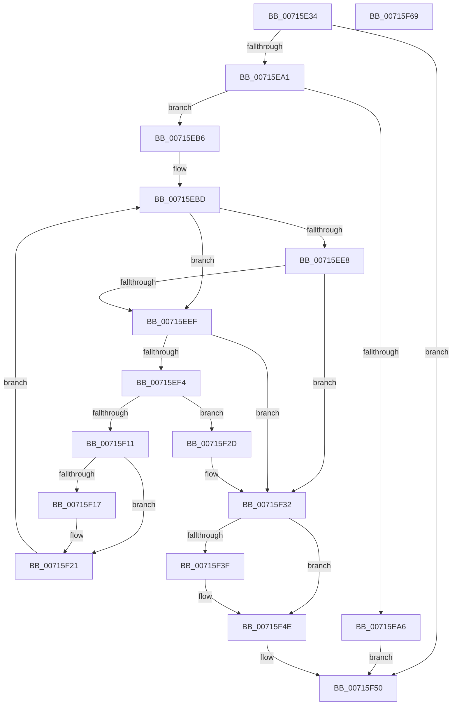

# FsRtlpDedupChangeQueryValueKey

- RVA: `0x00715E34`–`0x00715F6A` (길이 `310` bytes)
- VA: `0x0000000140715E34`
- 실행 섹션: `PAGE`
- PDB 이름 있음: `예`; PDB Function 태그: `아니요`
- unwind 정보 RVA: `0x000C57D0`
- 디코드: `89`개 명령, `310/310` bytes 표시
- 미해석 바이트: `0` (있으면 어셈블리에 `.byte`로 보존)

> 이 문서는 커널 이미지의 기계어와 PDB 기호를 분석해 생성했습니다. 4번과 5번은 함수 원형과 자료형을 바이너리 사용 방식에서 추정한 C 해석이며 원본 소스 복구 결과는 아닙니다.

## 1. Dependencies

- 직접 호출 지점: **6**; 고유 호출 대상: **5**
- 직접 호출자로 확인된 함수: **1**
- RIP 상대 이미지 참조: **0**

### Outgoing calls
- `0x00715E94` → [ZwOpenKey](../../text/6A/ZwOpenKey_function_006AD310.md) (function, `0x006AD310`)
- `0x00715EAA` → [ZwClose](../../text/6A/ZwClose_function_006AD2B0.md) (function, `0x006AD2B0`)
- `0x00715EDA` → [ZwQueryValueKey](../../text/6A/ZwQueryValueKey_function_006AD3B0.md) (function, `0x006AD3B0`)
- `0x00715F04` → [ExAllocatePool2](../../poolcode/B8/ExAllocatePool2_function_00B820F0.md) (function, `0x00B820F0`)
- `0x00715F1C` → [ExFreePoolWithTag](../../poolcode/B8/ExFreePoolWithTag_function_00B82870.md) (function, `0x00B82870`)
- `0x00715F36` → [ZwClose](../../text/6A/ZwClose_function_006AD2B0.md) (function, `0x006AD2B0`)

### Direct callers
- [FsRtlDedupChangeInit](FsRtlDedupChangeInit_function_00715B80.md) at `0x00715C14`

### Static image references
- 디코드된 RIP-relative 메모리 참조가 없습니다.

## 2. Other-region calls and transfers

- 다른 실행 섹션으로 향하는 call: **6**
  - `0x00715E94` → [ZwOpenKey](../../text/6A/ZwOpenKey_function_006AD310.md) (`PAGE` → `.text`)
  - `0x00715EAA` → [ZwClose](../../text/6A/ZwClose_function_006AD2B0.md) (`PAGE` → `.text`)
  - `0x00715EDA` → [ZwQueryValueKey](../../text/6A/ZwQueryValueKey_function_006AD3B0.md) (`PAGE` → `.text`)
  - `0x00715F04` → [ExAllocatePool2](../../poolcode/B8/ExAllocatePool2_function_00B820F0.md) (`PAGE` → `POOLCODE`)
  - `0x00715F1C` → [ExFreePoolWithTag](../../poolcode/B8/ExFreePoolWithTag_function_00B82870.md) (`PAGE` → `POOLCODE`)
  - `0x00715F36` → [ZwClose](../../text/6A/ZwClose_function_006AD2B0.md) (`PAGE` → `.text`)
- 별도 외부 분기/꼬리 이동을 확인하지 못했습니다.

## 3. Assembly (complete function range)

```asm
00715E34  48 89 5C 24 10                  mov qword ptr [rsp + 0x10], rbx
00715E39  48 89 74 24 18                  mov qword ptr [rsp + 0x18], rsi
00715E3E  55                              push rbp
00715E3F  57                              push rdi
00715E40  41 54                           push r12
00715E42  41 56                           push r14
00715E44  41 57                           push r15
00715E46  48 8B EC                        mov rbp, rsp
00715E49  48 83 EC 70                     sub rsp, 0x70
00715E4D  48 83 65 C0 00                  and qword ptr [rbp - 0x40], 0
00715E52  4D 8B F0                        mov r14, r8
00715E55  83 65 30 00                     and dword ptr [rbp + 0x30], 0
00715E59  4C 8D 45 C8                     lea r8, [rbp - 0x38]
00715E5D  83 65 E4 00                     and dword ptr [rbp - 0x1c], 0
00715E61  4C 8B E2                        mov r12, rdx
00715E64  48 83 65 D0 00                  and qword ptr [rbp - 0x30], 0
00715E69  0F 57 C0                        xorps xmm0, xmm0
00715E6C  48 89 4D D8                     mov qword ptr [rbp - 0x28], rcx
00715E70  BA 19 00 02 00                  mov edx, 0x20019
00715E75  48 C7 45 C8 30 00 00 00         mov qword ptr [rbp - 0x38], 0x30
00715E7D  48 8D 4D C0                     lea rcx, [rbp - 0x40]
00715E81  83 65 CC 00                     and dword ptr [rbp - 0x34], 0
00715E85  49 8B F1                        mov rsi, r9
00715E88  F3 0F 7F 45 E8                  movdqu xmmword ptr [rbp - 0x18], xmm0
00715E8D  C7 45 E0 40 02 00 00            mov dword ptr [rbp - 0x20], 0x240
00715E94  E8 77 74 F9 FF                  call 0x1406ad310
00715E99  85 C0                           test eax, eax
00715E9B  0F 88 AF 00 00 00               js 0x140715f50
00715EA1  4D 85 E4                        test r12, r12
00715EA4  75 10                           jne 0x140715eb6
00715EA6  48 8B 4D C0                     mov rcx, qword ptr [rbp - 0x40]
00715EAA  E8 01 74 F9 FF                  call 0x1406ad2b0
00715EAF  33 C0                           xor eax, eax
00715EB1  E9 9A 00 00 00                  jmp 0x140715f50
00715EB6  41 8B 3E                        mov edi, dword ptr [r14]
00715EB9  4C 8B 7D 50                     mov r15, qword ptr [rbp + 0x50]
00715EBD  4C 8B 0E                        mov r9, qword ptr [rsi]
00715EC0  48 8D 45 30                     lea rax, [rbp + 0x30]
00715EC4  48 8B 4D C0                     mov rcx, qword ptr [rbp - 0x40]
00715EC8  41 B8 01 00 00 00               mov r8d, 1
00715ECE  48 89 44 24 28                  mov qword ptr [rsp + 0x28], rax
00715ED3  49 8B D4                        mov rdx, r12
00715ED6  89 7C 24 20                     mov dword ptr [rsp + 0x20], edi
00715EDA  E8 D1 74 F9 FF                  call 0x1406ad3b0
00715EDF  8B D8                           mov ebx, eax
00715EE1  3D 23 00 00 C0                  cmp eax, 0xc0000023
00715EE6  74 07                           je 0x140715eef
00715EE8  3D 05 00 00 80                  cmp eax, 0x80000005
00715EED  75 43                           jne 0x140715f32
00715EEF  41 3B 3E                        cmp edi, dword ptr [r14]
00715EF2  75 3E                           jne 0x140715f32
00715EF4  8B 7D 30                        mov edi, dword ptr [rbp + 0x30]
00715EF7  B9 00 01 00 00                  mov ecx, 0x100
00715EFC  8B D7                           mov edx, edi
00715EFE  41 B8 44 65 43 68               mov r8d, 0x68436544
00715F04  E8 E7 C1 46 00                  call 0x140b820f0
00715F09  48 8B D8                        mov rbx, rax
00715F0C  48 85 C0                        test rax, rax
00715F0F  74 1C                           je 0x140715f2d
00715F11  41 80 3F 00                     cmp byte ptr [r15], 0
00715F15  74 0A                           je 0x140715f21
00715F17  48 8B 0E                        mov rcx, qword ptr [rsi]
00715F1A  33 D2                           xor edx, edx
00715F1C  E8 4F C9 46 00                  call 0x140b82870
00715F21  48 89 1E                        mov qword ptr [rsi], rbx
00715F24  41 89 3E                        mov dword ptr [r14], edi
00715F27  41 C6 07 01                     mov byte ptr [r15], 1
00715F2B  EB 90                           jmp 0x140715ebd
00715F2D  BB 9A 00 00 C0                  mov ebx, 0xc000009a
00715F32  48 8B 4D C0                     mov rcx, qword ptr [rbp - 0x40]
00715F36  E8 75 73 F9 FF                  call 0x1406ad2b0
00715F3B  85 DB                           test ebx, ebx
00715F3D  78 0F                           js 0x140715f4e
00715F3F  48 8B 06                        mov rax, qword ptr [rsi]
00715F42  B9 34 00 00 C0                  mov ecx, 0xc0000034
00715F47  83 78 0C 00                     cmp dword ptr [rax + 0xc], 0
00715F4B  0F 44 D9                        cmove ebx, ecx
00715F4E  8B C3                           mov eax, ebx
00715F50  4C 8D 5C 24 70                  lea r11, [rsp + 0x70]
00715F55  49 8B 5B 38                     mov rbx, qword ptr [r11 + 0x38]
00715F59  49 8B 73 40                     mov rsi, qword ptr [r11 + 0x40]
00715F5D  49 8B E3                        mov rsp, r11
00715F60  41 5F                           pop r15
00715F62  41 5E                           pop r14
00715F64  41 5C                           pop r12
00715F66  5F                              pop rdi
00715F67  5D                              pop rbp
00715F68  C3                              ret
00715F69  CC                              int3
```

## 4. C-style interpretation (structured pseudocode)

```c
__int64 __fastcall FsRtlpDedupChangeQueryValueKey(__int64 a1, __int64 a2, __int64 a3, __int64 a4, __int64 a5)
{
    __int64 result;
    __int64 v_rbx;
    __int64 v_rsp;
    unsigned __int64 v_stack_m28;
    unsigned __int64 v_stack_m40;
    unsigned int v_stack_m44;
    unsigned int v_stack_m48;
    unsigned __int64 v_stack_m50;
    unsigned __int64 v_stack_m58;
    unsigned int v_stack_m5C;
    unsigned __int64 v_stack_m60;
    unsigned __int64 v_stack_m68;
    unsigned __int64 v_stack_m70;
    unsigned int v_stack_m78;
    unsigned __int64 v_stack_p10;
    unsigned __int64 v_stack_p18;
    unsigned int v_stack_p8;

    v_stack_p10 = v_rbx;
    v_stack_p18 = v_rsi;
    v_rsp = (v_rsp) - (112);
    v_stack_m50 = a1;
    v_stack_m60 = 48;
    v_stack_m40 = v_xmm0;
    v_stack_m48 = 576;
    result = ZwOpenKey(v_stack_m68, (unsigned int)(0x20019ULL), v_stack_m60, a4);
    if (sign_flag) goto loc_00715F50;
    if (a2 != 0) goto loc_00715EB6;
    result = ZwClose(v_stack_m68, (unsigned int)(0x20019ULL), v_stack_m60, a4);
    result = 0;
    goto loc_00715F50;
loc_00715EB6:
loc_00715EBD:
    v_stack_m70 = v_stack_p8;
    v_stack_m78 = (unsigned int)((unsigned int)(*(unsigned int *)(a3)));
    result = ZwQueryValueKey(v_stack_m68, a2, 1, *(unsigned __int64 *)(a4));
    if (((unsigned int)(result)) == 0xC0000023ULL) goto loc_00715EEF;
    if (((unsigned int)(result)) != 0x80000005ULL) goto loc_00715F32;
loc_00715EEF:
    if (((unsigned int)((unsigned int)(*(unsigned int *)(a3)))) != (*(unsigned int *)(a3))) goto loc_00715F32;
    result = ExAllocatePool2(256, (unsigned int)((unsigned int)((unsigned int)(v_stack_p8))), (unsigned int)(0x68436544ULL), *(unsigned __int64 *)(a4));
    if (result == 0) goto loc_00715F2D;
    if ((*(unsigned __int8 *)(a5)) != 0) {
        a1 = *(unsigned __int64 *)(a4);
        a2 = 0;
        result = ExFreePoolWithTag(a1, a2, (unsigned int)(0x68436544ULL), *(unsigned __int64 *)(a4));
    }
    *(unsigned __int64 *)(a4) = result;
    *(unsigned int *)(a3) = (unsigned int)((unsigned int)(v_stack_p8));
    *(unsigned __int8 *)(a5) = 1;
    goto loc_00715EBD;
loc_00715F2D:
loc_00715F32:
    result = ZwClose(v_stack_m68, a2, (unsigned int)(0x68436544ULL), *(unsigned __int64 *)(a4));
    v_rbx = (unsigned int)(0xC000009AULL);
    if (!(sign_flag)) {
        result = *(unsigned __int64 *)(a4);
        a1 = 0xC0000034ULL;
        v_rbx = (unsigned int)(0xC000009AULL);
        if ((*(unsigned int *)(result + 12)) == 0) { v_rbx = (unsigned int)(a1); }
    }
loc_00715F50:
    return (unsigned int)((unsigned int)(v_rbx));
}
```

## 5. (Beta) C Style

```c
int64_t FsRtlpDedupChangeQueryValueKey(int64_t Arg1, int64_t Arg2, void *Arg3, void *Arg4, void *Arg5)
{
    uint8_t *arg3 = (uint8_t *)Arg3;
    uint8_t *arg4 = (uint8_t *)Arg4;
    uint8_t *arg5 = (uint8_t *)Arg5;

    int64_t result;
    int64_t local_rbx;
    int64_t local_rsp;
    uint64_t v_stack_m28;
    uint64_t v_stack_m40;
    uint32_t v_stack_m44;
    uint32_t v_stack_m48;
    uint64_t v_stack_m50;
    uint64_t v_stack_m58;
    uint32_t v_stack_m5C;
    uint64_t v_stack_m60;
    uint64_t v_stack_m68;
    uint64_t v_stack_m70;
    uint32_t v_stack_m78;
    uint64_t v_stack_p10;
    uint64_t v_stack_p18;
    uint32_t v_stack_p8;

    v_stack_p10 = local_rbx;
    v_stack_p18 = local_rsi;
    local_rsp = (local_rsp) - (112);
    v_stack_m50 = Arg1;
    v_stack_m60 = 48;
    v_stack_m40 = v_xmm0;
    v_stack_m48 = 576;
    result = ZwOpenKey(v_stack_m68, (uint32_t)(0x20019ULL), v_stack_m60, Arg4);
    if (sign_flag) goto loc_00715F50;
    if (Arg2 != 0) goto loc_00715EB6;
    result = ZwClose(v_stack_m68, (uint32_t)(0x20019ULL), v_stack_m60, Arg4);
    result = 0;
    goto loc_00715F50;
loc_00715EB6:
loc_00715EBD:
    v_stack_m70 = v_stack_p8;
    v_stack_m78 = (uint32_t)((uint32_t)(*(uint32_t *)(arg3)));
    result = ZwQueryValueKey(v_stack_m68, Arg2, 1, *(uint64_t *)(arg4));
    if (((uint32_t)(result)) == 0xC0000023ULL) goto loc_00715EEF;
    if (((uint32_t)(result)) != 0x80000005ULL) goto loc_00715F32;
loc_00715EEF:
    if (((uint32_t)((uint32_t)(*(uint32_t *)(arg3)))) != (*(uint32_t *)(arg3))) goto loc_00715F32;
    result = ExAllocatePool2(256, (uint32_t)((uint32_t)((uint32_t)(v_stack_p8))), (uint32_t)(0x68436544ULL), *(uint64_t *)(arg4));
    if (result == 0) goto loc_00715F2D;
    if ((*(uint8_t *)(arg5)) != 0) {
        Arg1 = *(uint64_t *)(arg4);
        Arg2 = 0;
        result = ExFreePoolWithTag(Arg1, Arg2, (uint32_t)(0x68436544ULL), *(uint64_t *)(arg4));
    }
    *(uint64_t *)(arg4) = result;
    *(uint32_t *)(arg3) = (uint32_t)((uint32_t)(v_stack_p8));
    *(uint8_t *)(arg5) = 1;
    goto loc_00715EBD;
loc_00715F2D:
loc_00715F32:
    result = ZwClose(v_stack_m68, Arg2, (uint32_t)(0x68436544ULL), *(uint64_t *)(arg4));
    local_rbx = (uint32_t)(0xC000009AULL);
    if (!(sign_flag)) {
        result = *(uint64_t *)(arg4);
        Arg1 = 0xC0000034ULL;
        local_rbx = (uint32_t)(0xC000009AULL);
        if ((*(uint32_t *)(result + 0xC)) == 0) { local_rbx = (uint32_t)(Arg1); }
    }
loc_00715F50:
    return (uint32_t)((uint32_t)(local_rbx));
}
```

### 관측된 메모리 오프셋

구조체 형식이 확인되지 않은 접근은 인자 기준의 오프셋으로만 기록했습니다.

| 기준 인자 | 오프셋 표현 | 폭 (bit) | 접근 |
|---|---:|---:|---|
| `Arg3` | `+ 0x0` | `32` | `R` |
| `Arg3` | `+ 0x0` | `32` | `W` |
| `Arg4` | `+ 0x0` | `64` | `R` |
| `Arg4` | `+ 0x0` | `64` | `W` |
| `Arg5` | `+ 0x0` | `8` | `R` |
| `Arg5` | `+ 0x0` | `8` | `W` |

## 6. Execution-region graph

[열기: 2D/3D 그래프와 함수 탐색 컨트롤 패널](../../../control-panel.html?section=page&rva=0x00715E34&view=graph)

- 2D 그래프는 위에서 아래로 흐르고, 3D 그래프는 빈 공간을 드래그해 회전합니다. Shift+드래그는 이동, 휠은 확대·축소, 함수 노드 선택은 대상 보고서 이동입니다.

### Static fallback


