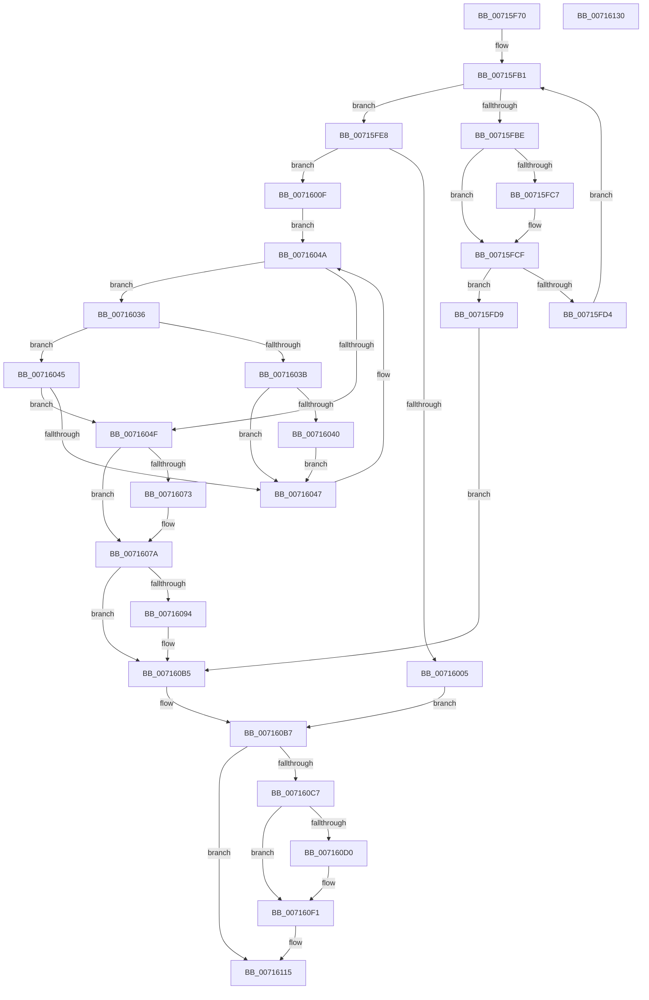

# FsRtlpDedupChangeRegisterVolume

- RVA: `0x00715F70`–`0x00716131` (길이 `449` bytes)
- VA: `0x0000000140715F70`
- 실행 섹션: `PAGE`
- PDB 이름 있음: `예`; PDB Function 태그: `아니요`
- unwind 정보 RVA: `0x00093E28`
- 디코드: `119`개 명령, `449/449` bytes 표시
- 미해석 바이트: `0` (있으면 어셈블리에 `.byte`로 보존)

> 이 문서는 커널 이미지의 기계어와 PDB 기호를 분석해 생성했습니다. 4번과 5번은 함수 원형과 자료형을 바이너리 사용 방식에서 추정한 C 해석이며 원본 소스 복구 결과는 아닙니다.

## 1. Dependencies

- 직접 호출 지점: **6**; 고유 호출 대상: **6**
- 직접 호출자로 확인된 함수: **1**
- RIP 상대 이미지 참조: **7**

### Outgoing calls
- `0x00715F9E` → [ExAcquireResourceExclusiveLite](../../text/21/ExAcquireResourceExclusiveLite_function_00214E20.md) (function, `0x00214E20`)
- `0x00715FF8` → [ExAllocatePool2](../../poolcode/B8/ExAllocatePool2_function_00B820F0.md) (function, `0x00B820F0`)
- `0x007160B0` → [EtwRegister](../92/EtwRegister_function_00920960.md) (function, `0x00920960`)
- `0x007160BE` → [ExReleaseResourceLite](../../text/25/ExReleaseResourceLite_function_0025FA10.md) (function, `0x0025FA10`)
- `0x007160EC` → [McTemplateK0jjtq_EtwWriteTransfer](../../text/58/McTemplateK0jjtq_EtwWriteTransfer_function_00582DC4.md) (function, `0x00582DC4`)
- `0x00716110` → [ZwUpdateWnfStateData](../../text/6B/ZwUpdateWnfStateData_function_006B0D10.md) (function, `0x006B0D10`)

### Direct callers
- [FsRtlDedupChangeInit](FsRtlDedupChangeInit_function_00715B80.md) at `0x00715C42`

### Static image references
- `0x00715F94` → RVA `0x00F8EFB0` (`.data`; read)
- `0x00715FA3` → RVA `0x00F8EFA0` (`.data`; read)
- `0x0071608A` → RVA `0x00E06C90` (`.data`; read)
- `0x007160A2` → RVA `0x00582C00` (`FsRtlpDedupChangeEventsControlCallbackV2`; read)
- `0x007160A9` → RVA `0x00026438` (`.rdata`; read)
- `0x007160C7` → RVA `0x00F8EF98` (`.data`; read)
- `0x007160F6` → RVA `0x00020B38` (`.rdata`; read)

## 2. Other-region calls and transfers

- 다른 실행 섹션으로 향하는 call: **5**
  - `0x00715F9E` → [ExAcquireResourceExclusiveLite](../../text/21/ExAcquireResourceExclusiveLite_function_00214E20.md) (`PAGE` → `.text`)
  - `0x00715FF8` → [ExAllocatePool2](../../poolcode/B8/ExAllocatePool2_function_00B820F0.md) (`PAGE` → `POOLCODE`)
  - `0x007160BE` → [ExReleaseResourceLite](../../text/25/ExReleaseResourceLite_function_0025FA10.md) (`PAGE` → `.text`)
  - `0x007160EC` → [McTemplateK0jjtq_EtwWriteTransfer](../../text/58/McTemplateK0jjtq_EtwWriteTransfer_function_00582DC4.md) (`PAGE` → `.text`)
  - `0x00716110` → [ZwUpdateWnfStateData](../../text/6B/ZwUpdateWnfStateData_function_006B0D10.md) (`PAGE` → `.text`)
- 별도 외부 분기/꼬리 이동을 확인하지 못했습니다.

## 3. Assembly (complete function range)

```asm
00715F70  48 89 5C 24 08                  mov qword ptr [rsp + 8], rbx
00715F75  48 89 6C 24 10                  mov qword ptr [rsp + 0x10], rbp
00715F7A  48 89 74 24 18                  mov qword ptr [rsp + 0x18], rsi
00715F7F  57                              push rdi
00715F80  41 56                           push r14
00715F82  41 57                           push r15
00715F84  48 83 EC 40                     sub rsp, 0x40
00715F88  4C 8B F2                        mov r14, rdx
00715F8B  41 0F B6 E8                     movzx ebp, r8b
00715F8F  48 8B F9                        mov rdi, rcx
00715F92  B2 01                           mov dl, 1
00715F94  48 8D 0D 15 90 87 00            lea rcx, [rip + 0x879015]
00715F9B  4D 8B F9                        mov r15, r9
00715F9E  E8 7D EE AF FF                  call 0x140214e20
00715FA3  4C 8B 15 F6 8F 87 00            mov r10, qword ptr [rip + 0x878ff6]
00715FAA  48 8D 1D EF 8F 87 00            lea rbx, [rip + 0x878fef]
00715FB1  48 8B B4 24 80 00 00 00         mov rsi, qword ptr [rsp + 0x80]
00715FB9  4C 3B D3                        cmp r10, rbx
00715FBC  74 2A                           je 0x140715fe8
00715FBE  49 8B 4A 10                     mov rcx, qword ptr [r10 + 0x10]
00715FC2  48 2B 0F                        sub rcx, qword ptr [rdi]
00715FC5  75 08                           jne 0x140715fcf
00715FC7  49 8B 4A 18                     mov rcx, qword ptr [r10 + 0x18]
00715FCB  48 2B 4F 08                     sub rcx, qword ptr [rdi + 8]
00715FCF  48 85 C9                        test rcx, rcx
00715FD2  74 05                           je 0x140715fd9
00715FD4  4D 8B 12                        mov r10, qword ptr [r10]
00715FD7  EB D8                           jmp 0x140715fb1
00715FD9  41 8B 42 30                     mov eax, dword ptr [r10 + 0x30]
00715FDD  89 06                           mov dword ptr [rsi], eax
00715FDF  41 88 6A 34                     mov byte ptr [r10 + 0x34], bpl
00715FE3  E9 CD 00 00 00                  jmp 0x1407160b5
00715FE8  BA 38 00 00 00                  mov edx, 0x38
00715FED  B9 02 01 00 00                  mov ecx, 0x102
00715FF2  41 B8 44 65 43 68               mov r8d, 0x68436544
00715FF8  E8 F3 C0 46 00                  call 0x140b820f0
00715FFD  4C 8B C0                        mov r8, rax
00716000  48 85 C0                        test rax, rax
00716003  75 0A                           jne 0x14071600f
00716005  BB 9A 00 00 C0                  mov ebx, 0xc000009a
0071600A  E9 A8 00 00 00                  jmp 0x1407160b7
0071600F  0F B6 47 0F                     movzx eax, byte ptr [rdi + 0xf]
00716013  0F B6 57 0A                     movzx edx, byte ptr [rdi + 0xa]
00716017  0F B7 4F 04                     movzx ecx, word ptr [rdi + 4]
0071601B  C1 E2 18                        shl edx, 0x18
0071601E  0B D0                           or edx, eax
00716020  C1 E1 10                        shl ecx, 0x10
00716023  0F B7 47 06                     movzx eax, word ptr [rdi + 6]
00716027  0B C8                           or ecx, eax
00716029  48 8B 05 70 8F 87 00            mov rax, qword ptr [rip + 0x878f70]
00716030  33 D1                           xor edx, ecx
00716032  33 17                           xor edx, dword ptr [rdi]
00716034  EB 14                           jmp 0x14071604a
00716036  39 50 30                        cmp dword ptr [rax + 0x30], edx
00716039  75 0A                           jne 0x140716045
0071603B  83 C2 01                        add edx, 1
0071603E  75 07                           jne 0x140716047
00716040  48 8B C3                        mov rax, rbx
00716043  EB 02                           jmp 0x140716047
00716045  77 08                           ja 0x14071604f
00716047  48 8B 00                        mov rax, qword ptr [rax]
0071604A  48 3B C3                        cmp rax, rbx
0071604D  75 E7                           jne 0x140716036
0071604F  0F 10 07                        movups xmm0, xmmword ptr [rdi]
00716052  F3 41 0F 7F 40 10               movdqu xmmword ptr [r8 + 0x10], xmm0
00716058  41 0F 10 0E                     movups xmm1, xmmword ptr [r14]
0071605C  41 89 50 30                     mov dword ptr [r8 + 0x30], edx
00716060  41 88 68 34                     mov byte ptr [r8 + 0x34], bpl
00716064  F3 41 0F 7F 48 20               movdqu xmmword ptr [r8 + 0x20], xmm1
0071606A  48 8B 48 08                     mov rcx, qword ptr [rax + 8]
0071606E  48 39 01                        cmp qword ptr [rcx], rax
00716071  74 07                           je 0x14071607a
00716073  B9 03 00 00 00                  mov ecx, 3
00716078  CD 29                           int 0x29
0071607A  49 89 00                        mov qword ptr [r8], rax
0071607D  49 89 48 08                     mov qword ptr [r8 + 8], rcx
00716081  4C 89 01                        mov qword ptr [rcx], r8
00716084  4C 89 40 08                     mov qword ptr [rax + 8], r8
00716088  89 16                           mov dword ptr [rsi], edx
0071608A  48 83 3D FE 0B 6F 00 00         cmp qword ptr [rip + 0x6f0bfe], 0
00716092  75 21                           jne 0x1407160b5
00716094  4C 8D 0D F5 0B 6F 00            lea r9, [rip + 0x6f0bf5]
0071609B  4C 8D 05 EE 0B 6F 00            lea r8, [rip + 0x6f0bee]
007160A2  48 8D 15 57 CB E6 FF            lea rdx, [rip - 0x1934a9]
007160A9  48 8D 0D 88 03 91 FF            lea rcx, [rip - 0x6efc78]
007160B0  E8 AB A8 20 00                  call 0x140920960
007160B5  33 DB                           xor ebx, ebx
007160B7  48 8D 0D F2 8E 87 00            lea rcx, [rip + 0x878ef2]
007160BE  E8 4D 99 B4 FF                  call 0x14025fa10
007160C3  85 DB                           test ebx, ebx
007160C5  78 4E                           js 0x140716115
007160C7  F6 05 CA 8E 87 00 01            test byte ptr [rip + 0x878eca], 1
007160CE  74 21                           je 0x1407160f1
007160D0  8B 06                           mov eax, dword ptr [rsi]
007160D2  48 8D 0D B7 0B 6F 00            lea rcx, [rip + 0x6f0bb7]
007160D9  89 44 24 30                     mov dword ptr [rsp + 0x30], eax
007160DD  4C 8B CF                        mov r9, rdi
007160E0  89 6C 24 28                     mov dword ptr [rsp + 0x28], ebp
007160E4  4D 8B C7                        mov r8, r15
007160E7  4C 89 74 24 20                  mov qword ptr [rsp + 0x20], r14
007160EC  E8 D3 CC E6 FF                  call 0x140582dc4
007160F1  83 64 24 30 00                  and dword ptr [rsp + 0x30], 0
007160F6  48 8D 0D 3B AA 90 FF            lea rcx, [rip - 0x6f55c5]
007160FD  83 64 24 28 00                  and dword ptr [rsp + 0x28], 0
00716102  45 33 C9                        xor r9d, r9d
00716105  48 83 64 24 20 00               and qword ptr [rsp + 0x20], 0
0071610B  45 33 C0                        xor r8d, r8d
0071610E  33 D2                           xor edx, edx
00716110  E8 FB AB F9 FF                  call 0x1406b0d10
00716115  48 8B 6C 24 68                  mov rbp, qword ptr [rsp + 0x68]
0071611A  8B C3                           mov eax, ebx
0071611C  48 8B 5C 24 60                  mov rbx, qword ptr [rsp + 0x60]
00716121  48 8B 74 24 70                  mov rsi, qword ptr [rsp + 0x70]
00716126  48 83 C4 40                     add rsp, 0x40
0071612A  41 5F                           pop r15
0071612C  41 5E                           pop r14
0071612E  5F                              pop rdi
0071612F  C3                              ret
00716130  CC                              int3
```

## 4. C-style interpretation (structured pseudocode)

```c
__int64 __fastcall FsRtlpDedupChangeRegisterVolume(__int64 a1, __int64 a2, unsigned __int8 a3, __int64 a4, __int64 a5)
{
    __int64 result;
    __int64 v_rbx;
    __int64 v_rsp;
    unsigned int v_stack_m28;
    unsigned int v_stack_m30;
    unsigned __int64 v_stack_m38;
    unsigned __int64 v_stack_p10;
    unsigned __int64 v_stack_p18;
    unsigned __int64 v_stack_p8;

    v_stack_p8 = v_rbx;
    v_stack_p10 = v_rbp;
    v_stack_p18 = v_rsi;
    v_rsp = (v_rsp) - (64);
    result = ExAcquireResourceExclusiveLite(v_rip + 8884245, 1, a3, a4);
loc_00715FB1:
    if ((*(unsigned __int64 *)(v_rip + 8884214)) == (v_rip + 8884207)) goto loc_00715FE8;
    a1 = (*(unsigned __int64 *)(*(unsigned __int64 *)(v_rip + 8884214) + 16)) - (*(unsigned __int64 *)(a1));
    if (!(condition_is_not_equal)) {
        a1 = *(unsigned __int64 *)(*(unsigned __int64 *)(v_rip + 8884214) + 24);
        a1 = (a1) - (*(unsigned __int64 *)(a1 + 8));
    }
    if (a1 == 0) goto loc_00715FD9;
    goto loc_00715FB1;
loc_00715FD9:
    *(unsigned int *)(a5) = (unsigned int)((unsigned int)(*(unsigned int *)(*(unsigned __int64 *)(*(unsigned __int64 *)(v_rip + 8884214)) + 48)));
    *(unsigned __int8 *)(*(unsigned __int64 *)(*(unsigned __int64 *)(v_rip + 8884214)) + 52) = a3;
    goto loc_007160B5;
loc_00715FE8:
    result = ExAllocatePool2(258, 56, (unsigned int)(0x68436544ULL), a4);
    if (result != 0) goto loc_0071600F;
    goto loc_007160B7;
loc_0071600F:
    a2 = (unsigned int)((*(unsigned __int8 *)(a1 + 10)) << (24));
    a2 = (unsigned int)((a2) | ((unsigned int)(*(unsigned __int8 *)(a1 + 15))));
    a1 = (unsigned int)((*(unsigned __int16 *)(a1 + 4)) << (16));
    a1 = (unsigned int)((a1) | ((unsigned int)(*(unsigned __int16 *)(a1 + 6))));
    a2 = (unsigned int)((a2) ^ ((unsigned int)(a1)));
    a2 = (unsigned int)((a2) ^ (*(unsigned int *)(a1)));
    goto loc_0071604A;
loc_00716036:
    if ((*(unsigned int *)(*(unsigned __int64 *)(v_rip + 8884080) + 48)) != ((unsigned int)(a2))) goto loc_00716045;
    a2 = (unsigned int)((a2) + (1));
    if (condition_is_not_equal) goto loc_00716047;
    goto loc_00716047;
loc_00716045:
    if (condition_is_above) goto loc_0071604F;
loc_00716047:
loc_0071604A:
    if ((*(unsigned __int64 *)((unsigned int)(0xC000009AULL))) != ((unsigned int)(0xC000009AULL))) goto loc_00716036;
loc_0071604F:
    *(unsigned __int64 *)(result + 16) = v_xmm0;
    *(unsigned int *)(result + 48) = (unsigned int)(a2);
    *(unsigned __int8 *)(result + 52) = a3;
    *(unsigned __int64 *)(result + 32) = v_xmm1;
    if ((*(unsigned __int64 *)(*(unsigned __int64 *)(*(unsigned __int64 *)((unsigned int)(0xC000009AULL)) + 8))) != (*(unsigned __int64 *)((unsigned int)(0xC000009AULL)))) {
        a1 = 3;
    }
    *(unsigned __int64 *)(result) = *(unsigned __int64 *)((unsigned int)(0xC000009AULL));
    *(unsigned __int64 *)(result + 8) = a1;
    *(unsigned __int64 *)(a1) = result;
    *(unsigned __int64 *)(*(unsigned __int64 *)((unsigned int)(0xC000009AULL)) + 8) = result;
    *(unsigned int *)(a5) = (unsigned int)(a2);
    result = *(unsigned __int64 *)((unsigned int)(0xC000009AULL));
    if ((*(unsigned __int64 *)(v_rip + 7277566)) == 0) {
        a4 = v_rip + 7277557;
        a3 = v_rip + 7277550;
        a2 = v_rip - 1651881;
        a1 = v_rip - 7273592;
        result = EtwRegister(a1, a2, a3, a4);
    }
    v_rbx = 0;
loc_007160B7:
    result = ExReleaseResourceLite(v_rip + 8883954, a2, a3, a4);
    if (sign_flag) goto loc_00716115;
    if (((*(unsigned __int8 *)(v_rip + 8883914)) & (1)) != 0) {
        result = *(unsigned int *)(a5);
        a1 = v_rip + 7277495;
        v_stack_m28 = (unsigned int)(result);
        a4 = a1;
        v_stack_m30 = a3;
        a3 = a4;
        v_stack_m38 = a2;
        result = McTemplateK0jjtq_EtwWriteTransfer(a1, a2, a3, a4);
    }
    a4 = 0;
    a3 = 0;
    a2 = 0;
    result = ZwUpdateWnfStateData(v_rip - 7296453, a2, a3, a4);
loc_00716115:
    v_rsp = (v_rsp) + (64);
    return 0;
}
```

## 5. (Beta) C Style

```c
int64_t FsRtlpDedupChangeRegisterVolume(void *Arg1, void *Arg2, uint8_t Arg3, int64_t Arg4, void *Arg5)
{
    uint8_t *arg1 = (uint8_t *)Arg1;
    uint8_t *arg2 = (uint8_t *)Arg2;
    uint8_t *arg5 = (uint8_t *)Arg5;

    int64_t result;
    int64_t local_rbx;
    int64_t local_rsp;
    uint32_t v_stack_m28;
    uint32_t v_stack_m30;
    uint64_t v_stack_m38;
    uint64_t v_stack_p10;
    uint64_t v_stack_p18;
    uint64_t v_stack_p8;

    v_stack_p8 = local_rbx;
    v_stack_p10 = local_rbp;
    v_stack_p18 = local_rsi;
    local_rsp = (local_rsp) - (64);
    result = ExAcquireResourceExclusiveLite(v_rip + 8884245, 1, Arg3, Arg4);
loc_00715FB1:
    if ((*(uint64_t *)(v_rip + 0x878FF6)) == (v_rip + 8884207)) goto loc_00715FE8;
    Arg1 = (*(uint64_t *)(*(uint64_t *)(v_rip + 0x878FF6) + 0x10)) - (*(uint64_t *)(arg1));
    if (!(condition_is_not_equal)) {
        Arg1 = *(uint64_t *)(*(uint64_t *)(v_rip + 0x878FF6) + 0x18);
        Arg1 = (Arg1) - (*(uint64_t *)(arg1 + 0x8));
    }
    if (Arg1 == NULL) goto loc_00715FD9;
    goto loc_00715FB1;
loc_00715FD9:
    *(uint32_t *)(arg5) = (uint32_t)((uint32_t)(*(uint32_t *)(*(uint64_t *)(*(uint64_t *)(v_rip + 0x878FF6)) + 0x30)));
    *(uint8_t *)(*(uint64_t *)(*(uint64_t *)(v_rip + 0x878FF6)) + 0x34) = Arg3;
    goto loc_007160B5;
loc_00715FE8:
    result = ExAllocatePool2(258, 56, (uint32_t)(0x68436544ULL), Arg4);
    if (result != 0) goto loc_0071600F;
    goto loc_007160B7;
loc_0071600F:
    Arg2 = (uint32_t)((*(uint8_t *)(arg1 + 0xA)) << (24));
    Arg2 = (uint32_t)((Arg2) | ((uint32_t)(*(uint8_t *)(arg1 + 0xF))));
    Arg1 = (uint32_t)((*(uint16_t *)(arg1 + 0x4)) << (16));
    Arg1 = (uint32_t)((Arg1) | ((uint32_t)(*(uint16_t *)(arg1 + 0x6))));
    Arg2 = (uint32_t)((Arg2) ^ ((uint32_t)(Arg1)));
    Arg2 = (uint32_t)((Arg2) ^ (*(uint32_t *)(arg1)));
    goto loc_0071604A;
loc_00716036:
    if ((*(uint32_t *)(*(uint64_t *)(v_rip + 0x878F70) + 0x30)) != ((uint32_t)(Arg2))) goto loc_00716045;
    Arg2 = (uint32_t)((Arg2) + (1));
    if (condition_is_not_equal) goto loc_00716047;
    goto loc_00716047;
loc_00716045:
    if (condition_is_above) goto loc_0071604F;
loc_00716047:
loc_0071604A:
    if ((*(uint64_t *)((uint32_t)(0xC000009AULL))) != ((uint32_t)(0xC000009AULL))) goto loc_00716036;
loc_0071604F:
    *(uint64_t *)(result + 0x10) = v_xmm0;
    *(uint32_t *)(result + 0x30) = (uint32_t)(Arg2);
    *(uint8_t *)(result + 0x34) = Arg3;
    *(uint64_t *)(result + 0x20) = v_xmm1;
    if ((*(uint64_t *)(*(uint64_t *)(*(uint64_t *)((uint32_t)(0xC000009AULL)) + 0x8))) != (*(uint64_t *)((uint32_t)(0xC000009AULL)))) {
        Arg1 = 3;
    }
    *(uint64_t *)(result) = *(uint64_t *)((uint32_t)(0xC000009AULL));
    *(void **)(result + 0x8) = Arg1;
    *(uint64_t *)(arg1) = result;
    *(uint64_t *)(*(uint64_t *)((uint32_t)(0xC000009AULL)) + 0x8) = result;
    *(uint32_t *)(arg5) = (uint32_t)(Arg2);
    result = *(uint64_t *)((uint32_t)(0xC000009AULL));
    if ((*(uint64_t *)(v_rip + 0x6F0BFE)) == 0) {
        Arg4 = v_rip + 7277557;
        Arg3 = v_rip + 7277550;
        Arg2 = v_rip - 1651881;
        Arg1 = v_rip - 7273592;
        result = EtwRegister(Arg1, Arg2, Arg3, Arg4);
    }
    local_rbx = 0;
loc_007160B7:
    result = ExReleaseResourceLite(v_rip + 8883954, Arg2, Arg3, Arg4);
    if (sign_flag) goto loc_00716115;
    if (((*(uint8_t *)(v_rip + 0x878ECA)) & (1)) != 0) {
        result = *(uint32_t *)(arg5);
        Arg1 = v_rip + 7277495;
        v_stack_m28 = (uint32_t)(result);
        Arg4 = Arg1;
        v_stack_m30 = Arg3;
        Arg3 = Arg4;
        v_stack_m38 = Arg2;
        result = McTemplateK0jjtq_EtwWriteTransfer(Arg1, Arg2, Arg3, Arg4);
    }
    Arg4 = 0;
    Arg3 = 0;
    Arg2 = 0;
    result = ZwUpdateWnfStateData(v_rip - 7296453, Arg2, Arg3, Arg4);
loc_00716115:
    local_rsp = (local_rsp) + (64);
    return 0;
}
```

### 관측된 메모리 오프셋

구조체 형식이 확인되지 않은 접근은 인자 기준의 오프셋으로만 기록했습니다.

| 기준 인자 | 오프셋 표현 | 폭 (bit) | 접근 |
|---|---:|---:|---|
| `Arg1` | `+ 0x0` | `32` | `R` |
| `Arg1` | `+ 0x0` | `64` | `R` |
| `Arg1` | `+ 0x0` | `128` | `R` |
| `Arg1` | `+ 0x4` | `16` | `R` |
| `Arg1` | `+ 0x6` | `16` | `R` |
| `Arg1` | `+ 0x8` | `64` | `R` |
| `Arg1` | `+ 0xA` | `8` | `R` |
| `Arg1` | `+ 0xF` | `8` | `R` |
| `Arg2` | `+ 0x0` | `128` | `R` |
| `Arg5` | `+ 0x0` | `32` | `R` |
| `Arg5` | `+ 0x0` | `32` | `W` |

## 6. Execution-region graph

[열기: 2D/3D 그래프와 함수 탐색 컨트롤 패널](../../../control-panel.html?section=page&rva=0x00715F70&view=graph)

- 2D 그래프는 위에서 아래로 흐르고, 3D 그래프는 빈 공간을 드래그해 회전합니다. Shift+드래그는 이동, 휠은 확대·축소, 함수 노드 선택은 대상 보고서 이동입니다.

### Static fallback


