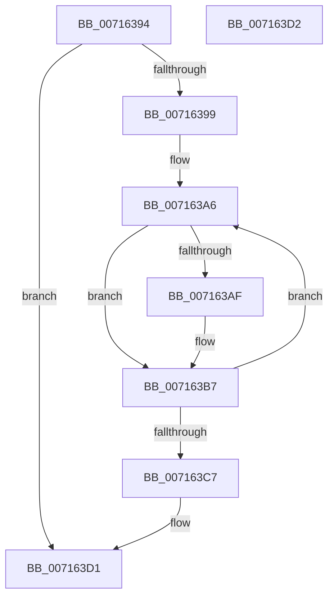

# FsRtlpFreeMdlChain

- RVA: `0x00716394`–`0x007163D3` (길이 `63` bytes)
- VA: `0x0000000140716394`
- 실행 섹션: `PAGE`
- PDB 이름 있음: `예`; PDB Function 태그: `아니요`
- unwind 정보 RVA: `0x00084918`
- 디코드: `21`개 명령, `63/63` bytes 표시
- 미해석 바이트: `0` (있으면 어셈블리에 `.byte`로 보존)

> 이 문서는 커널 이미지의 기계어와 PDB 기호를 분석해 생성했습니다. 4번과 5번은 함수 원형과 자료형을 바이너리 사용 방식에서 추정한 C 해석이며 원본 소스 복구 결과는 아닙니다.

## 1. Dependencies

- 직접 호출 지점: **2**; 고유 호출 대상: **2**
- 직접 호출자로 확인된 함수: **8**
- RIP 상대 이미지 참조: **0**

### Outgoing calls
- `0x007163B2` → [MmUnlockPages](../../text/29/MmUnlockPages_function_0029EEE0.md) (function, `0x0029EEE0`)
- `0x007163BA` → [IoFreeMdl](../../text/29/IoFreeMdl_function_0029EA80.md) (function, `0x0029EA80`)

### Direct callers
- [FsRtlQueryKernelEaFile](../A0/FsRtlQueryKernelEaFile_function_00A0C680.md) at `0x00A0C897`
- [FsRtlSetKernelEaFile](../A0/FsRtlSetKernelEaFile_function_00A0C8B0.md) at `0x00A0CA5B`
- [FsRtlKernelFsControlFile](../A0/FsRtlKernelFsControlFile_function_00A0CA70.md) at `0x00A0CDBB`
- [FsRtlQueryInformationFile](../A3/FsRtlQueryInformationFile_function_00A38780.md) at `0x00A38942`
- [FsRtlQueryKernelEaFile$fin$0](../B1/FsRtlQueryKernelEaFile_fin_0_function_00B10F8B.md) at `0x00B10FA9`
- [FsRtlSetKernelEaFile$fin$0](../B1/FsRtlSetKernelEaFile_fin_0_function_00B10FCA.md) at `0x00B10FE8`
- [FsRtlKernelFsControlFile$fin$0](../B1/FsRtlKernelFsControlFile_fin_0_function_00B11009.md) at `0x00B11027`
- [FsRtlQueryInformationFile$fin$0](../B1/FsRtlQueryInformationFile_fin_0_function_00B1159D.md) at `0x00B115BB`

### Static image references
- 디코드된 RIP-relative 메모리 참조가 없습니다.

## 2. Other-region calls and transfers

- 다른 실행 섹션으로 향하는 call: **2**
  - `0x007163B2` → [MmUnlockPages](../../text/29/MmUnlockPages_function_0029EEE0.md) (`PAGE` → `.text`)
  - `0x007163BA` → [IoFreeMdl](../../text/29/IoFreeMdl_function_0029EA80.md) (`PAGE` → `.text`)
- 별도 외부 분기/꼬리 이동을 확인하지 못했습니다.

## 3. Assembly (complete function range)

```asm
00716394  48 85 C9                        test rcx, rcx
00716397  74 38                           je 0x1407163d1
00716399  48 89 5C 24 08                  mov qword ptr [rsp + 8], rbx
0071639E  57                              push rdi
0071639F  48 83 EC 20                     sub rsp, 0x20
007163A3  48 8B D9                        mov rbx, rcx
007163A6  F6 43 0A 02                     test byte ptr [rbx + 0xa], 2
007163AA  48 8B 3B                        mov rdi, qword ptr [rbx]
007163AD  74 08                           je 0x1407163b7
007163AF  48 8B CB                        mov rcx, rbx
007163B2  E8 29 8B B8 FF                  call 0x14029eee0
007163B7  48 8B CB                        mov rcx, rbx
007163BA  E8 C1 86 B8 FF                  call 0x14029ea80
007163BF  48 8B DF                        mov rbx, rdi
007163C2  48 85 FF                        test rdi, rdi
007163C5  75 DF                           jne 0x1407163a6
007163C7  48 8B 5C 24 30                  mov rbx, qword ptr [rsp + 0x30]
007163CC  48 83 C4 20                     add rsp, 0x20
007163D0  5F                              pop rdi
007163D1  C3                              ret
007163D2  CC                              int3
```

## 4. C-style interpretation (structured pseudocode)

```c
__int64 __fastcall FsRtlpFreeMdlChain(__int64 a1)
{
    __int64 result;
    __int64 v_rsp;
    unsigned __int64 v_stack_p8;

    if (a1 == 0) goto loc_007163D1;
    v_stack_p8 = v_rbx;
    v_rsp = (v_rsp) - (32);
loc_007163A6:
    if (((*(unsigned __int8 *)(a1 + 10)) & (2)) != 0) {
        a1 = a1;
        result = MmUnlockPages(a1, a2, a3, a4);
    }
    result = IoFreeMdl(a1, a2, a3, a4);
    if (*(unsigned __int64 *)(a1) != 0) goto loc_007163A6;
    v_rsp = (v_rsp) + (32);
loc_007163D1:
    return result;
}
```

## 5. (Beta) C Style

```c
int64_t FsRtlpFreeMdlChain(int64_t Arg1)
{
    int64_t result;
    int64_t local_rsp;
    uint64_t v_stack_p8;

    if (Arg1 == 0) goto loc_007163D1;
    v_stack_p8 = local_rbx;
    local_rsp = (local_rsp) - (32);
loc_007163A6:
    if (((*(uint8_t *)(Arg1 + 0xA)) & (2)) != 0) {
        Arg1 = Arg1;
        result = MmUnlockPages(Arg1, a2, a3, a4);
    }
    result = IoFreeMdl(Arg1, a2, a3, a4);
    if (*(uint64_t *)(Arg1) != 0) goto loc_007163A6;
    local_rsp = (local_rsp) + (32);
loc_007163D1:
    return result;
}
```

## 6. Execution-region graph

[열기: 2D/3D 그래프와 함수 탐색 컨트롤 패널](../../../control-panel.html?section=page&rva=0x00716394&view=graph)

- 2D 그래프는 위에서 아래로 흐르고, 3D 그래프는 빈 공간을 드래그해 회전합니다. Shift+드래그는 이동, 휠은 확대·축소, 함수 노드 선택은 대상 보고서 이동입니다.

### Static fallback


