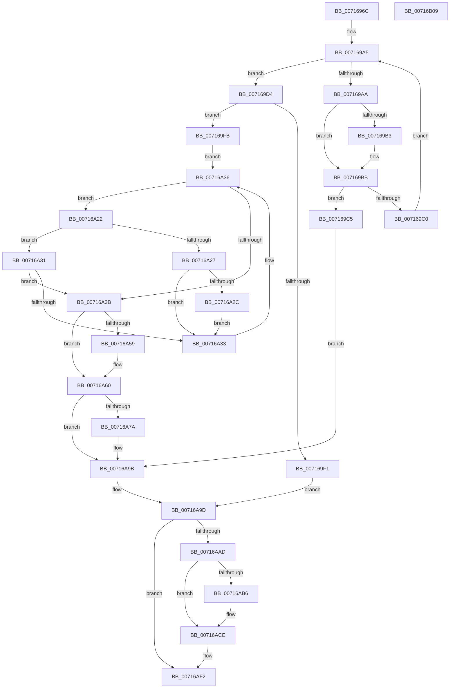

# FsRtlpHeatRegisterVolume

- RVA: `0x0071696C`–`0x00716B0A` (길이 `414` bytes)
- VA: `0x000000014071696C`
- 실행 섹션: `PAGE`
- PDB 이름 있음: `예`; PDB Function 태그: `아니요`
- unwind 정보 RVA: `0x0007D3C0`
- 디코드: `109`개 명령, `414/414` bytes 표시
- 미해석 바이트: `0` (있으면 어셈블리에 `.byte`로 보존)

> 이 문서는 커널 이미지의 기계어와 PDB 기호를 분석해 생성했습니다. 4번과 5번은 함수 원형과 자료형을 바이너리 사용 방식에서 추정한 C 해석이며 원본 소스 복구 결과는 아닙니다.

## 1. Dependencies

- 직접 호출 지점: **6**; 고유 호출 대상: **6**
- 직접 호출자로 확인된 함수: **1**
- RIP 상대 이미지 참조: **7**

### Outgoing calls
- `0x00716992` → [ExAcquireResourceExclusiveLite](../../text/21/ExAcquireResourceExclusiveLite_function_00214E20.md) (function, `0x00214E20`)
- `0x007169E4` → [ExAllocatePool2](../../poolcode/B8/ExAllocatePool2_function_00B820F0.md) (function, `0x00B820F0`)
- `0x00716A96` → [EtwRegister](../92/EtwRegister_function_00920960.md) (function, `0x00920960`)
- `0x00716AA4` → [ExReleaseResourceLite](../../text/25/ExReleaseResourceLite_function_0025FA10.md) (function, `0x0025FA10`)
- `0x00716AC9` → [McTemplateK0jq_EtwWriteTransfer](../../text/58/McTemplateK0jq_EtwWriteTransfer_function_00583238.md) (function, `0x00583238`)
- `0x00716AED` → [ZwUpdateWnfStateData](../../text/6B/ZwUpdateWnfStateData_function_006B0D10.md) (function, `0x006B0D10`)

### Direct callers
- [FsRtlHeatInit](FsRtlHeatInit_function_007166A0.md) at `0x00716797`

### Static image references
- `0x00716988` → RVA `0x00F8EF30` (`.data`; read)
- `0x00716997` → RVA `0x00F8EF20` (`.data`; read)
- `0x00716A70` → RVA `0x00E06CE0` (`.data`; read)
- `0x00716A88` → RVA `0x00583110` (`FsRtlpTieringHeatEventsControlCallbackV2`; read)
- `0x00716A8F` → RVA `0x00026888` (`.rdata`; read)
- `0x00716AAD` → RVA `0x00F8EF18` (`.data`; read)
- `0x00716AD3` → RVA `0x000208D8` (`.rdata`; read)

## 2. Other-region calls and transfers

- 다른 실행 섹션으로 향하는 call: **5**
  - `0x00716992` → [ExAcquireResourceExclusiveLite](../../text/21/ExAcquireResourceExclusiveLite_function_00214E20.md) (`PAGE` → `.text`)
  - `0x007169E4` → [ExAllocatePool2](../../poolcode/B8/ExAllocatePool2_function_00B820F0.md) (`PAGE` → `POOLCODE`)
  - `0x00716AA4` → [ExReleaseResourceLite](../../text/25/ExReleaseResourceLite_function_0025FA10.md) (`PAGE` → `.text`)
  - `0x00716AC9` → [McTemplateK0jq_EtwWriteTransfer](../../text/58/McTemplateK0jq_EtwWriteTransfer_function_00583238.md) (`PAGE` → `.text`)
  - `0x00716AED` → [ZwUpdateWnfStateData](../../text/6B/ZwUpdateWnfStateData_function_006B0D10.md) (`PAGE` → `.text`)
- 별도 외부 분기/꼬리 이동을 확인하지 못했습니다.

## 3. Assembly (complete function range)

```asm
0071696C  48 89 5C 24 08                  mov qword ptr [rsp + 8], rbx
00716971  48 89 6C 24 10                  mov qword ptr [rsp + 0x10], rbp
00716976  48 89 74 24 18                  mov qword ptr [rsp + 0x18], rsi
0071697B  57                              push rdi
0071697C  48 83 EC 40                     sub rsp, 0x40
00716980  48 8B EA                        mov rbp, rdx
00716983  48 8B F9                        mov rdi, rcx
00716986  B2 01                           mov dl, 1
00716988  48 8D 0D A1 85 87 00            lea rcx, [rip + 0x8785a1]
0071698F  49 8B F0                        mov rsi, r8
00716992  E8 89 E4 AF FF                  call 0x140214e20
00716997  4C 8B 0D 82 85 87 00            mov r9, qword ptr [rip + 0x878582]
0071699E  48 8D 1D 7B 85 87 00            lea rbx, [rip + 0x87857b]
007169A5  4C 3B CB                        cmp r9, rbx
007169A8  74 2A                           je 0x1407169d4
007169AA  49 8B 49 14                     mov rcx, qword ptr [r9 + 0x14]
007169AE  48 2B 0F                        sub rcx, qword ptr [rdi]
007169B1  75 08                           jne 0x1407169bb
007169B3  49 8B 49 1C                     mov rcx, qword ptr [r9 + 0x1c]
007169B7  48 2B 4F 08                     sub rcx, qword ptr [rdi + 8]
007169BB  48 85 C9                        test rcx, rcx
007169BE  74 05                           je 0x1407169c5
007169C0  4D 8B 09                        mov r9, qword ptr [r9]
007169C3  EB E0                           jmp 0x1407169a5
007169C5  41 FF 41 10                     inc dword ptr [r9 + 0x10]
007169C9  41 8B 41 24                     mov eax, dword ptr [r9 + 0x24]
007169CD  89 06                           mov dword ptr [rsi], eax
007169CF  E9 C7 00 00 00                  jmp 0x140716a9b
007169D4  BA 28 00 00 00                  mov edx, 0x28
007169D9  B9 02 01 00 00                  mov ecx, 0x102
007169DE  41 B8 46 53 74 68               mov r8d, 0x68745346
007169E4  E8 07 B7 46 00                  call 0x140b820f0
007169E9  4C 8B C0                        mov r8, rax
007169EC  48 85 C0                        test rax, rax
007169EF  75 0A                           jne 0x1407169fb
007169F1  BB 9A 00 00 C0                  mov ebx, 0xc000009a
007169F6  E9 A2 00 00 00                  jmp 0x140716a9d
007169FB  0F B6 47 0F                     movzx eax, byte ptr [rdi + 0xf]
007169FF  0F B6 57 0A                     movzx edx, byte ptr [rdi + 0xa]
00716A03  0F B7 4F 04                     movzx ecx, word ptr [rdi + 4]
00716A07  C1 E2 18                        shl edx, 0x18
00716A0A  0B D0                           or edx, eax
00716A0C  C1 E1 10                        shl ecx, 0x10
00716A0F  0F B7 47 06                     movzx eax, word ptr [rdi + 6]
00716A13  0B C8                           or ecx, eax
00716A15  48 8B 05 04 85 87 00            mov rax, qword ptr [rip + 0x878504]
00716A1C  33 D1                           xor edx, ecx
00716A1E  33 17                           xor edx, dword ptr [rdi]
00716A20  EB 14                           jmp 0x140716a36
00716A22  39 50 24                        cmp dword ptr [rax + 0x24], edx
00716A25  75 0A                           jne 0x140716a31
00716A27  83 C2 01                        add edx, 1
00716A2A  75 07                           jne 0x140716a33
00716A2C  48 8B C3                        mov rax, rbx
00716A2F  EB 02                           jmp 0x140716a33
00716A31  77 08                           ja 0x140716a3b
00716A33  48 8B 00                        mov rax, qword ptr [rax]
00716A36  48 3B C3                        cmp rax, rbx
00716A39  75 E7                           jne 0x140716a22
00716A3B  0F 10 07                        movups xmm0, xmmword ptr [rdi]
00716A3E  41 89 50 24                     mov dword ptr [r8 + 0x24], edx
00716A42  41 C7 40 10 01 00 00 00         mov dword ptr [r8 + 0x10], 1
00716A4A  F3 41 0F 7F 40 14               movdqu xmmword ptr [r8 + 0x14], xmm0
00716A50  48 8B 48 08                     mov rcx, qword ptr [rax + 8]
00716A54  48 39 01                        cmp qword ptr [rcx], rax
00716A57  74 07                           je 0x140716a60
00716A59  B9 03 00 00 00                  mov ecx, 3
00716A5E  CD 29                           int 0x29
00716A60  49 89 00                        mov qword ptr [r8], rax
00716A63  49 89 48 08                     mov qword ptr [r8 + 8], rcx
00716A67  4C 89 01                        mov qword ptr [rcx], r8
00716A6A  4C 89 40 08                     mov qword ptr [rax + 8], r8
00716A6E  89 16                           mov dword ptr [rsi], edx
00716A70  48 83 3D 68 02 6F 00 00         cmp qword ptr [rip + 0x6f0268], 0
00716A78  75 21                           jne 0x140716a9b
00716A7A  4C 8D 0D 5F 02 6F 00            lea r9, [rip + 0x6f025f]
00716A81  4C 8D 05 58 02 6F 00            lea r8, [rip + 0x6f0258]
00716A88  48 8D 15 81 C6 E6 FF            lea rdx, [rip - 0x19397f]
00716A8F  48 8D 0D F2 FD 90 FF            lea rcx, [rip - 0x6f020e]
00716A96  E8 C5 9E 20 00                  call 0x140920960
00716A9B  33 DB                           xor ebx, ebx
00716A9D  48 8D 0D 8C 84 87 00            lea rcx, [rip + 0x87848c]
00716AA4  E8 67 8F B4 FF                  call 0x14025fa10
00716AA9  85 DB                           test ebx, ebx
00716AAB  78 45                           js 0x140716af2
00716AAD  F6 05 64 84 87 00 01            test byte ptr [rip + 0x878464], 1
00716AB4  74 18                           je 0x140716ace
00716AB6  8B 06                           mov eax, dword ptr [rsi]
00716AB8  48 8D 0D 21 02 6F 00            lea rcx, [rip + 0x6f0221]
00716ABF  4C 8B CF                        mov r9, rdi
00716AC2  89 44 24 20                     mov dword ptr [rsp + 0x20], eax
00716AC6  4C 8B C5                        mov r8, rbp
00716AC9  E8 6A C7 E6 FF                  call 0x140583238
00716ACE  83 64 24 30 00                  and dword ptr [rsp + 0x30], 0
00716AD3  48 8D 0D FE 9D 90 FF            lea rcx, [rip - 0x6f6202]
00716ADA  83 64 24 28 00                  and dword ptr [rsp + 0x28], 0
00716ADF  45 33 C9                        xor r9d, r9d
00716AE2  48 83 64 24 20 00               and qword ptr [rsp + 0x20], 0
00716AE8  45 33 C0                        xor r8d, r8d
00716AEB  33 D2                           xor edx, edx
00716AED  E8 1E A2 F9 FF                  call 0x1406b0d10
00716AF2  48 8B 6C 24 58                  mov rbp, qword ptr [rsp + 0x58]
00716AF7  8B C3                           mov eax, ebx
00716AF9  48 8B 5C 24 50                  mov rbx, qword ptr [rsp + 0x50]
00716AFE  48 8B 74 24 60                  mov rsi, qword ptr [rsp + 0x60]
00716B03  48 83 C4 40                     add rsp, 0x40
00716B07  5F                              pop rdi
00716B08  C3                              ret
00716B09  CC                              int3
```

## 4. C-style interpretation (structured pseudocode)

```c
__int64 __fastcall FsRtlpHeatRegisterVolume(__int64 a1, __int64 a2, __int64 a3)
{
    __int64 result;
    __int64 v_rbx;
    __int64 v_rsp;
    unsigned int v_stack_m18;
    unsigned int v_stack_m20;
    unsigned int v_stack_m28;
    unsigned __int64 v_stack_p10;
    unsigned __int64 v_stack_p18;
    unsigned __int64 v_stack_p8;

    v_stack_p8 = v_rbx;
    v_stack_p10 = v_rbp;
    v_stack_p18 = v_rsi;
    v_rsp = (v_rsp) - (64);
    result = ExAcquireResourceExclusiveLite(v_rip + 8881569, 1, a3, a4);
loc_007169A5:
    if ((*(unsigned __int64 *)(v_rip + 8881538)) == (v_rip + 8881531)) goto loc_007169D4;
    a1 = (*(unsigned __int64 *)(*(unsigned __int64 *)(v_rip + 8881538) + 20)) - (*(unsigned __int64 *)(a1));
    if (!(condition_is_not_equal)) {
        a1 = *(unsigned __int64 *)(*(unsigned __int64 *)(v_rip + 8881538) + 28);
        a1 = (a1) - (*(unsigned __int64 *)(a1 + 8));
    }
    if (a1 == 0) goto loc_007169C5;
    goto loc_007169A5;
loc_007169C5:
    *(unsigned int *)(a3) = (unsigned int)((unsigned int)(*(unsigned int *)(*(unsigned __int64 *)(*(unsigned __int64 *)(v_rip + 8881538)) + 36)));
    goto loc_00716A9B;
loc_007169D4:
    result = ExAllocatePool2(258, 40, (unsigned int)(0x68745346ULL), *(unsigned __int64 *)(*(unsigned __int64 *)(v_rip + 8881538)));
    if (result != 0) goto loc_007169FB;
    goto loc_00716A9D;
loc_007169FB:
    a2 = (unsigned int)((*(unsigned __int8 *)(a1 + 10)) << (24));
    a2 = (unsigned int)((a2) | ((unsigned int)(*(unsigned __int8 *)(a1 + 15))));
    a1 = (unsigned int)((*(unsigned __int16 *)(a1 + 4)) << (16));
    a1 = (unsigned int)((a1) | ((unsigned int)(*(unsigned __int16 *)(a1 + 6))));
    a2 = (unsigned int)((a2) ^ ((unsigned int)(a1)));
    a2 = (unsigned int)((a2) ^ (*(unsigned int *)(a1)));
    goto loc_00716A36;
loc_00716A22:
    if ((*(unsigned int *)(*(unsigned __int64 *)(v_rip + 8881412) + 36)) != ((unsigned int)(a2))) goto loc_00716A31;
    a2 = (unsigned int)((a2) + (1));
    if (condition_is_not_equal) goto loc_00716A33;
    goto loc_00716A33;
loc_00716A31:
    if (condition_is_above) goto loc_00716A3B;
loc_00716A33:
loc_00716A36:
    if ((*(unsigned __int64 *)((unsigned int)(0xC000009AULL))) != ((unsigned int)(0xC000009AULL))) goto loc_00716A22;
loc_00716A3B:
    *(unsigned int *)(result + 36) = (unsigned int)(a2);
    *(unsigned int *)(result + 16) = 1;
    *(unsigned __int64 *)(result + 20) = v_xmm0;
    if ((*(unsigned __int64 *)(*(unsigned __int64 *)(*(unsigned __int64 *)((unsigned int)(0xC000009AULL)) + 8))) != (*(unsigned __int64 *)((unsigned int)(0xC000009AULL)))) {
        a1 = 3;
    }
    *(unsigned __int64 *)(result) = *(unsigned __int64 *)((unsigned int)(0xC000009AULL));
    *(unsigned __int64 *)(result + 8) = a1;
    *(unsigned __int64 *)(a1) = result;
    *(unsigned __int64 *)(*(unsigned __int64 *)((unsigned int)(0xC000009AULL)) + 8) = result;
    *(unsigned int *)(a3) = (unsigned int)(a2);
    result = *(unsigned __int64 *)((unsigned int)(0xC000009AULL));
    if ((*(unsigned __int64 *)(v_rip + 7275112)) == 0) {
        a4 = v_rip + 7275103;
        a3 = v_rip + 7275096;
        a2 = v_rip - 1653119;
        a1 = v_rip - 7275022;
        result = EtwRegister(a1, a2, a3, a4);
    }
    v_rbx = 0;
loc_00716A9D:
    result = ExReleaseResourceLite(v_rip + 8881292, a2, a3, a4);
    if (sign_flag) goto loc_00716AF2;
    if (((*(unsigned __int8 *)(v_rip + 8881252)) & (1)) != 0) {
        result = *(unsigned int *)(a3);
        a1 = v_rip + 7275041;
        a4 = a1;
        v_stack_m28 = (unsigned int)(result);
        a3 = a2;
        result = McTemplateK0jq_EtwWriteTransfer(a1, a2, a3, a4);
    }
    a4 = 0;
    a3 = 0;
    a2 = 0;
    result = ZwUpdateWnfStateData(v_rip - 7299586, a2, a3, a4);
loc_00716AF2:
    v_rsp = (v_rsp) + (64);
    return 0;
}
```

## 5. (Beta) C Style

```c
int64_t FsRtlpHeatRegisterVolume(void *Arg1, int64_t Arg2, void *Arg3)
{
    uint8_t *arg1 = (uint8_t *)Arg1;
    uint8_t *arg3 = (uint8_t *)Arg3;

    int64_t result;
    int64_t local_rbx;
    int64_t local_rsp;
    uint32_t v_stack_m18;
    uint32_t v_stack_m20;
    uint32_t v_stack_m28;
    uint64_t v_stack_p10;
    uint64_t v_stack_p18;
    uint64_t v_stack_p8;

    v_stack_p8 = local_rbx;
    v_stack_p10 = local_rbp;
    v_stack_p18 = local_rsi;
    local_rsp = (local_rsp) - (64);
    result = ExAcquireResourceExclusiveLite(v_rip + 8881569, 1, Arg3, a4);
loc_007169A5:
    if ((*(uint64_t *)(v_rip + 0x878582)) == (v_rip + 8881531)) goto loc_007169D4;
    Arg1 = (*(uint64_t *)(*(uint64_t *)(v_rip + 0x878582) + 0x14)) - (*(uint64_t *)(arg1));
    if (!(condition_is_not_equal)) {
        Arg1 = *(uint64_t *)(*(uint64_t *)(v_rip + 0x878582) + 0x1C);
        Arg1 = (Arg1) - (*(uint64_t *)(arg1 + 0x8));
    }
    if (Arg1 == NULL) goto loc_007169C5;
    goto loc_007169A5;
loc_007169C5:
    *(uint32_t *)(arg3) = (uint32_t)((uint32_t)(*(uint32_t *)(*(uint64_t *)(*(uint64_t *)(v_rip + 0x878582)) + 0x24)));
    goto loc_00716A9B;
loc_007169D4:
    result = ExAllocatePool2(258, 40, (uint32_t)(0x68745346ULL), *(uint64_t *)(*(uint64_t *)(v_rip + 0x878582)));
    if (result != 0) goto loc_007169FB;
    goto loc_00716A9D;
loc_007169FB:
    Arg2 = (uint32_t)((*(uint8_t *)(arg1 + 0xA)) << (24));
    Arg2 = (uint32_t)((Arg2) | ((uint32_t)(*(uint8_t *)(arg1 + 0xF))));
    Arg1 = (uint32_t)((*(uint16_t *)(arg1 + 0x4)) << (16));
    Arg1 = (uint32_t)((Arg1) | ((uint32_t)(*(uint16_t *)(arg1 + 0x6))));
    Arg2 = (uint32_t)((Arg2) ^ ((uint32_t)(Arg1)));
    Arg2 = (uint32_t)((Arg2) ^ (*(uint32_t *)(arg1)));
    goto loc_00716A36;
loc_00716A22:
    if ((*(uint32_t *)(*(uint64_t *)(v_rip + 0x878504) + 0x24)) != ((uint32_t)(Arg2))) goto loc_00716A31;
    Arg2 = (uint32_t)((Arg2) + (1));
    if (condition_is_not_equal) goto loc_00716A33;
    goto loc_00716A33;
loc_00716A31:
    if (condition_is_above) goto loc_00716A3B;
loc_00716A33:
loc_00716A36:
    if ((*(uint64_t *)((uint32_t)(0xC000009AULL))) != ((uint32_t)(0xC000009AULL))) goto loc_00716A22;
loc_00716A3B:
    *(uint32_t *)(result + 0x24) = (uint32_t)(Arg2);
    *(uint32_t *)(result + 0x10) = 1;
    *(uint64_t *)(result + 0x14) = v_xmm0;
    if ((*(uint64_t *)(*(uint64_t *)(*(uint64_t *)((uint32_t)(0xC000009AULL)) + 0x8))) != (*(uint64_t *)((uint32_t)(0xC000009AULL)))) {
        Arg1 = 3;
    }
    *(uint64_t *)(result) = *(uint64_t *)((uint32_t)(0xC000009AULL));
    *(void **)(result + 0x8) = Arg1;
    *(uint64_t *)(arg1) = result;
    *(uint64_t *)(*(uint64_t *)((uint32_t)(0xC000009AULL)) + 0x8) = result;
    *(uint32_t *)(arg3) = (uint32_t)(Arg2);
    result = *(uint64_t *)((uint32_t)(0xC000009AULL));
    if ((*(uint64_t *)(v_rip + 0x6F0268)) == 0) {
        a4 = v_rip + 7275103;
        Arg3 = v_rip + 7275096;
        Arg2 = v_rip - 1653119;
        Arg1 = v_rip - 7275022;
        result = EtwRegister(Arg1, Arg2, Arg3, a4);
    }
    local_rbx = 0;
loc_00716A9D:
    result = ExReleaseResourceLite(v_rip + 8881292, Arg2, Arg3, a4);
    if (sign_flag) goto loc_00716AF2;
    if (((*(uint8_t *)(v_rip + 0x878464)) & (1)) != 0) {
        result = *(uint32_t *)(arg3);
        Arg1 = v_rip + 7275041;
        a4 = Arg1;
        v_stack_m28 = (uint32_t)(result);
        Arg3 = Arg2;
        result = McTemplateK0jq_EtwWriteTransfer(Arg1, Arg2, Arg3, a4);
    }
    a4 = 0;
    Arg3 = 0;
    Arg2 = 0;
    result = ZwUpdateWnfStateData(v_rip - 7299586, Arg2, Arg3, a4);
loc_00716AF2:
    local_rsp = (local_rsp) + (64);
    return 0;
}
```

### 관측된 메모리 오프셋

구조체 형식이 확인되지 않은 접근은 인자 기준의 오프셋으로만 기록했습니다.

| 기준 인자 | 오프셋 표현 | 폭 (bit) | 접근 |
|---|---:|---:|---|
| `Arg1` | `+ 0x0` | `32` | `R` |
| `Arg1` | `+ 0x0` | `64` | `R` |
| `Arg1` | `+ 0x0` | `128` | `R` |
| `Arg1` | `+ 0x4` | `16` | `R` |
| `Arg1` | `+ 0x6` | `16` | `R` |
| `Arg1` | `+ 0x8` | `64` | `R` |
| `Arg1` | `+ 0xA` | `8` | `R` |
| `Arg1` | `+ 0xF` | `8` | `R` |
| `Arg3` | `+ 0x0` | `32` | `R` |
| `Arg3` | `+ 0x0` | `32` | `W` |

## 6. Execution-region graph

[열기: 2D/3D 그래프와 함수 탐색 컨트롤 패널](../../../control-panel.html?section=page&rva=0x0071696C&view=graph)

- 2D 그래프는 위에서 아래로 흐르고, 3D 그래프는 빈 공간을 드래그해 회전합니다. Shift+드래그는 이동, 휠은 확대·축소, 함수 노드 선택은 대상 보고서 이동입니다.

### Static fallback


