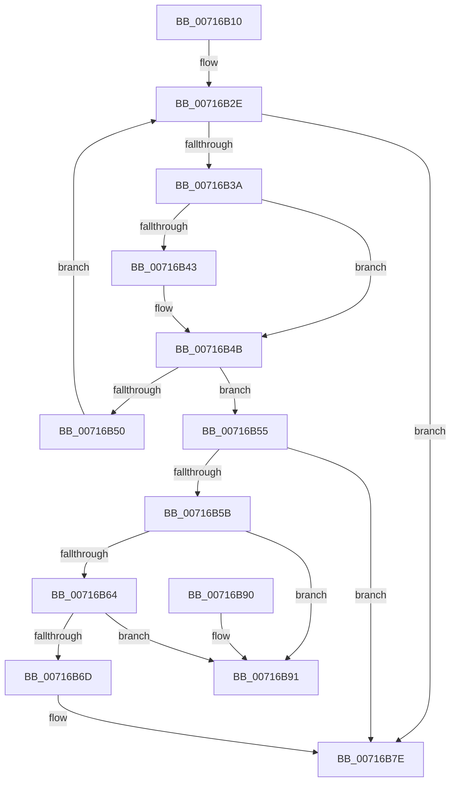

# FsRtlpHeatUnregisterVolume

- RVA: `0x00716B10`–`0x00716B98` (길이 `136` bytes)
- VA: `0x0000000140716B10`
- 실행 섹션: `PAGE`
- PDB 이름 있음: `예`; PDB Function 태그: `아니요`
- unwind 정보 RVA: `0x0005DAC8`
- 디코드: `39`개 명령, `136/136` bytes 표시
- 미해석 바이트: `0` (있으면 어셈블리에 `.byte`로 보존)

> 이 문서는 커널 이미지의 기계어와 PDB 기호를 분석해 생성했습니다. 4번과 5번은 함수 원형과 자료형을 바이너리 사용 방식에서 추정한 C 해석이며 원본 소스 복구 결과는 아닙니다.

## 1. Dependencies

- 직접 호출 지점: **3**; 고유 호출 대상: **3**
- 직접 호출자로 확인된 함수: **1**
- RIP 상대 이미지 참조: **2**

### Outgoing calls
- `0x00716B22` → [ExAcquireResourceExclusiveLite](../../text/21/ExAcquireResourceExclusiveLite_function_00214E20.md) (function, `0x00214E20`)
- `0x00716B79` → [ExFreePoolWithTag](../../poolcode/B8/ExFreePoolWithTag_function_00B82870.md) (function, `0x00B82870`)
- `0x00716B85` → [ExReleaseResourceLite](../../text/25/ExReleaseResourceLite_function_0025FA10.md) (function, `0x0025FA10`)

### Direct callers
- [FsRtlHeatUninit](FsRtlHeatUninit_function_00716920.md) at `0x00716927`

### Static image references
- `0x00716B1B` → RVA `0x00F8EF30` (`.data`; read)
- `0x00716B27` → RVA `0x00F8EF20` (`.data`; read)

## 2. Other-region calls and transfers

- 다른 실행 섹션으로 향하는 call: **3**
  - `0x00716B22` → [ExAcquireResourceExclusiveLite](../../text/21/ExAcquireResourceExclusiveLite_function_00214E20.md) (`PAGE` → `.text`)
  - `0x00716B79` → [ExFreePoolWithTag](../../poolcode/B8/ExFreePoolWithTag_function_00B82870.md) (`PAGE` → `POOLCODE`)
  - `0x00716B85` → [ExReleaseResourceLite](../../text/25/ExReleaseResourceLite_function_0025FA10.md) (`PAGE` → `.text`)
- 별도 외부 분기/꼬리 이동을 확인하지 못했습니다.

## 3. Assembly (complete function range)

```asm
00716B10  40 53                           push rbx
00716B12  48 83 EC 20                     sub rsp, 0x20
00716B16  48 8B D9                        mov rbx, rcx
00716B19  B2 01                           mov dl, 1
00716B1B  48 8D 0D 0E 84 87 00            lea rcx, [rip + 0x87840e]
00716B22  E8 F9 E2 AF FF                  call 0x140214e20
00716B27  48 8B 0D F2 83 87 00            mov rcx, qword ptr [rip + 0x8783f2]
00716B2E  48 8D 05 EB 83 87 00            lea rax, [rip + 0x8783eb]
00716B35  48 3B C8                        cmp rcx, rax
00716B38  74 44                           je 0x140716b7e
00716B3A  48 8B 51 14                     mov rdx, qword ptr [rcx + 0x14]
00716B3E  48 2B 13                        sub rdx, qword ptr [rbx]
00716B41  75 08                           jne 0x140716b4b
00716B43  48 8B 51 1C                     mov rdx, qword ptr [rcx + 0x1c]
00716B47  48 2B 53 08                     sub rdx, qword ptr [rbx + 8]
00716B4B  48 85 D2                        test rdx, rdx
00716B4E  74 05                           je 0x140716b55
00716B50  48 8B 09                        mov rcx, qword ptr [rcx]
00716B53  EB D9                           jmp 0x140716b2e
00716B55  83 41 10 FF                     add dword ptr [rcx + 0x10], -1
00716B59  75 23                           jne 0x140716b7e
00716B5B  48 8B 11                        mov rdx, qword ptr [rcx]
00716B5E  48 39 4A 08                     cmp qword ptr [rdx + 8], rcx
00716B62  75 2D                           jne 0x140716b91
00716B64  48 8B 41 08                     mov rax, qword ptr [rcx + 8]
00716B68  48 39 08                        cmp qword ptr [rax], rcx
00716B6B  75 24                           jne 0x140716b91
00716B6D  48 89 10                        mov qword ptr [rax], rdx
00716B70  48 89 42 08                     mov qword ptr [rdx + 8], rax
00716B74  BA 46 53 74 68                  mov edx, 0x68745346
00716B79  E8 F2 BC 46 00                  call 0x140b82870
00716B7E  48 8D 0D AB 83 87 00            lea rcx, [rip + 0x8783ab]
00716B85  E8 86 8E B4 FF                  call 0x14025fa10
00716B8A  48 83 C4 20                     add rsp, 0x20
00716B8E  5B                              pop rbx
00716B8F  C3                              ret
00716B90  CC                              int3
00716B91  B9 03 00 00 00                  mov ecx, 3
00716B96  CD 29                           int 0x29
```

## 4. C-style interpretation (structured pseudocode)

```c
__int64 __fastcall FsRtlpHeatUnregisterVolume(__int64 a1)
{
    __int64 result;
    __int64 v_rsp;

    v_rsp = (v_rsp) - (32);
    result = ExAcquireResourceExclusiveLite(v_rip + 8881166, 1, a3, a4);
loc_00716B2E:
    if ((*(unsigned __int64 *)(v_rip + 8881138)) == (v_rip + 8881131)) goto loc_00716B7E;
    a2 = (*(unsigned __int64 *)(*(unsigned __int64 *)(v_rip + 8881138) + 20)) - (*(unsigned __int64 *)(a1));
    if (!(condition_is_not_equal)) {
        a2 = *(unsigned __int64 *)(*(unsigned __int64 *)(v_rip + 8881138) + 28);
        a2 = (a2) - (*(unsigned __int64 *)(a1 + 8));
    }
    if (a2 == 0) goto loc_00716B55;
    goto loc_00716B2E;
loc_00716B55:
    if (a2 != 0) goto loc_00716B7E;
    if ((*(unsigned __int64 *)(*(unsigned __int64 *)(*(unsigned __int64 *)(*(unsigned __int64 *)(v_rip + 8881138))) + 8)) != (*(unsigned __int64 *)(*(unsigned __int64 *)(v_rip + 8881138)))) goto loc_00716B91;
    if ((*(unsigned __int64 *)(*(unsigned __int64 *)(*(unsigned __int64 *)(*(unsigned __int64 *)(v_rip + 8881138)) + 8))) != (*(unsigned __int64 *)(*(unsigned __int64 *)(v_rip + 8881138)))) goto loc_00716B91;
    *(unsigned __int64 *)(*(unsigned __int64 *)(*(unsigned __int64 *)(*(unsigned __int64 *)(v_rip + 8881138)) + 8)) = *(unsigned __int64 *)(*(unsigned __int64 *)(*(unsigned __int64 *)(v_rip + 8881138)));
    *(unsigned __int64 *)(*(unsigned __int64 *)(*(unsigned __int64 *)(*(unsigned __int64 *)(v_rip + 8881138))) + 8) = *(unsigned __int64 *)(*(unsigned __int64 *)(*(unsigned __int64 *)(v_rip + 8881138)) + 8);
    result = ExFreePoolWithTag(*(unsigned __int64 *)(*(unsigned __int64 *)(v_rip + 8881138)), (unsigned int)(0x68745346ULL), a3, a4);
loc_00716B7E:
    result = ExReleaseResourceLite(v_rip + 8881067, (unsigned int)(0x68745346ULL), a3, a4);
    v_rsp = (v_rsp) + (32);
    return result;
loc_00716B91:
    return result;
}
```

## 5. (Beta) C Style

```c
int64_t FsRtlpHeatUnregisterVolume(void *Arg1)
{
    uint8_t *arg1 = (uint8_t *)Arg1;

    int64_t result;
    int64_t local_rsp;

    local_rsp = (local_rsp) - (32);
    result = ExAcquireResourceExclusiveLite(v_rip + 8881166, 1, a3, a4);
loc_00716B2E:
    if ((*(uint64_t *)(v_rip + 0x8783F2)) == (v_rip + 8881131)) goto loc_00716B7E;
    a2 = (*(uint64_t *)(*(uint64_t *)(v_rip + 0x8783F2) + 0x14)) - (*(uint64_t *)(arg1));
    if (!(condition_is_not_equal)) {
        a2 = *(uint64_t *)(*(uint64_t *)(v_rip + 0x8783F2) + 0x1C);
        a2 = (a2) - (*(uint64_t *)(arg1 + 0x8));
    }
    if (a2 == 0) goto loc_00716B55;
    goto loc_00716B2E;
loc_00716B55:
    if (a2 != 0) goto loc_00716B7E;
    if ((*(uint64_t *)(*(uint64_t *)(*(uint64_t *)(*(uint64_t *)(v_rip + 0x8783F2))) + 0x8)) != (*(uint64_t *)(*(uint64_t *)(v_rip + 0x8783F2)))) goto loc_00716B91;
    if ((*(uint64_t *)(*(uint64_t *)(*(uint64_t *)(*(uint64_t *)(v_rip + 0x8783F2)) + 0x8))) != (*(uint64_t *)(*(uint64_t *)(v_rip + 0x8783F2)))) goto loc_00716B91;
    *(uint64_t *)(*(uint64_t *)(*(uint64_t *)(*(uint64_t *)(v_rip + 0x8783F2)) + 0x8)) = *(uint64_t *)(*(uint64_t *)(*(uint64_t *)(v_rip + 0x8783F2)));
    *(uint64_t *)(*(uint64_t *)(*(uint64_t *)(*(uint64_t *)(v_rip + 0x8783F2))) + 0x8) = *(uint64_t *)(*(uint64_t *)(*(uint64_t *)(v_rip + 0x8783F2)) + 0x8);
    result = ExFreePoolWithTag(*(uint64_t *)(*(uint64_t *)(v_rip + 0x8783F2)), (uint32_t)(0x68745346ULL), a3, a4);
loc_00716B7E:
    result = ExReleaseResourceLite(v_rip + 8881067, (uint32_t)(0x68745346ULL), a3, a4);
    local_rsp = (local_rsp) + (32);
    return result;
loc_00716B91:
    return result;
}
```

### 관측된 메모리 오프셋

구조체 형식이 확인되지 않은 접근은 인자 기준의 오프셋으로만 기록했습니다.

| 기준 인자 | 오프셋 표현 | 폭 (bit) | 접근 |
|---|---:|---:|---|
| `Arg1` | `+ 0x0` | `64` | `R` |
| `Arg1` | `+ 0x8` | `64` | `R` |

## 6. Execution-region graph

[열기: 2D/3D 그래프와 함수 탐색 컨트롤 패널](../../../control-panel.html?section=page&rva=0x00716B10&view=graph)

- 2D 그래프는 위에서 아래로 흐르고, 3D 그래프는 빈 공간을 드래그해 회전합니다. Shift+드래그는 이동, 휠은 확대·축소, 함수 노드 선택은 대상 보고서 이동입니다.

### Static fallback


