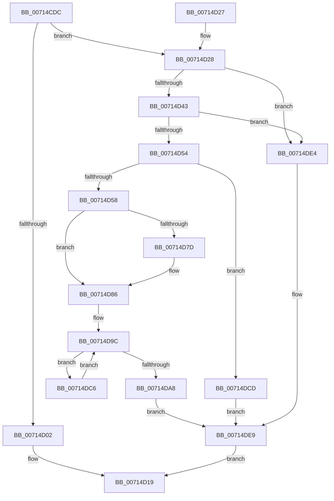

# FsRtlpOpBatchBreakClosePending

- RVA: `0x00714CDC`–`0x00714E0A` (길이 `302` bytes)
- VA: `0x0000000140714CDC`
- 실행 섹션: `PAGE`
- PDB 이름 있음: `예`; PDB Function 태그: `아니요`
- unwind 정보 RVA: `0x000C5F68`
- 디코드: `81`개 명령, `302/302` bytes 표시
- 미해석 바이트: `0` (있으면 어셈블리에 `.byte`로 보존)

> 이 문서는 커널 이미지의 기계어와 PDB 기호를 분석해 생성했습니다. 4번과 5번은 함수 원형과 자료형을 바이너리 사용 방식에서 추정한 C 해석이며 원본 소스 복구 결과는 아닙니다.

## 1. Dependencies

- 직접 호출 지점: **10**; 고유 호출 대상: **9**
- 직접 호출자로 확인된 함수: **1**
- RIP 상대 이미지 참조: **0**

### Outgoing calls
- `0x00714D0F` → [IofCompleteRequest](../../text/29/IofCompleteRequest_function_0029B5C0.md) (function, `0x0029B5C0`)
- `0x00714D2F` → [ExAcquireFastMutexUnsafe](../../text/3F/ExAcquireFastMutexUnsafe_function_003F3720.md) (function, `0x003F3720`)
- `0x00714D60` → [FsRtlpModifyThreadPriorities](../../text/48/FsRtlpModifyThreadPriorities_function_0048B098.md) (function, `0x0048B098`)
- `0x00714D6A` → [FsRtlpClearOwner](../../text/26/FsRtlpClearOwner_function_00265BE8.md) (function, `0x00265BE8`)
- `0x00714D81` → [ObfDereferenceObject](../../text/2F/ObfDereferenceObject_function_002F9350.md) (function, `0x002F9350`)
- `0x00714DAF` → [FsRtlpSyncWithAckTimeout](../../text/4F/FsRtlpSyncWithAckTimeout_function_004F23C4.md) (function, `0x004F23C4`)
- `0x00714DBB` → [FsRtlpOplockPerfSendData](../6F/FsRtlpOplockPerfSendData_function_006FDB80.md) (function, `0x006FDB80`)
- `0x00714DC6` → [FsRtlpRemoveAndCompleteWaitingIrp](../../text/42/FsRtlpRemoveAndCompleteWaitingIrp_function_00425FC0.md) (function, `0x00425FC0`)
- `0x00714DF1` → [IofCompleteRequest](../../text/29/IofCompleteRequest_function_0029B5C0.md) (function, `0x0029B5C0`)
- `0x00714DFE` → [ExReleaseFastMutexUnsafe](../../text/25/ExReleaseFastMutexUnsafe_function_002503A0.md) (function, `0x002503A0`)

### Direct callers
- [FsRtlpOplockFsctrlInternal](../9F/FsRtlpOplockFsctrlInternal_function_009F1640.md) at `0x009F1B50`

### Static image references
- 디코드된 RIP-relative 메모리 참조가 없습니다.

## 2. Other-region calls and transfers

- 다른 실행 섹션으로 향하는 call: **9**
  - `0x00714D0F` → [IofCompleteRequest](../../text/29/IofCompleteRequest_function_0029B5C0.md) (`PAGE` → `.text`)
  - `0x00714D2F` → [ExAcquireFastMutexUnsafe](../../text/3F/ExAcquireFastMutexUnsafe_function_003F3720.md) (`PAGE` → `.text`)
  - `0x00714D60` → [FsRtlpModifyThreadPriorities](../../text/48/FsRtlpModifyThreadPriorities_function_0048B098.md) (`PAGE` → `.text`)
  - `0x00714D6A` → [FsRtlpClearOwner](../../text/26/FsRtlpClearOwner_function_00265BE8.md) (`PAGE` → `.text`)
  - `0x00714D81` → [ObfDereferenceObject](../../text/2F/ObfDereferenceObject_function_002F9350.md) (`PAGE` → `.text`)
  - `0x00714DAF` → [FsRtlpSyncWithAckTimeout](../../text/4F/FsRtlpSyncWithAckTimeout_function_004F23C4.md) (`PAGE` → `.text`)
  - `0x00714DC6` → [FsRtlpRemoveAndCompleteWaitingIrp](../../text/42/FsRtlpRemoveAndCompleteWaitingIrp_function_00425FC0.md) (`PAGE` → `.text`)
  - `0x00714DF1` → [IofCompleteRequest](../../text/29/IofCompleteRequest_function_0029B5C0.md) (`PAGE` → `.text`)
  - `0x00714DFE` → [ExReleaseFastMutexUnsafe](../../text/25/ExReleaseFastMutexUnsafe_function_002503A0.md) (`PAGE` → `.text`)
- 별도 외부 분기/꼬리 이동을 확인하지 못했습니다.

## 3. Assembly (complete function range)

```asm
00714CDC  48 89 5C 24 10                  mov qword ptr [rsp + 0x10], rbx
00714CE1  48 89 4C 24 08                  mov qword ptr [rsp + 8], rcx
00714CE6  56                              push rsi
00714CE7  57                              push rdi
00714CE8  41 56                           push r14
00714CEA  48 83 EC 20                     sub rsp, 0x20
00714CEE  49 8B F0                        mov rsi, r8
00714CF1  4C 8B F2                        mov r14, rdx
00714CF4  48 8B D9                        mov rbx, rcx
00714CF7  33 FF                           xor edi, edi
00714CF9  89 7C 24 58                     mov dword ptr [rsp + 0x58], edi
00714CFD  48 85 C9                        test rcx, rcx
00714D00  75 26                           jne 0x140714d28
00714D02  41 C7 40 30 E3 00 00 C0         mov dword ptr [r8 + 0x30], 0xc00000e3
00714D0A  B2 01                           mov dl, 1
00714D0C  49 8B C8                        mov rcx, r8
00714D0F  E8 AC 68 B8 FF                  call 0x14029b5c0
00714D14  B8 E3 00 00 C0                  mov eax, 0xc00000e3
00714D19  48 8B 5C 24 48                  mov rbx, qword ptr [rsp + 0x48]
00714D1E  48 83 C4 20                     add rsp, 0x20
00714D22  41 5E                           pop r14
00714D24  5F                              pop rdi
00714D25  5E                              pop rsi
00714D26  C3                              ret
00714D27  CC                              int3
00714D28  48 8B 89 98 00 00 00            mov rcx, qword ptr [rcx + 0x98]
00714D2F  E8 EC E9 CD FF                  call 0x1403f3720
00714D34  90                              nop
00714D35  49 8B 46 30                     mov rax, qword ptr [r14 + 0x30]
00714D39  48 39 43 08                     cmp qword ptr [rbx + 8], rax
00714D3D  0F 85 A1 00 00 00               jne 0x140714de4
00714D43  8B 83 90 00 00 00               mov eax, dword ptr [rbx + 0x90]
00714D49  A9 00 07 00 00                  test eax, 0x700
00714D4E  0F 84 90 00 00 00               je 0x140714de4
00714D54  A8 82                           test al, 0x82
00714D56  74 75                           je 0x140714dcd
00714D58  45 33 C0                        xor r8d, r8d
00714D5B  33 D2                           xor edx, edx
00714D5D  48 8B CB                        mov rcx, rbx
00714D60  E8 33 63 D7 FF                  call 0x14048b098
00714D65  33 D2                           xor edx, edx
00714D67  48 8B CB                        mov rcx, rbx
00714D6A  E8 79 0E B5 FF                  call 0x140265be8
00714D6F  40 88 7B 20                     mov byte ptr [rbx + 0x20], dil
00714D73  8B 83 90 00 00 00               mov eax, dword ptr [rbx + 0x90]
00714D79  A8 02                           test al, 2
00714D7B  74 09                           je 0x140714d86
00714D7D  48 8B 4B 08                     mov rcx, qword ptr [rbx + 8]
00714D81  E8 CA 45 BE FF                  call 0x1402f9350
00714D86  8B 83 90 00 00 00               mov eax, dword ptr [rbx + 0x90]
00714D8C  83 E0 20                        and eax, 0x20
00714D8F  83 C8 01                        or eax, 1
00714D92  89 83 90 00 00 00               mov dword ptr [rbx + 0x90], eax
00714D98  48 89 7B 08                     mov qword ptr [rbx + 8], rdi
00714D9C  48 8D 43 58                     lea rax, [rbx + 0x58]
00714DA0  48 8B 08                        mov rcx, qword ptr [rax]
00714DA3  48 3B C8                        cmp rcx, rax
00714DA6  75 1E                           jne 0x140714dc6
00714DA8  48 8D 8B B8 00 00 00            lea rcx, [rbx + 0xb8]
00714DAF  E8 10 D6 DD FF                  call 0x1404f23c4
00714DB4  48 8D 8B A8 00 00 00            lea rcx, [rbx + 0xa8]
00714DBB  E8 C0 8D FE FF                  call 0x1406fdb80
00714DC0  8B 7C 24 58                     mov edi, dword ptr [rsp + 0x58]
00714DC4  EB 23                           jmp 0x140714de9
00714DC6  E8 F5 11 D1 FF                  call 0x140425fc0
00714DCB  EB CF                           jmp 0x140714d9c
00714DCD  25 FF F0 0F FE                  and eax, 0xfe0ff0ff
00714DD2  89 83 90 00 00 00               mov dword ptr [rbx + 0x90], eax
00714DD8  0F BA E8 0B                     bts eax, 0xb
00714DDC  89 83 90 00 00 00               mov dword ptr [rbx + 0x90], eax
00714DE2  EB 05                           jmp 0x140714de9
00714DE4  BF E3 00 00 C0                  mov edi, 0xc00000e3
00714DE9  89 7E 30                        mov dword ptr [rsi + 0x30], edi
00714DEC  B2 01                           mov dl, 1
00714DEE  48 8B CE                        mov rcx, rsi
00714DF1  E8 CA 67 B8 FF                  call 0x14029b5c0
00714DF6  90                              nop
00714DF7  48 8B 8B 98 00 00 00            mov rcx, qword ptr [rbx + 0x98]
00714DFE  E8 9D B5 B3 FF                  call 0x1402503a0
00714E03  8B C7                           mov eax, edi
00714E05  E9 0F FF FF FF                  jmp 0x140714d19
```

## 4. C-style interpretation (structured pseudocode)

```c
__int64 __fastcall FsRtlpOpBatchBreakClosePending(__int64 a1, __int64 a2, __int64 a3)
{
    __int64 result;
    __int64 v_rdi;
    __int64 v_rsp;
    unsigned __int64 v_stack_p10;
    unsigned int v_stack_p20;
    unsigned int v_stack_p58;
    unsigned __int64 v_stack_p8;

    v_stack_p10 = v_rbx;
    v_stack_p8 = a1;
    v_rsp = (v_rsp) - (32);
    v_rdi = 0;
    v_stack_p20 = 0;
    if (a1 != 0) goto loc_00714D28;
    *(unsigned int *)(a3 + 48) = 0xC00000E3ULL;
    result = IofCompleteRequest(a3, 1, a3, a4);
loc_00714D19:
    v_rsp = (v_rsp) + (32);
    return (unsigned int)(0xC00000E3ULL);
loc_00714D28:
    result = ExAcquireFastMutexUnsafe(*(unsigned __int64 *)(a3 + 152), 1, a3, a4);
    if ((*(unsigned __int64 *)(v_stack_p10 + 8)) != (*(unsigned __int64 *)(a2 + 48))) goto loc_00714DE4;
    if ((((unsigned int)((unsigned int)(*(unsigned int *)(v_stack_p10 + 144)))) & (0x700ULL)) == 0) goto loc_00714DE4;
    if ((((unsigned __int8)((unsigned int)(*(unsigned int *)(v_stack_p10 + 144)))) & (130)) == 0) goto loc_00714DCD;
    a3 = 0;
    a2 = 0;
    result = FsRtlpModifyThreadPriorities(v_stack_p10, a2, a3, a4);
    a2 = 0;
    result = FsRtlpClearOwner(v_stack_p10, a2, a3, a4);
    *(unsigned __int8 *)(v_stack_p10 + 32) = 0;
    result = (unsigned int)(*(unsigned int *)(v_stack_p10 + 144));
    if ((((unsigned __int8)((unsigned int)(*(unsigned int *)(v_stack_p10 + 144)))) & (2)) != 0) {
        a1 = *(unsigned __int64 *)(v_stack_p10 + 8);
        result = ObfDereferenceObject(a1, a2, a3, a4);
    }
    result = (unsigned int)(((unsigned int)(*(unsigned int *)(v_stack_p10 + 144))) & (32));
    result = (unsigned int)((result) | (1));
    *(unsigned int *)(v_stack_p10 + 144) = (unsigned int)(result);
    *(unsigned __int64 *)(v_stack_p10 + 8) = 0;
loc_00714D9C:
    if ((*(unsigned __int64 *)(v_stack_p10 + 88)) != (v_stack_p10 + 88)) goto loc_00714DC6;
    result = FsRtlpSyncWithAckTimeout(v_stack_p10 + 184, a2, a3, a4);
    result = FsRtlpOplockPerfSendData(v_stack_p10 + 168, a2, a3, a4);
    goto loc_00714DE9;
loc_00714DC6:
    result = FsRtlpRemoveAndCompleteWaitingIrp(v_stack_p10 + 168, a2, a3, a4);
    goto loc_00714D9C;
loc_00714DCD:
    result = (unsigned int)((result) & (0xFE0FF0FFULL));
    *(unsigned int *)(v_stack_p10 + 144) = (unsigned int)(result);
    *(unsigned int *)(v_stack_p10 + 144) = (unsigned int)(result);
    goto loc_00714DE9;
loc_00714DE4:
loc_00714DE9:
    *(unsigned int *)(a3 + 48) = (unsigned int)((unsigned int)(0xC00000E3ULL));
    result = IofCompleteRequest(0, 1, a3, a4);
    result = ExReleaseFastMutexUnsafe(*(unsigned __int64 *)(v_stack_p10 + 152), 1, a3, a4);
    goto loc_00714D19;
}
```

## 5. (Beta) C Style

```c
int64_t FsRtlpOpBatchBreakClosePending(void *Arg1, void *Arg2, void *Arg3)
{
    uint8_t *arg1 = (uint8_t *)Arg1;
    uint8_t *arg2 = (uint8_t *)Arg2;
    uint8_t *arg3 = (uint8_t *)Arg3;

    int64_t result;
    int64_t local_rdi;
    int64_t local_rsp;
    uint64_t v_stack_p10;
    uint32_t v_stack_p20;
    uint32_t v_stack_p58;
    uint64_t v_stack_p8;

    v_stack_p10 = local_rbx;
    v_stack_p8 = Arg1;
    local_rsp = (local_rsp) - (32);
    local_rdi = 0;
    v_stack_p20 = 0;
    if (Arg1 != NULL) goto loc_00714D28;
    *(uint32_t *)(arg3 + 0x30) = 0xC00000E3ULL;
    result = IofCompleteRequest(Arg3, 1, Arg3, a4);
loc_00714D19:
    local_rsp = (local_rsp) + (32);
    return (uint32_t)(0xC00000E3ULL);
loc_00714D28:
    result = ExAcquireFastMutexUnsafe(*(uint64_t *)(arg3 + 0x98), 1, Arg3, a4);
    if ((*(uint64_t *)(v_stack_p10 + 0x8)) != (*(uint64_t *)(arg2 + 0x30))) goto loc_00714DE4;
    if ((((uint32_t)((uint32_t)(*(uint32_t *)(v_stack_p10 + 0x90)))) & (0x700ULL)) == 0) goto loc_00714DE4;
    if ((((uint8_t)((uint32_t)(*(uint32_t *)(v_stack_p10 + 0x90)))) & (130)) == 0) goto loc_00714DCD;
    Arg3 = 0;
    Arg2 = 0;
    result = FsRtlpModifyThreadPriorities(v_stack_p10, Arg2, Arg3, a4);
    Arg2 = 0;
    result = FsRtlpClearOwner(v_stack_p10, Arg2, Arg3, a4);
    *(uint8_t *)(v_stack_p10 + 0x20) = 0;
    result = (uint32_t)(*(uint32_t *)(v_stack_p10 + 0x90));
    if ((((uint8_t)((uint32_t)(*(uint32_t *)(v_stack_p10 + 0x90)))) & (2)) != 0) {
        Arg1 = *(uint64_t *)(v_stack_p10 + 0x8);
        result = ObfDereferenceObject(Arg1, Arg2, Arg3, a4);
    }
    result = (uint32_t)(((uint32_t)(*(uint32_t *)(v_stack_p10 + 0x90))) & (32));
    result = (uint32_t)((result) | (1));
    *(uint32_t *)(v_stack_p10 + 0x90) = (uint32_t)(result);
    *(uint64_t *)(v_stack_p10 + 0x8) = 0;
loc_00714D9C:
    if ((*(uint64_t *)(v_stack_p10 + 0x58)) != (v_stack_p10 + 88)) goto loc_00714DC6;
    result = FsRtlpSyncWithAckTimeout(v_stack_p10 + 184, Arg2, Arg3, a4);
    result = FsRtlpOplockPerfSendData(v_stack_p10 + 168, Arg2, Arg3, a4);
    goto loc_00714DE9;
loc_00714DC6:
    result = FsRtlpRemoveAndCompleteWaitingIrp(v_stack_p10 + 168, Arg2, Arg3, a4);
    goto loc_00714D9C;
loc_00714DCD:
    result = (uint32_t)((result) & (0xFE0FF0FFULL));
    *(uint32_t *)(v_stack_p10 + 0x90) = (uint32_t)(result);
    *(uint32_t *)(v_stack_p10 + 0x90) = (uint32_t)(result);
    goto loc_00714DE9;
loc_00714DE4:
loc_00714DE9:
    *(uint32_t *)(arg3 + 0x30) = (uint32_t)((uint32_t)(0xC00000E3ULL));
    result = IofCompleteRequest(0, 1, Arg3, a4);
    result = ExReleaseFastMutexUnsafe(*(uint64_t *)(v_stack_p10 + 0x98), 1, Arg3, a4);
    goto loc_00714D19;
}
```

### 관측된 메모리 오프셋

구조체 형식이 확인되지 않은 접근은 인자 기준의 오프셋으로만 기록했습니다.

| 기준 인자 | 오프셋 표현 | 폭 (bit) | 접근 |
|---|---:|---:|---|
| `Arg1` | `+ 0x0` | `64` | `R` |
| `Arg1` | `+ 0x8` | `64` | `R` |
| `Arg1` | `+ 0x8` | `64` | `W` |
| `Arg1` | `+ 0x20` | `8` | `W` |
| `Arg1` | `+ 0x58` | `64` | `R` |
| `Arg1` | `+ 0x90` | `32` | `R` |
| `Arg1` | `+ 0x90` | `32` | `W` |
| `Arg1` | `+ 0x98` | `64` | `R` |
| `Arg1` | `+ 0xA8` | `64` | `R` |
| `Arg1` | `+ 0xB8` | `64` | `R` |
| `Arg2` | `+ 0x30` | `64` | `R` |
| `Arg3` | `+ 0x30` | `32` | `W` |

## 6. Execution-region graph

[열기: 2D/3D 그래프와 함수 탐색 컨트롤 패널](../../../control-panel.html?section=page&rva=0x00714CDC&view=graph)

- 2D 그래프는 위에서 아래로 흐르고, 3D 그래프는 빈 공간을 드래그해 회전합니다. Shift+드래그는 이동, 휠은 확대·축소, 함수 노드 선택은 대상 보고서 이동입니다.

### Static fallback


