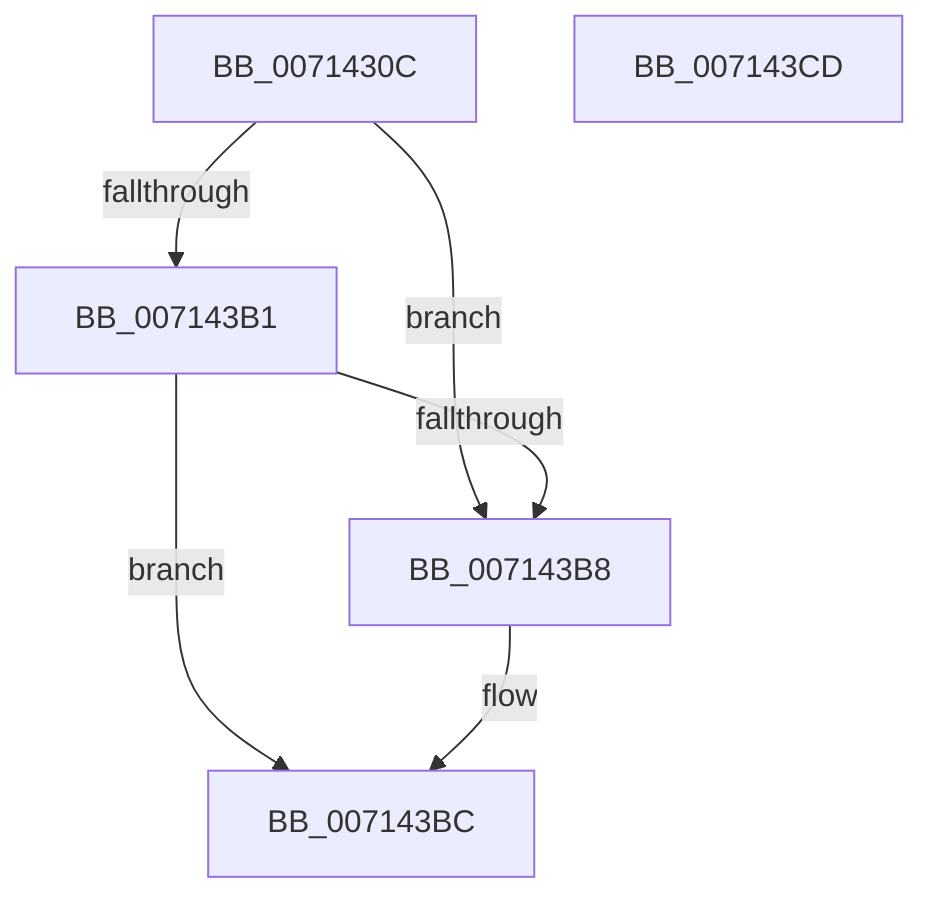

# FsRtlpOpenDev

- RVA: `0x0071430C`–`0x007143CE` (길이 `194` bytes)
- VA: `0x000000014071430C`
- 실행 섹션: `PAGE`
- PDB 이름 있음: `예`; PDB Function 태그: `아니요`
- unwind 정보 RVA: `0x000C5DBC`
- 디코드: `45`개 명령, `194/194` bytes 표시
- 미해석 바이트: `0` (있으면 어셈블리에 `.byte`로 보존)

> 이 문서는 커널 이미지의 기계어와 PDB 기호를 분석해 생성했습니다. 4번과 5번은 함수 원형과 자료형을 바이너리 사용 방식에서 추정한 C 해석이며 원본 소스 복구 결과는 아닙니다.

## 1. Dependencies

- 직접 호출 지점: **2**; 고유 호출 대상: **2**
- 직접 호출자로 확인된 함수: **1**
- RIP 상대 이미지 참조: **1**

### Outgoing calls
- `0x00714342` → [RtlInitUnicodeString](../../text/42/RtlInitUnicodeString_function_0042A780.md) (function, `0x0042A780`)
- `0x007143A8` → [ZwCreateFile](../../text/6A/ZwCreateFile_function_006ADB70.md) (function, `0x006ADB70`)

### Direct callers
- [FsRtlpRegisterUncProvider](FsRtlpRegisterUncProvider_function_007144D0.md) at `0x00714559`

### Static image references
- `0x00714320` → RVA `0x00AFBD90` (` ?? ::NNGAKEGL::`string'`; read)

## 2. Other-region calls and transfers

- 다른 실행 섹션으로 향하는 call: **2**
  - `0x00714342` → [RtlInitUnicodeString](../../text/42/RtlInitUnicodeString_function_0042A780.md) (`PAGE` → `.text`)
  - `0x007143A8` → [ZwCreateFile](../../text/6A/ZwCreateFile_function_006ADB70.md) (`PAGE` → `.text`)
- 별도 외부 분기/꼬리 이동을 확인하지 못했습니다.

## 3. Assembly (complete function range)

```asm
0071430C  48 89 5C 24 08                  mov qword ptr [rsp + 8], rbx
00714311  55                              push rbp
00714312  48 8D 6C 24 A9                  lea rbp, [rsp - 0x57]
00714317  48 81 EC B0 00 00 00            sub rsp, 0xb0
0071431E  33 C0                           xor eax, eax
00714320  48 8D 15 69 7A 3E 00            lea rdx, [rip + 0x3e7a69]
00714327  21 45 43                        and dword ptr [rbp + 0x43], eax
0071432A  0F 57 C0                        xorps xmm0, xmm0
0071432D  48 8B D9                        mov rbx, rcx
00714330  89 45 2B                        mov dword ptr [rbp + 0x2b], eax
00714333  21 45 2B                        and dword ptr [rbp + 0x2b], eax
00714336  48 8D 4D 07                     lea rcx, [rbp + 7]
0071433A  0F 11 45 07                     movups xmmword ptr [rbp + 7], xmm0
0071433E  0F 11 45 17                     movups xmmword ptr [rbp + 0x17], xmm0
00714342  E8 39 64 D1 FF                  call 0x14042a780
00714347  83 64 24 50 00                  and dword ptr [rsp + 0x50], 0
0071434C  48 8D 45 07                     lea rax, [rbp + 7]
00714350  48 83 64 24 48 00               and qword ptr [rsp + 0x48], 0
00714356  4C 8D 4D 17                     lea r9, [rbp + 0x17]
0071435A  83 64 24 40 00                  and dword ptr [rsp + 0x40], 0
0071435F  4C 8D 45 27                     lea r8, [rbp + 0x27]
00714363  48 83 65 2F 00                  and qword ptr [rbp + 0x2f], 0
00714368  0F 57 C0                        xorps xmm0, xmm0
0071436B  C7 44 24 38 01 00 00 00         mov dword ptr [rsp + 0x38], 1
00714373  BA 00 00 00 40                  mov edx, 0x40000000
00714378  C7 44 24 30 03 00 00 00         mov dword ptr [rsp + 0x30], 3
00714380  48 8B CB                        mov rcx, rbx
00714383  C7 44 24 28 80 00 00 00         mov dword ptr [rsp + 0x28], 0x80
0071438B  48 83 64 24 20 00               and qword ptr [rsp + 0x20], 0
00714391  C7 45 27 30 00 00 00            mov dword ptr [rbp + 0x27], 0x30
00714398  C7 45 3F 00 02 00 00            mov dword ptr [rbp + 0x3f], 0x200
0071439F  48 89 45 37                     mov qword ptr [rbp + 0x37], rax
007143A3  F3 0F 7F 45 47                  movdqu xmmword ptr [rbp + 0x47], xmm0
007143A8  E8 C3 97 F9 FF                  call 0x1406adb70
007143AD  85 C0                           test eax, eax
007143AF  78 07                           js 0x1407143b8
007143B1  8B 45 17                        mov eax, dword ptr [rbp + 0x17]
007143B4  85 C0                           test eax, eax
007143B6  79 04                           jns 0x1407143bc
007143B8  48 83 0B FF                     or qword ptr [rbx], 0xffffffffffffffff
007143BC  48 8B 9C 24 C0 00 00 00         mov rbx, qword ptr [rsp + 0xc0]
007143C4  48 81 C4 B0 00 00 00            add rsp, 0xb0
007143CB  5D                              pop rbp
007143CC  C3                              ret
007143CD  CC                              int3
```

## 4. C-style interpretation (structured pseudocode)

```c
__int64 __fastcall FsRtlpOpenDev(__int64 a1)
{
    __int64 result;
    __int64 v_rsp;
    unsigned __int64 v_stack_m18;
    unsigned int v_stack_m1C;
    unsigned int v_stack_m20;
    unsigned __int64 v_stack_m28;
    unsigned __int64 v_stack_m30;
    unsigned int v_stack_m34;
    unsigned __int64 v_stack_m38;
    unsigned __int64 v_stack_m48;
    unsigned __int64 v_stack_m58;
    unsigned __int64 v_stack_m5F;
    unsigned int v_stack_m68;
    unsigned __int64 v_stack_m70;
    unsigned int v_stack_m78;
    unsigned int v_stack_m80;
    unsigned int v_stack_m88;
    unsigned int v_stack_m90;
    unsigned __int64 v_stack_m98;
    unsigned __int64 v_stack_p8;

    v_stack_p8 = v_rbx;
    v_rsp = (v_rsp) - (176);
    result = 0;
    v_stack_m34 = 0;
    v_stack_m58 = v_xmm0;
    v_stack_m48 = v_xmm0;
    result = RtlInitUnicodeString(v_stack_m58, v_rip + 4094569, a3, a4);
    v_stack_m80 = 1;
    v_stack_m88 = 3;
    v_stack_m90 = 128;
    v_stack_m38 = 48;
    v_stack_m20 = 512;
    v_stack_m28 = v_stack_m58;
    v_stack_m18 = v_xmm0;
    result = ZwCreateFile(a1, (unsigned int)(0x40000000ULL), v_stack_m38, v_stack_m48);
    if (sign_flag) goto loc_007143B8;
    if (sign_flag) {
    }
    v_rsp = (v_rsp) + (176);
    return (unsigned int)(v_stack_m48);
}
```

## 5. (Beta) C Style

```c
int64_t FsRtlpOpenDev(void *Arg1)
{
    uint8_t *arg1 = (uint8_t *)Arg1;

    int64_t result;
    int64_t local_rsp;
    uint64_t v_stack_m18;
    uint32_t v_stack_m1C;
    uint32_t v_stack_m20;
    uint64_t v_stack_m28;
    uint64_t v_stack_m30;
    uint32_t v_stack_m34;
    uint64_t v_stack_m38;
    uint64_t v_stack_m48;
    uint64_t v_stack_m58;
    uint64_t v_stack_m5F;
    uint32_t v_stack_m68;
    uint64_t v_stack_m70;
    uint32_t v_stack_m78;
    uint32_t v_stack_m80;
    uint32_t v_stack_m88;
    uint32_t v_stack_m90;
    uint64_t v_stack_m98;
    uint64_t v_stack_p8;

    v_stack_p8 = local_rbx;
    local_rsp = (local_rsp) - (176);
    result = 0;
    v_stack_m34 = 0;
    v_stack_m58 = v_xmm0;
    v_stack_m48 = v_xmm0;
    result = RtlInitUnicodeString(v_stack_m58, v_rip + 4094569, a3, a4);
    v_stack_m80 = 1;
    v_stack_m88 = 3;
    v_stack_m90 = 128;
    v_stack_m38 = 48;
    v_stack_m20 = 512;
    v_stack_m28 = v_stack_m58;
    v_stack_m18 = v_xmm0;
    result = ZwCreateFile(Arg1, (uint32_t)(0x40000000ULL), v_stack_m38, v_stack_m48);
    if (sign_flag) goto loc_007143B8;
    if (sign_flag) {
    }
    local_rsp = (local_rsp) + (176);
    return (uint32_t)(v_stack_m48);
}
```

### 관측된 메모리 오프셋

구조체 형식이 확인되지 않은 접근은 인자 기준의 오프셋으로만 기록했습니다.

| 기준 인자 | 오프셋 표현 | 폭 (bit) | 접근 |
|---|---:|---:|---|
| `Arg1` | `+ 0x0` | `64` | `R/W` |

## 6. Execution-region graph

[열기: 2D/3D 그래프와 함수 탐색 컨트롤 패널](../../../control-panel.html?section=page&rva=0x0071430C&view=graph)

- 2D 그래프는 위에서 아래로 흐르고, 3D 그래프는 빈 공간을 드래그해 회전합니다. Shift+드래그는 이동, 휠은 확대·축소, 함수 노드 선택은 대상 보고서 이동입니다.

### Static fallback


