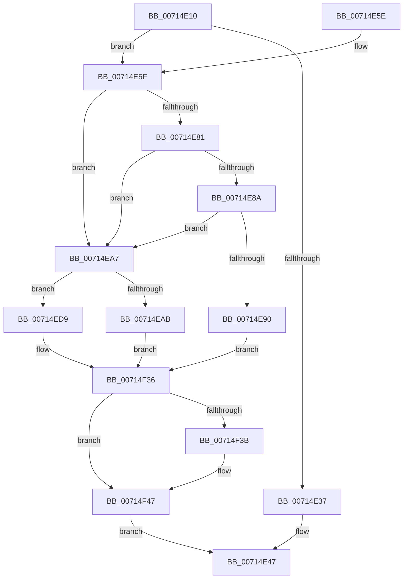

# FsRtlpOplockBreakNotify

- RVA: `0x00714E10`–`0x00714F4E` (길이 `318` bytes)
- VA: `0x0000000140714E10`
- 실행 섹션: `PAGE`
- PDB 이름 있음: `예`; PDB Function 태그: `아니요`
- unwind 정보 RVA: `0x000C5F38`
- 디코드: `86`개 명령, `318/318` bytes 표시
- 미해석 바이트: `0` (있으면 어셈블리에 `.byte`로 보존)

> 이 문서는 커널 이미지의 기계어와 PDB 기호를 분석해 생성했습니다. 4번과 5번은 함수 원형과 자료형을 바이너리 사용 방식에서 추정한 C 해석이며 원본 소스 복구 결과는 아닙니다.

## 1. Dependencies

- 직접 호출 지점: **8**; 고유 호출 대상: **6**
- 직접 호출자로 확인된 함수: **1**
- RIP 상대 이미지 참조: **1**

### Outgoing calls
- `0x00714E40` → [IofCompleteRequest](../../text/29/IofCompleteRequest_function_0029B5C0.md) (function, `0x0029B5C0`)
- `0x00714E66` → [ExAcquireFastMutexUnsafe](../../text/3F/ExAcquireFastMutexUnsafe_function_003F3720.md) (function, `0x003F3720`)
- `0x00714E9A` → [IofCompleteRequest](../../text/29/IofCompleteRequest_function_0029B5C0.md) (function, `0x0029B5C0`)
- `0x00714ECA` → [IofCompleteRequest](../../text/29/IofCompleteRequest_function_0029B5C0.md) (function, `0x0029B5C0`)
- `0x00714EED` → [FsRtlpModifyThreadPriorities](../../text/48/FsRtlpModifyThreadPriorities_function_0048B098.md) (function, `0x0048B098`)
- `0x00714EF7` → [FsRtlpOplockSendModernAppTermination](../../text/49/FsRtlpOplockSendModernAppTermination_function_0049F22C.md) (function, `0x0049F22C`)
- `0x00714F2F` → [FsRtlpWaitOnIrp](../../text/4E/FsRtlpWaitOnIrp_function_004E7998.md) (function, `0x004E7998`)
- `0x00714F42` → [ExReleaseFastMutexUnsafe](../../text/25/ExReleaseFastMutexUnsafe_function_002503A0.md) (function, `0x002503A0`)

### Direct callers
- [FsRtlpOplockFsctrlInternal](../9F/FsRtlpOplockFsctrlInternal_function_009F1640.md) at `0x009F1B60`

### Static image references
- `0x00714F1F` → RVA `0x00714CC0` (`FsRtlpNotifyOplockBreakComplete`; read)

## 2. Other-region calls and transfers

- 다른 실행 섹션으로 향하는 call: **8**
  - `0x00714E40` → [IofCompleteRequest](../../text/29/IofCompleteRequest_function_0029B5C0.md) (`PAGE` → `.text`)
  - `0x00714E66` → [ExAcquireFastMutexUnsafe](../../text/3F/ExAcquireFastMutexUnsafe_function_003F3720.md) (`PAGE` → `.text`)
  - `0x00714E9A` → [IofCompleteRequest](../../text/29/IofCompleteRequest_function_0029B5C0.md) (`PAGE` → `.text`)
  - `0x00714ECA` → [IofCompleteRequest](../../text/29/IofCompleteRequest_function_0029B5C0.md) (`PAGE` → `.text`)
  - `0x00714EED` → [FsRtlpModifyThreadPriorities](../../text/48/FsRtlpModifyThreadPriorities_function_0048B098.md) (`PAGE` → `.text`)
  - `0x00714EF7` → [FsRtlpOplockSendModernAppTermination](../../text/49/FsRtlpOplockSendModernAppTermination_function_0049F22C.md) (`PAGE` → `.text`)
  - `0x00714F2F` → [FsRtlpWaitOnIrp](../../text/4E/FsRtlpWaitOnIrp_function_004E7998.md) (`PAGE` → `.text`)
  - `0x00714F42` → [ExReleaseFastMutexUnsafe](../../text/25/ExReleaseFastMutexUnsafe_function_002503A0.md) (`PAGE` → `.text`)
- 별도 외부 분기/꼬리 이동을 확인하지 못했습니다.

## 3. Assembly (complete function range)

```asm
00714E10  48 8B C4                        mov rax, rsp
00714E13  48 89 58 10                     mov qword ptr [rax + 0x10], rbx
00714E17  48 89 70 18                     mov qword ptr [rax + 0x18], rsi
00714E1B  48 89 78 20                     mov qword ptr [rax + 0x20], rdi
00714E1F  48 89 48 08                     mov qword ptr [rax + 8], rcx
00714E23  41 56                           push r14
00714E25  48 83 EC 70                     sub rsp, 0x70
00714E29  49 8B F8                        mov rdi, r8
00714E2C  48 8B D9                        mov rbx, rcx
00714E2F  45 33 F6                        xor r14d, r14d
00714E32  48 85 C9                        test rcx, rcx
00714E35  75 28                           jne 0x140714e5f
00714E37  45 89 70 30                     mov dword ptr [r8 + 0x30], r14d
00714E3B  B2 01                           mov dl, 1
00714E3D  49 8B C8                        mov rcx, r8
00714E40  E8 7B 67 B8 FF                  call 0x14029b5c0
00714E45  33 C0                           xor eax, eax
00714E47  4C 8D 5C 24 70                  lea r11, [rsp + 0x70]
00714E4C  49 8B 5B 18                     mov rbx, qword ptr [r11 + 0x18]
00714E50  49 8B 73 20                     mov rsi, qword ptr [r11 + 0x20]
00714E54  49 8B 7B 28                     mov rdi, qword ptr [r11 + 0x28]
00714E58  49 8B E3                        mov rsp, r11
00714E5B  41 5E                           pop r14
00714E5D  C3                              ret
00714E5E  CC                              int3
00714E5F  48 8B 89 98 00 00 00            mov rcx, qword ptr [rcx + 0x98]
00714E66  E8 B5 E8 CD FF                  call 0x1403f3720
00714E6B  40 B6 01                        mov sil, 1
00714E6E  40 88 74 24 60                  mov byte ptr [rsp + 0x60], sil
00714E73  8B 8B 90 00 00 00               mov ecx, dword ptr [rbx + 0x90]
00714E79  F7 C1 00 0F F0 01               test ecx, 0x1f00f00
00714E7F  75 26                           jne 0x140714ea7
00714E81  48 8D 43 48                     lea rax, [rbx + 0x48]
00714E85  48 39 00                        cmp qword ptr [rax], rax
00714E88  75 1D                           jne 0x140714ea7
00714E8A  0F BA E1 11                     bt ecx, 0x11
00714E8E  72 17                           jb 0x140714ea7
00714E90  44 89 77 30                     mov dword ptr [rdi + 0x30], r14d
00714E94  40 8A D6                        mov dl, sil
00714E97  48 8B CF                        mov rcx, rdi
00714E9A  E8 21 67 B8 FF                  call 0x14029b5c0
00714E9F  41 8B FE                        mov edi, r14d
00714EA2  E9 8F 00 00 00                  jmp 0x140714f36
00714EA7  84 C9                           test cl, cl
00714EA9  79 2E                           jns 0x140714ed9
00714EAB  8B 83 90 00 00 00               mov eax, dword ptr [rbx + 0x90]
00714EB1  83 E0 20                        and eax, 0x20
00714EB4  83 C8 01                        or eax, 1
00714EB7  89 83 90 00 00 00               mov dword ptr [rbx + 0x90], eax
00714EBD  4C 89 73 08                     mov qword ptr [rbx + 8], r14
00714EC1  44 89 77 30                     mov dword ptr [rdi + 0x30], r14d
00714EC5  B2 01                           mov dl, 1
00714EC7  48 8B CF                        mov rcx, rdi
00714ECA  E8 F1 66 B8 FF                  call 0x14029b5c0
00714ECF  41 8B FE                        mov edi, r14d
00714ED2  40 8A 74 24 60                  mov sil, byte ptr [rsp + 0x60]
00714ED7  EB 5D                           jmp 0x140714f36
00714ED9  41 8A F6                        mov sil, r14b
00714EDC  44 88 74 24 60                  mov byte ptr [rsp + 0x60], r14b
00714EE1  44 89 77 30                     mov dword ptr [rdi + 0x30], r14d
00714EE5  41 B0 01                        mov r8b, 1
00714EE8  33 D2                           xor edx, edx
00714EEA  48 8B CB                        mov rcx, rbx
00714EED  E8 A6 61 D7 FF                  call 0x14048b098
00714EF2  33 D2                           xor edx, edx
00714EF4  48 8B CB                        mov rcx, rbx
00714EF7  E8 30 A3 D8 FF                  call 0x14049f22c
00714EFC  4C 89 74 24 50                  mov qword ptr [rsp + 0x50], r14
00714F01  4C 89 74 24 48                  mov qword ptr [rsp + 0x48], r14
00714F06  4C 89 74 24 40                  mov qword ptr [rsp + 0x40], r14
00714F0B  4C 89 74 24 38                  mov qword ptr [rsp + 0x38], r14
00714F10  44 88 74 24 30                  mov byte ptr [rsp + 0x30], r14b
00714F15  4C 89 74 24 28                  mov qword ptr [rsp + 0x28], r14
00714F1A  4C 89 74 24 20                  mov qword ptr [rsp + 0x20], r14
00714F1F  4C 8D 0D 9A FD FF FF            lea r9, [rip - 0x266]
00714F26  45 33 C0                        xor r8d, r8d
00714F29  48 8B D7                        mov rdx, rdi
00714F2C  48 8B CB                        mov rcx, rbx
00714F2F  E8 64 2A DD FF                  call 0x1404e7998
00714F34  8B F8                           mov edi, eax
00714F36  40 84 F6                        test sil, sil
00714F39  74 0C                           je 0x140714f47
00714F3B  48 8B 8B 98 00 00 00            mov rcx, qword ptr [rbx + 0x98]
00714F42  E8 59 B4 B3 FF                  call 0x1402503a0
00714F47  8B C7                           mov eax, edi
00714F49  E9 F9 FE FF FF                  jmp 0x140714e47
```

## 4. C-style interpretation (structured pseudocode)

```c
__int64 __fastcall FsRtlpOplockBreakNotify(__int64 a1, __int64 a2, __int64 a3)
{
    __int64 result;
    __int64 v_r14;
    __int64 v_rsp;
    unsigned __int8 v_stack_m10;
    unsigned __int64 v_stack_m20;
    unsigned __int64 v_stack_m28;
    unsigned __int64 v_stack_m30;
    unsigned __int64 v_stack_m38;
    unsigned __int8 v_stack_m40;
    unsigned __int64 v_stack_m48;
    unsigned __int64 v_stack_m50;
    unsigned __int64 v_stack_m8;

    *(unsigned __int64 *)(v_rsp + 16) = v_rbx;
    *(unsigned __int64 *)(v_rsp + 24) = v_rsi;
    *(unsigned __int64 *)(v_rsp + 32) = v_rdi;
    *(unsigned __int64 *)(v_rsp + 8) = a1;
    v_rsp = (v_rsp) - (112);
    v_r14 = 0;
    if (a1 != 0) goto loc_00714E5F;
    *(unsigned int *)(a3 + 48) = 0;
    result = IofCompleteRequest(a3, 1, a3, a4);
    result = 0;
loc_00714E47:
    return result;
loc_00714E5F:
    result = ExAcquireFastMutexUnsafe(*(unsigned __int64 *)(a3 + 152), 1, a3, a4);
    v_stack_m10 = 1;
    if ((((unsigned int)((unsigned int)(*(unsigned int *)(*(unsigned __int64 *)(v_stack_m8 + 24) + 144)))) & (0x1F00F00ULL)) != 0) goto loc_00714EA7;
    if ((*(unsigned __int64 *)(*(unsigned __int64 *)(v_stack_m8 + 24) + 72)) != (*(unsigned __int64 *)(v_stack_m8 + 24) + 72)) goto loc_00714EA7;
    if ((*(unsigned __int64 *)(*(unsigned __int64 *)(v_stack_m8 + 24) + 72)) < (*(unsigned __int64 *)(v_stack_m8 + 24) + 72)) goto loc_00714EA7;
    *(unsigned int *)(*(unsigned __int64 *)(v_stack_m8 + 40) + 48) = 0;
    result = IofCompleteRequest(*(unsigned __int64 *)(v_stack_m8 + 40), 1, a3, a4);
    goto loc_00714F36;
loc_00714EA7:
    if (!sign_flag) goto loc_00714ED9;
    result = (unsigned int)(((unsigned int)(*(unsigned int *)(*(unsigned __int64 *)(v_stack_m8 + 24) + 144))) & (32));
    result = (unsigned int)((result) | (1));
    *(unsigned int *)(*(unsigned __int64 *)(v_stack_m8 + 24) + 144) = (unsigned int)(result);
    *(unsigned __int64 *)(*(unsigned __int64 *)(v_stack_m8 + 24) + 8) = 0;
    *(unsigned int *)(0 + 48) = 0;
    result = IofCompleteRequest(0, 1, a3, a4);
    goto loc_00714F36;
loc_00714ED9:
    v_stack_m10 = 0;
    *(unsigned int *)(0 + 48) = 0;
    a2 = 0;
    result = FsRtlpModifyThreadPriorities(*(unsigned __int64 *)(v_stack_m8 + 24), a2, 1, a4);
    a2 = 0;
    result = FsRtlpOplockSendModernAppTermination(*(unsigned __int64 *)(v_stack_m8 + 24), a2, 1, a4);
    v_stack_m20 = 0;
    v_stack_m28 = 0;
    v_stack_m30 = 0;
    v_stack_m38 = 0;
    v_stack_m40 = 0;
    v_stack_m48 = 0;
    v_stack_m50 = 0;
    a3 = 0;
    result = FsRtlpWaitOnIrp(*(unsigned __int64 *)(v_stack_m8 + 24), 0, a3, v_rip - 614);
loc_00714F36:
    if (0 != 0) {
        a1 = *(unsigned __int64 *)(*(unsigned __int64 *)(v_stack_m8 + 24) + 152);
        result = ExReleaseFastMutexUnsafe(a1, 0, a3, v_rip - 614);
    }
    goto loc_00714E47;
}
```

## 5. (Beta) C Style

```c
int64_t FsRtlpOplockBreakNotify(void *Arg1, int64_t Arg2, void *Arg3)
{
    uint8_t *arg1 = (uint8_t *)Arg1;
    uint8_t *arg3 = (uint8_t *)Arg3;

    int64_t result;
    int64_t local_r14;
    int64_t local_rsp;
    uint8_t v_stack_m10;
    uint64_t v_stack_m20;
    uint64_t v_stack_m28;
    uint64_t v_stack_m30;
    uint64_t v_stack_m38;
    uint8_t v_stack_m40;
    uint64_t v_stack_m48;
    uint64_t v_stack_m50;
    uint64_t v_stack_m8;

    *(uint64_t *)(local_rsp + 0x10) = local_rbx;
    *(uint64_t *)(local_rsp + 0x18) = local_rsi;
    *(uint64_t *)(local_rsp + 0x20) = local_rdi;
    *(void **)(local_rsp + 0x8) = Arg1;
    local_rsp = (local_rsp) - (112);
    local_r14 = 0;
    if (Arg1 != NULL) goto loc_00714E5F;
    *(uint32_t *)(arg3 + 0x30) = 0;
    result = IofCompleteRequest(Arg3, 1, Arg3, a4);
    result = 0;
loc_00714E47:
    return result;
loc_00714E5F:
    result = ExAcquireFastMutexUnsafe(*(uint64_t *)(arg3 + 0x98), 1, Arg3, a4);
    v_stack_m10 = 1;
    if ((((uint32_t)((uint32_t)(*(uint32_t *)(*(uint64_t *)(v_stack_m8 + 0x18) + 0x90)))) & (0x1F00F00ULL)) != 0) goto loc_00714EA7;
    if ((*(uint64_t *)(*(uint64_t *)(v_stack_m8 + 0x18) + 0x48)) != (*(uint64_t *)(v_stack_m8 + 0x18) + 72)) goto loc_00714EA7;
    if ((*(uint64_t *)(*(uint64_t *)(v_stack_m8 + 0x18) + 0x48)) < (*(uint64_t *)(v_stack_m8 + 0x18) + 72)) goto loc_00714EA7;
    *(uint32_t *)(*(uint64_t *)(v_stack_m8 + 0x28) + 0x30) = 0;
    result = IofCompleteRequest(*(uint64_t *)(v_stack_m8 + 0x28), 1, Arg3, a4);
    goto loc_00714F36;
loc_00714EA7:
    if (!sign_flag) goto loc_00714ED9;
    result = (uint32_t)(((uint32_t)(*(uint32_t *)(*(uint64_t *)(v_stack_m8 + 0x18) + 0x90))) & (32));
    result = (uint32_t)((result) | (1));
    *(uint32_t *)(*(uint64_t *)(v_stack_m8 + 0x18) + 0x90) = (uint32_t)(result);
    *(uint64_t *)(*(uint64_t *)(v_stack_m8 + 0x18) + 0x8) = 0;
    *(uint32_t *)(0 + 0x30) = 0;
    result = IofCompleteRequest(0, 1, Arg3, a4);
    goto loc_00714F36;
loc_00714ED9:
    v_stack_m10 = 0;
    *(uint32_t *)(0 + 0x30) = 0;
    Arg2 = 0;
    result = FsRtlpModifyThreadPriorities(*(uint64_t *)(v_stack_m8 + 0x18), Arg2, 1, a4);
    Arg2 = 0;
    result = FsRtlpOplockSendModernAppTermination(*(uint64_t *)(v_stack_m8 + 0x18), Arg2, 1, a4);
    v_stack_m20 = 0;
    v_stack_m28 = 0;
    v_stack_m30 = 0;
    v_stack_m38 = 0;
    v_stack_m40 = 0;
    v_stack_m48 = 0;
    v_stack_m50 = 0;
    Arg3 = 0;
    result = FsRtlpWaitOnIrp(*(uint64_t *)(v_stack_m8 + 0x18), 0, Arg3, v_rip - 614);
loc_00714F36:
    if (0 != 0) {
        Arg1 = *(uint64_t *)(*(uint64_t *)(v_stack_m8 + 0x18) + 0x98);
        result = ExReleaseFastMutexUnsafe(Arg1, 0, Arg3, v_rip - 614);
    }
    goto loc_00714E47;
}
```

### 관측된 메모리 오프셋

구조체 형식이 확인되지 않은 접근은 인자 기준의 오프셋으로만 기록했습니다.

| 기준 인자 | 오프셋 표현 | 폭 (bit) | 접근 |
|---|---:|---:|---|
| `Arg1` | `+ 0x0` | `64` | `R` |
| `Arg1` | `+ 0x8` | `64` | `W` |
| `Arg1` | `+ 0x48` | `64` | `R` |
| `Arg1` | `+ 0x90` | `32` | `R` |
| `Arg1` | `+ 0x90` | `32` | `W` |
| `Arg1` | `+ 0x98` | `64` | `R` |
| `Arg3` | `+ 0x30` | `32` | `W` |

## 6. Execution-region graph

[열기: 2D/3D 그래프와 함수 탐색 컨트롤 패널](../../../control-panel.html?section=page&rva=0x00714E10&view=graph)

- 2D 그래프는 위에서 아래로 흐르고, 3D 그래프는 빈 공간을 드래그해 회전합니다. Shift+드래그는 이동, 휠은 확대·축소, 함수 노드 선택은 대상 보고서 이동입니다.

### Static fallback


