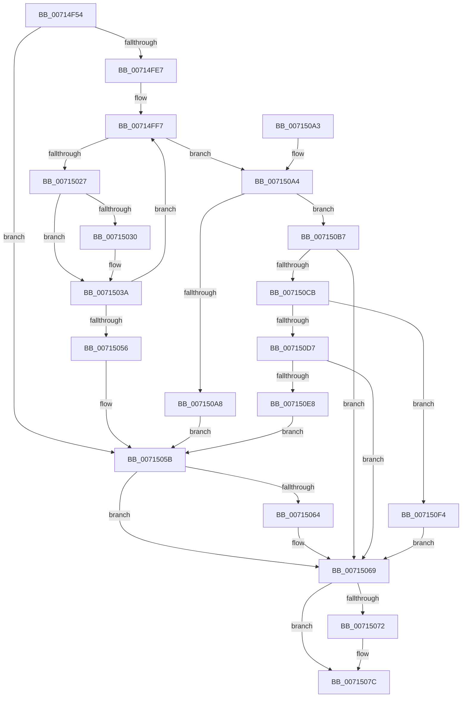

# FsRtlpOplockGetAckTimeoutOverride

- RVA: `0x00714F54`–`0x00715100` (길이 `428` bytes)
- VA: `0x0000000140714F54`
- 실행 섹션: `PAGE`
- PDB 이름 있음: `예`; PDB Function 태그: `아니요`
- unwind 정보 RVA: `0x000C5E14`
- 디코드: `112`개 명령, `428/428` bytes 표시
- 미해석 바이트: `0` (있으면 어셈블리에 `.byte`로 보존)

> 이 문서는 커널 이미지의 기계어와 PDB 기호를 분석해 생성했습니다. 4번과 5번은 함수 원형과 자료형을 바이너리 사용 방식에서 추정한 C 해석이며 원본 소스 복구 결과는 아닙니다.

## 1. Dependencies

- 직접 호출 지점: **10**; 고유 호출 대상: **7**
- 직접 호출자로 확인된 함수: **1**
- RIP 상대 이미지 참조: **4**

### Outgoing calls
- `0x00714FA7` → [RtlInitUnicodeString](../../text/42/RtlInitUnicodeString_function_0042A780.md) (function, `0x0042A780`)
- `0x00714FDC` → [ZwOpenKey](../../text/6A/ZwOpenKey_function_006AD310.md) (function, `0x006AD310`)
- `0x00714FF2` → [RtlInitUnicodeString](../../text/42/RtlInitUnicodeString_function_0042A780.md) (function, `0x0042A780`)
- `0x00715019` → [ZwQueryValueKey](../../text/6A/ZwQueryValueKey_function_006AD3B0.md) (function, `0x006AD3B0`)
- `0x00715035` → [ExFreePoolWithTag](../../poolcode/B8/ExFreePoolWithTag_function_00B82870.md) (function, `0x00B82870`)
- `0x00715049` → [ExAllocatePoolWithTag](../../poolcode/B8/ExAllocatePoolWithTag_function_00B82010.md) (function, `0x00B82010`)
- `0x00715064` → [ZwClose](../../text/6A/ZwClose_function_006AD2B0.md) (function, `0x006AD2B0`)
- `0x00715077` → [ExFreePoolWithTag](../../poolcode/B8/ExFreePoolWithTag_function_00B82870.md) (function, `0x00B82870`)
- `0x00715085` → [_security_check_cookie](../../text/6A/_security_check_cookie_function_006AC640.md) (function, `0x006AC640`)
- `0x007150BB` → [ZwClose](../../text/6A/ZwClose_function_006AD2B0.md) (function, `0x006AD2B0`)

### Direct callers
- [FsRtlInitializeOplockPerf](../../init/C2/FsRtlInitializeOplockPerf_function_00C29458.md) at `0x00C29577`

### Static image references
- `0x00714F6F` → RVA `0x00E0A740` (`.data`; read)
- `0x00714F7F` → RVA `0x00AFBD10` (` ?? ::NNGAKEGL::`string'`; read)
- `0x00714FE7` → RVA `0x00AFBDB0` (` ?? ::NNGAKEGL::`string'`; read)
- `0x007150DC` → RVA `0x00E0A8B0` (`.data`; write)

## 2. Other-region calls and transfers

- 다른 실행 섹션으로 향하는 call: **10**
  - `0x00714FA7` → [RtlInitUnicodeString](../../text/42/RtlInitUnicodeString_function_0042A780.md) (`PAGE` → `.text`)
  - `0x00714FDC` → [ZwOpenKey](../../text/6A/ZwOpenKey_function_006AD310.md) (`PAGE` → `.text`)
  - `0x00714FF2` → [RtlInitUnicodeString](../../text/42/RtlInitUnicodeString_function_0042A780.md) (`PAGE` → `.text`)
  - `0x00715019` → [ZwQueryValueKey](../../text/6A/ZwQueryValueKey_function_006AD3B0.md) (`PAGE` → `.text`)
  - `0x00715035` → [ExFreePoolWithTag](../../poolcode/B8/ExFreePoolWithTag_function_00B82870.md) (`PAGE` → `POOLCODE`)
  - `0x00715049` → [ExAllocatePoolWithTag](../../poolcode/B8/ExAllocatePoolWithTag_function_00B82010.md) (`PAGE` → `POOLCODE`)
  - `0x00715064` → [ZwClose](../../text/6A/ZwClose_function_006AD2B0.md) (`PAGE` → `.text`)
  - `0x00715077` → [ExFreePoolWithTag](../../poolcode/B8/ExFreePoolWithTag_function_00B82870.md) (`PAGE` → `POOLCODE`)
  - `0x00715085` → [_security_check_cookie](../../text/6A/_security_check_cookie_function_006AC640.md) (`PAGE` → `.text`)
  - `0x007150BB` → [ZwClose](../../text/6A/ZwClose_function_006AD2B0.md) (`PAGE` → `.text`)
- 별도 외부 분기/꼬리 이동을 확인하지 못했습니다.

## 3. Assembly (complete function range)

```asm
00714F54  48 8B C4                        mov rax, rsp
00714F57  48 89 58 08                     mov qword ptr [rax + 8], rbx
00714F5B  48 89 70 10                     mov qword ptr [rax + 0x10], rsi
00714F5F  48 89 78 18                     mov qword ptr [rax + 0x18], rdi
00714F63  55                              push rbp
00714F64  48 8D 68 A1                     lea rbp, [rax - 0x5f]
00714F68  48 81 EC F0 00 00 00            sub rsp, 0xf0
00714F6F  48 8B 05 CA 57 6F 00            mov rax, qword ptr [rip + 0x6f57ca]
00714F76  48 33 C4                        xor rax, rsp
00714F79  48 89 45 47                     mov qword ptr [rbp + 0x47], rax
00714F7D  33 C0                           xor eax, eax
00714F7F  48 8D 15 8A 6D 3E 00            lea rdx, [rip + 0x3e6d8a]
00714F86  21 45 D3                        and dword ptr [rbp - 0x2d], eax
00714F89  48 8D 4D A7                     lea rcx, [rbp - 0x59]
00714F8D  48 21 45 97                     and qword ptr [rbp - 0x69], rax
00714F91  48 8D 5D E7                     lea rbx, [rbp - 0x19]
00714F95  0F 57 C0                        xorps xmm0, xmm0
00714F98  89 45 BB                        mov dword ptr [rbp - 0x45], eax
00714F9B  21 45 BB                        and dword ptr [rbp - 0x45], eax
00714F9E  BE 54 00 00 00                  mov esi, 0x54
00714FA3  0F 11 45 A7                     movups xmmword ptr [rbp - 0x59], xmm0
00714FA7  E8 D4 57 D1 FF                  call 0x14042a780
00714FAC  48 83 65 BF 00                  and qword ptr [rbp - 0x41], 0
00714FB1  48 8D 45 A7                     lea rax, [rbp - 0x59]
00714FB5  0F 57 C0                        xorps xmm0, xmm0
00714FB8  48 89 45 C7                     mov qword ptr [rbp - 0x39], rax
00714FBC  4C 8D 45 B7                     lea r8, [rbp - 0x49]
00714FC0  C7 45 B7 30 00 00 00            mov dword ptr [rbp - 0x49], 0x30
00714FC7  BA 19 00 02 00                  mov edx, 0x20019
00714FCC  C7 45 CF 40 00 00 00            mov dword ptr [rbp - 0x31], 0x40
00714FD3  48 8D 4D 97                     lea rcx, [rbp - 0x69]
00714FD7  F3 0F 7F 45 D7                  movdqu xmmword ptr [rbp - 0x29], xmm0
00714FDC  E8 2F 83 F9 FF                  call 0x1406ad310
00714FE1  8B F8                           mov edi, eax
00714FE3  85 C0                           test eax, eax
00714FE5  78 74                           js 0x14071505b
00714FE7  48 8D 15 C2 6D 3E 00            lea rdx, [rip + 0x3e6dc2]
00714FEE  48 8D 4D A7                     lea rcx, [rbp - 0x59]
00714FF2  E8 89 57 D1 FF                  call 0x14042a780
00714FF7  48 8B 4D 97                     mov rcx, qword ptr [rbp - 0x69]
00714FFB  48 8D 45 9F                     lea rax, [rbp - 0x61]
00714FFF  83 65 9F 00                     and dword ptr [rbp - 0x61], 0
00715003  48 8D 55 A7                     lea rdx, [rbp - 0x59]
00715007  48 89 44 24 28                  mov qword ptr [rsp + 0x28], rax
0071500C  4C 8B CB                        mov r9, rbx
0071500F  41 B8 02 00 00 00               mov r8d, 2
00715015  89 74 24 20                     mov dword ptr [rsp + 0x20], esi
00715019  E8 92 83 F9 FF                  call 0x1406ad3b0
0071501E  8B F8                           mov edi, eax
00715020  3D 05 00 00 80                  cmp eax, 0x80000005
00715025  75 7D                           jne 0x1407150a4
00715027  48 8D 45 E7                     lea rax, [rbp - 0x19]
0071502B  48 3B D8                        cmp rbx, rax
0071502E  74 0A                           je 0x14071503a
00715030  33 D2                           xor edx, edx
00715032  48 8B CB                        mov rcx, rbx
00715035  E8 36 D8 46 00                  call 0x140b82870
0071503A  03 F6                           add esi, esi
0071503C  B9 01 04 00 00                  mov ecx, 0x401
00715041  8B D6                           mov edx, esi
00715043  41 B8 46 53 72 74               mov r8d, 0x74725346
00715049  E8 C2 CF 46 00                  call 0x140b82010
0071504E  48 8B D8                        mov rbx, rax
00715051  48 85 C0                        test rax, rax
00715054  75 A1                           jne 0x140714ff7
00715056  BF 17 00 00 C0                  mov edi, 0xc0000017
0071505B  48 8B 4D 97                     mov rcx, qword ptr [rbp - 0x69]
0071505F  48 85 C9                        test rcx, rcx
00715062  74 05                           je 0x140715069
00715064  E8 47 82 F9 FF                  call 0x1406ad2b0
00715069  48 8D 45 E7                     lea rax, [rbp - 0x19]
0071506D  48 3B D8                        cmp rbx, rax
00715070  74 0A                           je 0x14071507c
00715072  33 D2                           xor edx, edx
00715074  48 8B CB                        mov rcx, rbx
00715077  E8 F4 D7 46 00                  call 0x140b82870
0071507C  8B C7                           mov eax, edi
0071507E  48 8B 4D 47                     mov rcx, qword ptr [rbp + 0x47]
00715082  48 33 CC                        xor rcx, rsp
00715085  E8 B6 75 F9 FF                  call 0x1406ac640
0071508A  4C 8D 9C 24 F0 00 00 00         lea r11, [rsp + 0xf0]
00715092  49 8B 5B 10                     mov rbx, qword ptr [r11 + 0x10]
00715096  49 8B 73 18                     mov rsi, qword ptr [r11 + 0x18]
0071509A  49 8B 7B 20                     mov rdi, qword ptr [r11 + 0x20]
0071509E  49 8B E3                        mov rsp, r11
007150A1  5D                              pop rbp
007150A2  C3                              ret
007150A3  CC                              int3
007150A4  85 FF                           test edi, edi
007150A6  79 0F                           jns 0x1407150b7
007150A8  33 C0                           xor eax, eax
007150AA  81 FF 34 00 00 C0               cmp edi, 0xc0000034
007150B0  0F 45 C7                        cmovne eax, edi
007150B3  8B F8                           mov edi, eax
007150B5  EB A4                           jmp 0x14071505b
007150B7  48 8B 4D 97                     mov rcx, qword ptr [rbp - 0x69]
007150BB  E8 F0 81 F9 FF                  call 0x1406ad2b0
007150C0  48 83 65 97 00                  and qword ptr [rbp - 0x69], 0
007150C5  83 7B 04 04                     cmp dword ptr [rbx + 4], 4
007150C9  75 9E                           jne 0x140715069
007150CB  8B 43 0C                        mov eax, dword ptr [rbx + 0xc]
007150CE  B9 FA 00 00 00                  mov ecx, 0xfa
007150D3  3B C1                           cmp eax, ecx
007150D5  76 1D                           jbe 0x1407150f4
007150D7  B9 60 EA 00 00                  mov ecx, 0xea60
007150DC  48 89 05 CD 57 6F 00            mov qword ptr [rip + 0x6f57cd], rax
007150E3  48 3B C1                        cmp rax, rcx
007150E6  72 81                           jb 0x140715069
007150E8  48 89 0D C1 57 6F 00            mov qword ptr [rip + 0x6f57c1], rcx
007150EF  E9 67 FF FF FF                  jmp 0x14071505b
007150F4  48 89 0D B5 57 6F 00            mov qword ptr [rip + 0x6f57b5], rcx
007150FB  E9 69 FF FF FF                  jmp 0x140715069
```

## 4. C-style interpretation (structured pseudocode)

```c
__int64 __fastcall FsRtlpOplockGetAckTimeoutOverride(void)
{
    __int64 result;
    __int64 v_rsi;
    __int64 v_rsp;
    unsigned __int64 v_stack_m8;
    unsigned __int64 v_stack_mD0;
    unsigned int v_stack_mD8;

    *(unsigned __int64 *)(v_rsp + 8) = v_rbx;
    *(unsigned __int64 *)(v_rsp + 16) = v_rsi;
    *(unsigned __int64 *)(v_rsp + 24) = v_rdi;
    v_rsp = (v_rsp) - (240);
    result = (*(unsigned __int64 *)(v_rip + 7296970)) ^ (v_rsp);
    *(unsigned __int64 *)(v_rsp - 95 + 71) = result;
    result = 0;
    *(unsigned int *)(v_rsp - 95 - 69) = 0;
    *(unsigned __int64 *)(v_rsp - 95 - 89) = v_xmm0;
    result = RtlInitUnicodeString(v_rsp - 95 - 89, v_rip + 4091274, a3, a4);
    *(unsigned __int64 *)(v_rsp - 95 - 57) = v_rsp - 95 - 89;
    *(unsigned int *)(v_rsp - 95 - 73) = 48;
    *(unsigned int *)(v_rsp - 95 - 49) = 64;
    *(unsigned __int64 *)(v_rsp - 95 - 41) = v_xmm0;
    result = ZwOpenKey(v_rsp - 95 - 105, (unsigned int)(0x20019ULL), v_rsp - 95 - 73, a4);
    if (sign_flag) goto loc_0071505B;
    result = RtlInitUnicodeString(v_rsp - 95 - 89, v_rip + 4091330, v_rsp - 95 - 73, a4);
loc_00714FF7:
    v_stack_mD0 = v_rsp - 95 - 97;
    v_stack_mD8 = 84;
    result = ZwQueryValueKey(*(unsigned __int64 *)(v_rsp - 95 - 105), v_rsp - 95 - 89, 2, v_rsp - 95 - 25);
    if (((unsigned int)(result)) != 0x80000005ULL) goto loc_007150A4;
    result = v_rsp - 95 - 25;
    if ((v_rsp - 95 - 25) != (v_rsp - 95 - 25)) {
        a2 = 0;
        a1 = v_rsp - 95 - 25;
        result = ExFreePoolWithTag(a1, a2, 2, v_rsp - 95 - 25);
    }
    v_rsi = (unsigned int)((84) + (84));
    result = ExAllocatePoolWithTag((unsigned int)(0x401ULL), (unsigned int)((unsigned int)(v_rsi)), (unsigned int)(0x74725346ULL), v_rsp - 95 - 25);
    if (result != 0) goto loc_00714FF7;
loc_0071505B:
    if (*(unsigned __int64 *)(v_rsp - 95 - 105) != 0) {
        result = ZwClose(*(unsigned __int64 *)(v_rsp - 95 - 105), (unsigned int)((unsigned int)(v_rsi)), (unsigned int)(0x74725346ULL), v_rsp - 95 - 25);
    }
    result = v_rsp - 95 - 25;
    if (result != (v_rsp - 95 - 25)) {
        a2 = 0;
        a1 = result;
        result = ExFreePoolWithTag(a1, a2, (unsigned int)(0x74725346ULL), v_rsp - 95 - 25);
    }
    a1 = (*(unsigned __int64 *)(v_rsp - 95 + 71)) ^ (v_rsp);
    result = _security_check_cookie(a1, a2, (unsigned int)(0x74725346ULL), v_rsp - 95 - 25);
    return result;
loc_007150A4:
    if (!sign_flag) goto loc_007150B7;
    result = 0;
    if (((unsigned int)(*(unsigned __int64 *)(v_stack_m8 + 32))) != 0xC0000034ULL) { result = (unsigned int)(*(unsigned __int64 *)(v_stack_m8 + 32)); }
    goto loc_0071505B;
loc_007150B7:
    result = ZwClose(*(unsigned __int64 *)(v_rsp - 95 - 105), a2, (unsigned int)(0x74725346ULL), v_rsp - 95 - 25);
    if ((*(unsigned int *)(*(unsigned __int64 *)(v_stack_m8 + 16) + 4)) != 4) goto loc_00715069;
    if (((unsigned int)((unsigned int)(*(unsigned int *)(*(unsigned __int64 *)(v_stack_m8 + 16) + 12)))) <= 250) goto loc_007150F4;
    *(unsigned __int64 *)(v_rip + 7296973) = (unsigned int)(*(unsigned int *)(*(unsigned __int64 *)(v_stack_m8 + 16) + 12));
    if (((unsigned int)(*(unsigned int *)(*(unsigned __int64 *)(v_stack_m8 + 16) + 12))) < ((unsigned int)(0xEA60ULL))) goto loc_00715069;
    *(unsigned __int64 *)(v_rip + 7296961) = (unsigned int)(0xEA60ULL);
    goto loc_0071505B;
loc_007150F4:
    *(unsigned __int64 *)(v_rip + 7296949) = (unsigned int)(0xEA60ULL);
    goto loc_00715069;
}
```

## 5. (Beta) C Style

```c
void FsRtlpOplockGetAckTimeoutOverride(void)
{
    int64_t result;
    int64_t local_rsi;
    int64_t local_rsp;
    uint64_t v_stack_m8;
    uint64_t v_stack_mD0;
    uint32_t v_stack_mD8;

    *(uint64_t *)(local_rsp + 0x8) = local_rbx;
    *(uint64_t *)(local_rsp + 0x10) = local_rsi;
    *(uint64_t *)(local_rsp + 0x18) = local_rdi;
    local_rsp = (local_rsp) - (240);
    result = (*(uint64_t *)(v_rip + 0x6F57CA)) ^ (local_rsp);
    *(uint64_t *)(local_rsp - 0x5F + 0x47) = result;
    result = 0;
    *(uint32_t *)(local_rsp - 0x5F - 0x45) = 0;
    *(uint64_t *)(local_rsp - 0x5F - 0x59) = v_xmm0;
    result = RtlInitUnicodeString(local_rsp - 95 - 89, v_rip + 4091274, a3, a4);
    *(uint64_t *)(local_rsp - 0x5F - 0x39) = local_rsp - 95 - 89;
    *(uint32_t *)(local_rsp - 0x5F - 0x49) = 48;
    *(uint32_t *)(local_rsp - 0x5F - 0x31) = 64;
    *(uint64_t *)(local_rsp - 0x5F - 0x29) = v_xmm0;
    result = ZwOpenKey(local_rsp - 95 - 105, (uint32_t)(0x20019ULL), local_rsp - 95 - 73, a4);
    if (sign_flag) goto loc_0071505B;
    result = RtlInitUnicodeString(local_rsp - 95 - 89, v_rip + 4091330, local_rsp - 95 - 73, a4);
loc_00714FF7:
    v_stack_mD0 = local_rsp - 95 - 97;
    v_stack_mD8 = 84;
    result = ZwQueryValueKey(*(uint64_t *)(local_rsp - 0x5F - 0x69), local_rsp - 95 - 89, 2, local_rsp - 95 - 25);
    if (((uint32_t)(result)) != 0x80000005ULL) goto loc_007150A4;
    result = local_rsp - 95 - 25;
    if ((local_rsp - 95 - 25) != (local_rsp - 95 - 25)) {
        a2 = 0;
        a1 = local_rsp - 95 - 25;
        result = ExFreePoolWithTag(a1, a2, 2, local_rsp - 95 - 25);
    }
    local_rsi = (uint32_t)((84) + (84));
    result = ExAllocatePoolWithTag((uint32_t)(0x401ULL), (uint32_t)((uint32_t)(local_rsi)), (uint32_t)(0x74725346ULL), local_rsp - 95 - 25);
    if (result != 0) goto loc_00714FF7;
loc_0071505B:
    if (*(uint64_t *)(local_rsp - 0x5F - 0x69) != 0) {
        result = ZwClose(*(uint64_t *)(local_rsp - 0x5F - 0x69), (uint32_t)((uint32_t)(local_rsi)), (uint32_t)(0x74725346ULL), local_rsp - 95 - 25);
    }
    result = local_rsp - 95 - 25;
    if (result != (local_rsp - 95 - 25)) {
        a2 = 0;
        a1 = result;
        result = ExFreePoolWithTag(a1, a2, (uint32_t)(0x74725346ULL), local_rsp - 95 - 25);
    }
    a1 = (*(uint64_t *)(local_rsp - 0x5F + 0x47)) ^ (local_rsp);
    result = _security_check_cookie(a1, a2, (uint32_t)(0x74725346ULL), local_rsp - 95 - 25);
    return result;
loc_007150A4:
    if (!sign_flag) goto loc_007150B7;
    result = 0;
    if (((uint32_t)(*(uint64_t *)(v_stack_m8 + 0x20))) != 0xC0000034ULL) { result = (uint32_t)(*(uint64_t *)(v_stack_m8 + 0x20)); }
    goto loc_0071505B;
loc_007150B7:
    result = ZwClose(*(uint64_t *)(local_rsp - 0x5F - 0x69), a2, (uint32_t)(0x74725346ULL), local_rsp - 95 - 25);
    if ((*(uint32_t *)(*(uint64_t *)(v_stack_m8 + 0x10) + 0x4)) != 4) goto loc_00715069;
    if (((uint32_t)((uint32_t)(*(uint32_t *)(*(uint64_t *)(v_stack_m8 + 0x10) + 0xC)))) <= 250) goto loc_007150F4;
    *(uint64_t *)(v_rip + 0x6F57CD) = (uint32_t)(*(uint32_t *)(*(uint64_t *)(v_stack_m8 + 0x10) + 0xC));
    if (((uint32_t)(*(uint32_t *)(*(uint64_t *)(v_stack_m8 + 0x10) + 0xC))) < ((uint32_t)(0xEA60ULL))) goto loc_00715069;
    *(uint64_t *)(v_rip + 0x6F57C1) = (uint32_t)(0xEA60ULL);
    goto loc_0071505B;
loc_007150F4:
    *(uint64_t *)(v_rip + 0x6F57B5) = (uint32_t)(0xEA60ULL);
    goto loc_00715069;
}
```

## 6. Execution-region graph

[열기: 2D/3D 그래프와 함수 탐색 컨트롤 패널](../../../control-panel.html?section=page&rva=0x00714F54&view=graph)

- 2D 그래프는 위에서 아래로 흐르고, 3D 그래프는 빈 공간을 드래그해 회전합니다. Shift+드래그는 이동, 휠은 확대·축소, 함수 노드 선택은 대상 보고서 이동입니다.

### Static fallback


