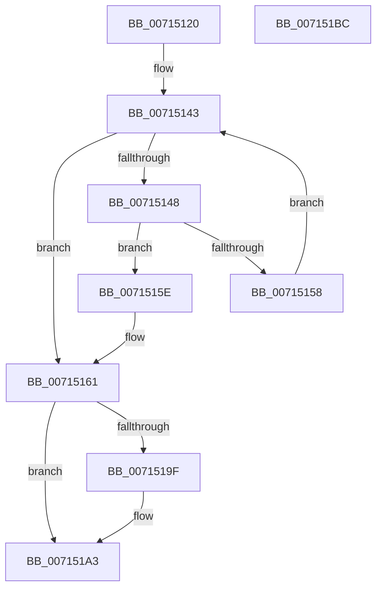

# FsRtlpOplockPerfBucketize

- RVA: `0x00715120`–`0x007151BD` (길이 `157` bytes)
- VA: `0x0000000140715120`
- 실행 섹션: `PAGE`
- PDB 이름 있음: `예`; PDB Function 태그: `아니요`
- unwind 정보 RVA: `0x0005CF00`
- 디코드: `43`개 명령, `157/157` bytes 표시
- 미해석 바이트: `0` (있으면 어셈블리에 `.byte`로 보존)

> 이 문서는 커널 이미지의 기계어와 PDB 기호를 분석해 생성했습니다. 4번과 5번은 함수 원형과 자료형을 바이너리 사용 방식에서 추정한 C 해석이며 원본 소스 복구 결과는 아닙니다.

## 1. Dependencies

- 직접 호출 지점: **1**; 고유 호출 대상: **1**
- 직접 호출자로 확인된 함수: **1**
- RIP 상대 이미지 참조: **3**

### Outgoing calls
- `0x0071512B` → [KeQueryPerformanceCounter](../../text/37/KeQueryPerformanceCounter_function_0037E7E0.md) (function, `0x0037E7E0`)

### Direct callers
- [FsRtlpOplockPerfSendData](../6F/FsRtlpOplockPerfSendData_function_006FDB80.md) at `0x006FDC8D`

### Static image references
- `0x00715133` → RVA `0x00E65DA8` (`.data`; read)
- `0x0071514B` → RVA `0x00E65CA0` (`.data`; read)
- `0x00715169` → RVA `0x00E65C08` (`.data`; read)

## 2. Other-region calls and transfers

- 다른 실행 섹션으로 향하는 call: **1**
  - `0x0071512B` → [KeQueryPerformanceCounter](../../text/37/KeQueryPerformanceCounter_function_0037E7E0.md) (`PAGE` → `.text`)
- 별도 외부 분기/꼬리 이동을 확인하지 못했습니다.

## 3. Assembly (complete function range)

```asm
00715120  40 53                           push rbx
00715122  48 83 EC 20                     sub rsp, 0x20
00715126  48 8B D9                        mov rbx, rcx
00715129  33 C9                           xor ecx, ecx
0071512B  E8 B0 96 C6 FF                  call 0x14037e7e0
00715130  4C 8B C0                        mov r8, rax
00715133  0F B7 05 6E 0C 75 00            movzx eax, word ptr [rip + 0x750c6e]
0071513A  4C 2B 03                        sub r8, qword ptr [rbx]
0071513D  33 D2                           xor edx, edx
0071513F  44 8D 52 01                     lea r10d, [rdx + 1]
00715143  66 3B D0                        cmp dx, ax
00715146  73 19                           jae 0x140715161
00715148  0F B7 CA                        movzx ecx, dx
0071514B  4C 8D 0D 4E 0B 75 00            lea r9, [rip + 0x750b4e]
00715152  4D 3B 04 C9                     cmp r8, qword ptr [r9 + rcx*8]
00715156  7C 06                           jl 0x14071515e
00715158  66 41 03 D2                     add dx, r10w
0071515C  EB E5                           jmp 0x140715143
0071515E  0F B7 C2                        movzx eax, dx
00715161  0F B7 D0                        movzx edx, ax
00715164  66 49 0F 6E C0                  movq xmm0, r8
00715169  48 8B 05 98 0A 75 00            mov rax, qword ptr [rip + 0x750a98]
00715170  66 49 0F 6E CA                  movq xmm1, r10
00715175  48 C1 E2 04                     shl rdx, 4
00715179  66 0F 6C C8                     punpcklqdq xmm1, xmm0
0071517D  48 8B 08                        mov rcx, qword ptr [rax]
00715180  48 03 11                        add rdx, qword ptr [rcx]
00715183  F3 0F 6F 02                     movdqu xmm0, xmmword ptr [rdx]
00715187  66 0F D4 C8                     paddq xmm1, xmm0
0071518B  F3 0F 7F 0A                     movdqu xmmword ptr [rdx], xmm1
0071518F  48 8B 05 72 0A 75 00            mov rax, qword ptr [rip + 0x750a72]
00715196  48 8B 08                        mov rcx, qword ptr [rax]
00715199  4C 3B 41 10                     cmp r8, qword ptr [rcx + 0x10]
0071519D  7E 04                           jle 0x1407151a3
0071519F  4C 89 41 10                     mov qword ptr [rcx + 0x10], r8
007151A3  48 8B 0D 5E 0A 75 00            mov rcx, qword ptr [rip + 0x750a5e]
007151AA  49 8B C2                        mov rax, r10
007151AD  F0 48 0F C1 41 10               lock xadd qword ptr [rcx + 0x10], rax
007151B3  49 03 C2                        add rax, r10
007151B6  48 83 C4 20                     add rsp, 0x20
007151BA  5B                              pop rbx
007151BB  C3                              ret
007151BC  CC                              int3
```

## 4. C-style interpretation (structured pseudocode)

```c
__int64 __fastcall FsRtlpOplockPerfBucketize(__int64 a1, int a2)
{
    __int64 result;
    __int64 v_rsp;

    v_rsp = (v_rsp) - (32);
    a1 = 0;
    result = KeQueryPerformanceCounter(a1, a2, a3, a4);
    a3 = (result) - (*(unsigned __int64 *)(a1));
    a2 = 0;
loc_00715143:
    if (0 >= ((unsigned __int16)(*(unsigned __int16 *)(v_rip + 7670894)))) goto loc_00715161;
    if (a3 < (*(unsigned __int64 *)(v_rip + 7670606 + 0 * 8))) goto loc_0071515E;
    a2 = (unsigned __int16)((a2) + ((unsigned __int16)(a2 + 1)));
    goto loc_00715143;
loc_0071515E:
loc_00715161:
    a2 = ((unsigned __int16)((unsigned __int16)(a2))) << (4);
    a2 = (a2) + (*(unsigned __int64 *)(*(unsigned __int64 *)(*(unsigned __int64 *)(v_rip + 7670424))));
    *(unsigned __int64 *)(a2) = v_xmm1;
    if (a3 >= = (*(unsigned __int64 *)(*(unsigned __int64 *)(*(unsigned __int64 *)(v_rip + 7670386)) + 16))) {
        *(unsigned __int64 *)(*(unsigned __int64 *)(*(unsigned __int64 *)(v_rip + 7670386)) + 16) = a3;
    }
    result = (a2 + 1) + (a2 + 1);
    v_rsp = (v_rsp) + (32);
    return result;
}
```

## 5. (Beta) C Style

```c
int64_t FsRtlpOplockPerfBucketize(void *Arg1, int32_t Arg2)
{
    uint8_t *arg1 = (uint8_t *)Arg1;

    int64_t result;
    int64_t local_rsp;

    local_rsp = (local_rsp) - (32);
    Arg1 = 0;
    result = KeQueryPerformanceCounter(Arg1, Arg2, a3, a4);
    a3 = (result) - (*(uint64_t *)(arg1));
    Arg2 = 0;
loc_00715143:
    if (0 >= ((uint16_t)(*(uint16_t *)(v_rip + 0x750C6E)))) goto loc_00715161;
    if (a3 < (*(uint64_t *)(v_rip + 0x750B4E + 0x0 * 8))) goto loc_0071515E;
    Arg2 = (uint16_t)((Arg2) + ((uint16_t)(Arg2 + 1)));
    goto loc_00715143;
loc_0071515E:
loc_00715161:
    Arg2 = ((uint16_t)((uint16_t)(Arg2))) << (4);
    Arg2 = (Arg2) + (*(uint64_t *)(*(uint64_t *)(*(uint64_t *)(v_rip + 0x750A98))));
    *(uint64_t *)(Arg2) = v_xmm1;
    if (a3 >= = (*(uint64_t *)(*(uint64_t *)(*(uint64_t *)(v_rip + 0x750A72)) + 0x10))) {
        *(uint64_t *)(*(uint64_t *)(*(uint64_t *)(v_rip + 0x750A72)) + 0x10) = a3;
    }
    result = (Arg2 + 1) + (Arg2 + 1);
    local_rsp = (local_rsp) + (32);
    return result;
}
```

### 관측된 메모리 오프셋

구조체 형식이 확인되지 않은 접근은 인자 기준의 오프셋으로만 기록했습니다.

| 기준 인자 | 오프셋 표현 | 폭 (bit) | 접근 |
|---|---:|---:|---|
| `Arg1` | `+ 0x0` | `64` | `R` |

## 6. Execution-region graph

[열기: 2D/3D 그래프와 함수 탐색 컨트롤 패널](../../../control-panel.html?section=page&rva=0x00715120&view=graph)

- 2D 그래프는 위에서 아래로 흐르고, 3D 그래프는 빈 공간을 드래그해 회전합니다. Shift+드래그는 이동, 휠은 확대·축소, 함수 노드 선택은 대상 보고서 이동입니다.

### Static fallback


