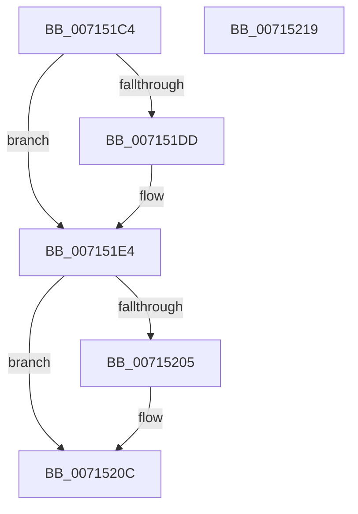

# FsRtlpOplockPerfCleanupData

- RVA: `0x007151C4`–`0x0071521A` (길이 `86` bytes)
- VA: `0x00000001407151C4`
- 실행 섹션: `PAGE`
- PDB 이름 있음: `예`; PDB Function 태그: `아니요`
- unwind 정보 RVA: `0x0005C788`
- 디코드: `21`개 명령, `86/86` bytes 표시
- 미해석 바이트: `0` (있으면 어셈블리에 `.byte`로 보존)

> 이 문서는 커널 이미지의 기계어와 PDB 기호를 분석해 생성했습니다. 4번과 5번은 함수 원형과 자료형을 바이너리 사용 방식에서 추정한 C 해석이며 원본 소스 복구 결과는 아닙니다.

## 1. Dependencies

- 직접 호출 지점: **2**; 고유 호출 대상: **1**
- 직접 호출자로 확인된 함수: **2**
- RIP 상대 이미지 참조: **4**

### Outgoing calls
- `0x007151DF` → [ExFreePoolWithTag](../../poolcode/B8/ExFreePoolWithTag_function_00B82870.md) (function, `0x00B82870`)
- `0x00715207` → [ExFreePoolWithTag](../../poolcode/B8/ExFreePoolWithTag_function_00B82870.md) (function, `0x00B82870`)

### Direct callers
- [FsRtlpOplockPerfSendData](../6F/FsRtlpOplockPerfSendData_function_006FDB80.md) at `0x006FDEDA`
- [FsRtlpOplockPerfPrepareToSendData](FsRtlpOplockPerfPrepareToSendData_function_0071532C.md) at `0x007153BA`

### Static image references
- `0x007151CA` → RVA `0x00E65C20` (`.data`; write)
- `0x007151D1` → RVA `0x00E65C10` (`.data`; read/write)
- `0x007151F1` → RVA `0x00E65C30` (`.data`; write)
- `0x007151F9` → RVA `0x00E65C28` (`.data`; read/write)

## 2. Other-region calls and transfers

- 다른 실행 섹션으로 향하는 call: **2**
  - `0x007151DF` → [ExFreePoolWithTag](../../poolcode/B8/ExFreePoolWithTag_function_00B82870.md) (`PAGE` → `POOLCODE`)
  - `0x00715207` → [ExFreePoolWithTag](../../poolcode/B8/ExFreePoolWithTag_function_00B82870.md) (`PAGE` → `POOLCODE`)
- 별도 외부 분기/꼬리 이동을 확인하지 못했습니다.

## 3. Assembly (complete function range)

```asm
007151C4  48 83 EC 28                     sub rsp, 0x28
007151C8  33 C9                           xor ecx, ecx
007151CA  C6 05 4F 0A 75 00 00            mov byte ptr [rip + 0x750a4f], 0
007151D1  48 87 0D 38 0A 75 00            xchg qword ptr [rip + 0x750a38], rcx
007151D8  48 85 C9                        test rcx, rcx
007151DB  74 07                           je 0x1407151e4
007151DD  33 D2                           xor edx, edx
007151DF  E8 8C D6 46 00                  call 0x140b82870
007151E4  48 83 25 24 0A 75 00 00         and qword ptr [rip + 0x750a24], 0
007151EC  33 C9                           xor ecx, ecx
007151EE  0F 57 C0                        xorps xmm0, xmm0
007151F1  66 0F 7F 05 37 0A 75 00         movdqa xmmword ptr [rip + 0x750a37], xmm0
007151F9  48 87 0D 28 0A 75 00            xchg qword ptr [rip + 0x750a28], rcx
00715200  48 85 C9                        test rcx, rcx
00715203  74 07                           je 0x14071520c
00715205  33 D2                           xor edx, edx
00715207  E8 64 D6 46 00                  call 0x140b82870
0071520C  48 83 25 14 0A 75 00 00         and qword ptr [rip + 0x750a14], 0
00715214  48 83 C4 28                     add rsp, 0x28
00715218  C3                              ret
00715219  CC                              int3
```

## 4. C-style interpretation (structured pseudocode)

```c
__int64 __fastcall FsRtlpOplockPerfCleanupData(int a1, int a2)
{
    __int64 result;
    __int64 v_rsp;

    v_rsp = (v_rsp) - (40);
    a1 = 0;
    *(unsigned __int8 *)(v_rip + 7670351) = 0;
    if (0 != 0) {
        a2 = 0;
        result = ExFreePoolWithTag(a1, a2, a3, a4);
    }
    a1 = 0;
    *(unsigned __int64 *)(v_rip + 7670327) = v_xmm0;
    if (0 != 0) {
        a2 = 0;
        result = ExFreePoolWithTag(a1, a2, a3, a4);
    }
    v_rsp = (v_rsp) + (40);
    return result;
}
```

## 5. (Beta) C Style

```c
int64_t FsRtlpOplockPerfCleanupData(int32_t Arg1, int32_t Arg2)
{
    int64_t result;
    int64_t local_rsp;

    local_rsp = (local_rsp) - (40);
    Arg1 = 0;
    *(uint8_t *)(v_rip + 0x750A4F) = 0;
    if (0 != 0) {
        Arg2 = 0;
        result = ExFreePoolWithTag(Arg1, Arg2, a3, a4);
    }
    Arg1 = 0;
    *(uint64_t *)(v_rip + 0x750A37) = v_xmm0;
    if (0 != 0) {
        Arg2 = 0;
        result = ExFreePoolWithTag(Arg1, Arg2, a3, a4);
    }
    local_rsp = (local_rsp) + (40);
    return result;
}
```

## 6. Execution-region graph

[열기: 2D/3D 그래프와 함수 탐색 컨트롤 패널](../../../control-panel.html?section=page&rva=0x007151C4&view=graph)

- 2D 그래프는 위에서 아래로 흐르고, 3D 그래프는 빈 공간을 드래그해 회전합니다. Shift+드래그는 이동, 휠은 확대·축소, 함수 노드 선택은 대상 보고서 이동입니다.

### Static fallback


