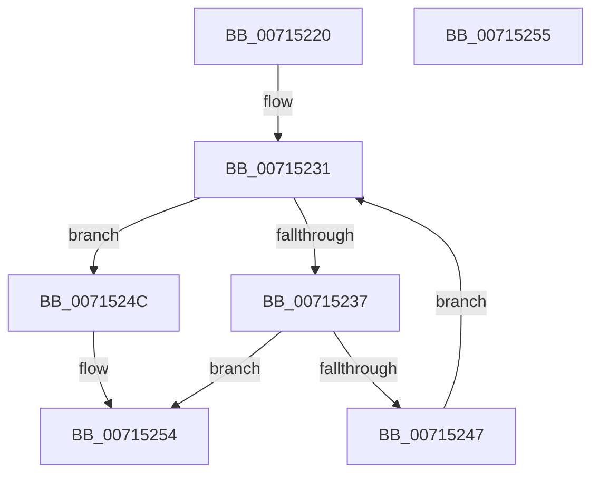

# FsRtlpOplockPerfGetLatencyNsBucket

- RVA: `0x00715220`–`0x00715256` (길이 `54` bytes)
- VA: `0x0000000140715220`
- 실행 섹션: `PAGE`
- PDB 이름 있음: `예`; PDB Function 태그: `아니요`
- unwind 정보 RVA: `0x000DB714`
- 디코드: `14`개 명령, `54/54` bytes 표시
- 미해석 바이트: `0` (있으면 어셈블리에 `.byte`로 보존)

> 이 문서는 커널 이미지의 기계어와 PDB 기호를 분석해 생성했습니다. 4번과 5번은 함수 원형과 자료형을 바이너리 사용 방식에서 추정한 C 해석이며 원본 소스 복구 결과는 아닙니다.

## 1. Dependencies

- 직접 호출 지점: **0**; 고유 호출 대상: **0**
- 직접 호출자로 확인된 함수: **1**
- RIP 상대 이미지 참조: **2**

### Outgoing calls
- 직접 디코드된 call 명령이 없습니다.

### Direct callers
- [FsRtlpOplockPerfSummarizeData](FsRtlpOplockPerfSummarizeData_function_007153DC.md) at `0x0071561D`
- [FsRtlpOplockPerfSummarizeData](FsRtlpOplockPerfSummarizeData_function_007153DC.md) at `0x00715630`

### Static image references
- `0x00715220` → RVA `0x00E65DA8` (`.data`; read)
- `0x00715228` → RVA `0x00E65CA0` (`.data`; read)

## 2. Other-region calls and transfers

- 다른 실행 섹션으로 향하는 call: **0**
- 별도 외부 분기/꼬리 이동을 확인하지 못했습니다.

## 3. Assembly (complete function range)

```asm
00715220  44 0F B7 05 80 0B 75 00         movzx r8d, word ptr [rip + 0x750b80]
00715228  4C 8D 0D 71 0A 75 00            lea r9, [rip + 0x750a71]
0071522F  33 D2                           xor edx, edx
00715231  66 41 3B D0                     cmp dx, r8w
00715235  73 15                           jae 0x14071524c
00715237  0F B7 C2                        movzx eax, dx
0071523A  49 8B 84 C1 80 00 00 00         mov rax, qword ptr [r9 + rax*8 + 0x80]
00715242  48 3B C8                        cmp rcx, rax
00715245  7C 0D                           jl 0x140715254
00715247  66 FF C2                        inc dx
0071524A  EB E5                           jmp 0x140715231
0071524C  4B 8B 84 C1 80 00 00 00         mov rax, qword ptr [r9 + r8*8 + 0x80]
00715254  C3                              ret
00715255  CC                              int3
```

## 4. C-style interpretation (structured pseudocode)

```c
__int64 __fastcall FsRtlpOplockPerfGetLatencyNsBucket(__int64 a1, int a2)
{
    a2 = 0;
loc_00715231:
    if (0 >= ((unsigned __int16)(*(unsigned __int16 *)(v_rip + 7670656)))) goto loc_0071524C;
    if (a1 < (*(unsigned __int64 *)(v_rip + 7670385 + 0 * 8 + 128))) goto loc_00715254;
    a2 = (unsigned __int16)((a2) + 1);
    goto loc_00715231;
loc_0071524C:
loc_00715254:
    return *(unsigned __int64 *)(v_rip + 7670385 + *(unsigned __int16 *)(v_rip + 7670656) * 8 + 128);
}
```

## 5. (Beta) C Style

```c
int64_t FsRtlpOplockPerfGetLatencyNsBucket(int64_t Arg1, int32_t Arg2)
{
    Arg2 = 0;
loc_00715231:
    if (0 >= ((uint16_t)(*(uint16_t *)(v_rip + 0x750B80)))) goto loc_0071524C;
    if (Arg1 < (*(uint64_t *)(v_rip + 0x750A71 + 0x0 * 8 + 0x80))) goto loc_00715254;
    Arg2 = (uint16_t)((Arg2) + 1);
    goto loc_00715231;
loc_0071524C:
loc_00715254:
    return *(uint64_t *)(v_rip + 0x750A71 + *(uint16_t *)(v_rip + 0x750B80) * 8 + 0x80);
}
```

## 6. Execution-region graph

[열기: 2D/3D 그래프와 함수 탐색 컨트롤 패널](../../../control-panel.html?section=page&rva=0x00715220&view=graph)

- 2D 그래프는 위에서 아래로 흐르고, 3D 그래프는 빈 공간을 드래그해 회전합니다. Shift+드래그는 이동, 휠은 확대·축소, 함수 노드 선택은 대상 보고서 이동입니다.

### Static fallback


