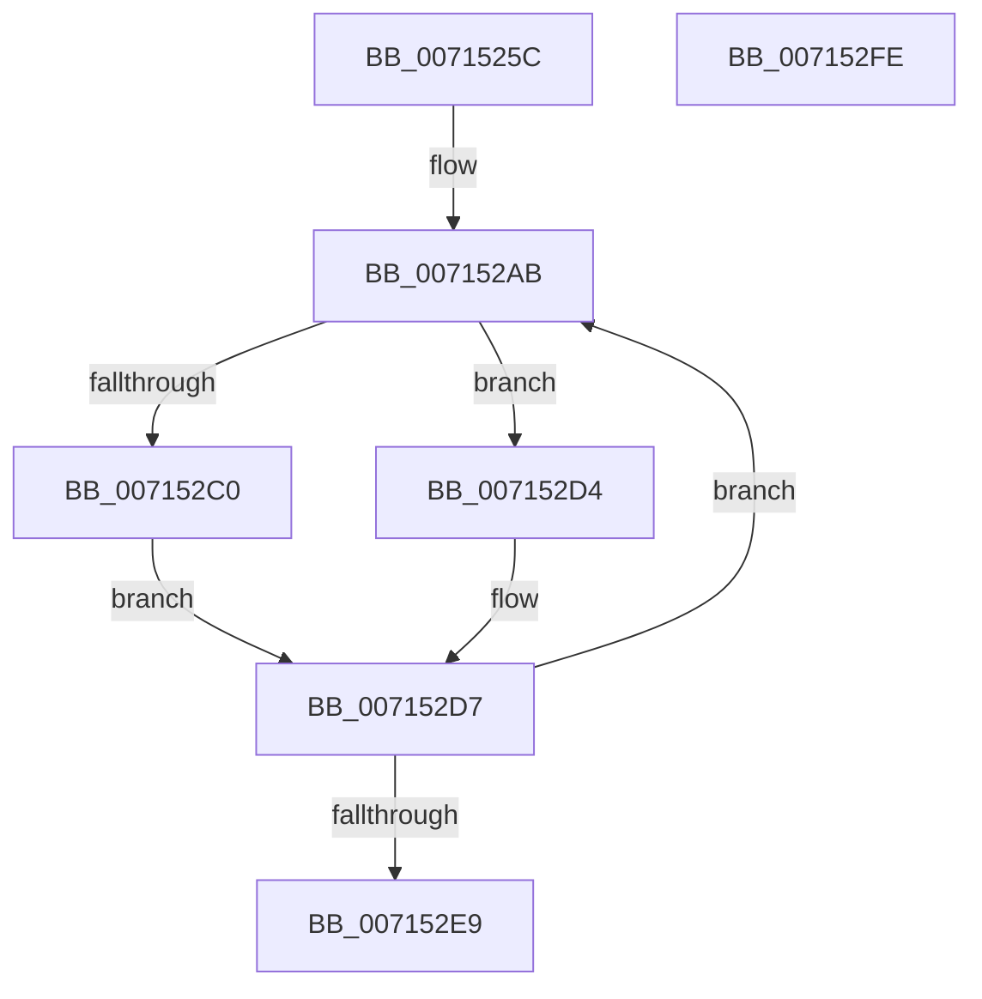

# FsRtlpOplockPerfInitializeLatencyInfo

- RVA: `0x0071525C`–`0x007152FF` (길이 `163` bytes)
- VA: `0x000000014071525C`
- 실행 섹션: `PAGE`
- PDB 이름 있음: `예`; PDB Function 태그: `아니요`
- unwind 정보 RVA: `0x0006C8E8`
- 디코드: `37`개 명령, `163/163` bytes 표시
- 미해석 바이트: `0` (있으면 어셈블리에 `.byte`로 보존)

> 이 문서는 커널 이미지의 기계어와 PDB 기호를 분석해 생성했습니다. 4번과 5번은 함수 원형과 자료형을 바이너리 사용 방식에서 추정한 C 해석이며 원본 소스 복구 결과는 아닙니다.

## 1. Dependencies

- 직접 호출 지점: **2**; 고유 호출 대상: **2**
- 직접 호출자로 확인된 함수: **1**
- RIP 상대 이미지 참조: **4**

### Outgoing calls
- `0x00715286` → [KeQueryPerformanceCounter](../../text/37/KeQueryPerformanceCounter_function_0037E7E0.md) (function, `0x0037E7E0`)
- `0x007152CD` → [FsRtlpComputeLargeRatio](../../text/58/FsRtlpComputeLargeRatio_function_0058243C.md) (function, `0x0058243C`)

### Direct callers
- [FsRtlInitializeOplockPerf](../../init/C2/FsRtlInitializeOplockPerf_function_00C29458.md) at `0x00C29502`

### Static image references
- `0x0071527B` → RVA `0x00E65DA8` (`.data`; write)
- `0x00715293` → RVA `0x00E65DA0` (`.data`; write)
- `0x0071529A` → RVA `0x00000000` (`image boundary/outside`; read)
- `0x007152C0` → RVA `0x00E65DA0` (`.data`; read)

## 2. Other-region calls and transfers

- 다른 실행 섹션으로 향하는 call: **2**
  - `0x00715286` → [KeQueryPerformanceCounter](../../text/37/KeQueryPerformanceCounter_function_0037E7E0.md) (`PAGE` → `.text`)
  - `0x007152CD` → [FsRtlpComputeLargeRatio](../../text/58/FsRtlpComputeLargeRatio_function_0058243C.md) (`PAGE` → `.text`)
- 별도 외부 분기/꼬리 이동을 확인하지 못했습니다.

## 3. Assembly (complete function range)

```asm
0071525C  4C 8B DC                        mov r11, rsp
0071525F  49 89 5B 10                     mov qword ptr [r11 + 0x10], rbx
00715263  49 89 6B 18                     mov qword ptr [r11 + 0x18], rbp
00715267  49 89 73 20                     mov qword ptr [r11 + 0x20], rsi
0071526B  57                              push rdi
0071526C  48 83 EC 20                     sub rsp, 0x20
00715270  B8 0F 00 00 00                  mov eax, 0xf
00715275  49 8D 4B 08                     lea rcx, [r11 + 8]
00715279  33 DB                           xor ebx, ebx
0071527B  66 89 05 26 0B 75 00            mov word ptr [rip + 0x750b26], ax
00715282  49 89 5B 08                     mov qword ptr [r11 + 8], rbx
00715286  E8 55 95 C6 FF                  call 0x14037e7e0
0071528B  48 8B 44 24 30                  mov rax, qword ptr [rsp + 0x30]
00715290  8D 7B 10                        lea edi, [rbx + 0x10]
00715293  48 89 05 06 0B 75 00            mov qword ptr [rip + 0x750b06], rax
0071529A  48 8D 35 5F AD 8E FF            lea rsi, [rip - 0x7152a1]
007152A1  48 BD FF FF FF FF FF FF FF 7F   movabs rbp, 0x7fffffffffffffff
007152AB  48 8B 8C 33 50 63 02 00         mov rcx, qword ptr [rbx + rsi + 0x26350]
007152B3  48 89 8C 33 20 5D E6 00         mov qword ptr [rbx + rsi + 0xe65d20], rcx
007152BB  48 3B CD                        cmp rcx, rbp
007152BE  74 14                           je 0x1407152d4
007152C0  48 8B 15 D9 0A 75 00            mov rdx, qword ptr [rip + 0x750ad9]
007152C7  41 B8 00 CA 9A 3B               mov r8d, 0x3b9aca00
007152CD  E8 6A D1 E6 FF                  call 0x14058243c
007152D2  EB 03                           jmp 0x1407152d7
007152D4  48 8B C5                        mov rax, rbp
007152D7  48 89 84 33 A0 5C E6 00         mov qword ptr [rbx + rsi + 0xe65ca0], rax
007152DF  48 83 C3 08                     add rbx, 8
007152E3  48 83 EF 01                     sub rdi, 1
007152E7  75 C2                           jne 0x1407152ab
007152E9  48 8B 5C 24 38                  mov rbx, qword ptr [rsp + 0x38]
007152EE  48 8B 6C 24 40                  mov rbp, qword ptr [rsp + 0x40]
007152F3  48 8B 74 24 48                  mov rsi, qword ptr [rsp + 0x48]
007152F8  48 83 C4 20                     add rsp, 0x20
007152FC  5F                              pop rdi
007152FD  C3                              ret
007152FE  CC                              int3
```

## 4. C-style interpretation (structured pseudocode)

```c
__int64 __fastcall FsRtlpOplockPerfInitializeLatencyInfo(void)
{
    __int64 result;
    __int64 v_rbx;
    __int64 v_rdi;
    __int64 v_rsp;
    unsigned __int64 v_stack_p10;
    unsigned __int64 v_stack_p18;
    unsigned __int64 v_stack_p20;
    unsigned __int64 v_stack_p8;

    *(unsigned __int64 *)(v_rsp + 16) = v_rbx;
    *(unsigned __int64 *)(v_rsp + 24) = v_rbp;
    *(unsigned __int64 *)(v_rsp + 32) = v_rsi;
    v_rsp = (v_rsp) - (32);
    v_rbx = 0;
    *(unsigned __int16 *)(v_rip + 7670566) = 15;
    *(unsigned __int64 *)(v_rsp + 8) = 0;
    result = KeQueryPerformanceCounter(v_rsp + 8, a2, a3, a4);
    *(unsigned __int64 *)(v_rip + 7670534) = v_stack_p8;
loc_007152AB:
    *(unsigned __int64 *)(v_rbx + v_rip - 7426721 * 1 + 15097120) = *(unsigned __int64 *)(v_rbx + v_rip - 7426721 * 1 + 156496);
    if ((*(unsigned __int64 *)(v_rbx + v_rip - 7426721 * 1 + 156496)) == v_rbp) goto loc_007152D4;
    result = FsRtlpComputeLargeRatio(*(unsigned __int64 *)(v_rbx + v_rip - 7426721 * 1 + 156496), *(unsigned __int64 *)(v_rip + 7670489), (unsigned int)(0x3B9ACA00ULL), a4);
    goto loc_007152D7;
loc_007152D4:
loc_007152D7:
    *(unsigned __int64 *)(v_rbx + v_rip - 7426721 * 1 + 15096992) = v_rbp;
    v_rbx = (v_rbx) + (8);
    v_rdi = (v_rbx + 16) - (1);
    if (condition_is_not_equal) goto loc_007152AB;
    v_rsp = (v_rsp) + (32);
    return v_rbp;
}
```

## 5. (Beta) C Style

```c
void FsRtlpOplockPerfInitializeLatencyInfo(void)
{
    int64_t result;
    int64_t local_rbx;
    int64_t local_rdi;
    int64_t local_rsp;
    uint64_t v_stack_p10;
    uint64_t v_stack_p18;
    uint64_t v_stack_p20;
    uint64_t v_stack_p8;

    *(uint64_t *)(local_rsp + 0x10) = local_rbx;
    *(uint64_t *)(local_rsp + 0x18) = local_rbp;
    *(uint64_t *)(local_rsp + 0x20) = local_rsi;
    local_rsp = (local_rsp) - (32);
    local_rbx = 0;
    *(uint16_t *)(v_rip + 0x750B26) = 15;
    *(uint64_t *)(local_rsp + 0x8) = 0;
    result = KeQueryPerformanceCounter(local_rsp + 8, a2, a3, a4);
    *(uint64_t *)(v_rip + 0x750B06) = v_stack_p8;
loc_007152AB:
    *(uint64_t *)(local_rbx + v_rip - 0x7152A1 * 1 + 0xE65D20) = *(uint64_t *)(local_rbx + v_rip - 0x7152A1 * 1 + 0x26350);
    if ((*(uint64_t *)(local_rbx + v_rip - 0x7152A1 * 1 + 0x26350)) == local_rbp) goto loc_007152D4;
    result = FsRtlpComputeLargeRatio(*(uint64_t *)(local_rbx + v_rip - 0x7152A1 * 1 + 0x26350), *(uint64_t *)(v_rip + 0x750AD9), (uint32_t)(0x3B9ACA00ULL), a4);
    goto loc_007152D7;
loc_007152D4:
loc_007152D7:
    *(uint64_t *)(local_rbx + v_rip - 0x7152A1 * 1 + 0xE65CA0) = local_rbp;
    local_rbx = (local_rbx) + (8);
    local_rdi = (local_rbx + 16) - (1);
    if (condition_is_not_equal) goto loc_007152AB;
    local_rsp = (local_rsp) + (32);
    return local_rbp;
}
```

## 6. Execution-region graph

[열기: 2D/3D 그래프와 함수 탐색 컨트롤 패널](../../../control-panel.html?section=page&rva=0x0071525C&view=graph)

- 2D 그래프는 위에서 아래로 흐르고, 3D 그래프는 빈 공간을 드래그해 회전합니다. Shift+드래그는 이동, 휠은 확대·축소, 함수 노드 선택은 대상 보고서 이동입니다.

### Static fallback


