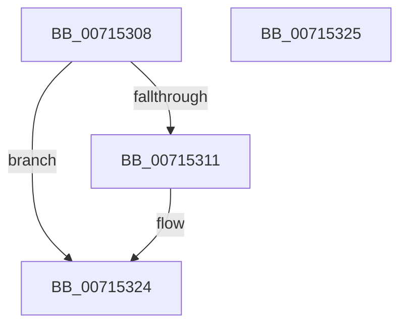

# FsRtlpOplockPerfMoveData

- RVA: `0x00715308`–`0x00715326` (길이 `30` bytes)
- VA: `0x0000000140715308`
- 실행 섹션: `PAGE`
- PDB 이름 있음: `예`; PDB Function 태그: `아니요`
- unwind 정보 RVA: `0x000DB714`
- 디코드: `11`개 명령, `30/30` bytes 표시
- 미해석 바이트: `0` (있으면 어셈블리에 `.byte`로 보존)

> 이 문서는 커널 이미지의 기계어와 PDB 기호를 분석해 생성했습니다. 4번과 5번은 함수 원형과 자료형을 바이너리 사용 방식에서 추정한 C 해석이며 원본 소스 복구 결과는 아닙니다.

## 1. Dependencies

- 직접 호출 지점: **0**; 고유 호출 대상: **0**
- 직접 호출자로 확인된 함수: **2**
- RIP 상대 이미지 참조: **0**

### Outgoing calls
- 직접 디코드된 call 명령이 없습니다.

### Direct callers
- [FsRtlpAcknowledgeOplockBreakByCacheFlags](../../text/3F/FsRtlpAcknowledgeOplockBreakByCacheFlags_function_003F1988.md) at `0x003F1CE5`
- [FsRtlpAcknowledgeOplockBreakByCacheFlags](../../text/3F/FsRtlpAcknowledgeOplockBreakByCacheFlags_function_003F1988.md) at `0x003F1F22`
- [FsRtlpAcknowledgeOplockBreakByCacheFlags](../../text/3F/FsRtlpAcknowledgeOplockBreakByCacheFlags_function_003F1988.md) at `0x003F2084`
- [FsRtlpAcknowledgeOplockBreakByCacheFlags](../../text/3F/FsRtlpAcknowledgeOplockBreakByCacheFlags_function_003F1988.md) at `0x003F219A`
- [FsRtlpGrantAnyOplockFromExclusive](../../text/58/FsRtlpGrantAnyOplockFromExclusive_function_00582540.md) at `0x00582616`
- [FsRtlpGrantAnyOplockFromExclusive](../../text/58/FsRtlpGrantAnyOplockFromExclusive_function_00582540.md) at `0x005827A1`

### Static image references
- 디코드된 RIP-relative 메모리 참조가 없습니다.

## 2. Other-region calls and transfers

- 다른 실행 섹션으로 향하는 call: **0**
- 별도 외부 분기/꼬리 이동을 확인하지 못했습니다.

## 3. Assembly (complete function range)

```asm
00715308  45 33 C0                        xor r8d, r8d
0071530B  44 39 41 08                     cmp dword ptr [rcx + 8], r8d
0071530F  74 13                           je 0x140715324
00715311  48 8B 01                        mov rax, qword ptr [rcx]
00715314  48 89 02                        mov qword ptr [rdx], rax
00715317  8B 41 08                        mov eax, dword ptr [rcx + 8]
0071531A  89 42 08                        mov dword ptr [rdx + 8], eax
0071531D  4C 89 01                        mov qword ptr [rcx], r8
00715320  44 89 41 08                     mov dword ptr [rcx + 8], r8d
00715324  C3                              ret
00715325  CC                              int3
```

## 4. C-style interpretation (structured pseudocode)

```c
__int64 __fastcall FsRtlpOplockPerfMoveData(__int64 a1, __int64 a2, int a3)
{
    __int64 result;

    a3 = 0;
    if ((*(unsigned int *)(a1 + 8)) != 0) {
        result = *(unsigned __int64 *)(a1);
        *(unsigned __int64 *)(a2) = result;
        result = *(unsigned int *)(a1 + 8);
        *(unsigned int *)(a2 + 8) = (unsigned int)(result);
        *(unsigned __int64 *)(a1) = 0;
        *(unsigned int *)(a1 + 8) = 0;
    }
    return result;
}
```

## 5. (Beta) C Style

```c
int64_t FsRtlpOplockPerfMoveData(void *Arg1, void *Arg2, int32_t Arg3)
{
    uint8_t *arg1 = (uint8_t *)Arg1;
    uint8_t *arg2 = (uint8_t *)Arg2;

    int64_t result;

    Arg3 = 0;
    if ((*(uint32_t *)(arg1 + 0x8)) != 0) {
        result = *(uint64_t *)(arg1);
        *(uint64_t *)(arg2) = result;
        result = *(uint32_t *)(arg1 + 0x8);
        *(uint32_t *)(arg2 + 0x8) = (uint32_t)(result);
        *(uint64_t *)(arg1) = 0;
        *(uint32_t *)(arg1 + 0x8) = 0;
    }
    return result;
}
```

### 관측된 메모리 오프셋

구조체 형식이 확인되지 않은 접근은 인자 기준의 오프셋으로만 기록했습니다.

| 기준 인자 | 오프셋 표현 | 폭 (bit) | 접근 |
|---|---:|---:|---|
| `Arg1` | `+ 0x0` | `64` | `R` |
| `Arg1` | `+ 0x0` | `64` | `W` |
| `Arg1` | `+ 0x8` | `32` | `R` |
| `Arg1` | `+ 0x8` | `32` | `W` |
| `Arg2` | `+ 0x0` | `64` | `W` |
| `Arg2` | `+ 0x8` | `32` | `W` |

## 6. Execution-region graph

[열기: 2D/3D 그래프와 함수 탐색 컨트롤 패널](../../../control-panel.html?section=page&rva=0x00715308&view=graph)

- 2D 그래프는 위에서 아래로 흐르고, 3D 그래프는 빈 공간을 드래그해 회전합니다. Shift+드래그는 이동, 휠은 확대·축소, 함수 노드 선택은 대상 보고서 이동입니다.

### Static fallback


