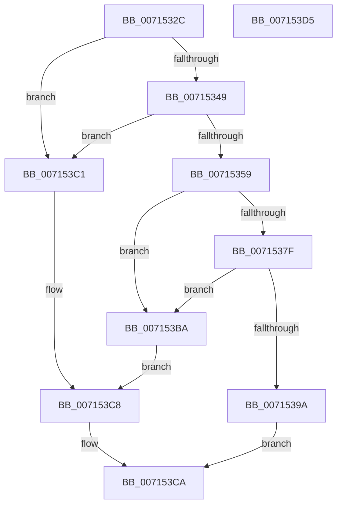

# FsRtlpOplockPerfPrepareToSendData

- RVA: `0x0071532C`–`0x007153D6` (길이 `170` bytes)
- VA: `0x000000014071532C`
- 실행 섹션: `PAGE`
- PDB 이름 있음: `예`; PDB Function 태그: `아니요`
- unwind 정보 RVA: `0x0005CAAC`
- 디코드: `42`개 명령, `170/170` bytes 표시
- 미해석 바이트: `0` (있으면 어셈블리에 `.byte`로 보존)

> 이 문서는 커널 이미지의 기계어와 PDB 기호를 분석해 생성했습니다. 4번과 5번은 함수 원형과 자료형을 바이너리 사용 방식에서 추정한 C 해석이며 원본 소스 복구 결과는 아닙니다.

## 1. Dependencies

- 직접 호출 지점: **4**; 고유 호출 대상: **3**
- 직접 호출자로 확인된 함수: **1**
- RIP 상대 이미지 참조: **9**

### Outgoing calls
- `0x00715338` → [KiQueryUnbiasedInterruptTime](../../text/42/KiQueryUnbiasedInterruptTime_function_0042D180.md) (function, `0x0042D180`)
- `0x0071536E` → [ExAllocatePool2](../../poolcode/B8/ExAllocatePool2_function_00B820F0.md) (function, `0x00B820F0`)
- `0x00715389` → [ExAllocatePool2](../../poolcode/B8/ExAllocatePool2_function_00B820F0.md) (function, `0x00B820F0`)
- `0x007153BA` → [FsRtlpOplockPerfCleanupData](FsRtlpOplockPerfCleanupData_function_007151C4.md) (function, `0x007151C4`)

### Direct callers
- [FsRtlpOplockPerfSendData](../6F/FsRtlpOplockPerfSendData_function_006FDB80.md) at `0x006FDCBB`

### Static image references
- `0x0071533D` → RVA `0x00E65C21` (`.data`; read)
- `0x00715349` → RVA `0x00E65C48` (`.data`; read)
- `0x00715350` → RVA `0x00E65C40` (`.data`; read)
- `0x0071535E` → RVA `0x00E65C20` (`.data`; write)
- `0x00715373` → RVA `0x00E65C10` (`.data`; write)
- `0x0071538E` → RVA `0x00E65C28` (`.data`; write)
- `0x007153A1` → RVA `0x00E65C30` (`.data`; write)
- `0x007153A8` → RVA `0x00E65C38` (`.data`; write)
- `0x007153B1` → RVA `0x00E65C48` (`.data`; write)

## 2. Other-region calls and transfers

- 다른 실행 섹션으로 향하는 call: **3**
  - `0x00715338` → [KiQueryUnbiasedInterruptTime](../../text/42/KiQueryUnbiasedInterruptTime_function_0042D180.md) (`PAGE` → `.text`)
  - `0x0071536E` → [ExAllocatePool2](../../poolcode/B8/ExAllocatePool2_function_00B820F0.md) (`PAGE` → `POOLCODE`)
  - `0x00715389` → [ExAllocatePool2](../../poolcode/B8/ExAllocatePool2_function_00B820F0.md) (`PAGE` → `POOLCODE`)
- 별도 외부 분기/꼬리 이동을 확인하지 못했습니다.

## 3. Assembly (complete function range)

```asm
0071532C  48 89 5C 24 08                  mov qword ptr [rsp + 8], rbx
00715331  57                              push rdi
00715332  48 83 EC 20                     sub rsp, 0x20
00715336  B1 01                           mov cl, 1
00715338  E8 43 7E D1 FF                  call 0x14042d180
0071533D  80 3D DD 08 75 00 00            cmp byte ptr [rip + 0x7508dd], 0
00715344  48 8B D8                        mov rbx, rax
00715347  74 78                           je 0x1407153c1
00715349  48 2B 05 F8 08 75 00            sub rax, qword ptr [rip + 0x7508f8]
00715350  48 3B 05 E9 08 75 00            cmp rax, qword ptr [rip + 0x7508e9]
00715357  72 68                           jb 0x1407153c1
00715359  BF 00 01 00 00                  mov edi, 0x100
0071535E  88 0D BC 08 75 00               mov byte ptr [rip + 0x7508bc], cl
00715364  8B D7                           mov edx, edi
00715366  8B CF                           mov ecx, edi
00715368  41 B8 46 53 72 6F               mov r8d, 0x6f725346
0071536E  E8 7D CD 46 00                  call 0x140b820f0
00715373  48 89 05 96 08 75 00            mov qword ptr [rip + 0x750896], rax
0071537A  48 85 C0                        test rax, rax
0071537D  74 3B                           je 0x1407153ba
0071537F  41 B8 46 53 72 6F               mov r8d, 0x6f725346
00715385  8B D7                           mov edx, edi
00715387  8B CF                           mov ecx, edi
00715389  E8 62 CD 46 00                  call 0x140b820f0
0071538E  48 89 05 93 08 75 00            mov qword ptr [rip + 0x750893], rax
00715395  48 85 C0                        test rax, rax
00715398  74 20                           je 0x1407153ba
0071539A  48 8D 88 80 00 00 00            lea rcx, [rax + 0x80]
007153A1  48 89 05 88 08 75 00            mov qword ptr [rip + 0x750888], rax
007153A8  48 89 0D 89 08 75 00            mov qword ptr [rip + 0x750889], rcx
007153AF  B0 01                           mov al, 1
007153B1  48 89 1D 90 08 75 00            mov qword ptr [rip + 0x750890], rbx
007153B8  EB 10                           jmp 0x1407153ca
007153BA  E8 05 FE FF FF                  call 0x1407151c4
007153BF  EB 07                           jmp 0x1407153c8
007153C1  C6 05 58 08 75 00 00            mov byte ptr [rip + 0x750858], 0
007153C8  32 C0                           xor al, al
007153CA  48 8B 5C 24 30                  mov rbx, qword ptr [rsp + 0x30]
007153CF  48 83 C4 20                     add rsp, 0x20
007153D3  5F                              pop rdi
007153D4  C3                              ret
007153D5  CC                              int3
```

## 4. C-style interpretation (structured pseudocode)

```c
__int64 __fastcall FsRtlpOplockPerfPrepareToSendData(void)
{
    __int64 result;
    __int64 v_rsp;
    unsigned __int64 v_stack_p8;

    v_stack_p8 = v_rbx;
    v_rsp = (v_rsp) - (32);
    result = KiQueryUnbiasedInterruptTime(1, a2, a3, a4);
    if ((*(unsigned __int8 *)(v_rip + 7669981)) == 0) goto loc_007153C1;
    result = (result) - (*(unsigned __int64 *)(v_rip + 7670008));
    if (result < (*(unsigned __int64 *)(v_rip + 7669993))) goto loc_007153C1;
    *(unsigned __int8 *)(v_rip + 7669948) = 1;
    result = ExAllocatePool2(256, 256, (unsigned int)(0x6F725346ULL), a4);
    *(unsigned __int64 *)(v_rip + 7669910) = result;
    if (result == 0) goto loc_007153BA;
    result = ExAllocatePool2(256, 256, (unsigned int)(0x6F725346ULL), a4);
    *(unsigned __int64 *)(v_rip + 7669907) = result;
    if (result == 0) goto loc_007153BA;
    *(unsigned __int64 *)(v_rip + 7669896) = result;
    *(unsigned __int64 *)(v_rip + 7669897) = result + 128;
    *(unsigned __int64 *)(v_rip + 7669904) = result;
    goto loc_007153CA;
loc_007153BA:
    result = FsRtlpOplockPerfCleanupData(result + 128, 256, (unsigned int)(0x6F725346ULL), a4);
    goto loc_007153C8;
loc_007153C1:
    *(unsigned __int8 *)(v_rip + 7669848) = 0;
loc_007153C8:
    result = 0;
loc_007153CA:
    v_rsp = (v_rsp) + (32);
    return result;
}
```

## 5. (Beta) C Style

```c
void FsRtlpOplockPerfPrepareToSendData(void)
{
    int64_t result;
    int64_t local_rsp;
    uint64_t v_stack_p8;

    v_stack_p8 = local_rbx;
    local_rsp = (local_rsp) - (32);
    result = KiQueryUnbiasedInterruptTime(1, a2, a3, a4);
    if ((*(uint8_t *)(v_rip + 0x7508DD)) == 0) goto loc_007153C1;
    result = (result) - (*(uint64_t *)(v_rip + 0x7508F8));
    if (result < (*(uint64_t *)(v_rip + 0x7508E9))) goto loc_007153C1;
    *(uint8_t *)(v_rip + 0x7508BC) = 1;
    result = ExAllocatePool2(256, 256, (uint32_t)(0x6F725346ULL), a4);
    *(uint64_t *)(v_rip + 0x750896) = result;
    if (result == 0) goto loc_007153BA;
    result = ExAllocatePool2(256, 256, (uint32_t)(0x6F725346ULL), a4);
    *(uint64_t *)(v_rip + 0x750893) = result;
    if (result == 0) goto loc_007153BA;
    *(uint64_t *)(v_rip + 0x750888) = result;
    *(uint64_t *)(v_rip + 0x750889) = result + 128;
    *(uint64_t *)(v_rip + 0x750890) = result;
    goto loc_007153CA;
loc_007153BA:
    result = FsRtlpOplockPerfCleanupData(result + 128, 256, (uint32_t)(0x6F725346ULL), a4);
    goto loc_007153C8;
loc_007153C1:
    *(uint8_t *)(v_rip + 0x750858) = 0;
loc_007153C8:
    result = 0;
loc_007153CA:
    local_rsp = (local_rsp) + (32);
    return result;
}
```

## 6. Execution-region graph

[열기: 2D/3D 그래프와 함수 탐색 컨트롤 패널](../../../control-panel.html?section=page&rva=0x0071532C&view=graph)

- 2D 그래프는 위에서 아래로 흐르고, 3D 그래프는 빈 공간을 드래그해 회전합니다. Shift+드래그는 이동, 휠은 확대·축소, 함수 노드 선택은 대상 보고서 이동입니다.

### Static fallback


