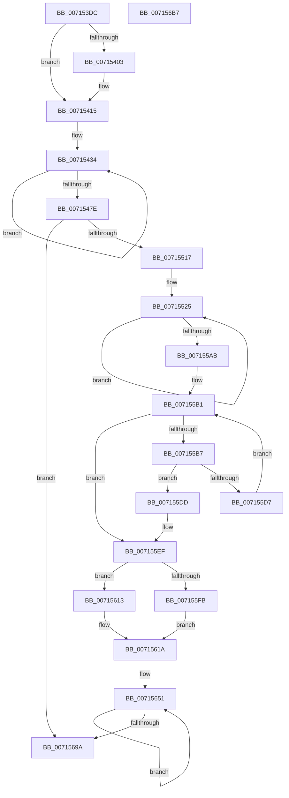

# FsRtlpOplockPerfSummarizeData

- RVA: `0x007153DC`–`0x007156B8` (길이 `732` bytes)
- VA: `0x00000001407153DC`
- 실행 섹션: `PAGE`
- PDB 이름 있음: `예`; PDB Function 태그: `아니요`
- unwind 정보 RVA: `0x00075C18`
- 디코드: `169`개 명령, `732/732` bytes 표시
- 미해석 바이트: `0` (있으면 어셈블리에 `.byte`로 보존)

> 이 문서는 커널 이미지의 기계어와 PDB 기호를 분석해 생성했습니다. 4번과 5번은 함수 원형과 자료형을 바이너리 사용 방식에서 추정한 C 해석이며 원본 소스 복구 결과는 아닙니다.

## 1. Dependencies

- 직접 호출 지점: **6**; 고유 호출 대상: **4**
- 직접 호출자로 확인된 함수: **1**
- RIP 상대 이미지 참조: **24**

### Outgoing calls
- `0x00715410` → [memset](../../text/6C/memset_function_006C6C40.md) (function, `0x006C6C40`)
- `0x0071549C` → [FsRtlpComputeLargeRatio](../../text/58/FsRtlpComputeLargeRatio_function_0058243C.md) (function, `0x0058243C`)
- `0x007154B1` → [KiQueryUnbiasedInterruptTime](../../text/42/KiQueryUnbiasedInterruptTime_function_0042D180.md) (function, `0x0042D180`)
- `0x00715558` → [FsRtlpComputeLargeRatio](../../text/58/FsRtlpComputeLargeRatio_function_0058243C.md) (function, `0x0058243C`)
- `0x0071561D` → [FsRtlpOplockPerfGetLatencyNsBucket](FsRtlpOplockPerfGetLatencyNsBucket_function_00715220.md) (function, `0x00715220`)
- `0x00715630` → [FsRtlpOplockPerfGetLatencyNsBucket](FsRtlpOplockPerfGetLatencyNsBucket_function_00715220.md) (function, `0x00715220`)

### Direct callers
- [FsRtlpOplockPerfSendData](../6F/FsRtlpOplockPerfSendData_function_006FDB80.md) at `0x006FDCC8`

### Static image references
- `0x007153FA` → RVA `0x00E65C20` (`.data`; read)
- `0x00715409` → RVA `0x00E65C50` (`.data`; read)
- `0x00715415` → RVA `0x00E65C08` (`.data`; read)
- `0x0071542D` → RVA `0x00E65C10` (`.data`; read)
- `0x00715495` → RVA `0x00E65DA0` (`.data`; read)
- `0x007154A7` → RVA `0x00E65C70` (`.data`; write)
- `0x007154C0` → RVA `0x00E65C18` (`.data`; write)
- `0x007154DB` → RVA `0x00E65C90` (`.data`; write)
- `0x0071550A` → RVA `0x00E65C98` (`.data`; write)
- `0x00715567` → RVA `0x00E65C30` (`.data`; read)
- `0x00715572` → RVA `0x00E65C52` (`.data`; read)
- `0x00715579` → RVA `0x00E65C58` (`.data`; read/write)
- `0x00715580` → RVA `0x00E65C50` (`.data`; read/write)
- `0x00715588` → RVA `0x00E65C38` (`.data`; read)
- `0x00715593` → RVA `0x00E65C60` (`.data`; read/write)
- `0x0071559A` → RVA `0x00E65C52` (`.data`; read/write)
- `0x007155C6` → RVA `0x00E65C58` (`.data`; read)
- `0x007155DD` → RVA `0x00E65D20` (`.data`; read)
- `0x007155E8` → RVA `0x00E65C88` (`.data`; write)
- `0x007155FB` → RVA `0x00E65C60` (`.data`; read)
- `0x0071560A` → RVA `0x00E65C68` (`.data`; write)
- `0x00715622` → RVA `0x00E65C70` (`.data`; read)
- `0x00715629` → RVA `0x00E65C80` (`.data`; write)
- `0x00715635` → RVA `0x00E65C78` (`.data`; write)

## 2. Other-region calls and transfers

- 다른 실행 섹션으로 향하는 call: **4**
  - `0x00715410` → [memset](../../text/6C/memset_function_006C6C40.md) (`PAGE` → `.text`)
  - `0x0071549C` → [FsRtlpComputeLargeRatio](../../text/58/FsRtlpComputeLargeRatio_function_0058243C.md) (`PAGE` → `.text`)
  - `0x007154B1` → [KiQueryUnbiasedInterruptTime](../../text/42/KiQueryUnbiasedInterruptTime_function_0042D180.md) (`PAGE` → `.text`)
  - `0x00715558` → [FsRtlpComputeLargeRatio](../../text/58/FsRtlpComputeLargeRatio_function_0058243C.md) (`PAGE` → `.text`)
- 별도 외부 분기/꼬리 이동을 확인하지 못했습니다.

## 3. Assembly (complete function range)

```asm
007153DC  48 89 5C 24 08                  mov qword ptr [rsp + 8], rbx
007153E1  48 89 6C 24 10                  mov qword ptr [rsp + 0x10], rbp
007153E6  48 89 74 24 18                  mov qword ptr [rsp + 0x18], rsi
007153EB  57                              push rdi
007153EC  41 54                           push r12
007153EE  41 55                           push r13
007153F0  41 56                           push r14
007153F2  41 57                           push r15
007153F4  48 83 EC 20                     sub rsp, 0x20
007153F8  33 FF                           xor edi, edi
007153FA  40 38 3D 1F 08 75 00            cmp byte ptr [rip + 0x75081f], dil
00715401  74 12                           je 0x140715415
00715403  33 D2                           xor edx, edx
00715405  44 8D 47 50                     lea r8d, [rdi + 0x50]
00715409  48 8D 0D 40 08 75 00            lea rcx, [rip + 0x750840]
00715410  E8 2B 18 FB FF                  call 0x1406c6c40
00715415  48 8B 05 EC 07 75 00            mov rax, qword ptr [rip + 0x7507ec]
0071541C  BE 02 00 00 00                  mov esi, 2
00715421  8B D6                           mov edx, esi
00715423  48 8B 08                        mov rcx, qword ptr [rax]
00715426  44 8D 7E 7E                     lea r15d, [rsi + 0x7e]
0071542A  48 8B 01                        mov rax, qword ptr [rcx]
0071542D  48 8B 0D DC 07 75 00            mov rcx, qword ptr [rip + 0x7507dc]
00715434  0F 10 00                        movups xmm0, xmmword ptr [rax]
00715437  0F 11 01                        movups xmmword ptr [rcx], xmm0
0071543A  0F 10 48 10                     movups xmm1, xmmword ptr [rax + 0x10]
0071543E  0F 11 49 10                     movups xmmword ptr [rcx + 0x10], xmm1
00715442  0F 10 40 20                     movups xmm0, xmmword ptr [rax + 0x20]
00715446  0F 11 41 20                     movups xmmword ptr [rcx + 0x20], xmm0
0071544A  0F 10 48 30                     movups xmm1, xmmword ptr [rax + 0x30]
0071544E  0F 11 49 30                     movups xmmword ptr [rcx + 0x30], xmm1
00715452  0F 10 40 40                     movups xmm0, xmmword ptr [rax + 0x40]
00715456  0F 11 41 40                     movups xmmword ptr [rcx + 0x40], xmm0
0071545A  0F 10 48 50                     movups xmm1, xmmword ptr [rax + 0x50]
0071545E  0F 11 49 50                     movups xmmword ptr [rcx + 0x50], xmm1
00715462  0F 10 40 60                     movups xmm0, xmmword ptr [rax + 0x60]
00715466  0F 11 41 60                     movups xmmword ptr [rcx + 0x60], xmm0
0071546A  49 03 CF                        add rcx, r15
0071546D  0F 10 48 70                     movups xmm1, xmmword ptr [rax + 0x70]
00715471  49 03 C7                        add rax, r15
00715474  0F 11 49 F0                     movups xmmword ptr [rcx - 0x10], xmm1
00715478  48 83 EA 01                     sub rdx, 1
0071547C  75 B6                           jne 0x140715434
0071547E  48 8B 05 83 07 75 00            mov rax, qword ptr [rip + 0x750783]
00715485  48 8B 10                        mov rdx, qword ptr [rax]
00715488  48 8B 4A 10                     mov rcx, qword ptr [rdx + 0x10]
0071548C  48 89 7A 10                     mov qword ptr [rdx + 0x10], rdi
00715490  BA 00 CA 9A 3B                  mov edx, 0x3b9aca00
00715495  4C 8B 05 04 09 75 00            mov r8, qword ptr [rip + 0x750904]
0071549C  E8 9B CF E6 FF                  call 0x14058243c
007154A1  41 BD 01 00 00 00               mov r13d, 1
007154A7  48 89 05 C2 07 75 00            mov qword ptr [rip + 0x7507c2], rax
007154AE  41 8A CD                        mov cl, r13b
007154B1  E8 CA 7C D1 FF                  call 0x14042d180
007154B6  4C 8B 05 4B 07 75 00            mov r8, qword ptr [rip + 0x75074b]
007154BD  48 8B C8                        mov rcx, rax
007154C0  48 89 05 51 07 75 00            mov qword ptr [rip + 0x750751], rax
007154C7  4C 8B D8                        mov r11, rax
007154CA  48 B8 CD CC CC CC CC CC CC CC   movabs rax, 0xcccccccccccccccd
007154D4  49 2B 48 08                     sub rcx, qword ptr [r8 + 8]
007154D8  48 F7 E1                        mul rcx
007154DB  48 89 0D AE 07 75 00            mov qword ptr [rip + 0x7507ae], rcx
007154E2  48 B8 77 BE 9F 1A 2F DD 24 06   movabs rax, 0x624dd2f1a9fbe77
007154EC  48 8B CA                        mov rcx, rdx
007154EF  48 C1 E9 03                     shr rcx, 3
007154F3  48 F7 E1                        mul rcx
007154F6  48 2B CA                        sub rcx, rdx
007154F9  48 D1 E9                        shr rcx, 1
007154FC  48 03 CA                        add rcx, rdx
007154FF  48 C1 E9 09                     shr rcx, 9
00715503  40 38 3D 16 07 75 00            cmp byte ptr [rip + 0x750716], dil
0071550A  48 89 0D 87 07 75 00            mov qword ptr [rip + 0x750787], rcx
00715511  0F 84 83 01 00 00               je 0x14071569a
00715517  45 8D 65 0F                     lea r12d, [r13 + 0xf]
0071551B  4D 89 58 08                     mov qword ptr [r8 + 8], r11
0071551F  41 8B EC                        mov ebp, r12d
00715522  4C 8B F7                        mov r14, rdi
00715525  4C 8B 05 E4 06 75 00            mov r8, qword ptr [rip + 0x7506e4]
0071552C  48 8B 05 D5 06 75 00            mov rax, qword ptr [rip + 0x7506d5]
00715533  4B 8B 1C 06                     mov rbx, qword ptr [r14 + r8]
00715537  48 8B 08                        mov rcx, qword ptr [rax]
0071553A  48 8B 51 08                     mov rdx, qword ptr [rcx + 8]
0071553E  4B 8B 4C 06 08                  mov rcx, qword ptr [r14 + r8 + 8]
00715543  4C 8B 05 56 08 75 00            mov r8, qword ptr [rip + 0x750856]
0071554A  49 2B 1C 16                     sub rbx, qword ptr [r14 + rdx]
0071554E  49 2B 4C 16 08                  sub rcx, qword ptr [r14 + rdx + 8]
00715553  BA 00 CA 9A 3B                  mov edx, 0x3b9aca00
00715558  E8 DF CE E6 FF                  call 0x14058243c
0071555D  0F B7 15 EC 06 75 00            movzx edx, word ptr [rip + 0x7506ec]
00715564  4D 03 F4                        add r14, r12
00715567  48 8B 0D C2 06 75 00            mov rcx, qword ptr [rip + 0x7506c2]
0071556E  48 89 1C D1                     mov qword ptr [rcx + rdx*8], rbx
00715572  0F B7 15 D9 06 75 00            movzx edx, word ptr [rip + 0x7506d9]
00715579  48 01 1D D8 06 75 00            add qword ptr [rip + 0x7506d8], rbx
00715580  66 44 01 2D C8 06 75 00         add word ptr [rip + 0x7506c8], r13w
00715588  48 8B 0D A9 06 75 00            mov rcx, qword ptr [rip + 0x7506a9]
0071558F  48 89 04 D1                     mov qword ptr [rcx + rdx*8], rax
00715593  48 01 05 C6 06 75 00            add qword ptr [rip + 0x7506c6], rax
0071559A  66 44 01 2D B0 06 75 00         add word ptr [rip + 0x7506b0], r13w
007155A2  49 2B ED                        sub rbp, r13
007155A5  0F 85 7A FF FF FF               jne 0x140715525
007155AB  4C 8B C7                        mov r8, rdi
007155AE  0F B7 CF                        movzx ecx, di
007155B1  66 41 3B CC                     cmp cx, r12w
007155B5  73 38                           jae 0x1407155ef
007155B7  48 8B 05 72 06 75 00            mov rax, qword ptr [rip + 0x750672]
007155BE  44 0F B7 C9                     movzx r9d, cx
007155C2  4E 03 04 C8                     add r8, qword ptr [rax + r9*8]
007155C6  48 8B 05 8B 06 75 00            mov rax, qword ptr [rip + 0x75068b]
007155CD  48 99                           cqo
007155CF  48 F7 FE                        idiv rsi
007155D2  4C 3B C0                        cmp r8, rax
007155D5  7D 06                           jge 0x1407155dd
007155D7  66 41 03 CD                     add cx, r13w
007155DB  EB D4                           jmp 0x1407155b1
007155DD  48 8D 05 3C 07 75 00            lea rax, [rip + 0x75073c]
007155E4  4A 8B 04 C8                     mov rax, qword ptr [rax + r9*8]
007155E8  48 89 05 99 06 75 00            mov qword ptr [rip + 0x750699], rax
007155EF  48 8B 0D 62 06 75 00            mov rcx, qword ptr [rip + 0x750662]
007155F6  48 85 C9                        test rcx, rcx
007155F9  7E 18                           jle 0x140715613
007155FB  48 8B 05 5E 06 75 00            mov rax, qword ptr [rip + 0x75065e]
00715602  48 99                           cqo
00715604  48 F7 F9                        idiv rcx
00715607  48 8B F8                        mov rdi, rax
0071560A  48 89 05 57 06 75 00            mov qword ptr [rip + 0x750657], rax
00715611  EB 07                           jmp 0x14071561a
00715613  48 89 3D 4E 06 75 00            mov qword ptr [rip + 0x75064e], rdi
0071561A  48 8B CF                        mov rcx, rdi
0071561D  E8 FE FB FF FF                  call 0x140715220
00715622  48 8B 0D 47 06 75 00            mov rcx, qword ptr [rip + 0x750647]
00715629  48 89 05 50 06 75 00            mov qword ptr [rip + 0x750650], rax
00715630  E8 EB FB FF FF                  call 0x140715220
00715635  48 89 05 3C 06 75 00            mov qword ptr [rip + 0x75063c], rax
0071563C  48 8B 05 C5 05 75 00            mov rax, qword ptr [rip + 0x7505c5]
00715643  48 8B 08                        mov rcx, qword ptr [rax]
00715646  48 8B 41 08                     mov rax, qword ptr [rcx + 8]
0071564A  48 8B 0D BF 05 75 00            mov rcx, qword ptr [rip + 0x7505bf]
00715651  0F 10 01                        movups xmm0, xmmword ptr [rcx]
00715654  0F 11 00                        movups xmmword ptr [rax], xmm0
00715657  0F 10 49 10                     movups xmm1, xmmword ptr [rcx + 0x10]
0071565B  0F 11 48 10                     movups xmmword ptr [rax + 0x10], xmm1
0071565F  0F 10 41 20                     movups xmm0, xmmword ptr [rcx + 0x20]
00715663  0F 11 40 20                     movups xmmword ptr [rax + 0x20], xmm0
00715667  0F 10 49 30                     movups xmm1, xmmword ptr [rcx + 0x30]
0071566B  0F 11 48 30                     movups xmmword ptr [rax + 0x30], xmm1
0071566F  0F 10 41 40                     movups xmm0, xmmword ptr [rcx + 0x40]
00715673  0F 11 40 40                     movups xmmword ptr [rax + 0x40], xmm0
00715677  0F 10 49 50                     movups xmm1, xmmword ptr [rcx + 0x50]
0071567B  0F 11 48 50                     movups xmmword ptr [rax + 0x50], xmm1
0071567F  0F 10 41 60                     movups xmm0, xmmword ptr [rcx + 0x60]
00715683  0F 11 40 60                     movups xmmword ptr [rax + 0x60], xmm0
00715687  49 03 C7                        add rax, r15
0071568A  0F 10 49 70                     movups xmm1, xmmword ptr [rcx + 0x70]
0071568E  49 03 CF                        add rcx, r15
00715691  0F 11 48 F0                     movups xmmword ptr [rax - 0x10], xmm1
00715695  49 2B F5                        sub rsi, r13
00715698  75 B7                           jne 0x140715651
0071569A  48 8B 5C 24 50                  mov rbx, qword ptr [rsp + 0x50]
0071569F  48 8B 6C 24 58                  mov rbp, qword ptr [rsp + 0x58]
007156A4  48 8B 74 24 60                  mov rsi, qword ptr [rsp + 0x60]
007156A9  48 83 C4 20                     add rsp, 0x20
007156AD  41 5F                           pop r15
007156AF  41 5E                           pop r14
007156B1  41 5D                           pop r13
007156B3  41 5C                           pop r12
007156B5  5F                              pop rdi
007156B6  C3                              ret
007156B7  CC                              int3
```

## 4. C-style interpretation (structured pseudocode)

```c
__int64 __fastcall FsRtlpOplockPerfSummarizeData(__int64 a1, int a2)
{
    __int64 result;
    __int64 v_r14;
    __int64 v_rbp;
    __int64 v_rbx;
    __int64 v_rdi;
    __int64 v_rsi;
    __int64 v_rsp;
    unsigned __int64 v_stack_p10;
    unsigned __int64 v_stack_p18;
    unsigned __int64 v_stack_p8;

    v_stack_p8 = v_rbx;
    v_stack_p10 = v_rbp;
    v_stack_p18 = v_rsi;
    v_rsp = (v_rsp) - (32);
    v_rdi = 0;
    if ((*(unsigned __int8 *)(v_rip + 7669791)) != 0) {
        a2 = 0;
        a3 = v_rdi + 80;
        a1 = v_rip + 7669824;
        result = memset(a1, a2, a3, a4);
    }
loc_00715434:
    *(unsigned __int64 *)(*(unsigned __int64 *)(v_rip + 7669724)) = v_xmm0;
    *(unsigned __int64 *)(*(unsigned __int64 *)(v_rip + 7669724) + 16) = v_xmm1;
    *(unsigned __int64 *)(*(unsigned __int64 *)(v_rip + 7669724) + 32) = v_xmm0;
    *(unsigned __int64 *)(*(unsigned __int64 *)(v_rip + 7669724) + 48) = v_xmm1;
    *(unsigned __int64 *)(*(unsigned __int64 *)(v_rip + 7669724) + 64) = v_xmm0;
    *(unsigned __int64 *)(*(unsigned __int64 *)(v_rip + 7669724) + 80) = v_xmm1;
    *(unsigned __int64 *)(*(unsigned __int64 *)(v_rip + 7669724) + 96) = v_xmm0;
    a1 = (*(unsigned __int64 *)(v_rip + 7669724)) + (2 + 126);
    result = (*(unsigned __int64 *)(*(unsigned __int64 *)(*(unsigned __int64 *)(v_rip + 7669740)))) + (2 + 126);
    *(unsigned __int64 *)(a1 - 16) = v_xmm1;
    a2 = (2) - (1);
    if (condition_is_not_equal) goto loc_00715434;
    *(unsigned __int64 *)(*(unsigned __int64 *)(*(unsigned __int64 *)(v_rip + 7669635)) + 16) = 0;
    result = FsRtlpComputeLargeRatio(*(unsigned __int64 *)(*(unsigned __int64 *)(*(unsigned __int64 *)(v_rip + 7669635)) + 16), (unsigned int)(0x3B9ACA00ULL), *(unsigned __int64 *)(v_rip + 7670020), a4);
    *(unsigned __int64 *)(v_rip + 7669698) = result;
    result = KiQueryUnbiasedInterruptTime(1, (unsigned int)(0x3B9ACA00ULL), *(unsigned __int64 *)(v_rip + 7670020), a4);
    *(unsigned __int64 *)(v_rip + 7669585) = result;
    a1 = (result) - (*(unsigned __int64 *)(*(unsigned __int64 *)(v_rip + 7669579) + 8));
    *(unsigned __int64 *)(v_rip + 7669678) = a1;
    a1 = ((unsigned int)(0x3B9ACA00ULL)) >> (3);
    a1 = (a1) - ((unsigned int)(0x3B9ACA00ULL));
    a1 = (a1) >> (1);
    a1 = (a1) + ((unsigned int)(0x3B9ACA00ULL));
    a1 = (a1) >> (9);
    *(unsigned __int64 *)(v_rip + 7669639) = a1;
    if ((*(unsigned __int8 *)(v_rip + 7669526)) == 0) goto loc_0071569A;
    *(unsigned __int64 *)(*(unsigned __int64 *)(v_rip + 7669579) + 8) = result;
loc_00715525:
    v_rbx = (*(unsigned __int64 *)(0 + *(unsigned __int64 *)(v_rip + 7669476) * 1)) - (*(unsigned __int64 *)(0 + *(unsigned __int64 *)(*(unsigned __int64 *)(*(unsigned __int64 *)(v_rip + 7669461)) + 8) * 1));
    a1 = (*(unsigned __int64 *)(0 + *(unsigned __int64 *)(v_rip + 7669476) * 1 + 8)) - (*(unsigned __int64 *)(0 + *(unsigned __int64 *)(*(unsigned __int64 *)(*(unsigned __int64 *)(v_rip + 7669461)) + 8) * 1 + 8));
    result = FsRtlpComputeLargeRatio(a1, (unsigned int)(0x3B9ACA00ULL), *(unsigned __int64 *)(v_rip + 7669846), a4);
    v_r14 = (0) + (1 + 15);
    *(unsigned __int64 *)(*(unsigned __int64 *)(v_rip + 7669442) + *(unsigned __int16 *)(v_rip + 7669484) * 8) = v_rbx;
    *(unsigned __int64 *)(*(unsigned __int64 *)(v_rip + 7669417) + *(unsigned __int16 *)(v_rip + 7669465) * 8) = result;
    v_rbp = ((unsigned int)((unsigned int)(1 + 15))) - (1);
    if (condition_is_not_equal) goto loc_00715525;
loc_007155B1:
    if (0 >= ((unsigned __int16)(1 + 15))) goto loc_007155EF;
    a3 = (0) + (*(unsigned __int64 *)(*(unsigned __int64 *)(v_rip + 7669362) + 0 * 8));
    if (a3 >= (*(unsigned __int64 *)(v_rip + 7669387))) goto loc_007155DD;
    a1 = (unsigned __int16)((0) + (1));
    goto loc_007155B1;
loc_007155DD:
    *(unsigned __int64 *)(v_rip + 7669401) = *(unsigned __int64 *)(v_rip + 7669564 + 0 * 8);
loc_007155EF:
    if (condition_is_less_or_equal) goto loc_00715613;
    *(unsigned __int64 *)(v_rip + 7669335) = *(unsigned __int64 *)(v_rip + 7669342);
    goto loc_0071561A;
loc_00715613:
    *(unsigned __int64 *)(v_rip + 7669326) = *(unsigned __int64 *)(v_rip + 7669342);
loc_0071561A:
    result = FsRtlpOplockPerfGetLatencyNsBucket(*(unsigned __int64 *)(v_rip + 7669342), *(unsigned __int16 *)(v_rip + 7669465), a3, 0);
    *(unsigned __int64 *)(v_rip + 7669328) = result;
    result = FsRtlpOplockPerfGetLatencyNsBucket(*(unsigned __int64 *)(v_rip + 7669319), *(unsigned __int16 *)(v_rip + 7669465), a3, 0);
    *(unsigned __int64 *)(v_rip + 7669308) = result;
loc_00715651:
    *(unsigned __int64 *)(*(unsigned __int64 *)(*(unsigned __int64 *)(*(unsigned __int64 *)(v_rip + 7669189)) + 8)) = v_xmm0;
    *(unsigned __int64 *)(*(unsigned __int64 *)(*(unsigned __int64 *)(*(unsigned __int64 *)(v_rip + 7669189)) + 8) + 16) = v_xmm1;
    *(unsigned __int64 *)(*(unsigned __int64 *)(*(unsigned __int64 *)(*(unsigned __int64 *)(v_rip + 7669189)) + 8) + 32) = v_xmm0;
    *(unsigned __int64 *)(*(unsigned __int64 *)(*(unsigned __int64 *)(*(unsigned __int64 *)(v_rip + 7669189)) + 8) + 48) = v_xmm1;
    *(unsigned __int64 *)(*(unsigned __int64 *)(*(unsigned __int64 *)(*(unsigned __int64 *)(v_rip + 7669189)) + 8) + 64) = v_xmm0;
    *(unsigned __int64 *)(*(unsigned __int64 *)(*(unsigned __int64 *)(*(unsigned __int64 *)(v_rip + 7669189)) + 8) + 80) = v_xmm1;
    *(unsigned __int64 *)(*(unsigned __int64 *)(*(unsigned __int64 *)(*(unsigned __int64 *)(v_rip + 7669189)) + 8) + 96) = v_xmm0;
    result = (*(unsigned __int64 *)(*(unsigned __int64 *)(*(unsigned __int64 *)(v_rip + 7669189)) + 8)) + (2 + 126);
    a1 = (*(unsigned __int64 *)(v_rip + 7669183)) + (2 + 126);
    *(unsigned __int64 *)(result - 16) = v_xmm1;
    v_rsi = (2) - (1);
    if (condition_is_not_equal) goto loc_00715651;
loc_0071569A:
    v_rsp = (v_rsp) + (32);
    return result;
}
```

## 5. (Beta) C Style

```c
int64_t FsRtlpOplockPerfSummarizeData(int64_t Arg1, int32_t Arg2)
{
    int64_t result;
    int64_t local_r14;
    int64_t local_rbp;
    int64_t local_rbx;
    int64_t local_rdi;
    int64_t local_rsi;
    int64_t local_rsp;
    uint64_t v_stack_p10;
    uint64_t v_stack_p18;
    uint64_t v_stack_p8;

    v_stack_p8 = local_rbx;
    v_stack_p10 = local_rbp;
    v_stack_p18 = local_rsi;
    local_rsp = (local_rsp) - (32);
    local_rdi = 0;
    if ((*(uint8_t *)(v_rip + 0x75081F)) != 0) {
        Arg2 = 0;
        a3 = local_rdi + 80;
        Arg1 = v_rip + 7669824;
        result = memset(Arg1, Arg2, a3, a4);
    }
loc_00715434:
    *(uint64_t *)(*(uint64_t *)(v_rip + 0x7507DC)) = v_xmm0;
    *(uint64_t *)(*(uint64_t *)(v_rip + 0x7507DC) + 0x10) = v_xmm1;
    *(uint64_t *)(*(uint64_t *)(v_rip + 0x7507DC) + 0x20) = v_xmm0;
    *(uint64_t *)(*(uint64_t *)(v_rip + 0x7507DC) + 0x30) = v_xmm1;
    *(uint64_t *)(*(uint64_t *)(v_rip + 0x7507DC) + 0x40) = v_xmm0;
    *(uint64_t *)(*(uint64_t *)(v_rip + 0x7507DC) + 0x50) = v_xmm1;
    *(uint64_t *)(*(uint64_t *)(v_rip + 0x7507DC) + 0x60) = v_xmm0;
    Arg1 = (*(uint64_t *)(v_rip + 0x7507DC)) + (2 + 126);
    result = (*(uint64_t *)(*(uint64_t *)(*(uint64_t *)(v_rip + 0x7507EC)))) + (2 + 126);
    *(uint64_t *)(Arg1 - 0x10) = v_xmm1;
    Arg2 = (2) - (1);
    if (condition_is_not_equal) goto loc_00715434;
    *(uint64_t *)(*(uint64_t *)(*(uint64_t *)(v_rip + 0x750783)) + 0x10) = 0;
    result = FsRtlpComputeLargeRatio(*(uint64_t *)(*(uint64_t *)(*(uint64_t *)(v_rip + 0x750783)) + 0x10), (uint32_t)(0x3B9ACA00ULL), *(uint64_t *)(v_rip + 0x750904), a4);
    *(uint64_t *)(v_rip + 0x7507C2) = result;
    result = KiQueryUnbiasedInterruptTime(1, (uint32_t)(0x3B9ACA00ULL), *(uint64_t *)(v_rip + 0x750904), a4);
    *(uint64_t *)(v_rip + 0x750751) = result;
    Arg1 = (result) - (*(uint64_t *)(*(uint64_t *)(v_rip + 0x75074B) + 0x8));
    *(uint64_t *)(v_rip + 0x7507AE) = Arg1;
    Arg1 = ((uint32_t)(0x3B9ACA00ULL)) >> (3);
    Arg1 = (Arg1) - ((uint32_t)(0x3B9ACA00ULL));
    Arg1 = (Arg1) >> (1);
    Arg1 = (Arg1) + ((uint32_t)(0x3B9ACA00ULL));
    Arg1 = (Arg1) >> (9);
    *(uint64_t *)(v_rip + 0x750787) = Arg1;
    if ((*(uint8_t *)(v_rip + 0x750716)) == 0) goto loc_0071569A;
    *(uint64_t *)(*(uint64_t *)(v_rip + 0x75074B) + 0x8) = result;
loc_00715525:
    local_rbx = (*(uint64_t *)(0 + *(uint64_t *)(v_rip + 0x7506E4) * 1)) - (*(uint64_t *)(0 + *(uint64_t *)(*(uint64_t *)(*(uint64_t *)(v_rip + 0x7506D5)) + 0x8) * 1));
    Arg1 = (*(uint64_t *)(0 + *(uint64_t *)(v_rip + 0x7506E4) * 1 + 0x8)) - (*(uint64_t *)(0 + *(uint64_t *)(*(uint64_t *)(*(uint64_t *)(v_rip + 0x7506D5)) + 0x8) * 1 + 0x8));
    result = FsRtlpComputeLargeRatio(Arg1, (uint32_t)(0x3B9ACA00ULL), *(uint64_t *)(v_rip + 0x750856), a4);
    local_r14 = (0) + (1 + 15);
    *(uint64_t *)(*(uint64_t *)(v_rip + 0x7506C2) + *(uint16_t *)(v_rip + 0x7506EC) * 8) = local_rbx;
    *(uint64_t *)(*(uint64_t *)(v_rip + 0x7506A9) + *(uint16_t *)(v_rip + 0x7506D9) * 8) = result;
    local_rbp = ((uint32_t)((uint32_t)(1 + 15))) - (1);
    if (condition_is_not_equal) goto loc_00715525;
loc_007155B1:
    if (0 >= ((uint16_t)(1 + 15))) goto loc_007155EF;
    a3 = (0) + (*(uint64_t *)(*(uint64_t *)(v_rip + 0x750672) + 0x0 * 8));
    if (a3 >= (*(uint64_t *)(v_rip + 0x75068B))) goto loc_007155DD;
    Arg1 = (uint16_t)((0) + (1));
    goto loc_007155B1;
loc_007155DD:
    *(uint64_t *)(v_rip + 0x750699) = *(uint64_t *)(v_rip + 0x75073C + 0x0 * 8);
loc_007155EF:
    if (condition_is_less_or_equal) goto loc_00715613;
    *(uint64_t *)(v_rip + 0x750657) = *(uint64_t *)(v_rip + 0x75065E);
    goto loc_0071561A;
loc_00715613:
    *(uint64_t *)(v_rip + 0x75064E) = *(uint64_t *)(v_rip + 0x75065E);
loc_0071561A:
    result = FsRtlpOplockPerfGetLatencyNsBucket(*(uint64_t *)(v_rip + 0x75065E), *(uint16_t *)(v_rip + 0x7506D9), a3, 0);
    *(uint64_t *)(v_rip + 0x750650) = result;
    result = FsRtlpOplockPerfGetLatencyNsBucket(*(uint64_t *)(v_rip + 0x750647), *(uint16_t *)(v_rip + 0x7506D9), a3, 0);
    *(uint64_t *)(v_rip + 0x75063C) = result;
loc_00715651:
    *(uint64_t *)(*(uint64_t *)(*(uint64_t *)(*(uint64_t *)(v_rip + 0x7505C5)) + 0x8)) = v_xmm0;
    *(uint64_t *)(*(uint64_t *)(*(uint64_t *)(*(uint64_t *)(v_rip + 0x7505C5)) + 0x8) + 0x10) = v_xmm1;
    *(uint64_t *)(*(uint64_t *)(*(uint64_t *)(*(uint64_t *)(v_rip + 0x7505C5)) + 0x8) + 0x20) = v_xmm0;
    *(uint64_t *)(*(uint64_t *)(*(uint64_t *)(*(uint64_t *)(v_rip + 0x7505C5)) + 0x8) + 0x30) = v_xmm1;
    *(uint64_t *)(*(uint64_t *)(*(uint64_t *)(*(uint64_t *)(v_rip + 0x7505C5)) + 0x8) + 0x40) = v_xmm0;
    *(uint64_t *)(*(uint64_t *)(*(uint64_t *)(*(uint64_t *)(v_rip + 0x7505C5)) + 0x8) + 0x50) = v_xmm1;
    *(uint64_t *)(*(uint64_t *)(*(uint64_t *)(*(uint64_t *)(v_rip + 0x7505C5)) + 0x8) + 0x60) = v_xmm0;
    result = (*(uint64_t *)(*(uint64_t *)(*(uint64_t *)(v_rip + 0x7505C5)) + 0x8)) + (2 + 126);
    Arg1 = (*(uint64_t *)(v_rip + 0x7505BF)) + (2 + 126);
    *(uint64_t *)(result - 0x10) = v_xmm1;
    local_rsi = (2) - (1);
    if (condition_is_not_equal) goto loc_00715651;
loc_0071569A:
    local_rsp = (local_rsp) + (32);
    return result;
}
```

## 6. Execution-region graph

[열기: 2D/3D 그래프와 함수 탐색 컨트롤 패널](../../../control-panel.html?section=page&rva=0x007153DC&view=graph)

- 2D 그래프는 위에서 아래로 흐르고, 3D 그래프는 빈 공간을 드래그해 회전합니다. Shift+드래그는 이동, 휠은 확대·축소, 함수 노드 선택은 대상 보고서 이동입니다.

### Static fallback


