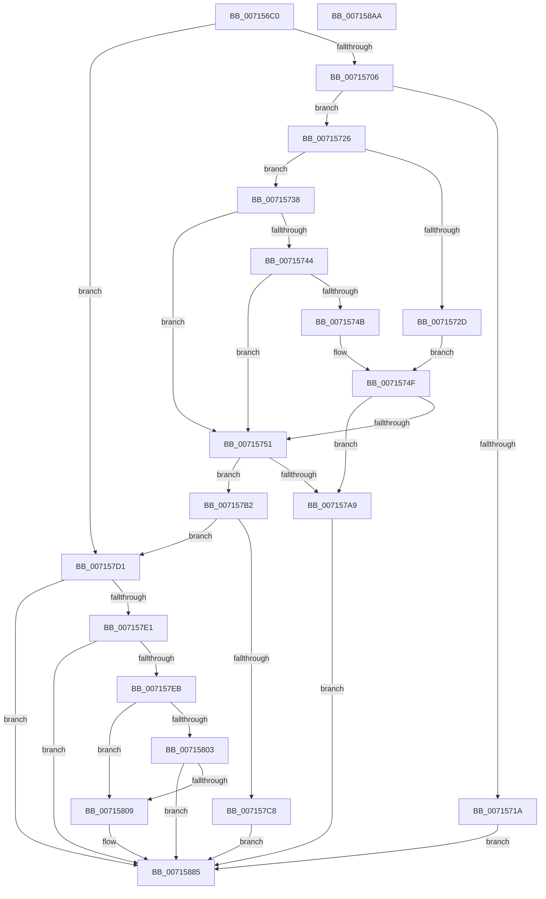

# FsRtlpOplockTryPrepForAckTimeout

- RVA: `0x007156C0`–`0x007158AB` (길이 `491` bytes)
- VA: `0x00000001407156C0`
- 실행 섹션: `PAGE`
- PDB 이름 있음: `예`; PDB Function 태그: `아니요`
- unwind 정보 RVA: `0x000C5DD0`
- 디코드: `126`개 명령, `491/491` bytes 표시
- 미해석 바이트: `0` (있으면 어셈블리에 `.byte`로 보존)

> 이 문서는 커널 이미지의 기계어와 PDB 기호를 분석해 생성했습니다. 4번과 5번은 함수 원형과 자료형을 바이너리 사용 방식에서 추정한 C 해석이며 원본 소스 복구 결과는 아닙니다.

## 1. Dependencies

- 직접 호출 지점: **14**; 고유 호출 대상: **14**
- 직접 호출자로 확인된 함수: **2**
- RIP 상대 이미지 참조: **4**

### Outgoing calls
- `0x00715711` → [IoIsFileOriginRemote](../../text/4A/IoIsFileOriginRemote_function_004AD590.md) (function, `0x004AD590`)
- `0x0071572D` → [ExGetPreviousMode](../../text/44/ExGetPreviousMode_function_0044C3A0.md) (function, `0x0044C3A0`)
- `0x00715760` → [SeCaptureSubjectContext](../86/SeCaptureSubjectContext_function_0086B820.md) (function, `0x0086B820`)
- `0x00715795` → [SePrivilegeCheck](../9B/SePrivilegeCheck_function_009BAE70.md) (function, `0x009BAE70`)
- `0x007157A0` → [SeReleaseSubjectContext](../86/SeReleaseSubjectContext_function_0086B710.md) (function, `0x0086B710`)
- `0x007157BF` → [FsRtlpOplockGetThreadIntegrityLevel](../6F/FsRtlpOplockGetThreadIntegrityLevel_function_006FD814.md) (function, `0x006FD814`)
- `0x007157D4` → [FsRtlpOplockIsSubjectToTimeout](../../text/4F/FsRtlpOplockIsSubjectToTimeout_function_004F5000.md) (function, `0x004F5000`)
- `0x007157F2` → [ExAllocateFromNPagedLookasideList](../../text/38/ExAllocateFromNPagedLookasideList_function_0038E6C0.md) (function, `0x0038E6C0`)
- `0x007157FA` → [Feature_697728313__private_IsEnabledDeviceUsageNoInline](../../text/58/Feature_697728313__private_IsEnabledDeviceUsageNoInline_function_00581D84.md) (function, `0x00581D84`)
- `0x00715814` → [memset](../../text/6C/memset_function_006C6C40.md) (function, `0x006C6C40`)
- `0x00715837` → [ObfReferenceObject](../../text/20/ObfReferenceObject_function_0020FA20.md) (function, `0x0020FA20`)
- `0x0071586A` → [KeInitializeDpc](../../text/45/KeInitializeDpc_function_0045BBD0.md) (function, `0x0045BBD0`)
- `0x00715874` → [KeInitializeTimerEx](../../text/45/KeInitializeTimerEx_function_004563F0.md) (function, `0x004563F0`)
- `0x0071588C` → [_security_check_cookie](../../text/6A/_security_check_cookie_function_006AC640.md) (function, `0x006AC640`)

### Direct callers
- [FsRtlpRequestExclusiveOplock](../../text/3F/FsRtlpRequestExclusiveOplock_function_003F3800.md) at `0x003F4038`
- [FsRtlpRequestShareableOplock](../../text/4E/FsRtlpRequestShareableOplock_function_004E6EC8.md) at `0x004E76A5`
- [FsRtlpRequestShareableOplock](../../text/4E/FsRtlpRequestShareableOplock_function_004E6EC8.md) at `0x004E7704`

### Static image references
- `0x007156D9` → RVA `0x00E0A740` (`.data`; read)
- `0x007157EB` → RVA `0x00E12280` (`.data`; read)
- `0x0071583F` → RVA `0x00582950` (`FsRtlpOplockAckTimeoutWorker`; read)
- `0x00715846` → RVA `0x00582920` (`FsRtlpOplockAckTimeoutDpc`; read)

## 2. Other-region calls and transfers

- 다른 실행 섹션으로 향하는 call: **10**
  - `0x00715711` → [IoIsFileOriginRemote](../../text/4A/IoIsFileOriginRemote_function_004AD590.md) (`PAGE` → `.text`)
  - `0x0071572D` → [ExGetPreviousMode](../../text/44/ExGetPreviousMode_function_0044C3A0.md) (`PAGE` → `.text`)
  - `0x007157D4` → [FsRtlpOplockIsSubjectToTimeout](../../text/4F/FsRtlpOplockIsSubjectToTimeout_function_004F5000.md) (`PAGE` → `.text`)
  - `0x007157F2` → [ExAllocateFromNPagedLookasideList](../../text/38/ExAllocateFromNPagedLookasideList_function_0038E6C0.md) (`PAGE` → `.text`)
  - `0x007157FA` → [Feature_697728313__private_IsEnabledDeviceUsageNoInline](../../text/58/Feature_697728313__private_IsEnabledDeviceUsageNoInline_function_00581D84.md) (`PAGE` → `.text`)
  - `0x00715814` → [memset](../../text/6C/memset_function_006C6C40.md) (`PAGE` → `.text`)
  - `0x00715837` → [ObfReferenceObject](../../text/20/ObfReferenceObject_function_0020FA20.md) (`PAGE` → `.text`)
  - `0x0071586A` → [KeInitializeDpc](../../text/45/KeInitializeDpc_function_0045BBD0.md) (`PAGE` → `.text`)
  - `0x00715874` → [KeInitializeTimerEx](../../text/45/KeInitializeTimerEx_function_004563F0.md) (`PAGE` → `.text`)
  - `0x0071588C` → [_security_check_cookie](../../text/6A/_security_check_cookie_function_006AC640.md) (`PAGE` → `.text`)
- 별도 외부 분기/꼬리 이동을 확인하지 못했습니다.

## 3. Assembly (complete function range)

```asm
007156C0  48 89 5C 24 08                  mov qword ptr [rsp + 8], rbx
007156C5  48 89 74 24 10                  mov qword ptr [rsp + 0x10], rsi
007156CA  55                              push rbp
007156CB  57                              push rdi
007156CC  41 54                           push r12
007156CE  41 56                           push r14
007156D0  41 57                           push r15
007156D2  48 8B EC                        mov rbp, rsp
007156D5  48 83 EC 70                     sub rsp, 0x70
007156D9  48 8B 05 60 50 6F 00            mov rax, qword ptr [rip + 0x6f5060]
007156E0  48 33 C4                        xor rax, rsp
007156E3  48 89 45 F8                     mov qword ptr [rbp - 8], rax
007156E7  83 65 B0 00                     and dword ptr [rbp - 0x50], 0
007156EB  49 8B F9                        mov rdi, r9
007156EE  41 83 79 08 00                  cmp dword ptr [r9 + 8], 0
007156F3  4D 8B F0                        mov r14, r8
007156F6  48 8B 75 50                     mov rsi, qword ptr [rbp + 0x50]
007156FA  4C 8B FA                        mov r15, rdx
007156FD  4C 8B E1                        mov r12, rcx
00715700  0F 85 CB 00 00 00               jne 0x1407157d1
00715706  48 8B CA                        mov rcx, rdx
00715709  41 C7 41 08 00 00 00 80         mov dword ptr [r9 + 8], 0x80000000
00715711  E8 7A 7E D9 FF                  call 0x1404ad590
00715716  84 C0                           test al, al
00715718  74 0C                           je 0x140715726
0071571A  C7 47 08 02 00 00 80            mov dword ptr [rdi + 8], 0x80000002
00715721  E9 5F 01 00 00                  jmp 0x140715885
00715726  B3 01                           mov bl, 1
00715728  4D 85 F6                        test r14, r14
0071572B  75 0B                           jne 0x140715738
0071572D  E8 6E 6C D3 FF                  call 0x14044c3a0
00715732  8A D8                           mov bl, al
00715734  84 C0                           test al, al
00715736  EB 17                           jmp 0x14071574f
00715738  49 8B 86 B8 00 00 00            mov rax, qword ptr [r14 + 0xb8]
0071573F  80 38 0D                        cmp byte ptr [rax], 0xd
00715742  75 0D                           jne 0x140715751
00715744  41 80 7E 40 00                  cmp byte ptr [r14 + 0x40], 0
00715749  75 06                           jne 0x140715751
0071574B  80 78 01 04                     cmp byte ptr [rax + 1], 4
0071574F  74 58                           je 0x1407157a9
00715751  0F 57 C0                        xorps xmm0, xmm0
00715754  48 8D 4D C0                     lea rcx, [rbp - 0x40]
00715758  0F 11 45 C0                     movups xmmword ptr [rbp - 0x40], xmm0
0071575C  0F 11 45 D0                     movups xmmword ptr [rbp - 0x30], xmm0
00715760  E8 BB 60 15 00                  call 0x14086b820
00715765  83 65 BC 00                     and dword ptr [rbp - 0x44], 0
00715769  48 8D 55 C0                     lea rdx, [rbp - 0x40]
0071576D  83 65 F0 00                     and dword ptr [rbp - 0x10], 0
00715771  48 8D 4D E0                     lea rcx, [rbp - 0x20]
00715775  41 BE 01 00 00 00               mov r14d, 1
0071577B  C7 45 B8 12 00 00 00            mov dword ptr [rbp - 0x48], 0x12
00715782  48 8B 45 B8                     mov rax, qword ptr [rbp - 0x48]
00715786  44 8A C3                        mov r8b, bl
00715789  48 89 45 E8                     mov qword ptr [rbp - 0x18], rax
0071578D  44 89 75 E0                     mov dword ptr [rbp - 0x20], r14d
00715791  44 89 75 E4                     mov dword ptr [rbp - 0x1c], r14d
00715795  E8 D6 56 2A 00                  call 0x1409bae70
0071579A  48 8D 4D C0                     lea rcx, [rbp - 0x40]
0071579E  8A D8                           mov bl, al
007157A0  E8 6B 5F 15 00                  call 0x14086b710
007157A5  84 DB                           test bl, bl
007157A7  74 09                           je 0x1407157b2
007157A9  83 4F 08 04                     or dword ptr [rdi + 8], 4
007157AD  E9 D3 00 00 00                  jmp 0x140715885
007157B2  65 48 8B 0C 25 88 01 00 00      mov rcx, qword ptr gs:[0x188]
007157BB  48 8D 55 B0                     lea rdx, [rbp - 0x50]
007157BF  E8 50 80 FE FF                  call 0x1406fd814
007157C4  84 C0                           test al, al
007157C6  75 09                           jne 0x1407157d1
007157C8  44 09 77 08                     or dword ptr [rdi + 8], r14d
007157CC  E9 B4 00 00 00                  jmp 0x140715885
007157D1  48 8B CF                        mov rcx, rdi
007157D4  E8 27 F8 DD FF                  call 0x1404f5000
007157D9  84 C0                           test al, al
007157DB  0F 84 A4 00 00 00               je 0x140715885
007157E1  48 83 3E 00                     cmp qword ptr [rsi], 0
007157E5  0F 85 9A 00 00 00               jne 0x140715885
007157EB  48 8D 0D 8E CA 6F 00            lea rcx, [rip + 0x6fca8e]
007157F2  E8 C9 8E C7 FF                  call 0x14038e6c0
007157F7  48 89 06                        mov qword ptr [rsi], rax
007157FA  E8 85 C5 E6 FF                  call 0x140581d84
007157FF  85 C0                           test eax, eax
00715801  74 06                           je 0x140715809
00715803  48 83 3E 00                     cmp qword ptr [rsi], 0
00715807  74 7C                           je 0x140715885
00715809  48 8B 0E                        mov rcx, qword ptr [rsi]
0071580C  33 D2                           xor edx, edx
0071580E  41 B8 B8 00 00 00               mov r8d, 0xb8
00715814  E8 27 14 FB FF                  call 0x1406c6c40
00715819  48 8B 06                        mov rax, qword ptr [rsi]
0071581C  4C 89 A0 A0 00 00 00            mov qword ptr [rax + 0xa0], r12
00715823  48 8B 06                        mov rax, qword ptr [rsi]
00715826  4C 89 B8 A8 00 00 00            mov qword ptr [rax + 0xa8], r15
0071582D  48 8B 0E                        mov rcx, qword ptr [rsi]
00715830  48 8B 89 A8 00 00 00            mov rcx, qword ptr [rcx + 0xa8]
00715837  E8 E4 A1 AF FF                  call 0x14020fa20
0071583C  48 8B 06                        mov rax, qword ptr [rsi]
0071583F  48 8D 0D 0A D1 E6 FF            lea rcx, [rip - 0x192ef6]
00715846  48 8D 15 D3 D0 E6 FF            lea rdx, [rip - 0x192f2d]
0071584D  48 83 A0 80 00 00 00 00         and qword ptr [rax + 0x80], 0
00715855  48 89 88 90 00 00 00            mov qword ptr [rax + 0x90], rcx
0071585C  48 89 80 98 00 00 00            mov qword ptr [rax + 0x98], rax
00715863  4C 8B 06                        mov r8, qword ptr [rsi]
00715866  49 8D 48 40                     lea rcx, [r8 + 0x40]
0071586A  E8 61 63 D4 FF                  call 0x14045bbd0
0071586F  48 8B 0E                        mov rcx, qword ptr [rsi]
00715872  33 D2                           xor edx, edx
00715874  E8 77 0B D4 FF                  call 0x1404563f0
00715879  48 8B 0E                        mov rcx, qword ptr [rsi]
0071587C  8B 45 B0                        mov eax, dword ptr [rbp - 0x50]
0071587F  89 81 B0 00 00 00               mov dword ptr [rcx + 0xb0], eax
00715885  48 8B 4D F8                     mov rcx, qword ptr [rbp - 8]
00715889  48 33 CC                        xor rcx, rsp
0071588C  E8 AF 6D F9 FF                  call 0x1406ac640
00715891  4C 8D 5C 24 70                  lea r11, [rsp + 0x70]
00715896  49 8B 5B 30                     mov rbx, qword ptr [r11 + 0x30]
0071589A  49 8B 73 38                     mov rsi, qword ptr [r11 + 0x38]
0071589E  49 8B E3                        mov rsp, r11
007158A1  41 5F                           pop r15
007158A3  41 5E                           pop r14
007158A5  41 5C                           pop r12
007158A7  5F                              pop rdi
007158A8  5D                              pop rbp
007158A9  C3                              ret
007158AA  CC                              int3
```

## 4. C-style interpretation (structured pseudocode)

```c
__int64 __fastcall FsRtlpOplockTryPrepForAckTimeout(__int64 a1, __int64 a2, __int64 a3, __int64 a4, __int64 a5)
{
    __int64 result;
    __int64 v_rsp;
    unsigned __int64 v_stack_m28;
    unsigned __int64 v_stack_m30;
    unsigned int v_stack_m38;
    unsigned __int64 v_stack_m40;
    unsigned int v_stack_m44;
    unsigned __int64 v_stack_m48;
    unsigned __int64 v_stack_m58;
    unsigned __int64 v_stack_m68;
    unsigned int v_stack_m6C;
    unsigned int v_stack_m70;
    unsigned int v_stack_m78;
    unsigned __int64 v_stack_p10;
    unsigned __int64 v_stack_p8;

    v_stack_p8 = v_rbx;
    v_stack_p10 = v_rsi;
    v_rsp = (v_rsp) - (112);
    result = (*(unsigned __int64 *)(v_rip + 7295072)) ^ (v_rsp);
    v_stack_m30 = result;
    if ((*(unsigned int *)(a4 + 8)) != 0) goto loc_007157D1;
    *(unsigned int *)(a4 + 8) = 0x80000000ULL;
    result = IoIsFileOriginRemote(a2, a2, a3, a4);
    if ((unsigned __int8)(result) == 0) goto loc_00715726;
    *(unsigned int *)(a4 + 8) = 0x80000002ULL;
    goto loc_00715885;
loc_00715726:
    if (a3 != 0) goto loc_00715738;
    result = ExGetPreviousMode(a2, a2, a3, a4);
    goto loc_0071574F;
loc_00715738:
    if ((*(unsigned __int8 *)(*(unsigned __int64 *)(a3 + 184))) != 13) goto loc_00715751;
    if ((*(unsigned __int8 *)(a3 + 64)) != 0) goto loc_00715751;
loc_0071574F:
    if ((*(unsigned __int8 *)(*(unsigned __int64 *)(a3 + 184) + 1)) == 4) goto loc_007157A9;
loc_00715751:
    v_stack_m68 = v_xmm0;
    v_stack_m58 = v_xmm0;
    result = SeCaptureSubjectContext(v_stack_m68, a2, a3, a4);
    v_stack_m70 = 18;
    v_stack_m40 = v_stack_m70;
    v_stack_m48 = 1;
    v_stack_m44 = 1;
    result = SePrivilegeCheck(v_stack_m48, v_stack_m68, (unsigned __int8)((unsigned __int8)(result)), a4);
    result = SeReleaseSubjectContext(v_stack_m68, v_stack_m68, (unsigned __int8)((unsigned __int8)(result)), a4);
    if ((unsigned __int8)((unsigned __int8)(result)) == 0) goto loc_007157B2;
loc_007157A9:
    goto loc_00715885;
loc_007157B2:
    result = FsRtlpOplockGetThreadIntegrityLevel(*(unsigned __int64 *)(gs_base + (0 + 392)), v_stack_m78, (unsigned __int8)((unsigned __int8)(result)), a4);
    if ((unsigned __int8)(result) != 0) goto loc_007157D1;
    goto loc_00715885;
loc_007157D1:
    result = FsRtlpOplockIsSubjectToTimeout(a4, v_stack_m78, (unsigned __int8)((unsigned __int8)(result)), a4);
    if ((unsigned __int8)(result) == 0) goto loc_00715885;
    if ((*(unsigned __int64 *)(a5)) != 0) goto loc_00715885;
    result = ExAllocateFromNPagedLookasideList(v_rip + 7326350, v_stack_m78, (unsigned __int8)((unsigned __int8)(result)), a4);
    *(unsigned __int64 *)(a5) = result;
    result = Feature_697728313__private_IsEnabledDeviceUsageNoInline(v_rip + 7326350, v_stack_m78, (unsigned __int8)((unsigned __int8)(result)), a4);
    if ((unsigned int)(result) == 0) goto loc_00715809;
    if ((*(unsigned __int64 *)(a5)) != 0) {
        a1 = *(unsigned __int64 *)(a5);
        a2 = 0;
        a3 = 184;
        result = memset(a1, a2, a3, a4);
        result = *(unsigned __int64 *)(a5);
        *(unsigned __int64 *)(result + 160) = a1;
        result = *(unsigned __int64 *)(a5);
        *(unsigned __int64 *)(result + 168) = 0;
        a1 = *(unsigned __int64 *)(a5);
        a1 = *(unsigned __int64 *)(a1 + 168);
        result = ObfReferenceObject(a1, a2, a3, a4);
        result = *(unsigned __int64 *)(a5);
        a1 = v_rip - 1650422;
        a2 = v_rip - 1650477;
        *(unsigned __int64 *)(result + 144) = a1;
        *(unsigned __int64 *)(result + 152) = result;
        a3 = *(unsigned __int64 *)(a5);
        a1 = a3 + 64;
        result = KeInitializeDpc(a1, a2, a3, a4);
        a1 = *(unsigned __int64 *)(a5);
        a2 = 0;
        result = KeInitializeTimerEx(a1, a2, a3, a4);
        a1 = *(unsigned __int64 *)(a5);
        result = v_stack_m78;
        *(unsigned int *)(a1 + 176) = (unsigned int)(result);
    }
    a1 = (v_stack_m30) ^ (v_rsp);
    result = _security_check_cookie(a1, a2, a3, a4);
    return result;
}
```

## 5. (Beta) C Style

```c
int64_t FsRtlpOplockTryPrepForAckTimeout(int64_t Arg1, int64_t Arg2, int64_t Arg3, void *Arg4, void *Arg5)
{
    uint8_t *arg4 = (uint8_t *)Arg4;
    uint8_t *arg5 = (uint8_t *)Arg5;

    int64_t result;
    int64_t local_rsp;
    uint64_t v_stack_m28;
    uint64_t v_stack_m30;
    uint32_t v_stack_m38;
    uint64_t v_stack_m40;
    uint32_t v_stack_m44;
    uint64_t v_stack_m48;
    uint64_t v_stack_m58;
    uint64_t v_stack_m68;
    uint32_t v_stack_m6C;
    uint32_t v_stack_m70;
    uint32_t v_stack_m78;
    uint64_t v_stack_p10;
    uint64_t v_stack_p8;

    v_stack_p8 = local_rbx;
    v_stack_p10 = local_rsi;
    local_rsp = (local_rsp) - (112);
    result = (*(uint64_t *)(v_rip + 0x6F5060)) ^ (local_rsp);
    v_stack_m30 = result;
    if ((*(uint32_t *)(arg4 + 0x8)) != 0) goto loc_007157D1;
    *(uint32_t *)(arg4 + 0x8) = 0x80000000ULL;
    result = IoIsFileOriginRemote(Arg2, Arg2, Arg3, Arg4);
    if ((uint8_t)(result) == 0) goto loc_00715726;
    *(uint32_t *)(arg4 + 0x8) = 0x80000002ULL;
    goto loc_00715885;
loc_00715726:
    if (Arg3 != 0) goto loc_00715738;
    result = ExGetPreviousMode(Arg2, Arg2, Arg3, Arg4);
    goto loc_0071574F;
loc_00715738:
    if ((*(uint8_t *)(*(uint64_t *)(Arg3 + 0xB8))) != 13) goto loc_00715751;
    if ((*(uint8_t *)(Arg3 + 0x40)) != 0) goto loc_00715751;
loc_0071574F:
    if ((*(uint8_t *)(*(uint64_t *)(Arg3 + 0xB8) + 0x1)) == 4) goto loc_007157A9;
loc_00715751:
    v_stack_m68 = v_xmm0;
    v_stack_m58 = v_xmm0;
    result = SeCaptureSubjectContext(v_stack_m68, Arg2, Arg3, Arg4);
    v_stack_m70 = 18;
    v_stack_m40 = v_stack_m70;
    v_stack_m48 = 1;
    v_stack_m44 = 1;
    result = SePrivilegeCheck(v_stack_m48, v_stack_m68, (uint8_t)((uint8_t)(result)), Arg4);
    result = SeReleaseSubjectContext(v_stack_m68, v_stack_m68, (uint8_t)((uint8_t)(result)), Arg4);
    if ((uint8_t)((uint8_t)(result)) == 0) goto loc_007157B2;
loc_007157A9:
    goto loc_00715885;
loc_007157B2:
    result = FsRtlpOplockGetThreadIntegrityLevel(*(uint64_t *)(gs_base + (0 + 0x188)), v_stack_m78, (uint8_t)((uint8_t)(result)), Arg4);
    if ((uint8_t)(result) != 0) goto loc_007157D1;
    goto loc_00715885;
loc_007157D1:
    result = FsRtlpOplockIsSubjectToTimeout(Arg4, v_stack_m78, (uint8_t)((uint8_t)(result)), Arg4);
    if ((uint8_t)(result) == 0) goto loc_00715885;
    if ((*(uint64_t *)(arg5)) != 0) goto loc_00715885;
    result = ExAllocateFromNPagedLookasideList(v_rip + 7326350, v_stack_m78, (uint8_t)((uint8_t)(result)), Arg4);
    *(uint64_t *)(arg5) = result;
    result = Feature_697728313__private_IsEnabledDeviceUsageNoInline(v_rip + 7326350, v_stack_m78, (uint8_t)((uint8_t)(result)), Arg4);
    if ((uint32_t)(result) == 0) goto loc_00715809;
    if ((*(uint64_t *)(arg5)) != 0) {
        Arg1 = *(uint64_t *)(arg5);
        Arg2 = 0;
        Arg3 = 184;
        result = memset(Arg1, Arg2, Arg3, Arg4);
        result = *(uint64_t *)(arg5);
        *(uint64_t *)(result + 0xA0) = Arg1;
        result = *(uint64_t *)(arg5);
        *(uint64_t *)(result + 0xA8) = 0;
        Arg1 = *(uint64_t *)(arg5);
        Arg1 = *(uint64_t *)(Arg1 + 0xA8);
        result = ObfReferenceObject(Arg1, Arg2, Arg3, Arg4);
        result = *(uint64_t *)(arg5);
        Arg1 = v_rip - 1650422;
        Arg2 = v_rip - 1650477;
        *(uint64_t *)(result + 0x90) = Arg1;
        *(uint64_t *)(result + 0x98) = result;
        Arg3 = *(uint64_t *)(arg5);
        Arg1 = Arg3 + 64;
        result = KeInitializeDpc(Arg1, Arg2, Arg3, Arg4);
        Arg1 = *(uint64_t *)(arg5);
        Arg2 = 0;
        result = KeInitializeTimerEx(Arg1, Arg2, Arg3, Arg4);
        Arg1 = *(uint64_t *)(arg5);
        result = v_stack_m78;
        *(uint32_t *)(Arg1 + 0xB0) = (uint32_t)(result);
    }
    Arg1 = (v_stack_m30) ^ (local_rsp);
    result = _security_check_cookie(Arg1, Arg2, Arg3, Arg4);
    return result;
}
```

### 관측된 메모리 오프셋

구조체 형식이 확인되지 않은 접근은 인자 기준의 오프셋으로만 기록했습니다.

| 기준 인자 | 오프셋 표현 | 폭 (bit) | 접근 |
|---|---:|---:|---|
| `Arg4` | `+ 0x8` | `32` | `R` |
| `Arg4` | `+ 0x8` | `32` | `R/W` |
| `Arg4` | `+ 0x8` | `32` | `W` |
| `Arg5` | `+ 0x0` | `64` | `R` |
| `Arg5` | `+ 0x0` | `64` | `W` |

## 6. Execution-region graph

[열기: 2D/3D 그래프와 함수 탐색 컨트롤 패널](../../../control-panel.html?section=page&rva=0x007156C0&view=graph)

- 2D 그래프는 위에서 아래로 흐르고, 3D 그래프는 빈 공간을 드래그해 회전합니다. Shift+드래그는 이동, 휠은 확대·축소, 함수 노드 선택은 대상 보고서 이동입니다.

### Static fallback


