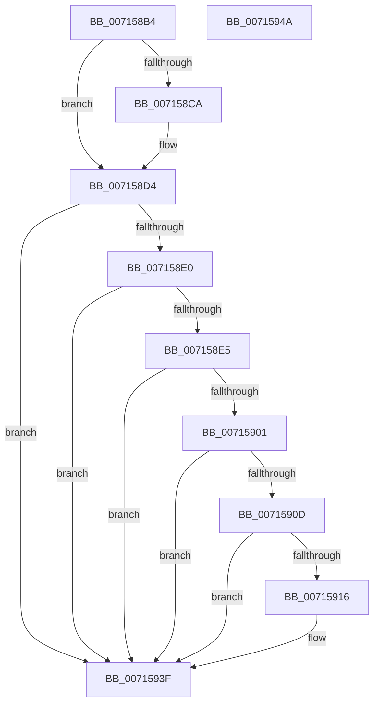

# FsRtlpOplockTryStartBreakAckTimeout

- RVA: `0x007158B4`–`0x0071594B` (길이 `151` bytes)
- VA: `0x00000001407158B4`
- 실행 섹션: `PAGE`
- PDB 이름 있음: `예`; PDB Function 태그: `아니요`
- unwind 정보 RVA: `0x0008A658`
- 디코드: `40`개 명령, `151/151` bytes 표시
- 미해석 바이트: `0` (있으면 어셈블리에 `.byte`로 보존)

> 이 문서는 커널 이미지의 기계어와 PDB 기호를 분석해 생성했습니다. 4번과 5번은 함수 원형과 자료형을 바이너리 사용 방식에서 추정한 C 해석이며 원본 소스 복구 결과는 아닙니다.

## 1. Dependencies

- 직접 호출 지점: **4**; 고유 호출 대상: **4**
- 직접 호출자로 확인된 함수: **3**
- RIP 상대 이미지 참조: **1**

### Outgoing calls
- `0x007158CC` → [KeQueryPerformanceCounter](../../text/37/KeQueryPerformanceCounter_function_0037E7E0.md) (function, `0x0037E7E0`)
- `0x007158D7` → [FsRtlpOplockIsSubjectToTimeout](../../text/4F/FsRtlpOplockIsSubjectToTimeout_function_004F5000.md) (function, `0x004F5000`)
- `0x007158F8` → [FsRtlpOplockGetThreadIntegrityLevel](../6F/FsRtlpOplockGetThreadIntegrityLevel_function_006FD814.md) (function, `0x006FD814`)
- `0x0071593A` → [KiSetTimerEx](../../text/23/KiSetTimerEx_function_00232CB0.md) (function, `0x00232CB0`)

### Direct callers
- [FsRtlpOplockBreakToII](../../text/4B/FsRtlpOplockBreakToII_function_004BB824.md) at `0x004BB9E3`
- [FsRtlpOplockBreakByCacheFlags](../../text/4E/FsRtlpOplockBreakByCacheFlags_function_004E4990.md) at `0x004E5CA4`
- [FsRtlpOplockBreakByCacheFlags](../../text/4E/FsRtlpOplockBreakByCacheFlags_function_004E4990.md) at `0x004E5D4C`
- [FsRtlpOplockBreakByCacheFlags](../../text/4E/FsRtlpOplockBreakByCacheFlags_function_004E4990.md) at `0x004E6010`
- [FsRtlpOplockBreakByCacheFlags](../../text/4E/FsRtlpOplockBreakByCacheFlags_function_004E4990.md) at `0x004E606B`
- [FsRtlpOplockBreakByCacheFlags](../../text/4E/FsRtlpOplockBreakByCacheFlags_function_004E4990.md) at `0x004E6CE8`
- [FsRtlpOplockBreakByCacheFlags](../../text/4E/FsRtlpOplockBreakByCacheFlags_function_004E4990.md) at `0x004E6D04`
- [FsRtlpOplockBreakToNone](../../text/4F/FsRtlpOplockBreakToNone_function_004F8354.md) at `0x004F857A`

### Static image references
- `0x00715916` → RVA `0x00E0A8B0` (`.data`; read)

## 2. Other-region calls and transfers

- 다른 실행 섹션으로 향하는 call: **3**
  - `0x007158CC` → [KeQueryPerformanceCounter](../../text/37/KeQueryPerformanceCounter_function_0037E7E0.md) (`PAGE` → `.text`)
  - `0x007158D7` → [FsRtlpOplockIsSubjectToTimeout](../../text/4F/FsRtlpOplockIsSubjectToTimeout_function_004F5000.md) (`PAGE` → `.text`)
  - `0x0071593A` → [KiSetTimerEx](../../text/23/KiSetTimerEx_function_00232CB0.md) (`PAGE` → `.text`)
- 별도 외부 분기/꼬리 이동을 확인하지 못했습니다.

## 3. Assembly (complete function range)

```asm
007158B4  48 89 5C 24 10                  mov qword ptr [rsp + 0x10], rbx
007158B9  57                              push rdi
007158BA  48 83 EC 30                     sub rsp, 0x30
007158BE  48 83 39 00                     cmp qword ptr [rcx], 0
007158C2  48 8B DA                        mov rbx, rdx
007158C5  48 8B F9                        mov rdi, rcx
007158C8  75 0A                           jne 0x1407158d4
007158CA  33 C9                           xor ecx, ecx
007158CC  E8 0F 8F C6 FF                  call 0x14037e7e0
007158D1  48 89 07                        mov qword ptr [rdi], rax
007158D4  48 8B CF                        mov rcx, rdi
007158D7  E8 24 F7 DD FF                  call 0x1404f5000
007158DC  84 C0                           test al, al
007158DE  74 5F                           je 0x14071593f
007158E0  48 85 DB                        test rbx, rbx
007158E3  74 5A                           je 0x14071593f
007158E5  83 64 24 40 00                  and dword ptr [rsp + 0x40], 0
007158EA  48 8D 54 24 40                  lea rdx, [rsp + 0x40]
007158EF  65 48 8B 0C 25 88 01 00 00      mov rcx, qword ptr gs:[0x188]
007158F8  E8 17 7F FE FF                  call 0x1406fd814
007158FD  84 C0                           test al, al
007158FF  74 3E                           je 0x14071593f
00715901  8B 83 B0 00 00 00               mov eax, dword ptr [rbx + 0xb0]
00715907  39 44 24 40                     cmp dword ptr [rsp + 0x40], eax
0071590B  76 32                           jbe 0x14071593f
0071590D  80 BB B4 00 00 00 00            cmp byte ptr [rbx + 0xb4], 0
00715914  75 29                           jne 0x14071593f
00715916  48 69 15 8F 4F 6F 00 F0 D8 FF FF  imul rdx, qword ptr [rip + 0x6f4f8f], -0x2710
00715921  48 8D 43 40                     lea rax, [rbx + 0x40]
00715925  C6 83 B4 00 00 00 01            mov byte ptr [rbx + 0xb4], 1
0071592C  45 33 C9                        xor r9d, r9d
0071592F  48 89 44 24 20                  mov qword ptr [rsp + 0x20], rax
00715934  45 33 C0                        xor r8d, r8d
00715937  48 8B CB                        mov rcx, rbx
0071593A  E8 71 D3 B1 FF                  call 0x140232cb0
0071593F  48 8B 5C 24 48                  mov rbx, qword ptr [rsp + 0x48]
00715944  48 83 C4 30                     add rsp, 0x30
00715948  5F                              pop rdi
00715949  C3                              ret
0071594A  CC                              int3
```

## 4. C-style interpretation (structured pseudocode)

```c
__int64 __fastcall FsRtlpOplockTryStartBreakAckTimeout(__int64 a1, __int64 a2, int a3, int a4)
{
    __int64 result;
    __int64 v_rsp;
    unsigned __int64 v_stack_m18;
    unsigned __int64 v_stack_p10;
    unsigned int v_stack_p8;

    v_stack_p10 = v_rbx;
    v_rsp = (v_rsp) - (48);
    if ((*(unsigned __int64 *)(a1)) == 0) {
        a1 = 0;
        result = KeQueryPerformanceCounter(a1, a2, a3, a4);
        *(unsigned __int64 *)(a1) = result;
    }
    result = FsRtlpOplockIsSubjectToTimeout(0, a2, a3, a4);
    if ((unsigned __int8)(result) == 0) goto loc_0071593F;
    if (a2 == 0) goto loc_0071593F;
    result = FsRtlpOplockGetThreadIntegrityLevel(*(unsigned __int64 *)(gs_base + (0 + 392)), v_stack_p8, a3, a4);
    if ((unsigned __int8)(result) == 0) goto loc_0071593F;
    if (v_stack_p8 <= ((unsigned int)((unsigned int)(*(unsigned int *)(a2 + 176))))) goto loc_0071593F;
    result = (unsigned int)(*(unsigned int *)(a2 + 176));
    if ((*(unsigned __int8 *)(a2 + 180)) == 0) {
        a2 = (v_stack_p8) * (*(unsigned __int64 *)(v_rip + 7294863));
        result = a2 + 64;
        *(unsigned __int8 *)(a2 + 180) = 1;
        a4 = 0;
        v_stack_m18 = result;
        a3 = 0;
        a1 = a2;
        result = KiSetTimerEx(a1, a2, a3, a4);
    }
    v_rsp = (v_rsp) + (48);
    return result;
}
```

## 5. (Beta) C Style

```c
int64_t FsRtlpOplockTryStartBreakAckTimeout(void *Arg1, int64_t Arg2, int32_t Arg3, int32_t Arg4)
{
    uint8_t *arg1 = (uint8_t *)Arg1;

    int64_t result;
    int64_t local_rsp;
    uint64_t v_stack_m18;
    uint64_t v_stack_p10;
    uint32_t v_stack_p8;

    v_stack_p10 = local_rbx;
    local_rsp = (local_rsp) - (48);
    if ((*(uint64_t *)(arg1)) == 0) {
        Arg1 = 0;
        result = KeQueryPerformanceCounter(Arg1, Arg2, Arg3, Arg4);
        *(uint64_t *)(arg1) = result;
    }
    result = FsRtlpOplockIsSubjectToTimeout(0, Arg2, Arg3, Arg4);
    if ((uint8_t)(result) == 0) goto loc_0071593F;
    if (Arg2 == 0) goto loc_0071593F;
    result = FsRtlpOplockGetThreadIntegrityLevel(*(uint64_t *)(gs_base + (0 + 0x188)), v_stack_p8, Arg3, Arg4);
    if ((uint8_t)(result) == 0) goto loc_0071593F;
    if (v_stack_p8 <= ((uint32_t)((uint32_t)(*(uint32_t *)(Arg2 + 0xB0))))) goto loc_0071593F;
    result = (uint32_t)(*(uint32_t *)(Arg2 + 0xB0));
    if ((*(uint8_t *)(Arg2 + 0xB4)) == 0) {
        Arg2 = (v_stack_p8) * (*(uint64_t *)(v_rip + 0x6F4F8F));
        result = Arg2 + 64;
        *(uint8_t *)(Arg2 + 0xB4) = 1;
        Arg4 = 0;
        v_stack_m18 = result;
        Arg3 = 0;
        Arg1 = Arg2;
        result = KiSetTimerEx(Arg1, Arg2, Arg3, Arg4);
    }
    local_rsp = (local_rsp) + (48);
    return result;
}
```

### 관측된 메모리 오프셋

구조체 형식이 확인되지 않은 접근은 인자 기준의 오프셋으로만 기록했습니다.

| 기준 인자 | 오프셋 표현 | 폭 (bit) | 접근 |
|---|---:|---:|---|
| `Arg1` | `+ 0x0` | `64` | `R` |
| `Arg1` | `+ 0x0` | `64` | `W` |

## 6. Execution-region graph

[열기: 2D/3D 그래프와 함수 탐색 컨트롤 패널](../../../control-panel.html?section=page&rva=0x007158B4&view=graph)

- 2D 그래프는 위에서 아래로 흐르고, 3D 그래프는 빈 공간을 드래그해 회전합니다. Shift+드래그는 이동, 휠은 확대·축소, 함수 노드 선택은 대상 보고서 이동입니다.

### Static fallback


