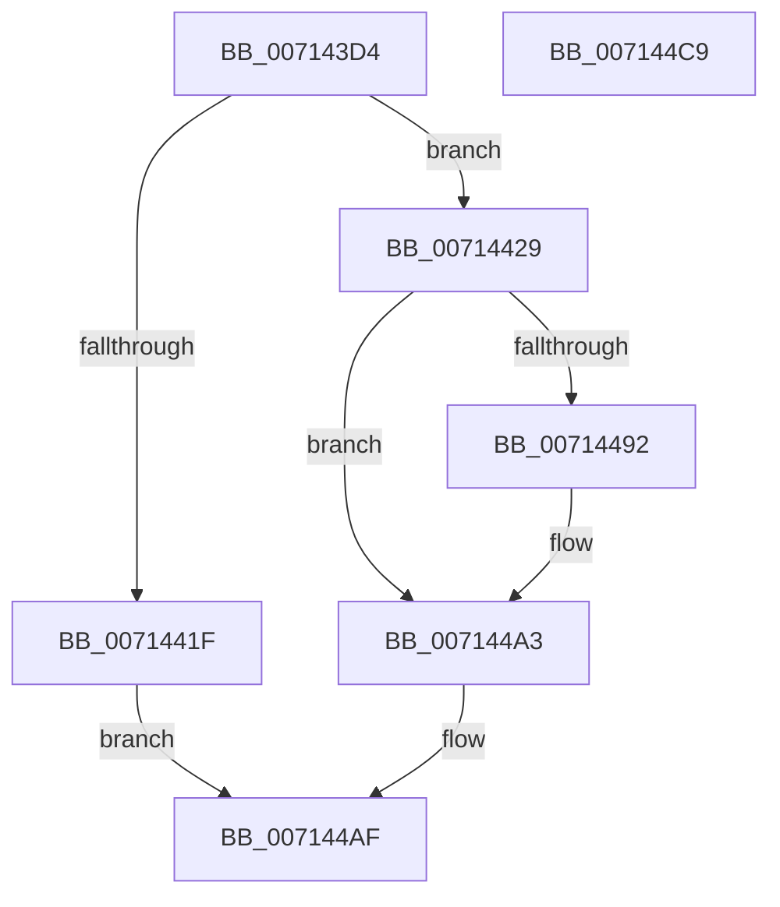

# FsRtlpRegisterProviderWithMUP

- RVA: `0x007143D4`–`0x007144CA` (길이 `246` bytes)
- VA: `0x00000001407143D4`
- 실행 섹션: `PAGE`
- PDB 이름 있음: `예`; PDB Function 태그: `아니요`
- unwind 정보 RVA: `0x0008CA40`
- 디코드: `70`개 명령, `246/246` bytes 표시
- 미해석 바이트: `0` (있으면 어셈블리에 `.byte`로 보존)

> 이 문서는 커널 이미지의 기계어와 PDB 기호를 분석해 생성했습니다. 4번과 5번은 함수 원형과 자료형을 바이너리 사용 방식에서 추정한 C 해석이며 원본 소스 복구 결과는 아닙니다.

## 1. Dependencies

- 직접 호출 지점: **5**; 고유 호출 대상: **5**
- 직접 호출자로 확인된 함수: **1**
- RIP 상대 이미지 참조: **0**

### Outgoing calls
- `0x00714412` → [ExAllocatePool2](../../poolcode/B8/ExAllocatePool2_function_00B820F0.md) (function, `0x00B820F0`)
- `0x0071444E` → [memcpy](../../text/6C/memcpy_function_006C6840.md) (function, `0x006C6840`)
- `0x00714484` → [ZwFsControlFile](../../text/6A/ZwFsControlFile_function_006AD7F0.md) (function, `0x006AD7F0`)
- `0x0071449A` → [ZwWaitForSingleObject](../../text/6A/ZwWaitForSingleObject_function_006AD150.md) (function, `0x006AD150`)
- `0x007144A8` → [ExFreePoolWithTag](../../poolcode/B8/ExFreePoolWithTag_function_00B82870.md) (function, `0x00B82870`)

### Direct callers
- [FsRtlpRegisterUncProvider](FsRtlpRegisterUncProvider_function_007144D0.md) at `0x00714572`

### Static image references
- 디코드된 RIP-relative 메모리 참조가 없습니다.

## 2. Other-region calls and transfers

- 다른 실행 섹션으로 향하는 call: **5**
  - `0x00714412` → [ExAllocatePool2](../../poolcode/B8/ExAllocatePool2_function_00B820F0.md) (`PAGE` → `POOLCODE`)
  - `0x0071444E` → [memcpy](../../text/6C/memcpy_function_006C6840.md) (`PAGE` → `.text`)
  - `0x00714484` → [ZwFsControlFile](../../text/6A/ZwFsControlFile_function_006AD7F0.md) (`PAGE` → `.text`)
  - `0x0071449A` → [ZwWaitForSingleObject](../../text/6A/ZwWaitForSingleObject_function_006AD150.md) (`PAGE` → `.text`)
  - `0x007144A8` → [ExFreePoolWithTag](../../poolcode/B8/ExFreePoolWithTag_function_00B82870.md) (`PAGE` → `POOLCODE`)
- 별도 외부 분기/꼬리 이동을 확인하지 못했습니다.

## 3. Assembly (complete function range)

```asm
007143D4  48 8B C4                        mov rax, rsp
007143D7  48 89 58 08                     mov qword ptr [rax + 8], rbx
007143DB  48 89 68 10                     mov qword ptr [rax + 0x10], rbp
007143DF  48 89 70 18                     mov qword ptr [rax + 0x18], rsi
007143E3  57                              push rdi
007143E4  41 56                           push r14
007143E6  41 57                           push r15
007143E8  48 83 EC 60                     sub rsp, 0x60
007143EC  0F B7 3A                        movzx edi, word ptr [rdx]
007143EF  4D 8B F8                        mov r15, r8
007143F2  48 8B F2                        mov rsi, rdx
007143F5  48 8B E9                        mov rbp, rcx
007143F8  0F 57 C0                        xorps xmm0, xmm0
007143FB  83 C7 20                        add edi, 0x20
007143FE  8B D7                           mov edx, edi
00714400  B9 40 00 00 00                  mov ecx, 0x40
00714405  41 B8 46 53 75 6E               mov r8d, 0x6e755346
0071440B  4D 8B F1                        mov r14, r9
0071440E  0F 11 40 D8                     movups xmmword ptr [rax - 0x28], xmm0
00714412  E8 D9 DC 46 00                  call 0x140b820f0
00714417  48 8B D8                        mov rbx, rax
0071441A  48 85 C0                        test rax, rax
0071441D  75 0A                           jne 0x140714429
0071441F  B8 9A 00 00 C0                  mov eax, 0xc000009a
00714424  E9 86 00 00 00                  jmp 0x1407144af
00714429  48 8D 48 20                     lea rcx, [rax + 0x20]
0071442D  48 89 48 08                     mov qword ptr [rax + 8], rcx
00714431  0F B7 06                        movzx eax, word ptr [rsi]
00714434  66 89 03                        mov word ptr [rbx], ax
00714437  0F B7 06                        movzx eax, word ptr [rsi]
0071443A  66 89 43 02                     mov word ptr [rbx + 2], ax
0071443E  4C 89 7B 10                     mov qword ptr [rbx + 0x10], r15
00714442  4C 89 73 18                     mov qword ptr [rbx + 0x18], r14
00714446  44 0F B7 06                     movzx r8d, word ptr [rsi]
0071444A  48 8B 56 08                     mov rdx, qword ptr [rsi + 8]
0071444E  E8 ED 23 FB FF                  call 0x1406c6840
00714453  83 64 24 48 00                  and dword ptr [rsp + 0x48], 0
00714458  48 8D 44 24 50                  lea rax, [rsp + 0x50]
0071445D  48 83 64 24 40 00               and qword ptr [rsp + 0x40], 0
00714463  45 33 C9                        xor r9d, r9d
00714466  89 7C 24 38                     mov dword ptr [rsp + 0x38], edi
0071446A  45 33 C0                        xor r8d, r8d
0071446D  48 89 5C 24 30                  mov qword ptr [rsp + 0x30], rbx
00714472  33 D2                           xor edx, edx
00714474  C7 44 24 28 04 00 10 00         mov dword ptr [rsp + 0x28], 0x100004
0071447C  48 8B CD                        mov rcx, rbp
0071447F  48 89 44 24 20                  mov qword ptr [rsp + 0x20], rax
00714484  E8 67 93 F9 FF                  call 0x1406ad7f0
00714489  8B F8                           mov edi, eax
0071448B  3D 03 01 00 00                  cmp eax, 0x103
00714490  75 11                           jne 0x1407144a3
00714492  45 33 C0                        xor r8d, r8d
00714495  33 D2                           xor edx, edx
00714497  48 8B CD                        mov rcx, rbp
0071449A  E8 B1 8C F9 FF                  call 0x1406ad150
0071449F  8B 7C 24 50                     mov edi, dword ptr [rsp + 0x50]
007144A3  33 D2                           xor edx, edx
007144A5  48 8B CB                        mov rcx, rbx
007144A8  E8 C3 E3 46 00                  call 0x140b82870
007144AD  8B C7                           mov eax, edi
007144AF  4C 8D 5C 24 60                  lea r11, [rsp + 0x60]
007144B4  49 8B 5B 20                     mov rbx, qword ptr [r11 + 0x20]
007144B8  49 8B 6B 28                     mov rbp, qword ptr [r11 + 0x28]
007144BC  49 8B 73 30                     mov rsi, qword ptr [r11 + 0x30]
007144C0  49 8B E3                        mov rsp, r11
007144C3  41 5F                           pop r15
007144C5  41 5E                           pop r14
007144C7  5F                              pop rdi
007144C8  C3                              ret
007144C9  CC                              int3
```

## 4. C-style interpretation (structured pseudocode)

```c
__int64 __fastcall FsRtlpRegisterProviderWithMUP(__int64 a1, __int64 a2, __int64 a3, __int64 a4)
{
    __int64 result;
    __int64 v_rdi;
    __int64 v_rsp;
    unsigned __int64 v_stack_m18;
    unsigned __int64 v_stack_m28;
    unsigned int v_stack_m30;
    unsigned __int64 v_stack_m38;
    unsigned int v_stack_m40;
    unsigned __int64 v_stack_m48;
    unsigned int v_stack_m50;
    unsigned __int64 v_stack_m58;

    *(unsigned __int64 *)(v_rsp + 8) = v_rbx;
    *(unsigned __int64 *)(v_rsp + 16) = v_rbp;
    *(unsigned __int64 *)(v_rsp + 24) = v_rsi;
    v_rsp = (v_rsp) - (96);
    v_rdi = (unsigned int)((*(unsigned __int16 *)(a2)) + (32));
    *(unsigned __int64 *)(v_rsp - 40) = v_xmm0;
    result = ExAllocatePool2(64, (unsigned int)((unsigned int)(v_rdi)), (unsigned int)(0x6E755346ULL), a4);
    if (result != 0) goto loc_00714429;
    goto loc_007144AF;
loc_00714429:
    *(unsigned __int64 *)((unsigned int)(0xC000009AULL) + 8) = (unsigned int)(0xC000009AULL) + 32;
    *(unsigned __int16 *)(result) = (unsigned __int16)(*(unsigned __int16 *)(a2));
    *(unsigned __int16 *)(result + 2) = (unsigned __int16)(*(unsigned __int16 *)(a2));
    *(unsigned __int64 *)(result + 16) = a3;
    *(unsigned __int64 *)(result + 24) = a4;
    result = memcpy((unsigned int)(0xC000009AULL) + 32, *(unsigned __int64 *)(a2 + 8), *(unsigned __int16 *)(a2), a4);
    a4 = 0;
    v_stack_m40 = (unsigned int)(v_rdi);
    a3 = 0;
    v_stack_m48 = result;
    a2 = 0;
    v_stack_m50 = 0x100004ULL;
    v_stack_m58 = v_stack_m28;
    result = ZwFsControlFile(a1, a2, a3, a4);
    v_rdi = (unsigned int)((unsigned int)(result));
    if (((unsigned int)(result)) == 259) {
        a3 = 0;
        a2 = 0;
        a1 = a1;
        result = ZwWaitForSingleObject(a1, a2, a3, a4);
        v_rdi = v_stack_m28;
    }
    a2 = 0;
    result = ExFreePoolWithTag(result, a2, a3, a4);
loc_007144AF:
    return (unsigned int)((unsigned int)(v_rdi));
}
```

## 5. (Beta) C Style

```c
int64_t FsRtlpRegisterProviderWithMUP(int64_t Arg1, void *Arg2, int64_t Arg3, int64_t Arg4)
{
    uint8_t *arg2 = (uint8_t *)Arg2;

    int64_t result;
    int64_t local_rdi;
    int64_t local_rsp;
    uint64_t v_stack_m18;
    uint64_t v_stack_m28;
    uint32_t v_stack_m30;
    uint64_t v_stack_m38;
    uint32_t v_stack_m40;
    uint64_t v_stack_m48;
    uint32_t v_stack_m50;
    uint64_t v_stack_m58;

    *(uint64_t *)(local_rsp + 0x8) = local_rbx;
    *(uint64_t *)(local_rsp + 0x10) = local_rbp;
    *(uint64_t *)(local_rsp + 0x18) = local_rsi;
    local_rsp = (local_rsp) - (96);
    local_rdi = (uint32_t)((*(uint16_t *)(arg2)) + (32));
    *(uint64_t *)(local_rsp - 0x28) = v_xmm0;
    result = ExAllocatePool2(64, (uint32_t)((uint32_t)(local_rdi)), (uint32_t)(0x6E755346ULL), Arg4);
    if (result != 0) goto loc_00714429;
    goto loc_007144AF;
loc_00714429:
    *(uint64_t *)((uint32_t)(0xC000009AULL) + 0x8) = (uint32_t)(0xC000009AULL) + 32;
    *(uint16_t *)(result) = (uint16_t)(*(uint16_t *)(arg2));
    *(uint16_t *)(result + 0x2) = (uint16_t)(*(uint16_t *)(arg2));
    *(uint64_t *)(result + 0x10) = Arg3;
    *(uint64_t *)(result + 0x18) = Arg4;
    result = memcpy((uint32_t)(0xC000009AULL) + 32, *(uint64_t *)(arg2 + 0x8), *(uint16_t *)(arg2), Arg4);
    Arg4 = 0;
    v_stack_m40 = (uint32_t)(local_rdi);
    Arg3 = 0;
    v_stack_m48 = result;
    Arg2 = 0;
    v_stack_m50 = 0x100004ULL;
    v_stack_m58 = v_stack_m28;
    result = ZwFsControlFile(Arg1, Arg2, Arg3, Arg4);
    local_rdi = (uint32_t)((uint32_t)(result));
    if (((uint32_t)(result)) == 259) {
        Arg3 = 0;
        Arg2 = 0;
        Arg1 = Arg1;
        result = ZwWaitForSingleObject(Arg1, Arg2, Arg3, Arg4);
        local_rdi = v_stack_m28;
    }
    Arg2 = 0;
    result = ExFreePoolWithTag(result, Arg2, Arg3, Arg4);
loc_007144AF:
    return (uint32_t)((uint32_t)(local_rdi));
}
```

### 관측된 메모리 오프셋

구조체 형식이 확인되지 않은 접근은 인자 기준의 오프셋으로만 기록했습니다.

| 기준 인자 | 오프셋 표현 | 폭 (bit) | 접근 |
|---|---:|---:|---|
| `Arg2` | `+ 0x0` | `16` | `R` |
| `Arg2` | `+ 0x8` | `64` | `R` |

## 6. Execution-region graph

[열기: 2D/3D 그래프와 함수 탐색 컨트롤 패널](../../../control-panel.html?section=page&rva=0x007143D4&view=graph)

- 2D 그래프는 위에서 아래로 흐르고, 3D 그래프는 빈 공간을 드래그해 회전합니다. Shift+드래그는 이동, 휠은 확대·축소, 함수 노드 선택은 대상 보고서 이동입니다.

### Static fallback


