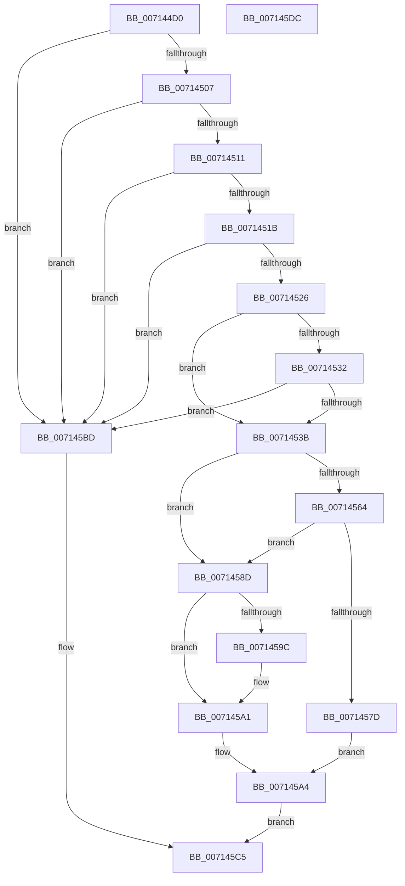

# FsRtlpRegisterUncProvider

- RVA: `0x007144D0`–`0x007145DD` (길이 `269` bytes)
- VA: `0x00000001407144D0`
- 실행 섹션: `PAGE`
- PDB 이름 있음: `예`; PDB Function 태그: `아니요`
- unwind 정보 RVA: `0x000B8D34`
- 디코드: `76`개 명령, `269/269` bytes 표시
- 미해석 바이트: `0` (있으면 어셈블리에 `.byte`로 보존)

> 이 문서는 커널 이미지의 기계어와 PDB 기호를 분석해 생성했습니다. 4번과 5번은 함수 원형과 자료형을 바이너리 사용 방식에서 추정한 C 해석이며 원본 소스 복구 결과는 아닙니다.

## 1. Dependencies

- 직접 호출 지점: **5**; 고유 호출 대상: **5**
- 직접 호출자로 확인된 함수: **3**
- RIP 상대 이미지 참조: **2**

### Outgoing calls
- `0x0071454F` → [KeWaitForSingleObject](../../text/20/KeWaitForSingleObject_function_0020E6B0.md) (function, `0x0020E6B0`)
- `0x00714559` → [FsRtlpOpenDev](FsRtlpOpenDev_function_0071430C.md) (function, `0x0071430C`)
- `0x00714572` → [FsRtlpRegisterProviderWithMUP](FsRtlpRegisterProviderWithMUP_function_007143D4.md) (function, `0x007143D4`)
- `0x0071459C` → [ZwClose](../../text/6A/ZwClose_function_006AD2B0.md) (function, `0x006AD2B0`)
- `0x007145B4` → [KeReleaseSemaphore](../../text/39/KeReleaseSemaphore_function_00397080.md) (function, `0x00397080`)

### Direct callers
- [FsRtlRegisterUncProvider](FsRtlRegisterUncProvider_function_00714260.md) at `0x0071428C`
- [FsRtlRegisterUncProviderEx](FsRtlRegisterUncProviderEx_function_007142A0.md) at `0x007142C5`
- [FsRtlRegisterUncProviderEx2](FsRtlRegisterUncProviderEx2_function_007142E0.md) at `0x007142FB`

### Static image references
- `0x00714546` → RVA `0x00F8F080` (`.data`; read)
- `0x00714582` → RVA `0x00FD81A8` (`PAGEDATA`; read/write)

## 2. Other-region calls and transfers

- 다른 실행 섹션으로 향하는 call: **3**
  - `0x0071454F` → [KeWaitForSingleObject](../../text/20/KeWaitForSingleObject_function_0020E6B0.md) (`PAGE` → `.text`)
  - `0x0071459C` → [ZwClose](../../text/6A/ZwClose_function_006AD2B0.md) (`PAGE` → `.text`)
  - `0x007145B4` → [KeReleaseSemaphore](../../text/39/KeReleaseSemaphore_function_00397080.md) (`PAGE` → `.text`)
- 별도 외부 분기/꼬리 이동을 확인하지 못했습니다.

## 3. Assembly (complete function range)

```asm
007144D0  48 89 5C 24 10                  mov qword ptr [rsp + 0x10], rbx
007144D5  48 89 6C 24 18                  mov qword ptr [rsp + 0x18], rbp
007144DA  56                              push rsi
007144DB  57                              push rdi
007144DC  41 54                           push r12
007144DE  41 56                           push r14
007144E0  41 57                           push r15
007144E2  48 83 EC 30                     sub rsp, 0x30
007144E6  49 83 CC FF                     or r12, 0xffffffffffffffff
007144EA  45 33 FF                        xor r15d, r15d
007144ED  4C 89 64 24 60                  mov qword ptr [rsp + 0x60], r12
007144F2  49 8B F9                        mov rdi, r9
007144F5  4D 8B F0                        mov r14, r8
007144F8  48 8B EA                        mov rbp, rdx
007144FB  48 8B D9                        mov rbx, rcx
007144FE  48 85 C9                        test rcx, rcx
00714501  0F 84 B6 00 00 00               je 0x1407145bd
00714507  4C 39 79 08                     cmp qword ptr [rcx + 8], r15
0071450B  0F 84 AC 00 00 00               je 0x1407145bd
00714511  66 44 39 39                     cmp word ptr [rcx], r15w
00714515  0F 84 A2 00 00 00               je 0x1407145bd
0071451B  66 44 39 79 02                  cmp word ptr [rcx + 2], r15w
00714520  0F 84 97 00 00 00               je 0x1407145bd
00714526  B8 01 01 00 00                  mov eax, 0x101
0071452B  66 41 39 40 02                  cmp word ptr [r8 + 2], ax
00714530  72 09                           jb 0x14071453b
00714532  48 85 D2                        test rdx, rdx
00714535  0F 84 82 00 00 00               je 0x1407145bd
0071453B  45 33 C9                        xor r9d, r9d
0071453E  4C 89 7C 24 20                  mov qword ptr [rsp + 0x20], r15
00714543  45 33 C0                        xor r8d, r8d
00714546  48 8D 0D 33 AB 87 00            lea rcx, [rip + 0x87ab33]
0071454D  33 D2                           xor edx, edx
0071454F  E8 5C A1 AF FF                  call 0x14020e6b0
00714554  48 8D 4C 24 60                  lea rcx, [rsp + 0x60]
00714559  E8 AE FD FF FF                  call 0x14071430c
0071455E  8B F0                           mov esi, eax
00714560  85 C0                           test eax, eax
00714562  78 29                           js 0x14071458d
00714564  48 8B 4C 24 60                  mov rcx, qword ptr [rsp + 0x60]
00714569  4D 8B CE                        mov r9, r14
0071456C  4C 8B C5                        mov r8, rbp
0071456F  48 8B D3                        mov rdx, rbx
00714572  E8 5D FE FF FF                  call 0x1407143d4
00714577  8B F0                           mov esi, eax
00714579  85 C0                           test eax, eax
0071457B  78 10                           js 0x14071458d
0071457D  48 8B 44 24 60                  mov rax, qword ptr [rsp + 0x60]
00714582  FF 05 20 3C 8C 00               inc dword ptr [rip + 0x8c3c20]
00714588  48 89 07                        mov qword ptr [rdi], rax
0071458B  EB 17                           jmp 0x1407145a4
0071458D  48 8B 4C 24 60                  mov rcx, qword ptr [rsp + 0x60]
00714592  48 8D 41 FF                     lea rax, [rcx - 1]
00714596  48 83 F8 FD                     cmp rax, -3
0071459A  77 05                           ja 0x1407145a1
0071459C  E8 0F 8D F9 FF                  call 0x1406ad2b0
007145A1  4C 89 27                        mov qword ptr [rdi], r12
007145A4  45 33 C9                        xor r9d, r9d
007145A7  48 8D 0D D2 AA 87 00            lea rcx, [rip + 0x87aad2]
007145AE  33 D2                           xor edx, edx
007145B0  45 8D 41 01                     lea r8d, [r9 + 1]
007145B4  E8 C7 2A C8 FF                  call 0x140397080
007145B9  8B C6                           mov eax, esi
007145BB  EB 08                           jmp 0x1407145c5
007145BD  4D 89 21                        mov qword ptr [r9], r12
007145C0  B8 0D 00 00 C0                  mov eax, 0xc000000d
007145C5  48 8B 5C 24 68                  mov rbx, qword ptr [rsp + 0x68]
007145CA  48 8B 6C 24 70                  mov rbp, qword ptr [rsp + 0x70]
007145CF  48 83 C4 30                     add rsp, 0x30
007145D3  41 5F                           pop r15
007145D5  41 5E                           pop r14
007145D7  41 5C                           pop r12
007145D9  5F                              pop rdi
007145DA  5E                              pop rsi
007145DB  C3                              ret
007145DC  CC                              int3
```

## 4. C-style interpretation (structured pseudocode)

```c
__int64 __fastcall FsRtlpRegisterUncProvider(__int64 a1, __int64 a2, __int64 a3, __int64 a4)
{
    __int64 result;
    __int64 v_r12;
    __int64 v_r15;
    __int64 v_rsp;
    unsigned __int64 v_stack_m38;
    unsigned __int64 v_stack_p10;
    unsigned __int64 v_stack_p18;
    unsigned __int64 v_stack_p8;

    v_stack_p10 = v_rbx;
    v_stack_p18 = v_rbp;
    v_rsp = (v_rsp) - (48);
    v_r12 = (v_r12) | (-1);
    v_r15 = 0;
    v_stack_p8 = v_r12;
    if (a1 == 0) goto loc_007145BD;
    if ((*(unsigned __int64 *)(a1 + 8)) == 0) goto loc_007145BD;
    if ((*(unsigned __int16 *)(a1)) == 0) goto loc_007145BD;
    if ((*(unsigned __int16 *)(a1 + 2)) == 0) goto loc_007145BD;
    if ((*(unsigned __int16 *)(a3 + 2)) < 257) goto loc_0071453B;
    if (a2 == 0) goto loc_007145BD;
loc_0071453B:
    a4 = 0;
    v_stack_m38 = 0;
    a3 = 0;
    a2 = 0;
    result = KeWaitForSingleObject(v_rip + 8891187, a2, a3, a4);
    result = FsRtlpOpenDev(v_stack_p8, a2, a3, a4);
    if (sign_flag) goto loc_0071458D;
    result = FsRtlpRegisterProviderWithMUP(v_stack_p8, a1, 0, 0);
    if (sign_flag) goto loc_0071458D;
    *(unsigned __int64 *)(a4) = v_stack_p8;
    goto loc_007145A4;
loc_0071458D:
    result = v_stack_p8 - 1;
    if ((v_stack_p8 - 1) <= -3) {
        result = ZwClose(v_stack_p8, a1, 0, 0);
    }
    *(unsigned __int64 *)(a4) = v_r12;
loc_007145A4:
    a4 = 0;
    a2 = 0;
    result = KeReleaseSemaphore(v_rip + 8891090, a2, a4 + 1, a4);
    goto loc_007145C5;
loc_007145BD:
    *(unsigned __int64 *)(a4) = v_r12;
loc_007145C5:
    v_rsp = (v_rsp) + (48);
    return (unsigned int)(0xC000000DULL);
}
```

## 5. (Beta) C Style

```c
int64_t FsRtlpRegisterUncProvider(int64_t Arg1, int64_t Arg2, void *Arg3, void *Arg4)
{
    uint8_t *arg3 = (uint8_t *)Arg3;
    uint8_t *arg4 = (uint8_t *)Arg4;

    int64_t result;
    int64_t local_r12;
    int64_t local_r15;
    int64_t local_rsp;
    uint64_t v_stack_m38;
    uint64_t v_stack_p10;
    uint64_t v_stack_p18;
    uint64_t v_stack_p8;

    v_stack_p10 = local_rbx;
    v_stack_p18 = local_rbp;
    local_rsp = (local_rsp) - (48);
    local_r12 = (local_r12) | (-1);
    local_r15 = 0;
    v_stack_p8 = local_r12;
    if (Arg1 == 0) goto loc_007145BD;
    if ((*(uint64_t *)(Arg1 + 0x8)) == 0) goto loc_007145BD;
    if ((*(uint16_t *)(Arg1)) == 0) goto loc_007145BD;
    if ((*(uint16_t *)(Arg1 + 0x2)) == 0) goto loc_007145BD;
    if ((*(uint16_t *)(arg3 + 0x2)) < 257) goto loc_0071453B;
    if (Arg2 == 0) goto loc_007145BD;
loc_0071453B:
    Arg4 = 0;
    v_stack_m38 = 0;
    Arg3 = 0;
    Arg2 = 0;
    result = KeWaitForSingleObject(v_rip + 8891187, Arg2, Arg3, Arg4);
    result = FsRtlpOpenDev(v_stack_p8, Arg2, Arg3, Arg4);
    if (sign_flag) goto loc_0071458D;
    result = FsRtlpRegisterProviderWithMUP(v_stack_p8, Arg1, 0, 0);
    if (sign_flag) goto loc_0071458D;
    *(uint64_t *)(arg4) = v_stack_p8;
    goto loc_007145A4;
loc_0071458D:
    result = v_stack_p8 - 1;
    if ((v_stack_p8 - 1) <= -3) {
        result = ZwClose(v_stack_p8, Arg1, 0, 0);
    }
    *(uint64_t *)(arg4) = local_r12;
loc_007145A4:
    Arg4 = 0;
    Arg2 = 0;
    result = KeReleaseSemaphore(v_rip + 8891090, Arg2, Arg4 + 1, Arg4);
    goto loc_007145C5;
loc_007145BD:
    *(uint64_t *)(arg4) = local_r12;
loc_007145C5:
    local_rsp = (local_rsp) + (48);
    return (uint32_t)(0xC000000DULL);
}
```

### 관측된 메모리 오프셋

구조체 형식이 확인되지 않은 접근은 인자 기준의 오프셋으로만 기록했습니다.

| 기준 인자 | 오프셋 표현 | 폭 (bit) | 접근 |
|---|---:|---:|---|
| `Arg3` | `+ 0x2` | `16` | `R` |
| `Arg4` | `+ 0x0` | `64` | `W` |

## 6. Execution-region graph

[열기: 2D/3D 그래프와 함수 탐색 컨트롤 패널](../../../control-panel.html?section=page&rva=0x007144D0&view=graph)

- 2D 그래프는 위에서 아래로 흐르고, 3D 그래프는 빈 공간을 드래그해 회전합니다. Shift+드래그는 이동, 휠은 확대·축소, 함수 노드 선택은 대상 보고서 이동입니다.

### Static fallback


