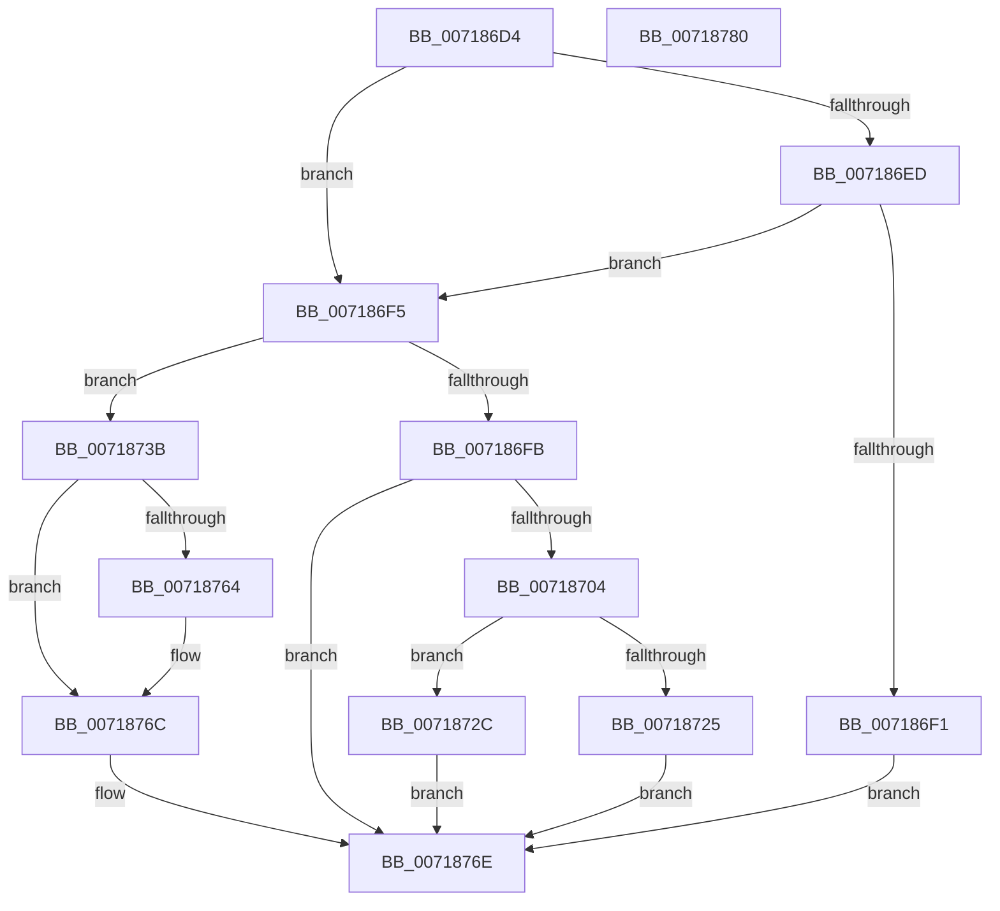

# HvlAllocateHibernateResources

- RVA: `0x007186D4`–`0x00718781` (길이 `173` bytes)
- VA: `0x00000001407186D4`
- 실행 섹션: `PAGE`
- PDB 이름 있음: `예`; PDB Function 태그: `아니요`
- unwind 정보 RVA: `0x00060BC4`
- 디코드: `52`개 명령, `173/173` bytes 표시
- 미해석 바이트: `0` (있으면 어셈블리에 `.byte`로 보존)

> 이 문서는 커널 이미지의 기계어와 PDB 기호를 분석해 생성했습니다. 4번과 5번은 함수 원형과 자료형을 바이너리 사용 방식에서 추정한 C 해석이며 원본 소스 복구 결과는 아닙니다.

## 1. Dependencies

- 직접 호출 지점: **3**; 고유 호출 대상: **3**
- 직접 호출자로 확인된 함수: **2**
- RIP 상대 이미지 참조: **5**

### Outgoing calls
- `0x00718714` → [MmAllocateIndependentPagesEx](../AA/MmAllocateIndependentPagesEx_function_00AA0CFC.md) (function, `0x00AA0CFC`)
- `0x00718734` → [memset](../../text/6C/memset_function_006C6C40.md) (function, `0x006C6C40`)
- `0x00718753` → [ExAllocatePool2](../../poolcode/B8/ExAllocatePool2_function_00B820F0.md) (function, `0x00B820F0`)

### Direct callers
- [PopPreallocateHibernateMemory](../75/PopPreallocateHibernateMemory_function_0075DB98.md) at `0x0075DC96`
- [PopAllocateHiberContext](../AD/PopAllocateHiberContext_function_00ADC05C.md) at `0x00ADC6C0`

### Static image references
- `0x007186E3` → RVA `0x00FC6A90` (`ALMOSTRO`; read)
- `0x007186FB` → RVA `0x00F8ECA0` (`.data`; read)
- `0x00718719` → RVA `0x00F8ECA0` (`.data`; write)
- `0x00718758` → RVA `0x00F8EDF0` (`.data`; write)
- `0x00718764` → RVA `0x00F8EDF8` (`.data`; write)

## 2. Other-region calls and transfers

- 다른 실행 섹션으로 향하는 call: **2**
  - `0x00718734` → [memset](../../text/6C/memset_function_006C6C40.md) (`PAGE` → `.text`)
  - `0x00718753` → [ExAllocatePool2](../../poolcode/B8/ExAllocatePool2_function_00B820F0.md) (`PAGE` → `POOLCODE`)
- 별도 외부 분기/꼬리 이동을 확인하지 못했습니다.

## 3. Assembly (complete function range)

```asm
007186D4  48 89 5C 24 08                  mov qword ptr [rsp + 8], rbx
007186D9  48 89 74 24 10                  mov qword ptr [rsp + 0x10], rsi
007186DE  57                              push rdi
007186DF  48 83 EC 20                     sub rsp, 0x20
007186E3  8B 05 A7 E3 8A 00               mov eax, dword ptr [rip + 0x8ae3a7]
007186E9  A8 02                           test al, 2
007186EB  75 08                           jne 0x1407186f5
007186ED  A8 40                           test al, 0x40
007186EF  75 04                           jne 0x1407186f5
007186F1  33 DB                           xor ebx, ebx
007186F3  EB 79                           jmp 0x14071876e
007186F5  33 DB                           xor ebx, ebx
007186F7  84 C9                           test cl, cl
007186F9  74 40                           je 0x14071873b
007186FB  48 39 1D 9E 65 87 00            cmp qword ptr [rip + 0x87659e], rbx
00718702  75 6A                           jne 0x14071876e
00718704  BF 00 10 00 00                  mov edi, 0x1000
00718709  45 33 C9                        xor r9d, r9d
0071870C  8B CF                           mov ecx, edi
0071870E  45 33 C0                        xor r8d, r8d
00718711  83 CA FF                        or edx, 0xffffffff
00718714  E8 E3 85 38 00                  call 0x140aa0cfc
00718719  48 89 05 80 65 87 00            mov qword ptr [rip + 0x876580], rax
00718720  48 85 C0                        test rax, rax
00718723  75 07                           jne 0x14071872c
00718725  BB 9A 00 00 C0                  mov ebx, 0xc000009a
0071872A  EB 42                           jmp 0x14071876e
0071872C  4C 8B C7                        mov r8, rdi
0071872F  33 D2                           xor edx, edx
00718731  48 8B C8                        mov rcx, rax
00718734  E8 07 E5 FA FF                  call 0x1406c6c40
00718739  EB 33                           jmp 0x14071876e
0071873B  8D 72 02                        lea esi, [rdx + 2]
0071873E  B9 40 00 00 00                  mov ecx, 0x40
00718743  8B D6                           mov edx, esi
00718745  41 B8 48 56 4C 20               mov r8d, 0x204c5648
0071874B  C1 E2 0C                        shl edx, 0xc
0071874E  BF 9A 00 00 C0                  mov edi, 0xc000009a
00718753  E8 98 99 46 00                  call 0x140b820f0
00718758  48 89 05 91 66 87 00            mov qword ptr [rip + 0x876691], rax
0071875F  48 85 C0                        test rax, rax
00718762  74 08                           je 0x14071876c
00718764  89 35 8E 66 87 00               mov dword ptr [rip + 0x87668e], esi
0071876A  8B FB                           mov edi, ebx
0071876C  8B DF                           mov ebx, edi
0071876E  48 8B 74 24 38                  mov rsi, qword ptr [rsp + 0x38]
00718773  8B C3                           mov eax, ebx
00718775  48 8B 5C 24 30                  mov rbx, qword ptr [rsp + 0x30]
0071877A  48 83 C4 20                     add rsp, 0x20
0071877E  5F                              pop rdi
0071877F  C3                              ret
00718780  CC                              int3
```

## 4. C-style interpretation (structured pseudocode)

```c
__int64 __fastcall HvlAllocateHibernateResources(unsigned __int8 a1, int a2, int a3, int a4)
{
    __int64 result;
    __int64 v_rbx;
    __int64 v_rdi;
    __int64 v_rsp;
    unsigned __int64 v_stack_p10;
    unsigned __int64 v_stack_p8;

    v_stack_p8 = v_rbx;
    v_stack_p10 = v_rsi;
    v_rsp = (v_rsp) - (32);
    if ((((unsigned __int8)((unsigned int)(*(unsigned int *)(v_rip + 9102247)))) & (2)) != 0) goto loc_007186F5;
    if ((((unsigned __int8)((unsigned int)(*(unsigned int *)(v_rip + 9102247)))) & (64)) != 0) goto loc_007186F5;
    v_rbx = 0;
    goto loc_0071876E;
loc_007186F5:
    v_rbx = 0;
    if (a1 == 0) goto loc_0071873B;
    if ((*(unsigned __int64 *)(v_rip + 8873374)) != 0) goto loc_0071876E;
    a4 = 0;
    a3 = 0;
    a2 = (unsigned int)((a2) | (0xFFFFFFFFULL));
    result = MmAllocateIndependentPagesEx((unsigned int)((unsigned int)((unsigned int)(0x1000ULL))), a2, a3, a4);
    *(unsigned __int64 *)(v_rip + 8873344) = result;
    if (result != 0) goto loc_0071872C;
    goto loc_0071876E;
loc_0071872C:
    a2 = 0;
    result = memset(result, a2, (unsigned int)(0x1000ULL), a4);
    goto loc_0071876E;
loc_0071873B:
    a2 = (unsigned int)(((unsigned int)((unsigned int)(a2 + 2))) << (12));
    result = ExAllocatePool2(64, a2, (unsigned int)(0x204C5648ULL), a4);
    *(unsigned __int64 *)(v_rip + 8873617) = result;
    v_rdi = (unsigned int)(0xC000009AULL);
    if (result != 0) {
        *(unsigned int *)(v_rip + 8873614) = (unsigned int)(a2 + 2);
        v_rdi = (unsigned int)((unsigned int)(0xC000009AULL));
    }
loc_0071876E:
    v_rsp = (v_rsp) + (32);
    return (unsigned int)((unsigned int)((unsigned int)((unsigned int)(v_rdi))));
}
```

## 5. (Beta) C Style

```c
int64_t HvlAllocateHibernateResources(uint8_t Arg1, void *Arg2, int32_t Arg3, int32_t Arg4)
{
    uint8_t *arg2 = (uint8_t *)Arg2;

    int64_t result;
    int64_t local_rbx;
    int64_t local_rdi;
    int64_t local_rsp;
    uint64_t v_stack_p10;
    uint64_t v_stack_p8;

    v_stack_p8 = local_rbx;
    v_stack_p10 = local_rsi;
    local_rsp = (local_rsp) - (32);
    if ((((uint8_t)((uint32_t)(*(uint32_t *)(v_rip + 0x8AE3A7)))) & (2)) != 0) goto loc_007186F5;
    if ((((uint8_t)((uint32_t)(*(uint32_t *)(v_rip + 0x8AE3A7)))) & (64)) != 0) goto loc_007186F5;
    local_rbx = 0;
    goto loc_0071876E;
loc_007186F5:
    local_rbx = 0;
    if (Arg1 == 0) goto loc_0071873B;
    if ((*(uint64_t *)(v_rip + 0x87659E)) != 0) goto loc_0071876E;
    Arg4 = 0;
    Arg3 = 0;
    Arg2 = (uint32_t)((Arg2) | (0xFFFFFFFFULL));
    result = MmAllocateIndependentPagesEx((uint32_t)((uint32_t)((uint32_t)(0x1000ULL))), Arg2, Arg3, Arg4);
    *(uint64_t *)(v_rip + 0x876580) = result;
    if (result != 0) goto loc_0071872C;
    goto loc_0071876E;
loc_0071872C:
    Arg2 = 0;
    result = memset(result, Arg2, (uint32_t)(0x1000ULL), Arg4);
    goto loc_0071876E;
loc_0071873B:
    Arg2 = (uint32_t)(((uint32_t)((uint32_t)(Arg2 + 2))) << (12));
    result = ExAllocatePool2(64, Arg2, (uint32_t)(0x204C5648ULL), Arg4);
    *(uint64_t *)(v_rip + 0x876691) = result;
    local_rdi = (uint32_t)(0xC000009AULL);
    if (result != 0) {
        *(uint32_t *)(v_rip + 0x87668E) = (uint32_t)(Arg2 + 2);
        local_rdi = (uint32_t)((uint32_t)(0xC000009AULL));
    }
loc_0071876E:
    local_rsp = (local_rsp) + (32);
    return (uint32_t)((uint32_t)((uint32_t)((uint32_t)(local_rdi))));
}
```

### 관측된 메모리 오프셋

구조체 형식이 확인되지 않은 접근은 인자 기준의 오프셋으로만 기록했습니다.

| 기준 인자 | 오프셋 표현 | 폭 (bit) | 접근 |
|---|---:|---:|---|
| `Arg2` | `+ 0x2` | `32` | `R` |

## 6. Execution-region graph

[열기: 2D/3D 그래프와 함수 탐색 컨트롤 패널](../../../control-panel.html?section=page&rva=0x007186D4&view=graph)

- 2D 그래프는 위에서 아래로 흐르고, 3D 그래프는 빈 공간을 드래그해 회전합니다. Shift+드래그는 이동, 휠은 확대·축소, 함수 노드 선택은 대상 보고서 이동입니다.

### Static fallback


