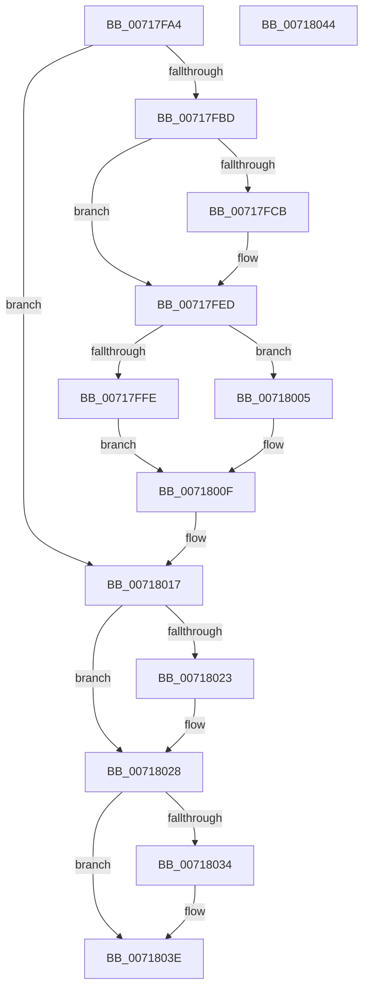

# HvlDeleteProcessor

- RVA: `0x00717FA4`–`0x00718045` (길이 `161` bytes)
- VA: `0x0000000140717FA4`
- 실행 섹션: `PAGE`
- PDB 이름 있음: `예`; PDB Function 태그: `아니요`
- unwind 정보 RVA: `0x0005CF00`
- 디코드: `38`개 명령, `161/161` bytes 표시
- 미해석 바이트: `0` (있으면 어셈블리에 `.byte`로 보존)

> 이 문서는 커널 이미지의 기계어와 PDB 기호를 분석해 생성했습니다. 4번과 5번은 함수 원형과 자료형을 바이너리 사용 방식에서 추정한 C 해석이며 원본 소스 복구 결과는 아닙니다.

## 1. Dependencies

- 직접 호출 지점: **6**; 고유 호출 대상: **5**
- 직접 호출자로 확인된 함수: **2**
- RIP 상대 이미지 참조: **1**

### Outgoing calls
- `0x00717FD5` → [HvlpGetRegister64](../../text/37/HvlpGetRegister64_function_00379050.md) (function, `0x00379050`)
- `0x00717FE8` → [HvlpSetRegister64](../../text/4D/HvlpSetRegister64_function_004DDA70.md) (function, `0x004DDA70`)
- `0x00717FFE` → [HvlpFreeOverlayPages](../../text/3F/HvlpFreeOverlayPages_function_003F67E0.md) (function, `0x003F67E0`)
- `0x0071800A` → [MmUnmapIoSpace](../../text/3F/MmUnmapIoSpace_function_003F78F0.md) (function, `0x003F78F0`)
- `0x00718023` → [HvlpFreeOverlayPages](../../text/3F/HvlpFreeOverlayPages_function_003F67E0.md) (function, `0x003F67E0`)
- `0x00718039` → [MmFreeIndependentPages](../../text/2A/MmFreeIndependentPages_function_002A2510.md) (function, `0x002A2510`)

### Direct callers
- [KiStartDynamicProcessor](../74/KiStartDynamicProcessor_function_007456C8.md) at `0x00745C9E`
- [KeStartAllProcessors](../../init/C3/KeStartAllProcessors_function_00C36F78.md) at `0x00C3745E`

### Static image references
- `0x00717FED` → RVA `0x00FC6A90` (`ALMOSTRO`; read)

## 2. Other-region calls and transfers

- 다른 실행 섹션으로 향하는 call: **6**
  - `0x00717FD5` → [HvlpGetRegister64](../../text/37/HvlpGetRegister64_function_00379050.md) (`PAGE` → `.text`)
  - `0x00717FE8` → [HvlpSetRegister64](../../text/4D/HvlpSetRegister64_function_004DDA70.md) (`PAGE` → `.text`)
  - `0x00717FFE` → [HvlpFreeOverlayPages](../../text/3F/HvlpFreeOverlayPages_function_003F67E0.md) (`PAGE` → `.text`)
  - `0x0071800A` → [MmUnmapIoSpace](../../text/3F/MmUnmapIoSpace_function_003F78F0.md) (`PAGE` → `.text`)
  - `0x00718023` → [HvlpFreeOverlayPages](../../text/3F/HvlpFreeOverlayPages_function_003F67E0.md) (`PAGE` → `.text`)
  - `0x00718039` → [MmFreeIndependentPages](../../text/2A/MmFreeIndependentPages_function_002A2510.md) (`PAGE` → `.text`)
- 별도 외부 분기/꼬리 이동을 확인하지 못했습니다.

## 3. Assembly (complete function range)

```asm
00717FA4  40 53                           push rbx
00717FA6  48 83 EC 20                     sub rsp, 0x20
00717FAA  48 83 64 24 30 00               and qword ptr [rsp + 0x30], 0
00717FB0  48 8B D9                        mov rbx, rcx
00717FB3  48 83 B9 08 8C 00 00 00         cmp qword ptr [rcx + 0x8c08], 0
00717FBB  74 5A                           je 0x140718017
00717FBD  65 48 8B 04 25 20 00 00 00      mov rax, qword ptr gs:[0x20]
00717FC6  48 3B C8                        cmp rcx, rax
00717FC9  75 22                           jne 0x140717fed
00717FCB  48 8D 54 24 30                  lea rdx, [rsp + 0x30]
00717FD0  B9 13 00 09 00                  mov ecx, 0x90013
00717FD5  E8 76 10 C6 FF                  call 0x140379050
00717FDA  48 8B 54 24 30                  mov rdx, qword ptr [rsp + 0x30]
00717FDF  B9 13 00 09 00                  mov ecx, 0x90013
00717FE4  48 83 E2 FE                     and rdx, 0xfffffffffffffffe
00717FE8  E8 83 5A DC FF                  call 0x1404dda70
00717FED  8B 05 9D EA 8A 00               mov eax, dword ptr [rip + 0x8aea9d]
00717FF3  48 8B 8B 08 8C 00 00            mov rcx, qword ptr [rbx + 0x8c08]
00717FFA  A8 02                           test al, 2
00717FFC  75 07                           jne 0x140718005
00717FFE  E8 DD E7 CD FF                  call 0x1403f67e0
00718003  EB 0A                           jmp 0x14071800f
00718005  BA 01 00 00 00                  mov edx, 1
0071800A  E8 E1 F8 CD FF                  call 0x1403f78f0
0071800F  48 83 A3 08 8C 00 00 00         and qword ptr [rbx + 0x8c08], 0
00718017  48 8B 8B B8 8E 00 00            mov rcx, qword ptr [rbx + 0x8eb8]
0071801E  48 85 C9                        test rcx, rcx
00718021  74 05                           je 0x140718028
00718023  E8 B8 E7 CD FF                  call 0x1403f67e0
00718028  48 8B 8B 00 8C 00 00            mov rcx, qword ptr [rbx + 0x8c00]
0071802F  48 85 C9                        test rcx, rcx
00718032  74 0A                           je 0x14071803e
00718034  BA 00 50 00 00                  mov edx, 0x5000
00718039  E8 D2 A4 B8 FF                  call 0x1402a2510
0071803E  48 83 C4 20                     add rsp, 0x20
00718042  5B                              pop rbx
00718043  C3                              ret
00718044  CC                              int3
```

## 4. C-style interpretation (structured pseudocode)

```c
__int64 __fastcall HvlDeleteProcessor(__int64 a1)
{
    __int64 result;
    __int64 v_rsp;
    unsigned __int64 v_stack_p8;

    v_rsp = (v_rsp) - (32);
    if ((*(unsigned __int64 *)(a1 + 35848)) == 0) goto loc_00718017;
    result = *(unsigned __int64 *)(gs_base + (0 + 32));
    if (a1 == (*(unsigned __int64 *)(gs_base + (0 + 32)))) {
        a2 = v_stack_p8;
        a1 = 0x90013ULL;
        result = HvlpGetRegister64(a1, a2, a3, a4);
        a2 = v_stack_p8;
        a1 = 0x90013ULL;
        a2 = (a2) & (-2);
        result = HvlpSetRegister64(a1, a2, a3, a4);
    }
    if ((((unsigned __int8)((unsigned int)(*(unsigned int *)(v_rip + 9104029)))) & (2)) != 0) goto loc_00718005;
    result = HvlpFreeOverlayPages(*(unsigned __int64 *)(a1 + 35848), a2, a3, a4);
    goto loc_0071800F;
loc_00718005:
    result = MmUnmapIoSpace(*(unsigned __int64 *)(a1 + 35848), 1, a3, a4);
loc_0071800F:
loc_00718017:
    if (*(unsigned __int64 *)(a1 + 36536) != 0) {
        result = HvlpFreeOverlayPages(*(unsigned __int64 *)(a1 + 36536), 1, a3, a4);
    }
    if (*(unsigned __int64 *)(a1 + 35840) != 0) {
        a2 = 0x5000ULL;
        result = MmFreeIndependentPages(*(unsigned __int64 *)(a1 + 35840), a2, a3, a4);
    }
    v_rsp = (v_rsp) + (32);
    return result;
}
```

## 5. (Beta) C Style

```c
int64_t HvlDeleteProcessor(void *Arg1)
{
    uint8_t *arg1 = (uint8_t *)Arg1;

    int64_t result;
    int64_t local_rsp;
    uint64_t v_stack_p8;

    local_rsp = (local_rsp) - (32);
    if ((*(uint64_t *)(arg1 + 0x8C08)) == 0) goto loc_00718017;
    result = *(uint64_t *)(gs_base + (0 + 0x20));
    if (Arg1 == (*(uint64_t *)(gs_base + (0 + 0x20)))) {
        a2 = v_stack_p8;
        Arg1 = 0x90013ULL;
        result = HvlpGetRegister64(Arg1, a2, a3, a4);
        a2 = v_stack_p8;
        Arg1 = 0x90013ULL;
        a2 = (a2) & (-2);
        result = HvlpSetRegister64(Arg1, a2, a3, a4);
    }
    if ((((uint8_t)((uint32_t)(*(uint32_t *)(v_rip + 0x8AEA9D)))) & (2)) != 0) goto loc_00718005;
    result = HvlpFreeOverlayPages(*(uint64_t *)(arg1 + 0x8C08), a2, a3, a4);
    goto loc_0071800F;
loc_00718005:
    result = MmUnmapIoSpace(*(uint64_t *)(arg1 + 0x8C08), 1, a3, a4);
loc_0071800F:
loc_00718017:
    if (*(uint64_t *)(arg1 + 0x8EB8) != 0) {
        result = HvlpFreeOverlayPages(*(uint64_t *)(arg1 + 0x8EB8), 1, a3, a4);
    }
    if (*(uint64_t *)(arg1 + 0x8C00) != 0) {
        a2 = 0x5000ULL;
        result = MmFreeIndependentPages(*(uint64_t *)(arg1 + 0x8C00), a2, a3, a4);
    }
    local_rsp = (local_rsp) + (32);
    return result;
}
```

### 관측된 메모리 오프셋

구조체 형식이 확인되지 않은 접근은 인자 기준의 오프셋으로만 기록했습니다.

| 기준 인자 | 오프셋 표현 | 폭 (bit) | 접근 |
|---|---:|---:|---|
| `Arg1` | `+ 0x8C00` | `64` | `R` |
| `Arg1` | `+ 0x8C08` | `64` | `R` |
| `Arg1` | `+ 0x8C08` | `64` | `R/W` |
| `Arg1` | `+ 0x8EB8` | `64` | `R` |

## 6. Execution-region graph

[열기: 2D/3D 그래프와 함수 탐색 컨트롤 패널](../../../control-panel.html?section=page&rva=0x00717FA4&view=graph)

- 2D 그래프는 위에서 아래로 흐르고, 3D 그래프는 빈 공간을 드래그해 회전합니다. Shift+드래그는 이동, 휠은 확대·축소, 함수 노드 선택은 대상 보고서 이동입니다.

### Static fallback


