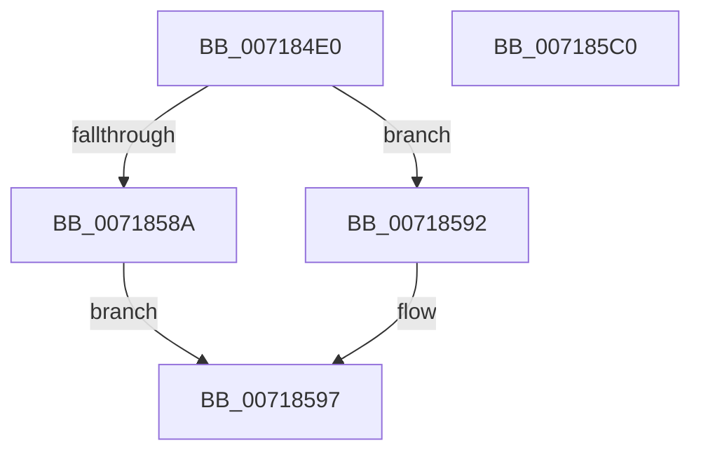

# HvlGetMicrocodeLatency

- RVA: `0x007184E0`–`0x007185C1` (길이 `225` bytes)
- VA: `0x00000001407184E0`
- 실행 섹션: `PAGE`
- PDB 이름 있음: `예`; PDB Function 태그: `아니요`
- unwind 정보 RVA: `0x000C6664`
- 디코드: `58`개 명령, `225/225` bytes 표시
- 미해석 바이트: `0` (있으면 어셈블리에 `.byte`로 보존)

> 이 문서는 커널 이미지의 기계어와 PDB 기호를 분석해 생성했습니다. 4번과 5번은 함수 원형과 자료형을 바이너리 사용 방식에서 추정한 C 해석이며 원본 소스 복구 결과는 아닙니다.

## 1. Dependencies

- 직접 호출 지점: **5**; 고유 호출 대상: **4**
- 직접 호출자로 확인된 함수: **0**
- RIP 상대 이미지 참조: **1**

### Outgoing calls
- `0x00718536` → [HvlpAcquireHypercallPage](../../text/47/HvlpAcquireHypercallPage_function_00471410.md) (function, `0x00471410`)
- `0x00718550` → [HvlpAcquireHypercallPage](../../text/47/HvlpAcquireHypercallPage_function_00471410.md) (function, `0x00471410`)
- `0x0071856C` → [HvcallInitInputControl](../../text/46/HvcallInitInputControl_function_00464730.md) (function, `0x00464730`)
- `0x00718580` → [HvcallInitiateHypercall](../../text/31/HvcallInitiateHypercall_function_00313630.md) (function, `0x00313630`)
- `0x007185A3` → [_security_check_cookie](../../text/6A/_security_check_cookie_function_006AC640.md) (function, `0x006AC640`)

### Direct callers
- 이 함수 시작 RVA로 연결되는 직접 call은 확인되지 않았습니다. 간접 호출은 완전히 역산할 수 없습니다.

### Static image references
- `0x007184FD` → RVA `0x00E0A740` (`.data`; read)

## 2. Other-region calls and transfers

- 다른 실행 섹션으로 향하는 call: **5**
  - `0x00718536` → [HvlpAcquireHypercallPage](../../text/47/HvlpAcquireHypercallPage_function_00471410.md) (`PAGE` → `.text`)
  - `0x00718550` → [HvlpAcquireHypercallPage](../../text/47/HvlpAcquireHypercallPage_function_00471410.md) (`PAGE` → `.text`)
  - `0x0071856C` → [HvcallInitInputControl](../../text/46/HvcallInitInputControl_function_00464730.md) (`PAGE` → `.text`)
  - `0x00718580` → [HvcallInitiateHypercall](../../text/31/HvcallInitiateHypercall_function_00313630.md) (`PAGE` → `.text`)
  - `0x007185A3` → [_security_check_cookie](../../text/6A/_security_check_cookie_function_006AC640.md) (`PAGE` → `.text`)
- 별도 외부 분기/꼬리 이동을 확인하지 못했습니다.

## 3. Assembly (complete function range)

```asm
007184E0  48 89 5C 24 10                  mov qword ptr [rsp + 0x10], rbx
007184E5  48 89 74 24 18                  mov qword ptr [rsp + 0x18], rsi
007184EA  55                              push rbp
007184EB  57                              push rdi
007184EC  41 56                           push r14
007184EE  48 8D AC 24 60 F8 FF FF         lea rbp, [rsp - 0x7a0]
007184F6  48 81 EC A0 08 00 00            sub rsp, 0x8a0
007184FD  48 8B 05 3C 22 6F 00            mov rax, qword ptr [rip + 0x6f223c]
00718504  48 33 C4                        xor rax, rsp
00718507  48 89 85 98 07 00 00            mov qword ptr [rbp + 0x798], rax
0071850E  33 FF                           xor edi, edi
00718510  4C 8D 44 24 68                  lea r8, [rsp + 0x68]
00718515  33 C0                           xor eax, eax
00718517  48 89 39                        mov qword ptr [rcx], rdi
0071851A  48 8B F1                        mov rsi, rcx
0071851D  89 44 24 60                     mov dword ptr [rsp + 0x60], eax
00718521  48 8D 4C 24 48                  lea rcx, [rsp + 0x48]
00718526  89 44 24 40                     mov dword ptr [rsp + 0x40], eax
0071852A  44 8D 4F 10                     lea r9d, [rdi + 0x10]
0071852E  48 89 7C 24 20                  mov qword ptr [rsp + 0x20], rdi
00718533  8D 57 01                        lea edx, [rdi + 1]
00718536  E8 D5 8E D5 FF                  call 0x140471410
0071853B  41 B9 08 04 00 00               mov r9d, 0x408
00718541  4C 8D 45 88                     lea r8, [rbp - 0x78]
00718545  8D 57 02                        lea edx, [rdi + 2]
00718548  48 8B D8                        mov rbx, rax
0071854B  48 8D 4C 24 28                  lea rcx, [rsp + 0x28]
00718550  E8 BB 8E D5 FF                  call 0x140471410
00718555  0F 57 C0                        xorps xmm0, xmm0
00718558  48 8D 54 24 20                  lea rdx, [rsp + 0x20]
0071855D  0F 11 03                        movups xmmword ptr [rbx], xmm0
00718560  8D 4F 7B                        lea ecx, [rdi + 0x7b]
00718563  C7 03 30 00 00 00               mov dword ptr [rbx], 0x30
00718569  4C 8B F0                        mov r14, rax
0071856C  E8 BF C1 D4 FF                  call 0x140464730
00718571  4C 8B 44 24 40                  mov r8, qword ptr [rsp + 0x40]
00718576  48 8B 54 24 60                  mov rdx, qword ptr [rsp + 0x60]
0071857B  48 8B 4C 24 20                  mov rcx, qword ptr [rsp + 0x20]
00718580  E8 AB B0 BF FF                  call 0x140313630
00718585  66 85 C0                        test ax, ax
00718588  75 08                           jne 0x140718592
0071858A  49 8B 06                        mov rax, qword ptr [r14]
0071858D  48 89 06                        mov qword ptr [rsi], rax
00718590  EB 05                           jmp 0x140718597
00718592  BF 01 00 00 C0                  mov edi, 0xc0000001
00718597  8B C7                           mov eax, edi
00718599  48 8B 8D 98 07 00 00            mov rcx, qword ptr [rbp + 0x798]
007185A0  48 33 CC                        xor rcx, rsp
007185A3  E8 98 40 F9 FF                  call 0x1406ac640
007185A8  4C 8D 9C 24 A0 08 00 00         lea r11, [rsp + 0x8a0]
007185B0  49 8B 5B 28                     mov rbx, qword ptr [r11 + 0x28]
007185B4  49 8B 73 30                     mov rsi, qword ptr [r11 + 0x30]
007185B8  49 8B E3                        mov rsp, r11
007185BB  41 5E                           pop r14
007185BD  5F                              pop rdi
007185BE  5D                              pop rbp
007185BF  C3                              ret
007185C0  CC                              int3
```

## 4. C-style interpretation (structured pseudocode)

```c
__int64 __fastcall HvlGetMicrocodeLatency(__int64 a1)
{
    __int64 result;
    __int64 v_rdi;
    __int64 v_rsp;
    unsigned __int64 v_stack_m18;
    unsigned __int64 v_stack_m20;
    unsigned __int64 v_stack_m7B8;
    unsigned __int64 v_stack_m830;
    unsigned __int64 v_stack_m850;
    unsigned int v_stack_m858;
    unsigned __int64 v_stack_m870;
    unsigned int v_stack_m878;
    unsigned __int64 v_stack_m890;
    unsigned __int64 v_stack_m898;
    unsigned __int64 v_stack_p10;
    unsigned __int64 v_stack_p18;

    v_stack_p10 = v_rbx;
    v_stack_p18 = v_rsi;
    v_rsp = (v_rsp) - (0x8A0ULL);
    result = (*(unsigned __int64 *)(v_rip + 7283260)) ^ (v_rsp);
    v_stack_m20 = result;
    v_rdi = 0;
    result = 0;
    *(unsigned __int64 *)(a1) = 0;
    v_stack_m858 = 0;
    v_stack_m878 = 0;
    v_stack_m898 = 0;
    result = HvlpAcquireHypercallPage(v_stack_m870, v_rdi + 1, v_stack_m850, v_rdi + 16);
    result = HvlpAcquireHypercallPage(v_stack_m890, v_rdi + 2, v_stack_m830, (unsigned int)(0x408ULL));
    *(unsigned __int64 *)(result) = v_xmm0;
    *(unsigned int *)(result) = 48;
    result = HvcallInitInputControl(v_rdi + 123, v_stack_m898, v_stack_m830, (unsigned int)(0x408ULL));
    result = HvcallInitiateHypercall(v_stack_m898, v_stack_m858, v_stack_m878, (unsigned int)(0x408ULL));
    if ((unsigned __int16)(result) != 0) goto loc_00718592;
    *(unsigned __int64 *)(a1) = *(unsigned __int64 *)(result);
    goto loc_00718597;
loc_00718592:
loc_00718597:
    a1 = (v_stack_m20) ^ (v_rsp);
    result = _security_check_cookie(a1, v_stack_m858, v_stack_m878, (unsigned int)(0x408ULL));
    return result;
}
```

## 5. (Beta) C Style

```c
int64_t HvlGetMicrocodeLatency(void *Arg1)
{
    uint8_t *arg1 = (uint8_t *)Arg1;

    int64_t result;
    int64_t local_rdi;
    int64_t local_rsp;
    uint64_t v_stack_m18;
    uint64_t v_stack_m20;
    uint64_t v_stack_m7B8;
    uint64_t v_stack_m830;
    uint64_t v_stack_m850;
    uint32_t v_stack_m858;
    uint64_t v_stack_m870;
    uint32_t v_stack_m878;
    uint64_t v_stack_m890;
    uint64_t v_stack_m898;
    uint64_t v_stack_p10;
    uint64_t v_stack_p18;

    v_stack_p10 = local_rbx;
    v_stack_p18 = local_rsi;
    local_rsp = (local_rsp) - (0x8A0ULL);
    result = (*(uint64_t *)(v_rip + 0x6F223C)) ^ (local_rsp);
    v_stack_m20 = result;
    local_rdi = 0;
    result = 0;
    *(uint64_t *)(arg1) = 0;
    v_stack_m858 = 0;
    v_stack_m878 = 0;
    v_stack_m898 = 0;
    result = HvlpAcquireHypercallPage(v_stack_m870, local_rdi + 1, v_stack_m850, local_rdi + 16);
    result = HvlpAcquireHypercallPage(v_stack_m890, local_rdi + 2, v_stack_m830, (uint32_t)(0x408ULL));
    *(uint64_t *)(result) = v_xmm0;
    *(uint32_t *)(result) = 48;
    result = HvcallInitInputControl(local_rdi + 123, v_stack_m898, v_stack_m830, (uint32_t)(0x408ULL));
    result = HvcallInitiateHypercall(v_stack_m898, v_stack_m858, v_stack_m878, (uint32_t)(0x408ULL));
    if ((uint16_t)(result) != 0) goto loc_00718592;
    *(uint64_t *)(arg1) = *(uint64_t *)(result);
    goto loc_00718597;
loc_00718592:
loc_00718597:
    Arg1 = (v_stack_m20) ^ (local_rsp);
    result = _security_check_cookie(Arg1, v_stack_m858, v_stack_m878, (uint32_t)(0x408ULL));
    return result;
}
```

### 관측된 메모리 오프셋

구조체 형식이 확인되지 않은 접근은 인자 기준의 오프셋으로만 기록했습니다.

| 기준 인자 | 오프셋 표현 | 폭 (bit) | 접근 |
|---|---:|---:|---|
| `Arg1` | `+ 0x0` | `64` | `W` |

## 6. Execution-region graph

[열기: 2D/3D 그래프와 함수 탐색 컨트롤 패널](../../../control-panel.html?section=page&rva=0x007184E0&view=graph)

- 2D 그래프는 위에서 아래로 흐르고, 3D 그래프는 빈 공간을 드래그해 회전합니다. Shift+드래그는 이동, 휠은 확대·축소, 함수 노드 선택은 대상 보고서 이동입니다.

### Static fallback


