# HvlInitializeProcessor

- RVA: `0x0071804C`–`0x00718277` (길이 `555` bytes)
- VA: `0x000000014071804C`
- 실행 섹션: `PAGE`
- PDB 이름 있음: `예`; PDB Function 태그: `아니요`
- unwind 정보 RVA: `0x000C4178`
- 디코드: `147`개 명령, `555/555` bytes 표시
- 미해석 바이트: `0` (있으면 어셈블리에 `.byte`로 보존)

> 이 문서는 커널 이미지의 기계어와 PDB 기호를 분석해 생성했습니다. 4번과 5번은 함수 원형과 자료형을 바이너리 사용 방식에서 추정한 C 해석이며 원본 소스 복구 결과는 아닙니다.

## 1. Dependencies

- 직접 호출 지점: **17**; 고유 호출 대상: **13**
- 직접 호출자로 확인된 함수: **2**
- RIP 상대 이미지 참조: **4**

### Outgoing calls
- `0x0071808D` → [HvlpGetLpcbByApicId](../../text/58/HvlpGetLpcbByApicId_function_00585858.md) (function, `0x00585858`)
- `0x007180A6` → [HvlpCreateRootVirtualProcessor](HvlpCreateRootVirtualProcessor_function_00718280.md) (function, `0x00718280`)
- `0x007180F9` → [HvlGetRootVpSharedPages](../../text/58/HvlGetRootVpSharedPages_function_0058466C.md) (function, `0x0058466C`)
- `0x00718128` → [HvlpAllocateOverlayPages](../../text/58/HvlpAllocateOverlayPages_function_0058D3F8.md) (function, `0x0058D3F8`)
- `0x00718140` → [MmGetPhysicalAddress](../../text/23/MmGetPhysicalAddress_function_0023A500.md) (function, `0x0023A500`)
- `0x00718156` → [MmMapIoSpaceEx](../../text/32/MmMapIoSpaceEx_function_00327830.md) (function, `0x00327830`)
- `0x00718170` → [HvlGetLpIndexFromProcessorIndex](../../text/44/HvlGetLpIndexFromProcessorIndex_function_0044FFE0.md) (function, `0x0044FFE0`)
- `0x00718177` → [HvlpGetLpcbByLpIndex](../../text/44/HvlpGetLpcbByLpIndex_function_0044FFA0.md) (function, `0x0044FFA0`)
- `0x00718190` → [MmMapIoSpaceEx](../../text/32/MmMapIoSpaceEx_function_00327830.md) (function, `0x00327830`)
- `0x007181AA` → [HvlpAllocateOverlayPages](../../text/58/HvlpAllocateOverlayPages_function_0058D3F8.md) (function, `0x0058D3F8`)
- `0x007181C2` → [memset](../../text/6C/memset_function_006C6C40.md) (function, `0x006C6C40`)
- `0x007181D1` → [KeGetProcessorNodeNumber](../../text/43/KeGetProcessorNodeNumber_function_0043F210.md) (function, `0x0043F210`)
- `0x007181E4` → [MmAllocateIndependentPagesEx](../AA/MmAllocateIndependentPagesEx_function_00AA0CFC.md) (function, `0x00AA0CFC`)
- `0x00718208` → [HvlpFreeOverlayPages](../../text/3F/HvlpFreeOverlayPages_function_003F67E0.md) (function, `0x003F67E0`)
- `0x00718225` → [HvlpFreeOverlayPages](../../text/3F/HvlpFreeOverlayPages_function_003F67E0.md) (function, `0x003F67E0`)
- `0x00718243` → [MmGetPhysicalAddress](../../text/23/MmGetPhysicalAddress_function_0023A500.md) (function, `0x0023A500`)
- `0x00718258` → [HvlpSetupCachedHypercallPages](../../text/58/HvlpSetupCachedHypercallPages_function_00586844.md) (function, `0x00586844`)

### Direct callers
- [KiStartDynamicProcessor](../74/KiStartDynamicProcessor_function_007456C8.md) at `0x00745971`
- [KeStartAllProcessors](../../init/C3/KeStartAllProcessors_function_00C36F78.md) at `0x00C37288`

### Static image references
- `0x0071806A` → RVA `0x00FC6A97` (`ALMOSTRO`; read)
- `0x0071807A` → RVA `0x00FC6A90` (`ALMOSTRO`; read)
- `0x00718092` → RVA `0x00FC6AD8` (`ALMOSTRO`; read)
- `0x007180C9` → RVA `0x00E0A8BC` (`.data`; write)

## 2. Other-region calls and transfers

- 다른 실행 섹션으로 향하는 call: **15**
  - `0x0071808D` → [HvlpGetLpcbByApicId](../../text/58/HvlpGetLpcbByApicId_function_00585858.md) (`PAGE` → `.text`)
  - `0x007180F9` → [HvlGetRootVpSharedPages](../../text/58/HvlGetRootVpSharedPages_function_0058466C.md) (`PAGE` → `.text`)
  - `0x00718128` → [HvlpAllocateOverlayPages](../../text/58/HvlpAllocateOverlayPages_function_0058D3F8.md) (`PAGE` → `.text`)
  - `0x00718140` → [MmGetPhysicalAddress](../../text/23/MmGetPhysicalAddress_function_0023A500.md) (`PAGE` → `.text`)
  - `0x00718156` → [MmMapIoSpaceEx](../../text/32/MmMapIoSpaceEx_function_00327830.md) (`PAGE` → `.text`)
  - `0x00718170` → [HvlGetLpIndexFromProcessorIndex](../../text/44/HvlGetLpIndexFromProcessorIndex_function_0044FFE0.md) (`PAGE` → `.text`)
  - `0x00718177` → [HvlpGetLpcbByLpIndex](../../text/44/HvlpGetLpcbByLpIndex_function_0044FFA0.md) (`PAGE` → `.text`)
  - `0x00718190` → [MmMapIoSpaceEx](../../text/32/MmMapIoSpaceEx_function_00327830.md) (`PAGE` → `.text`)
  - `0x007181AA` → [HvlpAllocateOverlayPages](../../text/58/HvlpAllocateOverlayPages_function_0058D3F8.md) (`PAGE` → `.text`)
  - `0x007181C2` → [memset](../../text/6C/memset_function_006C6C40.md) (`PAGE` → `.text`)
  - `0x007181D1` → [KeGetProcessorNodeNumber](../../text/43/KeGetProcessorNodeNumber_function_0043F210.md) (`PAGE` → `.text`)
  - `0x00718208` → [HvlpFreeOverlayPages](../../text/3F/HvlpFreeOverlayPages_function_003F67E0.md) (`PAGE` → `.text`)
  - `0x00718225` → [HvlpFreeOverlayPages](../../text/3F/HvlpFreeOverlayPages_function_003F67E0.md) (`PAGE` → `.text`)
  - `0x00718243` → [MmGetPhysicalAddress](../../text/23/MmGetPhysicalAddress_function_0023A500.md) (`PAGE` → `.text`)
  - `0x00718258` → [HvlpSetupCachedHypercallPages](../../text/58/HvlpSetupCachedHypercallPages_function_00586844.md) (`PAGE` → `.text`)
- 별도 외부 분기/꼬리 이동을 확인하지 못했습니다.

## 3. Assembly (complete function range)

```asm
0071804C  48 89 5C 24 08                  mov qword ptr [rsp + 8], rbx
00718051  48 89 6C 24 10                  mov qword ptr [rsp + 0x10], rbp
00718056  56                              push rsi
00718057  57                              push rdi
00718058  41 55                           push r13
0071805A  41 56                           push r14
0071805C  41 57                           push r15
0071805E  48 83 EC 20                     sub rsp, 0x20
00718062  48 83 64 24 68 00               and qword ptr [rsp + 0x68], 0
00718068  8B FA                           mov edi, edx
0071806A  80 3D 26 EA 8A 00 00            cmp byte ptr [rip + 0x8aea26], 0
00718071  48 8B F1                        mov rsi, rcx
00718074  0F 84 E3 01 00 00               je 0x14071825d
0071807A  8B 05 10 EA 8A 00               mov eax, dword ptr [rip + 0x8aea10]
00718080  BD 02 00 00 00                  mov ebp, 2
00718085  40 84 C5                        test bpl, al
00718088  74 46                           je 0x1407180d0
0071808A  41 8B C8                        mov ecx, r8d
0071808D  E8 C6 D7 E6 FF                  call 0x140585858
00718092  8B 0D 40 EA 8A 00               mov ecx, dword ptr [rip + 0x8aea40]
00718098  48 8B D8                        mov rbx, rax
0071809B  F6 C1 40                        test cl, 0x40
0071809E  74 13                           je 0x1407180b3
007180A0  8B 56 24                        mov edx, dword ptr [rsi + 0x24]
007180A3  48 8B C8                        mov rcx, rax
007180A6  E8 D5 01 00 00                  call 0x140718280
007180AB  85 C0                           test eax, eax
007180AD  0F 88 AC 01 00 00               js 0x14071825f
007180B3  48 8B 43 18                     mov rax, qword ptr [rbx + 0x18]
007180B7  48 89 86 D0 8B 00 00            mov qword ptr [rsi + 0x8bd0], rax
007180BE  8B 46 24                        mov eax, dword ptr [rsi + 0x24]
007180C1  89 43 14                        mov dword ptr [rbx + 0x14], eax
007180C4  3B 43 04                        cmp eax, dword ptr [rbx + 4]
007180C7  74 07                           je 0x1407180d0
007180C9  C6 05 EC 27 6F 00 00            mov byte ptr [rip + 0x6f27ec], 0
007180D0  8B 05 BA E9 8A 00               mov eax, dword ptr [rip + 0x8ae9ba]
007180D6  45 33 F6                        xor r14d, r14d
007180D9  40 84 C5                        test bpl, al
007180DC  74 27                           je 0x140718105
007180DE  A8 20                           test al, 0x20
007180E0  75 06                           jne 0x1407180e8
007180E2  0F BA E0 13                     bt eax, 0x13
007180E6  73 1D                           jae 0x140718105
007180E8  48 8D 9E E0 8B 00 00            lea rbx, [rsi + 0x8be0]
007180EF  8B CF                           mov ecx, edi
007180F1  48 8B D3                        mov rdx, rbx
007180F4  4C 8D 44 24 68                  lea r8, [rsp + 0x68]
007180F9  E8 6E C5 E6 FF                  call 0x14058466c
007180FE  48 8B 7C 24 68                  mov rdi, qword ptr [rsp + 0x68]
00718103  EB 0C                           jmp 0x140718111
00718105  48 8D 9E E0 8B 00 00            lea rbx, [rsi + 0x8be0]
0071810C  4C 21 33                        and qword ptr [rbx], r14
0071810F  33 FF                           xor edi, edi
00718111  8B 05 79 E9 8A 00               mov eax, dword ptr [rip + 0x8ae979]
00718117  41 BD 00 10 00 00               mov r13d, 0x1000
0071811D  0F BA E0 13                     bt eax, 0x13
00718121  73 3F                           jae 0x140718162
00718123  40 84 C5                        test bpl, al
00718126  75 22                           jne 0x14071814a
00718128  E8 CB 52 E7 FF                  call 0x14058d3f8
0071812D  48 89 86 08 8C 00 00            mov qword ptr [rsi + 0x8c08], rax
00718134  48 85 C0                        test rax, rax
00718137  0F 84 B4 00 00 00               je 0x1407181f1
0071813D  48 8B C8                        mov rcx, rax
00718140  E8 BB 23 B2 FF                  call 0x14023a500
00718145  48 89 03                        mov qword ptr [rbx], rax
00718148  EB 18                           jmp 0x140718162
0071814A  48 8B 0B                        mov rcx, qword ptr [rbx]
0071814D  41 B8 04 00 00 00               mov r8d, 4
00718153  49 8B D5                        mov rdx, r13
00718156  E8 D5 F6 C0 FF                  call 0x140327830
0071815B  48 89 86 08 8C 00 00            mov qword ptr [rsi + 0x8c08], rax
00718162  8B 1D 28 E9 8A 00               mov ebx, dword ptr [rip + 0x8ae928]
00718168  40 84 DD                        test bpl, bl
0071816B  74 2C                           je 0x140718199
0071816D  8B 4E 24                        mov ecx, dword ptr [rsi + 0x24]
00718170  E8 6B 7E D3 FF                  call 0x14044ffe0
00718175  8B C8                           mov ecx, eax
00718177  E8 24 7E D3 FF                  call 0x14044ffa0
0071817C  4C 8B F8                        mov r15, rax
0071817F  F6 C3 20                        test bl, 0x20
00718182  74 15                           je 0x140718199
00718184  41 B8 04 00 00 00               mov r8d, 4
0071818A  49 8B D5                        mov rdx, r13
0071818D  48 8B CF                        mov rcx, rdi
00718190  E8 9B F6 C0 FF                  call 0x140327830
00718195  49 89 47 20                     mov qword ptr [r15 + 0x20], rax
00718199  8B 05 F1 E8 8A 00               mov eax, dword ptr [rip + 0x8ae8f1]
0071819F  40 84 C5                        test bpl, al
007181A2  75 2A                           jne 0x1407181ce
007181A4  0F BA E0 0F                     bt eax, 0xf
007181A8  73 24                           jae 0x1407181ce
007181AA  E8 49 52 E7 FF                  call 0x14058d3f8
007181AF  4C 8B F0                        mov r14, rax
007181B2  48 85 C0                        test rax, rax
007181B5  74 3A                           je 0x1407181f1
007181B7  33 D2                           xor edx, edx
007181B9  41 B8 80 00 00 00               mov r8d, 0x80
007181BF  48 8B C8                        mov rcx, rax
007181C2  E8 79 EA FA FF                  call 0x1406c6c40
007181C7  4C 89 B6 B8 8E 00 00            mov qword ptr [rsi + 0x8eb8], r14
007181CE  48 8B CE                        mov rcx, rsi
007181D1  E8 3A 70 D2 FF                  call 0x14043f210
007181D6  0F B7 D0                        movzx edx, ax
007181D9  45 33 C9                        xor r9d, r9d
007181DC  45 33 C0                        xor r8d, r8d
007181DF  B9 00 60 00 00                  mov ecx, 0x6000
007181E4  E8 13 8B 38 00                  call 0x140aa0cfc
007181E9  48 8B D8                        mov rbx, rax
007181EC  48 85 C0                        test rax, rax
007181EF  75 48                           jne 0x140718239
007181F1  8B 05 99 E8 8A 00               mov eax, dword ptr [rip + 0x8ae899]
007181F7  40 84 C5                        test bpl, al
007181FA  75 21                           jne 0x14071821d
007181FC  48 8B 8E 08 8C 00 00            mov rcx, qword ptr [rsi + 0x8c08]
00718203  48 85 C9                        test rcx, rcx
00718206  74 15                           je 0x14071821d
00718208  E8 D3 E5 CD FF                  call 0x1403f67e0
0071820D  48 83 A6 08 8C 00 00 00         and qword ptr [rsi + 0x8c08], 0
00718215  48 83 A6 E0 8B 00 00 00         and qword ptr [rsi + 0x8be0], 0
0071821D  4D 85 F6                        test r14, r14
00718220  74 10                           je 0x140718232
00718222  49 8B CE                        mov rcx, r14
00718225  E8 B6 E5 CD FF                  call 0x1403f67e0
0071822A  48 83 A6 B8 8E 00 00 00         and qword ptr [rsi + 0x8eb8], 0
00718232  B8 9A 00 00 C0                  mov eax, 0xc000009a
00718237  EB 26                           jmp 0x14071825f
00718239  48 89 86 00 8C 00 00            mov qword ptr [rsi + 0x8c00], rax
00718240  48 8B CB                        mov rcx, rbx
00718243  E8 B8 22 B2 FF                  call 0x14023a500
00718248  48 89 43 10                     mov qword ptr [rbx + 0x10], rax
0071824C  49 03 DD                        add rbx, r13
0071824F  48 83 ED 01                     sub rbp, 1
00718253  75 EB                           jne 0x140718240
00718255  48 8B CE                        mov rcx, rsi
00718258  E8 E7 E5 E6 FF                  call 0x140586844
0071825D  33 C0                           xor eax, eax
0071825F  48 8B 5C 24 50                  mov rbx, qword ptr [rsp + 0x50]
00718264  48 8B 6C 24 58                  mov rbp, qword ptr [rsp + 0x58]
00718269  48 83 C4 20                     add rsp, 0x20
0071826D  41 5F                           pop r15
0071826F  41 5E                           pop r14
00718271  41 5D                           pop r13
00718273  5F                              pop rdi
00718274  5E                              pop rsi
00718275  C3                              ret
00718276  CC                              int3
```

## 4. C-style interpretation (structured pseudocode)

```c
__int64 __fastcall HvlInitializeProcessor(__int64 a1, int a2, int a3, int a4)
{
    __int64 result;
    __int64 v_r14;
    __int64 v_rbp;
    __int64 v_rbx;
    __int64 v_rdi;
    __int64 v_rsp;
    unsigned __int64 v_stack_p10;
    unsigned __int64 v_stack_p20;
    unsigned __int64 v_stack_p8;

    v_stack_p8 = v_rbx;
    v_stack_p10 = v_rbp;
    v_rsp = (v_rsp) - (32);
    if ((*(unsigned __int8 *)(v_rip + 9103910)) == 0) goto loc_0071825D;
    if (((2) & ((unsigned __int8)((unsigned int)(*(unsigned int *)(v_rip + 9103888))))) == 0) goto loc_007180D0;
    result = HvlpGetLpcbByApicId((unsigned int)(a3), a2, a3, a4);
    if ((((unsigned __int8)((unsigned int)(*(unsigned int *)(v_rip + 9103936)))) & (64)) == 0) goto loc_007180B3;
    result = HvlpCreateRootVirtualProcessor(result, (unsigned int)(*(unsigned int *)(a1 + 36)), a3, a4);
    if (sign_flag) goto loc_0071825F;
loc_007180B3:
    *(unsigned __int64 *)(a1 + 35792) = *(unsigned __int64 *)(result + 24);
    *(unsigned int *)(result + 20) = (unsigned int)((unsigned int)(*(unsigned int *)(a1 + 36)));
    if (((unsigned int)((unsigned int)(*(unsigned int *)(a1 + 36)))) != (*(unsigned int *)(result + 4))) {
        *(unsigned __int8 *)(v_rip + 7284716) = 0;
    }
    v_r14 = 0;
    if (((2) & ((unsigned __int8)((unsigned int)(*(unsigned int *)(v_rip + 9103802))))) == 0) goto loc_00718105;
    if ((((unsigned __int8)((unsigned int)(*(unsigned int *)(v_rip + 9103802)))) & (32)) != 0) goto loc_007180E8;
    if (condition_is_above_or_equal) goto loc_00718105;
loc_007180E8:
    result = HvlGetRootVpSharedPages((unsigned int)((unsigned int)((unsigned int)(a2))), a1 + 35808, v_stack_p20, a4);
    goto loc_00718111;
loc_00718105:
    v_rdi = 0;
loc_00718111:
    if (condition_is_above_or_equal) goto loc_00718162;
    if (((2) & ((unsigned __int8)((unsigned int)(*(unsigned int *)(v_rip + 9103737))))) != 0) goto loc_0071814A;
    result = HvlpAllocateOverlayPages((unsigned int)((unsigned int)((unsigned int)(a2))), a1 + 35808, v_stack_p20, a4);
    *(unsigned __int64 *)(a1 + 35848) = result;
    if (result == 0) goto loc_007181F1;
    result = MmGetPhysicalAddress(result, a1 + 35808, v_stack_p20, a4);
    *(unsigned __int64 *)(a1 + 35808) = result;
    goto loc_00718162;
loc_0071814A:
    result = MmMapIoSpaceEx(*(unsigned __int64 *)(a1 + 35808), (unsigned int)(0x1000ULL), 4, a4);
    *(unsigned __int64 *)(a1 + 35848) = result;
loc_00718162:
    if (((2) & ((unsigned __int8)((unsigned int)(*(unsigned int *)(v_rip + 9103656))))) == 0) goto loc_00718199;
    result = HvlGetLpIndexFromProcessorIndex((unsigned int)(*(unsigned int *)(a1 + 36)), (unsigned int)(0x1000ULL), 4, a4);
    result = HvlpGetLpcbByLpIndex((unsigned int)((unsigned int)(result)), (unsigned int)(0x1000ULL), 4, a4);
    if ((((unsigned __int8)((unsigned int)(*(unsigned int *)(v_rip + 9103656)))) & (32)) != 0) {
        a3 = 4;
        a2 = (unsigned int)(0x1000ULL);
        a1 = 0;
        result = MmMapIoSpaceEx(a1, a2, a3, a4);
        *(unsigned __int64 *)(result + 32) = result;
    }
    if (((2) & ((unsigned __int8)((unsigned int)(*(unsigned int *)(v_rip + 9103601))))) != 0) goto loc_007181CE;
    if (condition_is_above_or_equal) goto loc_007181CE;
    result = HvlpAllocateOverlayPages(a1, a2, a3, a4);
    if (result == 0) goto loc_007181F1;
    a2 = 0;
    result = memset(result, a2, 128, a4);
    *(unsigned __int64 *)(a1 + 36536) = result;
loc_007181CE:
    result = KeGetProcessorNodeNumber(a1, a2, 128, a4);
    a4 = 0;
    a3 = 0;
    result = MmAllocateIndependentPagesEx((unsigned int)(0x6000ULL), (unsigned __int16)(result), a3, a4);
    if (result != 0) goto loc_00718239;
loc_007181F1:
    if (((2) & ((unsigned __int8)((unsigned int)(*(unsigned int *)(v_rip + 9103513))))) != 0) goto loc_0071821D;
    result = (unsigned int)(*(unsigned int *)(v_rip + 9103513));
    if (*(unsigned __int64 *)(a1 + 35848) != 0) {
        result = HvlpFreeOverlayPages(*(unsigned __int64 *)(a1 + 35848), (unsigned __int16)(result), a3, a4);
    }
    if (result != 0) {
        a1 = result;
        result = HvlpFreeOverlayPages(a1, (unsigned __int16)(result), a3, a4);
    }
    goto loc_0071825F;
loc_00718239:
    *(unsigned __int64 *)(a1 + 35840) = (unsigned int)(0xC000009AULL);
loc_00718240:
    result = MmGetPhysicalAddress(result, (unsigned __int16)(result), a3, a4);
    *(unsigned __int64 *)(result + 16) = result;
    v_rbx = (result) + ((unsigned int)(0x1000ULL));
    v_rbp = (2) - (1);
    if (condition_is_not_equal) goto loc_00718240;
    result = HvlpSetupCachedHypercallPages(a1, (unsigned __int16)(result), a3, a4);
loc_0071825D:
    result = 0;
loc_0071825F:
    v_rsp = (v_rsp) + (32);
    return result;
}
```

## 5. (Beta) C Style

```c
int64_t HvlInitializeProcessor(void *Arg1, int32_t Arg2, int32_t Arg3, int32_t Arg4)
{
    uint8_t *arg1 = (uint8_t *)Arg1;

    int64_t result;
    int64_t local_r14;
    int64_t local_rbp;
    int64_t local_rbx;
    int64_t local_rdi;
    int64_t local_rsp;
    uint64_t v_stack_p10;
    uint64_t v_stack_p20;
    uint64_t v_stack_p8;

    v_stack_p8 = local_rbx;
    v_stack_p10 = local_rbp;
    local_rsp = (local_rsp) - (32);
    if ((*(uint8_t *)(v_rip + 0x8AEA26)) == 0) goto loc_0071825D;
    if (((2) & ((uint8_t)((uint32_t)(*(uint32_t *)(v_rip + 0x8AEA10))))) == 0) goto loc_007180D0;
    result = HvlpGetLpcbByApicId((uint32_t)(Arg3), Arg2, Arg3, Arg4);
    if ((((uint8_t)((uint32_t)(*(uint32_t *)(v_rip + 0x8AEA40)))) & (64)) == 0) goto loc_007180B3;
    result = HvlpCreateRootVirtualProcessor(result, (uint32_t)(*(uint32_t *)(arg1 + 0x24)), Arg3, Arg4);
    if (sign_flag) goto loc_0071825F;
loc_007180B3:
    *(uint64_t *)(arg1 + 0x8BD0) = *(uint64_t *)(result + 0x18);
    *(uint32_t *)(result + 0x14) = (uint32_t)((uint32_t)(*(uint32_t *)(arg1 + 0x24)));
    if (((uint32_t)((uint32_t)(*(uint32_t *)(arg1 + 0x24)))) != (*(uint32_t *)(result + 0x4))) {
        *(uint8_t *)(v_rip + 0x6F27EC) = 0;
    }
    local_r14 = 0;
    if (((2) & ((uint8_t)((uint32_t)(*(uint32_t *)(v_rip + 0x8AE9BA))))) == 0) goto loc_00718105;
    if ((((uint8_t)((uint32_t)(*(uint32_t *)(v_rip + 0x8AE9BA)))) & (32)) != 0) goto loc_007180E8;
    if (condition_is_above_or_equal) goto loc_00718105;
loc_007180E8:
    result = HvlGetRootVpSharedPages((uint32_t)((uint32_t)((uint32_t)(Arg2))), Arg1 + 35808, v_stack_p20, Arg4);
    goto loc_00718111;
loc_00718105:
    local_rdi = 0;
loc_00718111:
    if (condition_is_above_or_equal) goto loc_00718162;
    if (((2) & ((uint8_t)((uint32_t)(*(uint32_t *)(v_rip + 0x8AE979))))) != 0) goto loc_0071814A;
    result = HvlpAllocateOverlayPages((uint32_t)((uint32_t)((uint32_t)(Arg2))), Arg1 + 35808, v_stack_p20, Arg4);
    *(uint64_t *)(arg1 + 0x8C08) = result;
    if (result == 0) goto loc_007181F1;
    result = MmGetPhysicalAddress(result, Arg1 + 35808, v_stack_p20, Arg4);
    *(uint64_t *)(arg1 + 0x8BE0) = result;
    goto loc_00718162;
loc_0071814A:
    result = MmMapIoSpaceEx(*(uint64_t *)(arg1 + 0x8BE0), (uint32_t)(0x1000ULL), 4, Arg4);
    *(uint64_t *)(arg1 + 0x8C08) = result;
loc_00718162:
    if (((2) & ((uint8_t)((uint32_t)(*(uint32_t *)(v_rip + 0x8AE928))))) == 0) goto loc_00718199;
    result = HvlGetLpIndexFromProcessorIndex((uint32_t)(*(uint32_t *)(arg1 + 0x24)), (uint32_t)(0x1000ULL), 4, Arg4);
    result = HvlpGetLpcbByLpIndex((uint32_t)((uint32_t)(result)), (uint32_t)(0x1000ULL), 4, Arg4);
    if ((((uint8_t)((uint32_t)(*(uint32_t *)(v_rip + 0x8AE928)))) & (32)) != 0) {
        Arg3 = 4;
        Arg2 = (uint32_t)(0x1000ULL);
        Arg1 = 0;
        result = MmMapIoSpaceEx(Arg1, Arg2, Arg3, Arg4);
        *(uint64_t *)(result + 0x20) = result;
    }
    if (((2) & ((uint8_t)((uint32_t)(*(uint32_t *)(v_rip + 0x8AE8F1))))) != 0) goto loc_007181CE;
    if (condition_is_above_or_equal) goto loc_007181CE;
    result = HvlpAllocateOverlayPages(Arg1, Arg2, Arg3, Arg4);
    if (result == 0) goto loc_007181F1;
    Arg2 = 0;
    result = memset(result, Arg2, 128, Arg4);
    *(uint64_t *)(arg1 + 0x8EB8) = result;
loc_007181CE:
    result = KeGetProcessorNodeNumber(Arg1, Arg2, 128, Arg4);
    Arg4 = 0;
    Arg3 = 0;
    result = MmAllocateIndependentPagesEx((uint32_t)(0x6000ULL), (uint16_t)(result), Arg3, Arg4);
    if (result != 0) goto loc_00718239;
loc_007181F1:
    if (((2) & ((uint8_t)((uint32_t)(*(uint32_t *)(v_rip + 0x8AE899))))) != 0) goto loc_0071821D;
    result = (uint32_t)(*(uint32_t *)(v_rip + 0x8AE899));
    if (*(uint64_t *)(arg1 + 0x8C08) != 0) {
        result = HvlpFreeOverlayPages(*(uint64_t *)(arg1 + 0x8C08), (uint16_t)(result), Arg3, Arg4);
    }
    if (result != 0) {
        Arg1 = result;
        result = HvlpFreeOverlayPages(Arg1, (uint16_t)(result), Arg3, Arg4);
    }
    goto loc_0071825F;
loc_00718239:
    *(uint64_t *)(arg1 + 0x8C00) = (uint32_t)(0xC000009AULL);
loc_00718240:
    result = MmGetPhysicalAddress(result, (uint16_t)(result), Arg3, Arg4);
    *(uint64_t *)(result + 0x10) = result;
    local_rbx = (result) + ((uint32_t)(0x1000ULL));
    local_rbp = (2) - (1);
    if (condition_is_not_equal) goto loc_00718240;
    result = HvlpSetupCachedHypercallPages(Arg1, (uint16_t)(result), Arg3, Arg4);
loc_0071825D:
    result = 0;
loc_0071825F:
    local_rsp = (local_rsp) + (32);
    return result;
}
```

### 관측된 메모리 오프셋

구조체 형식이 확인되지 않은 접근은 인자 기준의 오프셋으로만 기록했습니다.

| 기준 인자 | 오프셋 표현 | 폭 (bit) | 접근 |
|---|---:|---:|---|
| `Arg1` | `+ 0x0` | `64` | `R` |
| `Arg1` | `+ 0x0` | `64` | `R/W` |
| `Arg1` | `+ 0x0` | `64` | `W` |
| `Arg1` | `+ 0x24` | `32` | `R` |
| `Arg1` | `+ 0x8BD0` | `64` | `W` |
| `Arg1` | `+ 0x8BE0` | `64` | `R` |
| `Arg1` | `+ 0x8BE0` | `64` | `R/W` |
| `Arg1` | `+ 0x8C00` | `64` | `W` |
| `Arg1` | `+ 0x8C08` | `64` | `R` |
| `Arg1` | `+ 0x8C08` | `64` | `R/W` |
| `Arg1` | `+ 0x8C08` | `64` | `W` |
| `Arg1` | `+ 0x8EB8` | `64` | `R/W` |
| `Arg1` | `+ 0x8EB8` | `64` | `W` |

## 6. Execution-region graph

[열기: 2D/3D 그래프와 함수 탐색 컨트롤 패널](../../../control-panel.html?section=page&rva=0x0071804C&view=graph)

- 2D 그래프는 위에서 아래로 흐르고, 3D 그래프는 빈 공간을 드래그해 회전합니다. Shift+드래그는 이동, 휠은 확대·축소, 함수 노드 선택은 대상 보고서 이동입니다.

### Static fallback

```mermaid
flowchart TD
  bb_0071804C[BB_0071804C]
  bb_0071807A[BB_0071807A]
  bb_0071808A[BB_0071808A]
  bb_007180A0[BB_007180A0]
  bb_007180B3[BB_007180B3]
  bb_007180C9[BB_007180C9]
  bb_007180D0[BB_007180D0]
  bb_007180DE[BB_007180DE]
  bb_007180E2[BB_007180E2]
  bb_007180E8[BB_007180E8]
  bb_00718105[BB_00718105]
  bb_00718111[BB_00718111]
  bb_00718123[BB_00718123]
  bb_00718128[BB_00718128]
  bb_0071813D[BB_0071813D]
  bb_0071814A[BB_0071814A]
  bb_00718162[BB_00718162]
  bb_0071816D[BB_0071816D]
  bb_00718184[BB_00718184]
  bb_00718199[BB_00718199]
  bb_007181A4[BB_007181A4]
  bb_007181AA[BB_007181AA]
  bb_007181B7[BB_007181B7]
  bb_007181CE[BB_007181CE]
  bb_007181F1[BB_007181F1]
  bb_007181FC[BB_007181FC]
  bb_00718208[BB_00718208]
  bb_0071821D[BB_0071821D]
  bb_00718222[BB_00718222]
  bb_00718232[BB_00718232]
  bb_00718239[BB_00718239]
  bb_00718240[BB_00718240]
  bb_00718255[BB_00718255]
  bb_0071825D[BB_0071825D]
  bb_0071825F[BB_0071825F]
  bb_00718276[BB_00718276]
  bb_0071804C -->|branch| bb_0071825D
  bb_0071804C -->|fallthrough| bb_0071807A
  bb_0071807A -->|branch| bb_007180D0
  bb_0071807A -->|fallthrough| bb_0071808A
  bb_0071808A -->|branch| bb_007180B3
  bb_0071808A -->|fallthrough| bb_007180A0
  bb_007180A0 -->|branch| bb_0071825F
  bb_007180A0 -->|fallthrough| bb_007180B3
  bb_007180B3 -->|branch| bb_007180D0
  bb_007180B3 -->|fallthrough| bb_007180C9
  bb_007180C9 -->|flow| bb_007180D0
  bb_007180D0 -->|branch| bb_00718105
  bb_007180D0 -->|fallthrough| bb_007180DE
  bb_007180DE -->|branch| bb_007180E8
  bb_007180DE -->|fallthrough| bb_007180E2
  bb_007180E2 -->|branch| bb_00718105
  bb_007180E2 -->|fallthrough| bb_007180E8
  bb_007180E8 -->|branch| bb_00718111
  bb_00718105 -->|flow| bb_00718111
  bb_00718111 -->|branch| bb_00718162
  bb_00718111 -->|fallthrough| bb_00718123
  bb_00718123 -->|branch| bb_0071814A
  bb_00718123 -->|fallthrough| bb_00718128
  bb_00718128 -->|branch| bb_007181F1
  bb_00718128 -->|fallthrough| bb_0071813D
  bb_0071813D -->|branch| bb_00718162
  bb_0071814A -->|flow| bb_00718162
  bb_00718162 -->|branch| bb_00718199
  bb_00718162 -->|fallthrough| bb_0071816D
  bb_0071816D -->|branch| bb_00718199
  bb_0071816D -->|fallthrough| bb_00718184
  bb_00718184 -->|flow| bb_00718199
  bb_00718199 -->|branch| bb_007181CE
  bb_00718199 -->|fallthrough| bb_007181A4
  bb_007181A4 -->|branch| bb_007181CE
  bb_007181A4 -->|fallthrough| bb_007181AA
  bb_007181AA -->|branch| bb_007181F1
  bb_007181AA -->|fallthrough| bb_007181B7
  bb_007181B7 -->|flow| bb_007181CE
  bb_007181CE -->|branch| bb_00718239
  bb_007181CE -->|fallthrough| bb_007181F1
  bb_007181F1 -->|branch| bb_0071821D
  bb_007181F1 -->|fallthrough| bb_007181FC
  bb_007181FC -->|branch| bb_0071821D
  bb_007181FC -->|fallthrough| bb_00718208
  bb_00718208 -->|flow| bb_0071821D
  bb_0071821D -->|branch| bb_00718232
  bb_0071821D -->|fallthrough| bb_00718222
  bb_00718222 -->|flow| bb_00718232
  bb_00718232 -->|branch| bb_0071825F
  bb_00718239 -->|flow| bb_00718240
  bb_00718240 -->|branch| bb_00718240
  bb_00718240 -->|fallthrough| bb_00718255
  bb_00718255 -->|flow| bb_0071825D
  bb_0071825D -->|flow| bb_0071825F
```


