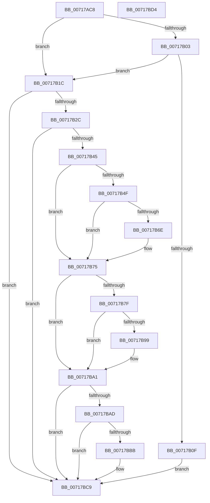

# HvlPhase0Initialize

- RVA: `0x00717AC8`–`0x00717BD5` (길이 `269` bytes)
- VA: `0x0000000140717AC8`
- 실행 섹션: `PAGE`
- PDB 이름 있음: `예`; PDB Function 태그: `아니요`
- unwind 정보 RVA: `0x0005CAAC`
- 디코드: `68`개 명령, `269/269` bytes 표시
- 미해석 바이트: `0` (있으면 어셈블리에 `.byte`로 보존)

> 이 문서는 커널 이미지의 기계어와 PDB 기호를 분석해 생성했습니다. 4번과 5번은 함수 원형과 자료형을 바이너리 사용 방식에서 추정한 C 해석이며 원본 소스 복구 결과는 아닙니다.

## 1. Dependencies

- 직접 호출 지점: **10**; 고유 호출 대상: **10**
- 직접 호출자로 확인된 함수: **1**
- RIP 상대 이미지 참조: **7**

### Outgoing calls
- `0x00717AD5` → [HviIsAnyHypervisorPresent](../../text/4A/HviIsAnyHypervisorPresent_function_004ADC50.md) (function, `0x004ADC50`)
- `0x00717AF8` → [HvlQueryConnection](../../text/46/HvlQueryConnection_function_00469C90.md) (function, `0x00469C90`)
- `0x00717B06` → [HvlpTryConfigureInterface](../../text/58/HvlpTryConfigureInterface_function_0058CABC.md) (function, `0x0058CABC`)
- `0x00717B1F` → [HvlpSetupBootProcessorEarlyHypercallPages](../../text/58/HvlpSetupBootProcessorEarlyHypercallPages_function_005867CC.md) (function, `0x005867CC`)
- `0x00717B33` → [HvlpDetermineEnlightenments](../../text/58/HvlpDetermineEnlightenments_function_0058CC9C.md) (function, `0x0058CC9C`)
- `0x00717B38` → [HalAdjustResourceList](../../text/48/HalAdjustResourceList_function_0048FDC0.md) (function, `0x0048FDC0`)
- `0x00717B64` → [strstr](../../text/4F/strstr_function_004FF680.md) (function, `0x004FF680`)
- `0x00717BA4` → [HvlpPhase0Enlightenments](../../text/58/HvlpPhase0Enlightenments_function_0058D1B8.md) (function, `0x0058D1B8`)
- `0x00717BB0` → [HvlpInitializeBootProcessor](../../text/58/HvlpInitializeBootProcessor_function_00585964.md) (function, `0x00585964`)
- `0x00717BC2` → [HviGetHypervisorVersion](../../text/66/HviGetHypervisorVersion_function_006666C0.md) (function, `0x006666C0`)

### Direct callers
- [KiInitializeKernel](../../pagelk/B6/KiInitializeKernel_function_00B68D20.md) at `0x00B68D8A`

### Static image references
- `0x00717ADC` → RVA `0x00FC6A90` (`ALMOSTRO`; read)
- `0x00717AF2` → RVA `0x00FC6A90` (`ALMOSTRO`; write)
- `0x00717B2C` → RVA `0x00FC6A97` (`ALMOSTRO`; write)
- `0x00717B4F` → RVA `0x00FC6B20` (`ALMOSTRO`; read)
- `0x00717B56` → RVA `0x00AFC200` (` ?? ::NNGAKEGL::`string'`; read)
- `0x00717B6E` → RVA `0x00FC6AD8` (`ALMOSTRO`; read/write)
- `0x00717BBB` → RVA `0x00FC7680` (`ALMOSTRO`; read)

## 2. Other-region calls and transfers

- 다른 실행 섹션으로 향하는 call: **10**
  - `0x00717AD5` → [HviIsAnyHypervisorPresent](../../text/4A/HviIsAnyHypervisorPresent_function_004ADC50.md) (`PAGE` → `.text`)
  - `0x00717AF8` → [HvlQueryConnection](../../text/46/HvlQueryConnection_function_00469C90.md) (`PAGE` → `.text`)
  - `0x00717B06` → [HvlpTryConfigureInterface](../../text/58/HvlpTryConfigureInterface_function_0058CABC.md) (`PAGE` → `.text`)
  - `0x00717B1F` → [HvlpSetupBootProcessorEarlyHypercallPages](../../text/58/HvlpSetupBootProcessorEarlyHypercallPages_function_005867CC.md) (`PAGE` → `.text`)
  - `0x00717B33` → [HvlpDetermineEnlightenments](../../text/58/HvlpDetermineEnlightenments_function_0058CC9C.md) (`PAGE` → `.text`)
  - `0x00717B38` → [HalAdjustResourceList](../../text/48/HalAdjustResourceList_function_0048FDC0.md) (`PAGE` → `.text`)
  - `0x00717B64` → [strstr](../../text/4F/strstr_function_004FF680.md) (`PAGE` → `.text`)
  - `0x00717BA4` → [HvlpPhase0Enlightenments](../../text/58/HvlpPhase0Enlightenments_function_0058D1B8.md) (`PAGE` → `.text`)
  - `0x00717BB0` → [HvlpInitializeBootProcessor](../../text/58/HvlpInitializeBootProcessor_function_00585964.md) (`PAGE` → `.text`)
  - `0x00717BC2` → [HviGetHypervisorVersion](../../text/66/HviGetHypervisorVersion_function_006666C0.md) (`PAGE` → `.text`)
- 별도 외부 분기/꼬리 이동을 확인하지 못했습니다.

## 3. Assembly (complete function range)

```asm
00717AC8  48 89 5C 24 08                  mov qword ptr [rsp + 8], rbx
00717ACD  57                              push rdi
00717ACE  48 83 EC 20                     sub rsp, 0x20
00717AD2  48 8B D9                        mov rbx, rcx
00717AD5  E8 76 61 D9 FF                  call 0x1404adc50
00717ADA  F6 D8                           neg al
00717ADC  8B 05 AE EF 8A 00               mov eax, dword ptr [rip + 0x8aefae]
00717AE2  1B D2                           sbb edx, edx
00717AE4  0F BA F0 0C                     btr eax, 0xc
00717AE8  81 E2 00 10 00 00               and edx, 0x1000
00717AEE  33 C9                           xor ecx, ecx
00717AF0  0B C2                           or eax, edx
00717AF2  89 05 98 EF 8A 00               mov dword ptr [rip + 0x8aef98], eax
00717AF8  E8 93 21 D5 FF                  call 0x140469c90
00717AFD  33 FF                           xor edi, edi
00717AFF  85 C0                           test eax, eax
00717B01  79 19                           jns 0x140717b1c
00717B03  48 8B CB                        mov rcx, rbx
00717B06  E8 B1 4F E7 FF                  call 0x14058cabc
00717B0B  85 C0                           test eax, eax
00717B0D  79 0D                           jns 0x140717b1c
00717B0F  3D 00 10 35 C0                  cmp eax, 0xc0351000
00717B14  0F 44 C7                        cmove eax, edi
00717B17  E9 AD 00 00 00                  jmp 0x140717bc9
00717B1C  48 8B CB                        mov rcx, rbx
00717B1F  E8 A8 EC E6 FF                  call 0x1405867cc
00717B24  85 C0                           test eax, eax
00717B26  0F 88 9D 00 00 00               js 0x140717bc9
00717B2C  C6 05 64 EF 8A 00 01            mov byte ptr [rip + 0x8aef64], 1
00717B33  E8 64 51 E7 FF                  call 0x14058cc9c
00717B38  E8 83 82 D7 FF                  call 0x14048fdc0
00717B3D  85 C0                           test eax, eax
00717B3F  0F 88 84 00 00 00               js 0x140717bc9
00717B45  8B 05 45 EF 8A 00               mov eax, dword ptr [rip + 0x8aef45]
00717B4B  A8 02                           test al, 2
00717B4D  74 26                           je 0x140717b75
00717B4F  48 8B 0D CA EF 8A 00            mov rcx, qword ptr [rip + 0x8aefca]
00717B56  48 8D 15 A3 46 3E 00            lea rdx, [rip + 0x3e46a3]
00717B5D  48 8B 89 D8 00 00 00            mov rcx, qword ptr [rcx + 0xd8]
00717B64  E8 17 7B DE FF                  call 0x1404ff680
00717B69  48 85 C0                        test rax, rax
00717B6C  74 07                           je 0x140717b75
00717B6E  83 0D 63 EF 8A 00 08            or dword ptr [rip + 0x8aef63], 8
00717B75  8B 05 15 EF 8A 00               mov eax, dword ptr [rip + 0x8aef15]
00717B7B  A8 02                           test al, 2
00717B7D  74 22                           je 0x140717ba1
00717B7F  48 8B 05 9A EF 8A 00            mov rax, qword ptr [rip + 0x8aef9a]
00717B86  48 8B 88 F0 00 00 00            mov rcx, qword ptr [rax + 0xf0]
00717B8D  F7 81 A4 0D 00 00 00 20 00 00   test dword ptr [rcx + 0xda4], 0x2000
00717B97  74 08                           je 0x140717ba1
00717B99  0F BA 2D 37 EF 8A 00 0B         bts dword ptr [rip + 0x8aef37], 0xb
00717BA1  48 8B CB                        mov rcx, rbx
00717BA4  E8 0F 56 E7 FF                  call 0x14058d1b8
00717BA9  85 C0                           test eax, eax
00717BAB  78 1C                           js 0x140717bc9
00717BAD  48 8B CB                        mov rcx, rbx
00717BB0  E8 AF DD E6 FF                  call 0x140585964
00717BB5  8B D8                           mov ebx, eax
00717BB7  85 C0                           test eax, eax
00717BB9  78 0E                           js 0x140717bc9
00717BBB  48 8D 0D BE FA 8A 00            lea rcx, [rip + 0x8afabe]
00717BC2  E8 F9 EA F4 FF                  call 0x1406666c0
00717BC7  8B C3                           mov eax, ebx
00717BC9  48 8B 5C 24 30                  mov rbx, qword ptr [rsp + 0x30]
00717BCE  48 83 C4 20                     add rsp, 0x20
00717BD2  5F                              pop rdi
00717BD3  C3                              ret
00717BD4  CC                              int3
```

## 4. C-style interpretation (structured pseudocode)

```c
__int64 __fastcall HvlPhase0Initialize(__int64 a1, int a2)
{
    __int64 result;
    __int64 v_rdi;
    __int64 v_rsp;
    unsigned __int64 v_stack_p8;

    v_stack_p8 = v_rbx;
    v_rsp = (v_rsp) - (32);
    result = HviIsAnyHypervisorPresent(a1, a2, a3, a4);
    result = (unsigned __int8)(-(result));
    a2 = (unsigned int)((a2) & (0x1000ULL));
    a1 = 0;
    result = (unsigned int)(((unsigned int)(*(unsigned int *)(v_rip + 9105326))) | (a2));
    *(unsigned int *)(v_rip + 9105304) = (unsigned int)(result);
    result = HvlQueryConnection(a1, a2, a3, a4);
    v_rdi = 0;
    if (!sign_flag) goto loc_00717B1C;
    result = HvlpTryConfigureInterface(0, a2, a3, a4);
    if (!sign_flag) goto loc_00717B1C;
    if (((unsigned int)(result)) == 0xC0351000ULL) { result = 0; }
    goto loc_00717BC9;
loc_00717B1C:
    result = HvlpSetupBootProcessorEarlyHypercallPages(0, a2, a3, a4);
    if (sign_flag) goto loc_00717BC9;
    *(unsigned __int8 *)(v_rip + 9105252) = 1;
    result = HvlpDetermineEnlightenments(0, a2, a3, a4);
    result = HalAdjustResourceList(0, a2, a3, a4);
    if (sign_flag) goto loc_00717BC9;
    if ((((unsigned __int8)((unsigned int)(*(unsigned int *)(v_rip + 9105221)))) & (2)) == 0) goto loc_00717B75;
    result = strstr(*(unsigned __int64 *)(*(unsigned __int64 *)(v_rip + 9105354) + 216), v_rip + 4081315, a3, a4);
    if (result != 0) {
    }
    if ((((unsigned __int8)((unsigned int)(*(unsigned int *)(v_rip + 9105173)))) & (2)) == 0) goto loc_00717BA1;
    if (((*(unsigned int *)(*(unsigned __int64 *)(*(unsigned __int64 *)(v_rip + 9105306) + 240) + 3492)) & (0x2000ULL)) != 0) {
    }
    result = HvlpPhase0Enlightenments(0, v_rip + 4081315, a3, a4);
    if (sign_flag) goto loc_00717BC9;
    result = HvlpInitializeBootProcessor(0, v_rip + 4081315, a3, a4);
    if (!(sign_flag)) {
        a1 = v_rip + 9108158;
        result = HviGetHypervisorVersion(a1, v_rip + 4081315, a3, a4);
        result = (unsigned int)((unsigned int)((unsigned int)(result)));
    }
    v_rsp = (v_rsp) + (32);
    return result;
}
```

## 5. (Beta) C Style

```c
int64_t HvlPhase0Initialize(int64_t Arg1, int32_t Arg2)
{
    int64_t result;
    int64_t local_rdi;
    int64_t local_rsp;
    uint64_t v_stack_p8;

    v_stack_p8 = local_rbx;
    local_rsp = (local_rsp) - (32);
    result = HviIsAnyHypervisorPresent(Arg1, Arg2, a3, a4);
    result = (uint8_t)(-(result));
    Arg2 = (uint32_t)((Arg2) & (0x1000ULL));
    Arg1 = 0;
    result = (uint32_t)(((uint32_t)(*(uint32_t *)(v_rip + 0x8AEFAE))) | (Arg2));
    *(uint32_t *)(v_rip + 0x8AEF98) = (uint32_t)(result);
    result = HvlQueryConnection(Arg1, Arg2, a3, a4);
    local_rdi = 0;
    if (!sign_flag) goto loc_00717B1C;
    result = HvlpTryConfigureInterface(0, Arg2, a3, a4);
    if (!sign_flag) goto loc_00717B1C;
    if (((uint32_t)(result)) == 0xC0351000ULL) { result = 0; }
    goto loc_00717BC9;
loc_00717B1C:
    result = HvlpSetupBootProcessorEarlyHypercallPages(0, Arg2, a3, a4);
    if (sign_flag) goto loc_00717BC9;
    *(uint8_t *)(v_rip + 0x8AEF64) = 1;
    result = HvlpDetermineEnlightenments(0, Arg2, a3, a4);
    result = HalAdjustResourceList(0, Arg2, a3, a4);
    if (sign_flag) goto loc_00717BC9;
    if ((((uint8_t)((uint32_t)(*(uint32_t *)(v_rip + 0x8AEF45)))) & (2)) == 0) goto loc_00717B75;
    result = strstr(*(uint64_t *)(*(uint64_t *)(v_rip + 0x8AEFCA) + 0xD8), v_rip + 4081315, a3, a4);
    if (result != 0) {
    }
    if ((((uint8_t)((uint32_t)(*(uint32_t *)(v_rip + 0x8AEF15)))) & (2)) == 0) goto loc_00717BA1;
    if (((*(uint32_t *)(*(uint64_t *)(*(uint64_t *)(v_rip + 0x8AEF9A) + 0xF0) + 0xDA4)) & (0x2000ULL)) != 0) {
    }
    result = HvlpPhase0Enlightenments(0, v_rip + 4081315, a3, a4);
    if (sign_flag) goto loc_00717BC9;
    result = HvlpInitializeBootProcessor(0, v_rip + 4081315, a3, a4);
    if (!(sign_flag)) {
        Arg1 = v_rip + 9108158;
        result = HviGetHypervisorVersion(Arg1, v_rip + 4081315, a3, a4);
        result = (uint32_t)((uint32_t)((uint32_t)(result)));
    }
    local_rsp = (local_rsp) + (32);
    return result;
}
```

## 6. Execution-region graph

[열기: 2D/3D 그래프와 함수 탐색 컨트롤 패널](../../../control-panel.html?section=page&rva=0x00717AC8&view=graph)

- 2D 그래프는 위에서 아래로 흐르고, 3D 그래프는 빈 공간을 드래그해 회전합니다. Shift+드래그는 이동, 휠은 확대·축소, 함수 노드 선택은 대상 보고서 이동입니다.

### Static fallback


