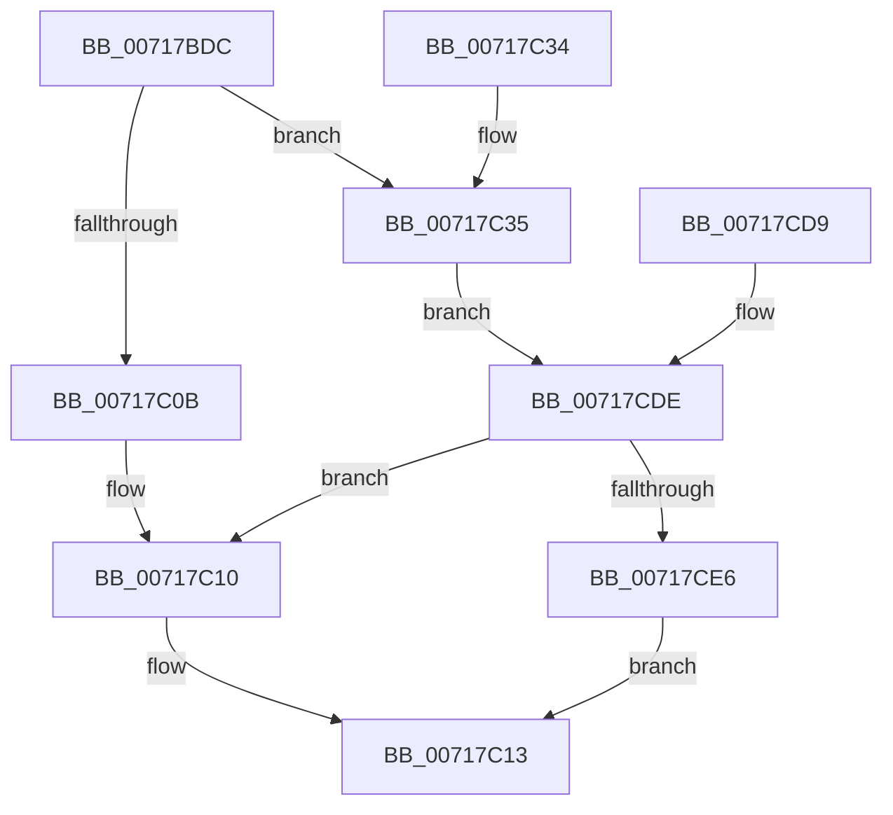

# HvlQueryDetailInfo

- RVA: `0x00717BDC`–`0x00717CF1` (길이 `277` bytes)
- VA: `0x0000000140717BDC`
- 실행 섹션: `PAGE`
- PDB 이름 있음: `예`; PDB Function 태그: `아니요`
- unwind 정보 RVA: `0x000C6460`
- 디코드: `60`개 명령, `277/277` bytes 표시
- 미해석 바이트: `0` (있으면 어셈블리에 `.byte`로 보존)

> 이 문서는 커널 이미지의 기계어와 PDB 기호를 분석해 생성했습니다. 4번과 5번은 함수 원형과 자료형을 바이너리 사용 방식에서 추정한 C 해석이며 원본 소스 복구 결과는 아닙니다.

## 1. Dependencies

- 직접 호출 지점: **9**; 고유 호출 대상: **9**
- 직접 호출자로 확인된 함수: **1**
- RIP 상대 이미지 참조: **1**

### Outgoing calls
- `0x00717C1E` → [_security_check_cookie](../../text/6A/_security_check_cookie_function_006AC640.md) (function, `0x006AC640`)
- `0x00717C40` → [memset](../../text/6C/memset_function_006C6C40.md) (function, `0x006C6C40`)
- `0x00717C4A` → [HviGetHypervisorVendorAndMaxFunction](../../text/4A/HviGetHypervisorVendorAndMaxFunction_function_004ADB6C.md) (function, `0x004ADB6C`)
- `0x00717C54` → [HviGetHypervisorInterface](../../text/66/HviGetHypervisorInterface_function_00666678.md) (function, `0x00666678`)
- `0x00717C5E` → [HviGetHypervisorVersion](../../text/66/HviGetHypervisorVersion_function_006666C0.md) (function, `0x006666C0`)
- `0x00717C68` → [HviGetHypervisorFeatures](../../text/66/HviGetHypervisorFeatures_function_00666630.md) (function, `0x00666630`)
- `0x00717C72` → [HviGetHardwareFeatures](../../text/4A/HviGetHardwareFeatures_function_004ADBC0.md) (function, `0x004ADBC0`)
- `0x00717C7F` → [HviGetEnlightenmentInformation](../../text/66/HviGetEnlightenmentInformation_function_006665E4.md) (function, `0x006665E4`)
- `0x00717C8C` → [HviGetImplementationLimits](../../text/66/HviGetImplementationLimits_function_00666708.md) (function, `0x00666708`)

### Direct callers
- [ExpQuerySystemInformation](../A5/ExpQuerySystemInformation_function_00A57858.md) at `0x00A5A324`

### Static image references
- `0x00717BE9` → RVA `0x00E0A740` (`.data`; read)

## 2. Other-region calls and transfers

- 다른 실행 섹션으로 향하는 call: **9**
  - `0x00717C1E` → [_security_check_cookie](../../text/6A/_security_check_cookie_function_006AC640.md) (`PAGE` → `.text`)
  - `0x00717C40` → [memset](../../text/6C/memset_function_006C6C40.md) (`PAGE` → `.text`)
  - `0x00717C4A` → [HviGetHypervisorVendorAndMaxFunction](../../text/4A/HviGetHypervisorVendorAndMaxFunction_function_004ADB6C.md) (`PAGE` → `.text`)
  - `0x00717C54` → [HviGetHypervisorInterface](../../text/66/HviGetHypervisorInterface_function_00666678.md) (`PAGE` → `.text`)
  - `0x00717C5E` → [HviGetHypervisorVersion](../../text/66/HviGetHypervisorVersion_function_006666C0.md) (`PAGE` → `.text`)
  - `0x00717C68` → [HviGetHypervisorFeatures](../../text/66/HviGetHypervisorFeatures_function_00666630.md) (`PAGE` → `.text`)
  - `0x00717C72` → [HviGetHardwareFeatures](../../text/4A/HviGetHardwareFeatures_function_004ADBC0.md) (`PAGE` → `.text`)
  - `0x00717C7F` → [HviGetEnlightenmentInformation](../../text/66/HviGetEnlightenmentInformation_function_006665E4.md) (`PAGE` → `.text`)
  - `0x00717C8C` → [HviGetImplementationLimits](../../text/66/HviGetImplementationLimits_function_00666708.md) (`PAGE` → `.text`)
- 별도 외부 분기/꼬리 이동을 확인하지 못했습니다.

## 3. Assembly (complete function range)

```asm
00717BDC  48 89 5C 24 10                  mov qword ptr [rsp + 0x10], rbx
00717BE1  57                              push rdi
00717BE2  48 81 EC B0 00 00 00            sub rsp, 0xb0
00717BE9  48 8B 05 50 2B 6F 00            mov rax, qword ptr [rip + 0x6f2b50]
00717BF0  48 33 C4                        xor rax, rsp
00717BF3  48 89 84 24 A0 00 00 00         mov qword ptr [rsp + 0xa0], rax
00717BFB  49 8B D9                        mov rbx, r9
00717BFE  48 8B F9                        mov rdi, rcx
00717C01  48 89 5C 24 20                  mov qword ptr [rsp + 0x20], rbx
00717C06  83 FA 70                        cmp edx, 0x70
00717C09  74 2A                           je 0x140717c35
00717C0B  B8 F0 00 00 C0                  mov eax, 0xc00000f0
00717C10  83 23 00                        and dword ptr [rbx], 0
00717C13  48 8B 8C 24 A0 00 00 00         mov rcx, qword ptr [rsp + 0xa0]
00717C1B  48 33 CC                        xor rcx, rsp
00717C1E  E8 1D 4A F9 FF                  call 0x1406ac640
00717C23  48 8B 9C 24 C8 00 00 00         mov rbx, qword ptr [rsp + 0xc8]
00717C2B  48 81 C4 B0 00 00 00            add rsp, 0xb0
00717C32  5F                              pop rdi
00717C33  C3                              ret
00717C34  CC                              int3
00717C35  33 D2                           xor edx, edx
00717C37  44 8D 42 70                     lea r8d, [rdx + 0x70]
00717C3B  48 8D 4C 24 30                  lea rcx, [rsp + 0x30]
00717C40  E8 FB EF FA FF                  call 0x1406c6c40
00717C45  48 8D 4C 24 30                  lea rcx, [rsp + 0x30]
00717C4A  E8 1D 5F D9 FF                  call 0x1404adb6c
00717C4F  48 8D 4C 24 40                  lea rcx, [rsp + 0x40]
00717C54  E8 1F EA F4 FF                  call 0x140666678
00717C59  48 8D 4C 24 50                  lea rcx, [rsp + 0x50]
00717C5E  E8 5D EA F4 FF                  call 0x1406666c0
00717C63  48 8D 4C 24 60                  lea rcx, [rsp + 0x60]
00717C68  E8 C3 E9 F4 FF                  call 0x140666630
00717C6D  48 8D 4C 24 70                  lea rcx, [rsp + 0x70]
00717C72  E8 49 5F D9 FF                  call 0x1404adbc0
00717C77  48 8D 8C 24 80 00 00 00         lea rcx, [rsp + 0x80]
00717C7F  E8 60 E9 F4 FF                  call 0x1406665e4
00717C84  48 8D 8C 24 90 00 00 00         lea rcx, [rsp + 0x90]
00717C8C  E8 77 EA F4 FF                  call 0x140666708
00717C91  33 C0                           xor eax, eax
00717C93  0F 28 44 24 30                  movaps xmm0, xmmword ptr [rsp + 0x30]
00717C98  0F 11 07                        movups xmmword ptr [rdi], xmm0
00717C9B  0F 28 4C 24 40                  movaps xmm1, xmmword ptr [rsp + 0x40]
00717CA0  0F 11 4F 10                     movups xmmword ptr [rdi + 0x10], xmm1
00717CA4  0F 28 44 24 50                  movaps xmm0, xmmword ptr [rsp + 0x50]
00717CA9  0F 11 47 20                     movups xmmword ptr [rdi + 0x20], xmm0
00717CAD  0F 28 4C 24 60                  movaps xmm1, xmmword ptr [rsp + 0x60]
00717CB2  0F 11 4F 30                     movups xmmword ptr [rdi + 0x30], xmm1
00717CB6  0F 28 44 24 70                  movaps xmm0, xmmword ptr [rsp + 0x70]
00717CBB  0F 11 47 40                     movups xmmword ptr [rdi + 0x40], xmm0
00717CBF  0F 28 8C 24 80 00 00 00         movaps xmm1, xmmword ptr [rsp + 0x80]
00717CC7  0F 11 4F 50                     movups xmmword ptr [rdi + 0x50], xmm1
00717CCB  0F 28 84 24 90 00 00 00         movaps xmm0, xmmword ptr [rsp + 0x90]
00717CD3  0F 11 47 60                     movups xmmword ptr [rdi + 0x60], xmm0
00717CD7  EB 05                           jmp 0x140717cde
00717CD9  48 8B 5C 24 20                  mov rbx, qword ptr [rsp + 0x20]
00717CDE  85 C0                           test eax, eax
00717CE0  0F 88 2A FF FF FF               js 0x140717c10
00717CE6  C7 03 70 00 00 00               mov dword ptr [rbx], 0x70
00717CEC  E9 22 FF FF FF                  jmp 0x140717c13
```

## 4. C-style interpretation (structured pseudocode)

```c
__int64 __fastcall HvlQueryDetailInfo(__int64 a1, int a2, __int64 a3, __int64 a4)
{
    __int64 result;
    __int64 v_rsp;
    unsigned __int64 v_stack_m18;
    unsigned __int64 v_stack_m98;
    unsigned __int64 v_stack_p10;
    unsigned __int64 v_stack_p20;
    unsigned __int64 v_stack_p30;
    unsigned __int64 v_stack_p40;
    unsigned __int64 v_stack_p50;
    unsigned __int64 v_stack_p60;
    unsigned __int64 v_stack_p70;
    unsigned __int64 v_stack_p80;
    unsigned __int64 v_stack_p90;

    v_stack_p10 = v_rbx;
    v_rsp = (v_rsp) - (176);
    result = (*(unsigned __int64 *)(v_rip + 7285584)) ^ (v_rsp);
    v_stack_m18 = result;
    v_stack_m98 = a4;
    if (a2 == 112) goto loc_00717C35;
loc_00717C10:
loc_00717C13:
    a1 = (v_stack_m18) ^ (v_rsp);
    result = _security_check_cookie(a1, a2, a3, a4);
    v_rsp = (v_rsp) + (176);
    return result;
loc_00717C35:
    a2 = 0;
    result = memset(v_stack_p30, a2, a2 + 112, a4);
    result = HviGetHypervisorVendorAndMaxFunction(v_stack_p30, a2, a2 + 112, a4);
    result = HviGetHypervisorInterface(v_stack_p40, a2, a2 + 112, a4);
    result = HviGetHypervisorVersion(v_stack_p50, a2, a2 + 112, a4);
    result = HviGetHypervisorFeatures(v_stack_p60, a2, a2 + 112, a4);
    result = HviGetHardwareFeatures(v_stack_p70, a2, a2 + 112, a4);
    result = HviGetEnlightenmentInformation(v_stack_p80, a2, a2 + 112, a4);
    result = HviGetImplementationLimits(v_stack_p90, a2, a2 + 112, a4);
    result = 0;
    *(unsigned __int64 *)(a1) = v_xmm0;
    *(unsigned __int64 *)(a1 + 16) = v_xmm1;
    *(unsigned __int64 *)(a1 + 32) = v_xmm0;
    *(unsigned __int64 *)(a1 + 48) = v_xmm1;
    *(unsigned __int64 *)(a1 + 64) = v_xmm0;
    *(unsigned __int64 *)(a1 + 80) = v_xmm1;
    *(unsigned __int64 *)(a1 + 96) = v_xmm0;
    goto loc_00717CDE;
loc_00717CDE:
    if (sign_flag) goto loc_00717C10;
    *(unsigned int *)(v_stack_p10) = 112;
    goto loc_00717C13;
}
```

## 5. (Beta) C Style

```c
int64_t HvlQueryDetailInfo(void *Arg1, int32_t Arg2, int64_t Arg3, void *Arg4)
{
    uint8_t *arg1 = (uint8_t *)Arg1;
    uint8_t *arg4 = (uint8_t *)Arg4;

    int64_t result;
    int64_t local_rsp;
    uint64_t v_stack_m18;
    uint64_t v_stack_m98;
    uint64_t v_stack_p10;
    uint64_t v_stack_p20;
    uint64_t v_stack_p30;
    uint64_t v_stack_p40;
    uint64_t v_stack_p50;
    uint64_t v_stack_p60;
    uint64_t v_stack_p70;
    uint64_t v_stack_p80;
    uint64_t v_stack_p90;

    v_stack_p10 = local_rbx;
    local_rsp = (local_rsp) - (176);
    result = (*(uint64_t *)(v_rip + 0x6F2B50)) ^ (local_rsp);
    v_stack_m18 = result;
    v_stack_m98 = Arg4;
    if (Arg2 == 112) goto loc_00717C35;
loc_00717C10:
loc_00717C13:
    Arg1 = (v_stack_m18) ^ (local_rsp);
    result = _security_check_cookie(Arg1, Arg2, Arg3, Arg4);
    local_rsp = (local_rsp) + (176);
    return result;
loc_00717C35:
    Arg2 = 0;
    result = memset(v_stack_p30, Arg2, Arg2 + 112, Arg4);
    result = HviGetHypervisorVendorAndMaxFunction(v_stack_p30, Arg2, Arg2 + 112, Arg4);
    result = HviGetHypervisorInterface(v_stack_p40, Arg2, Arg2 + 112, Arg4);
    result = HviGetHypervisorVersion(v_stack_p50, Arg2, Arg2 + 112, Arg4);
    result = HviGetHypervisorFeatures(v_stack_p60, Arg2, Arg2 + 112, Arg4);
    result = HviGetHardwareFeatures(v_stack_p70, Arg2, Arg2 + 112, Arg4);
    result = HviGetEnlightenmentInformation(v_stack_p80, Arg2, Arg2 + 112, Arg4);
    result = HviGetImplementationLimits(v_stack_p90, Arg2, Arg2 + 112, Arg4);
    result = 0;
    *(uint64_t *)(arg1) = v_xmm0;
    *(uint64_t *)(arg1 + 0x10) = v_xmm1;
    *(uint64_t *)(arg1 + 0x20) = v_xmm0;
    *(uint64_t *)(arg1 + 0x30) = v_xmm1;
    *(uint64_t *)(arg1 + 0x40) = v_xmm0;
    *(uint64_t *)(arg1 + 0x50) = v_xmm1;
    *(uint64_t *)(arg1 + 0x60) = v_xmm0;
    goto loc_00717CDE;
loc_00717CDE:
    if (sign_flag) goto loc_00717C10;
    *(uint32_t *)(v_stack_p10) = 112;
    goto loc_00717C13;
}
```

### 관측된 메모리 오프셋

구조체 형식이 확인되지 않은 접근은 인자 기준의 오프셋으로만 기록했습니다.

| 기준 인자 | 오프셋 표현 | 폭 (bit) | 접근 |
|---|---:|---:|---|
| `Arg1` | `+ 0x0` | `128` | `R` |
| `Arg1` | `+ 0x10` | `128` | `R` |
| `Arg1` | `+ 0x20` | `128` | `R` |
| `Arg1` | `+ 0x30` | `128` | `R` |
| `Arg1` | `+ 0x40` | `128` | `R` |
| `Arg1` | `+ 0x50` | `128` | `R` |
| `Arg1` | `+ 0x60` | `128` | `R` |
| `Arg4` | `+ 0x0` | `32` | `R/W` |
| `Arg4` | `+ 0x0` | `32` | `W` |

## 6. Execution-region graph

[열기: 2D/3D 그래프와 함수 탐색 컨트롤 패널](../../../control-panel.html?section=page&rva=0x00717BDC&view=graph)

- 2D 그래프는 위에서 아래로 흐르고, 3D 그래프는 빈 공간을 드래그해 회전합니다. Shift+드래그는 이동, 휠은 확대·축소, 함수 노드 선택은 대상 보고서 이동입니다.

### Static fallback


