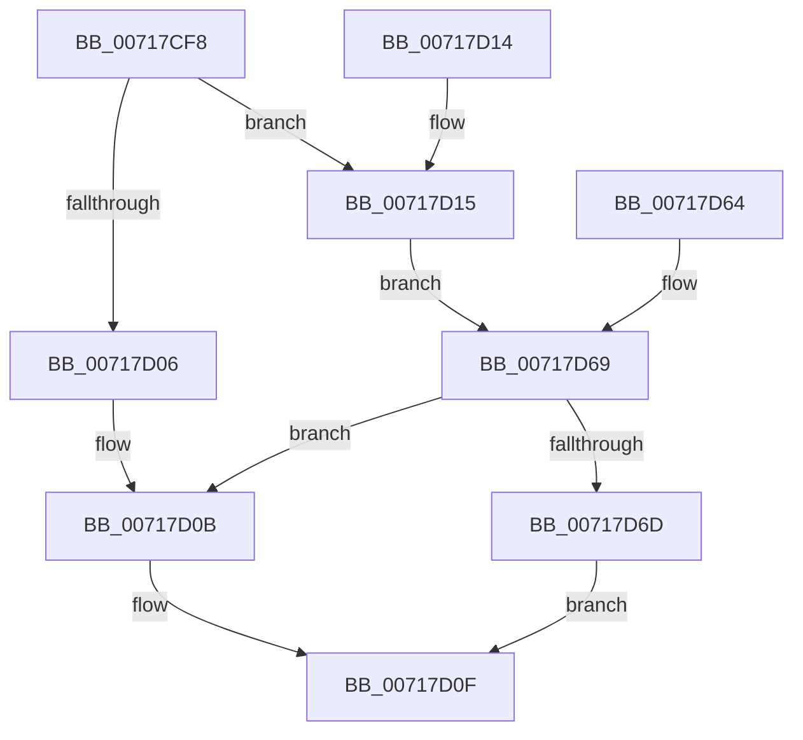

# HvlQueryEnlightenmentInfo

- RVA: `0x00717CF8`–`0x00717D76` (길이 `126` bytes)
- VA: `0x0000000140717CF8`
- 실행 섹션: `PAGE`
- PDB 이름 있음: `예`; PDB Function 태그: `아니요`
- unwind 정보 RVA: `0x000C6490`
- 디코드: `33`개 명령, `126/126` bytes 표시
- 미해석 바이트: `0` (있으면 어셈블리에 `.byte`로 보존)

> 이 문서는 커널 이미지의 기계어와 PDB 기호를 분석해 생성했습니다. 4번과 5번은 함수 원형과 자료형을 바이너리 사용 방식에서 추정한 C 해석이며 원본 소스 복구 결과는 아닙니다.

## 1. Dependencies

- 직접 호출 지점: **0**; 고유 호출 대상: **0**
- 직접 호출자로 확인된 함수: **1**
- RIP 상대 이미지 참조: **5**

### Outgoing calls
- 직접 디코드된 call 명령이 없습니다.

### Direct callers
- [ExpQuerySystemInformation](../A5/ExpQuerySystemInformation_function_00A57858.md) at `0x00A591D2`

### Static image references
- `0x00717D1A` → RVA `0x00FC6A97` (`ALMOSTRO`; read)
- `0x00717D25` → RVA `0x00FC6AD8` (`ALMOSTRO`; read)
- `0x00717D34` → RVA `0x00FC6A90` (`ALMOSTRO`; read)
- `0x00717D43` → RVA `0x00FC6CEC` (`ALMOSTRO`; read)
- `0x00717D4D` → RVA `0x00FC6AB8` (`ALMOSTRO`; read)

## 2. Other-region calls and transfers

- 다른 실행 섹션으로 향하는 call: **0**
- 별도 외부 분기/꼬리 이동을 확인하지 못했습니다.

## 3. Assembly (complete function range)

```asm
00717CF8  4C 89 4C 24 20                  mov qword ptr [rsp + 0x20], r9
00717CFD  48 83 EC 18                     sub rsp, 0x18
00717D01  83 FA 10                        cmp edx, 0x10
00717D04  74 0F                           je 0x140717d15
00717D06  B8 F0 00 00 C0                  mov eax, 0xc00000f0
00717D0B  41 83 21 00                     and dword ptr [r9], 0
00717D0F  48 83 C4 18                     add rsp, 0x18
00717D13  C3                              ret
00717D14  CC                              int3
00717D15  83 64 24 04 00                  and dword ptr [rsp + 4], 0
00717D1A  80 3D 76 ED 8A 00 00            cmp byte ptr [rip + 0x8aed76], 0
00717D21  0F 95 04 24                     setne byte ptr [rsp]
00717D25  8A 05 AD ED 8A 00               mov al, byte ptr [rip + 0x8aedad]
00717D2B  C0 E8 03                        shr al, 3
00717D2E  24 01                           and al, 1
00717D30  88 44 24 01                     mov byte ptr [rsp + 1], al
00717D34  8B 05 56 ED 8A 00               mov eax, dword ptr [rip + 0x8aed56]
00717D3A  C1 E8 0C                        shr eax, 0xc
00717D3D  24 01                           and al, 1
00717D3F  88 44 24 02                     mov byte ptr [rsp + 2], al
00717D43  8A 05 A3 EF 8A 00               mov al, byte ptr [rip + 0x8aefa3]
00717D49  88 44 24 03                     mov byte ptr [rsp + 3], al
00717D4D  8B 05 65 ED 8A 00               mov eax, dword ptr [rip + 0x8aed65]
00717D53  48 89 44 24 08                  mov qword ptr [rsp + 8], rax
00717D58  33 C0                           xor eax, eax
00717D5A  0F 10 04 24                     movups xmm0, xmmword ptr [rsp]
00717D5E  F3 0F 7F 01                     movdqu xmmword ptr [rcx], xmm0
00717D62  EB 05                           jmp 0x140717d69
00717D64  4C 8B 4C 24 38                  mov r9, qword ptr [rsp + 0x38]
00717D69  85 C0                           test eax, eax
00717D6B  78 9E                           js 0x140717d0b
00717D6D  41 C7 01 10 00 00 00            mov dword ptr [r9], 0x10
00717D74  EB 99                           jmp 0x140717d0f
```

## 4. C-style interpretation (structured pseudocode)

```c
__int64 __fastcall HvlQueryEnlightenmentInfo(__int64 a1, int a2, __int64 a3, __int64 a4)
{
    __int64 result;
    __int64 v_rsp;
    unsigned __int8 v_stack_p0;
    unsigned __int8 v_stack_p1;
    unsigned __int8 v_stack_p2;
    unsigned __int64 v_stack_p20;
    unsigned __int8 v_stack_p3;
    unsigned __int64 v_stack_p38;
    unsigned int v_stack_p4;
    unsigned __int64 v_stack_p8;

    v_stack_p20 = a4;
    v_rsp = (v_rsp) - (24);
    if (a2 == 16) goto loc_00717D15;
loc_00717D0B:
loc_00717D0F:
    v_rsp = (v_rsp) + (24);
    return (unsigned int)(0xC00000F0ULL);
loc_00717D15:
    result = (unsigned __int8)((*(unsigned __int8 *)(v_rip + 9104813)) >> (3));
    result = (unsigned __int8)((result) & (1));
    v_stack_p1 = (unsigned __int8)(result);
    result = (unsigned int)(((unsigned int)(*(unsigned int *)(v_rip + 9104726))) >> (12));
    result = (unsigned __int8)((result) & (1));
    v_stack_p2 = (unsigned __int8)(result);
    v_stack_p3 = (unsigned __int8)(*(unsigned __int8 *)(v_rip + 9105315));
    v_stack_p8 = (unsigned int)(*(unsigned int *)(v_rip + 9104741));
    result = 0;
    *(unsigned __int64 *)(a1) = v_xmm0;
    goto loc_00717D69;
loc_00717D69:
    if (sign_flag) goto loc_00717D0B;
    *(unsigned int *)(a4) = 16;
    goto loc_00717D0F;
}
```

## 5. (Beta) C Style

```c
int64_t HvlQueryEnlightenmentInfo(void *Arg1, int32_t Arg2, int64_t Arg3, void *Arg4)
{
    uint8_t *arg1 = (uint8_t *)Arg1;
    uint8_t *arg4 = (uint8_t *)Arg4;

    int64_t result;
    int64_t local_rsp;
    uint8_t v_stack_p0;
    uint8_t v_stack_p1;
    uint8_t v_stack_p2;
    uint64_t v_stack_p20;
    uint8_t v_stack_p3;
    uint64_t v_stack_p38;
    uint32_t v_stack_p4;
    uint64_t v_stack_p8;

    v_stack_p20 = Arg4;
    local_rsp = (local_rsp) - (24);
    if (Arg2 == 16) goto loc_00717D15;
loc_00717D0B:
loc_00717D0F:
    local_rsp = (local_rsp) + (24);
    return (uint32_t)(0xC00000F0ULL);
loc_00717D15:
    result = (uint8_t)((*(uint8_t *)(v_rip + 0x8AEDAD)) >> (3));
    result = (uint8_t)((result) & (1));
    v_stack_p1 = (uint8_t)(result);
    result = (uint32_t)(((uint32_t)(*(uint32_t *)(v_rip + 0x8AED56))) >> (12));
    result = (uint8_t)((result) & (1));
    v_stack_p2 = (uint8_t)(result);
    v_stack_p3 = (uint8_t)(*(uint8_t *)(v_rip + 0x8AEFA3));
    v_stack_p8 = (uint32_t)(*(uint32_t *)(v_rip + 0x8AED65));
    result = 0;
    *(uint64_t *)(arg1) = v_xmm0;
    goto loc_00717D69;
loc_00717D69:
    if (sign_flag) goto loc_00717D0B;
    *(uint32_t *)(arg4) = 16;
    goto loc_00717D0F;
}
```

### 관측된 메모리 오프셋

구조체 형식이 확인되지 않은 접근은 인자 기준의 오프셋으로만 기록했습니다.

| 기준 인자 | 오프셋 표현 | 폭 (bit) | 접근 |
|---|---:|---:|---|
| `Arg1` | `+ 0x0` | `128` | `W` |
| `Arg4` | `+ 0x0` | `32` | `R/W` |
| `Arg4` | `+ 0x0` | `32` | `W` |

## 6. Execution-region graph

[열기: 2D/3D 그래프와 함수 탐색 컨트롤 패널](../../../control-panel.html?section=page&rva=0x00717CF8&view=graph)

- 2D 그래프는 위에서 아래로 흐르고, 3D 그래프는 빈 공간을 드래그해 회전합니다. Shift+드래그는 이동, 휠은 확대·축소, 함수 노드 선택은 대상 보고서 이동입니다.

### Static fallback


