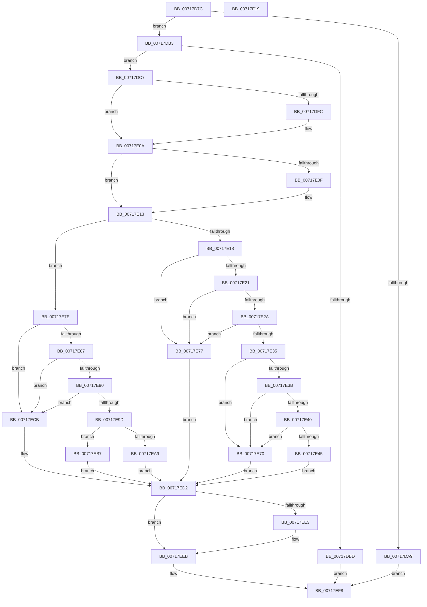

# HvlQuerySetBootPagesInfo

- RVA: `0x00717D7C`–`0x00717F1A` (길이 `414` bytes)
- VA: `0x0000000140717D7C`
- 실행 섹션: `PAGE`
- PDB 이름 있음: `예`; PDB Function 태그: `아니요`
- unwind 정보 RVA: `0x0005FEF8`
- 디코드: `112`개 명령, `414/414` bytes 표시
- 미해석 바이트: `0` (있으면 어셈블리에 `.byte`로 보존)

> 이 문서는 커널 이미지의 기계어와 PDB 기호를 분석해 생성했습니다. 4번과 5번은 함수 원형과 자료형을 바이너리 사용 방식에서 추정한 C 해석이며 원본 소스 복구 결과는 아닙니다.

## 1. Dependencies

- 직접 호출 지점: **8**; 고유 호출 대상: **8**
- 직접 호출자로 확인된 함수: **2**
- RIP 상대 이미지 참조: **9**

### Outgoing calls
- `0x00717DEB` → [KeAbPreAcquire](../../text/21/KeAbPreAcquire_function_00210230.md) (function, `0x00210230`)
- `0x00717E05` → [ExfAcquirePushLockExclusiveEx](../../text/20/ExfAcquirePushLockExclusiveEx_function_0020FC90.md) (function, `0x0020FC90`)
- `0x00717E4A` → [ExFreePoolWithTag](../../poolcode/B8/ExFreePoolWithTag_function_00B82870.md) (function, `0x00B82870`)
- `0x00717E69` → [KeSetEvent](../../text/33/KeSetEvent_function_0033F310.md) (function, `0x0033F310`)
- `0x00717EBD` → [memcpy](../../text/6C/memcpy_function_006C6840.md) (function, `0x006C6840`)
- `0x00717EE6` → [ExfTryToWakePushLock](../../text/26/ExfTryToWakePushLock_function_00265DD0.md) (function, `0x00265DD0`)
- `0x00717EEE` → [KeAbPostRelease](../../text/2E/KeAbPostRelease_function_002E1600.md) (function, `0x002E1600`)
- `0x00717EF3` → [KeLeaveCriticalRegion](../../text/25/KeLeaveCriticalRegion_function_0025D8B0.md) (function, `0x0025D8B0`)

### Direct callers
- [ExpQuerySystemInformation](../A5/ExpQuerySystemInformation_function_00A57858.md) at `0x00A5B472`
- [NtSetSystemInformation](../AF/NtSetSystemInformation_function_00AF4A60.md) at `0x00AF6860`

### Static image references
- `0x00717DB3` → RVA `0x00FC6A90` (`ALMOSTRO`; read)
- `0x00717DD0` → RVA `0x00F8EE00` (`.data`; read)
- `0x00717E18` → RVA `0x00F8EE08` (`.data`; read)
- `0x00717E21` → RVA `0x00F8EE09` (`.data`; read)
- `0x00717E2A` → RVA `0x00F8EE20` (`.data`; read)
- `0x00717E4F` → RVA `0x00F8EE10` (`.data`; read)
- `0x00717E5B` → RVA `0x00F8EE20` (`.data`; write)
- `0x00717E62` → RVA `0x00F8EE09` (`.data`; write)
- `0x00717ED2` → RVA `0x00F8EE00` (`.data`; read/write)

## 2. Other-region calls and transfers

- 다른 실행 섹션으로 향하는 call: **8**
  - `0x00717DEB` → [KeAbPreAcquire](../../text/21/KeAbPreAcquire_function_00210230.md) (`PAGE` → `.text`)
  - `0x00717E05` → [ExfAcquirePushLockExclusiveEx](../../text/20/ExfAcquirePushLockExclusiveEx_function_0020FC90.md) (`PAGE` → `.text`)
  - `0x00717E4A` → [ExFreePoolWithTag](../../poolcode/B8/ExFreePoolWithTag_function_00B82870.md) (`PAGE` → `POOLCODE`)
  - `0x00717E69` → [KeSetEvent](../../text/33/KeSetEvent_function_0033F310.md) (`PAGE` → `.text`)
  - `0x00717EBD` → [memcpy](../../text/6C/memcpy_function_006C6840.md) (`PAGE` → `.text`)
  - `0x00717EE6` → [ExfTryToWakePushLock](../../text/26/ExfTryToWakePushLock_function_00265DD0.md) (`PAGE` → `.text`)
  - `0x00717EEE` → [KeAbPostRelease](../../text/2E/KeAbPostRelease_function_002E1600.md) (`PAGE` → `.text`)
  - `0x00717EF3` → [KeLeaveCriticalRegion](../../text/25/KeLeaveCriticalRegion_function_0025D8B0.md) (`PAGE` → `.text`)
- 별도 외부 분기/꼬리 이동을 확인하지 못했습니다.

## 3. Assembly (complete function range)

```asm
00717D7C  48 8B C4                        mov rax, rsp
00717D7F  48 89 58 08                     mov qword ptr [rax + 8], rbx
00717D83  48 89 68 10                     mov qword ptr [rax + 0x10], rbp
00717D87  48 89 70 18                     mov qword ptr [rax + 0x18], rsi
00717D8B  48 89 78 20                     mov qword ptr [rax + 0x20], rdi
00717D8F  41 54                           push r12
00717D91  41 56                           push r14
00717D93  41 57                           push r15
00717D95  48 83 EC 20                     sub rsp, 0x20
00717D99  33 FF                           xor edi, edi
00717D9B  45 8A F9                        mov r15b, r9b
00717D9E  44 8B F2                        mov r14d, edx
00717DA1  48 8B E9                        mov rbp, rcx
00717DA4  45 84 C0                        test r8b, r8b
00717DA7  74 0A                           je 0x140717db3
00717DA9  BF 22 00 00 C0                  mov edi, 0xc0000022
00717DAE  E9 45 01 00 00                  jmp 0x140717ef8
00717DB3  8B 05 D7 EC 8A 00               mov eax, dword ptr [rip + 0x8aecd7]
00717DB9  A8 02                           test al, 2
00717DBB  75 0A                           jne 0x140717dc7
00717DBD  BF BB 00 00 C0                  mov edi, 0xc00000bb
00717DC2  E9 31 01 00 00                  jmp 0x140717ef8
00717DC7  65 48 8B 04 25 88 01 00 00      mov rax, qword ptr gs:[0x188]
00717DD0  4C 8D 25 29 70 87 00            lea r12, [rip + 0x877029]
00717DD7  48 83 CB FF                     or rbx, 0xffffffffffffffff
00717DDB  45 33 C0                        xor r8d, r8d
00717DDE  33 D2                           xor edx, edx
00717DE0  49 8B CC                        mov rcx, r12
00717DE3  66 01 98 E4 01 00 00            add word ptr [rax + 0x1e4], bx
00717DEA  90                              nop
00717DEB  E8 40 84 AF FF                  call 0x140210230
00717DF0  F0 49 0F BA 2C 24 00            lock bts qword ptr [r12], 0
00717DF7  48 8B F0                        mov rsi, rax
00717DFA  73 0E                           jae 0x140717e0a
00717DFC  4D 8B C4                        mov r8, r12
00717DFF  48 8B D0                        mov rdx, rax
00717E02  49 8B CC                        mov rcx, r12
00717E05  E8 86 7E AF FF                  call 0x14020fc90
00717E0A  48 85 F6                        test rsi, rsi
00717E0D  74 04                           je 0x140717e13
00717E0F  C6 46 0A 01                     mov byte ptr [rsi + 0xa], 1
00717E13  45 84 FF                        test r15b, r15b
00717E16  75 66                           jne 0x140717e7e
00717E18  40 38 3D E9 6F 87 00            cmp byte ptr [rip + 0x876fe9], dil
00717E1F  74 56                           je 0x140717e77
00717E21  40 38 3D E1 6F 87 00            cmp byte ptr [rip + 0x876fe1], dil
00717E28  75 4D                           jne 0x140717e77
00717E2A  48 8B 0D EF 6F 87 00            mov rcx, qword ptr [rip + 0x876fef]
00717E31  39 39                           cmp dword ptr [rcx], edi
00717E33  74 42                           je 0x140717e77
00717E35  41 83 FE 10                     cmp r14d, 0x10
00717E39  75 35                           jne 0x140717e70
00717E3B  48 85 ED                        test rbp, rbp
00717E3E  74 30                           je 0x140717e70
00717E40  39 7D 00                        cmp dword ptr [rbp], edi
00717E43  75 2B                           jne 0x140717e70
00717E45  BA 48 56 4C 20                  mov edx, 0x204c5648
00717E4A  E8 21 AA 46 00                  call 0x140b82870
00717E4F  48 8B 0D BA 6F 87 00            mov rcx, qword ptr [rip + 0x876fba]
00717E56  45 33 C0                        xor r8d, r8d
00717E59  33 D2                           xor edx, edx
00717E5B  48 89 3D BE 6F 87 00            mov qword ptr [rip + 0x876fbe], rdi
00717E62  C6 05 A0 6F 87 00 01            mov byte ptr [rip + 0x876fa0], 1
00717E69  E8 A2 74 C2 FF                  call 0x14033f310
00717E6E  EB 62                           jmp 0x140717ed2
00717E70  BF 0D 00 00 C0                  mov edi, 0xc000000d
00717E75  EB 5B                           jmp 0x140717ed2
00717E77  BF 03 A0 00 C0                  mov edi, 0xc000a003
00717E7C  EB 54                           jmp 0x140717ed2
00717E7E  40 38 3D 83 6F 87 00            cmp byte ptr [rip + 0x876f83], dil
00717E85  74 44                           je 0x140717ecb
00717E87  40 38 3D 7B 6F 87 00            cmp byte ptr [rip + 0x876f7b], dil
00717E8E  75 3B                           jne 0x140717ecb
00717E90  48 8B 15 89 6F 87 00            mov rdx, qword ptr [rip + 0x876f89]
00717E97  8B 32                           mov esi, dword ptr [rdx]
00717E99  85 F6                           test esi, esi
00717E9B  74 2E                           je 0x140717ecb
00717E9D  8D 34 F5 08 00 00 00            lea esi, [rsi*8 + 8]
00717EA4  41 3B F6                        cmp esi, r14d
00717EA7  76 0E                           jbe 0x140717eb7
00717EA9  48 8B 44 24 60                  mov rax, qword ptr [rsp + 0x60]
00717EAE  BF 23 00 00 C0                  mov edi, 0xc0000023
00717EB3  89 30                           mov dword ptr [rax], esi
00717EB5  EB 1B                           jmp 0x140717ed2
00717EB7  44 8B C6                        mov r8d, esi
00717EBA  48 8B CD                        mov rcx, rbp
00717EBD  E8 7E E9 FA FF                  call 0x1406c6840
00717EC2  48 8B 44 24 60                  mov rax, qword ptr [rsp + 0x60]
00717EC7  89 30                           mov dword ptr [rax], esi
00717EC9  EB 07                           jmp 0x140717ed2
00717ECB  48 8B 44 24 60                  mov rax, qword ptr [rsp + 0x60]
00717ED0  89 38                           mov dword ptr [rax], edi
00717ED2  F0 48 0F C1 1D 25 6F 87 00      lock xadd qword ptr [rip + 0x876f25], rbx
00717EDB  80 E3 06                        and bl, 6
00717EDE  80 FB 02                        cmp bl, 2
00717EE1  75 08                           jne 0x140717eeb
00717EE3  49 8B CC                        mov rcx, r12
00717EE6  E8 E5 DE B4 FF                  call 0x140265dd0
00717EEB  49 8B CC                        mov rcx, r12
00717EEE  E8 0D 97 BC FF                  call 0x1402e1600
00717EF3  E8 B8 59 B4 FF                  call 0x14025d8b0
00717EF8  48 8B 5C 24 40                  mov rbx, qword ptr [rsp + 0x40]
00717EFD  8B C7                           mov eax, edi
00717EFF  48 8B 7C 24 58                  mov rdi, qword ptr [rsp + 0x58]
00717F04  48 8B 6C 24 48                  mov rbp, qword ptr [rsp + 0x48]
00717F09  48 8B 74 24 50                  mov rsi, qword ptr [rsp + 0x50]
00717F0E  48 83 C4 20                     add rsp, 0x20
00717F12  41 5F                           pop r15
00717F14  41 5E                           pop r14
00717F16  41 5C                           pop r12
00717F18  C3                              ret
00717F19  CC                              int3
```

## 4. C-style interpretation (structured pseudocode)

```c
__int64 __fastcall HvlQuerySetBootPagesInfo(__int64 a1, int a2, int a3, unsigned __int8 a4, __int64 a5)
{
    __int64 result;
    __int64 v_rbx;
    __int64 v_rdi;
    __int64 v_rsp;
    unsigned __int64 v_stack_p10;
    unsigned __int64 v_stack_p18;
    unsigned __int64 v_stack_p20;
    unsigned __int64 v_stack_p8;

    *(unsigned __int64 *)(v_rsp + 8) = v_rbx;
    *(unsigned __int64 *)(v_rsp + 16) = v_rbp;
    *(unsigned __int64 *)(v_rsp + 24) = v_rsi;
    *(unsigned __int64 *)(v_rsp + 32) = v_rdi;
    v_rsp = (v_rsp) - (32);
    v_rdi = 0;
    if ((unsigned __int8)(a3) == 0) goto loc_00717DB3;
    goto loc_00717EF8;
loc_00717DB3:
    if ((((unsigned __int8)((unsigned int)(*(unsigned int *)(v_rip + 9104599)))) & (2)) != 0) goto loc_00717DC7;
    goto loc_00717EF8;
loc_00717DC7:
    v_rbx = (v_rbx) | (-1);
    a3 = 0;
    a2 = 0;
    result = KeAbPreAcquire(v_rip + 8876073, a2, a3, a4);
    if (!(condition_is_above_or_equal)) {
        a3 = v_rip + 8876073;
        a2 = result;
        a1 = v_rip + 8876073;
        result = ExfAcquirePushLockExclusiveEx(a1, a2, a3, a4);
    }
    if (result != 0) {
        *(unsigned __int8 *)(result + 10) = 1;
    }
    if (a4 != 0) goto loc_00717E7E;
    if ((*(unsigned __int8 *)(v_rip + 8876009)) == ((unsigned __int8)((unsigned int)(0xC00000BBULL)))) goto loc_00717E77;
    if ((*(unsigned __int8 *)(v_rip + 8876001)) != ((unsigned __int8)((unsigned int)(0xC00000BBULL)))) goto loc_00717E77;
    if ((*(unsigned int *)(*(unsigned __int64 *)(v_rip + 8876015))) == ((unsigned int)((unsigned int)(0xC00000BBULL)))) goto loc_00717E77;
    if (((unsigned int)((unsigned int)(a2))) != 16) goto loc_00717E70;
    if (a1 == 0) goto loc_00717E70;
    if ((*(unsigned int *)(a1)) != ((unsigned int)((unsigned int)(0xC00000BBULL)))) goto loc_00717E70;
    result = ExFreePoolWithTag(*(unsigned __int64 *)(v_rip + 8876015), (unsigned int)(0x204C5648ULL), a3, a4);
    a3 = 0;
    a2 = 0;
    *(unsigned __int64 *)(v_rip + 8875966) = (unsigned int)(0xC00000BBULL);
    *(unsigned __int8 *)(v_rip + 8875936) = 1;
    result = KeSetEvent(*(unsigned __int64 *)(v_rip + 8875962), a2, a3, a4);
    goto loc_00717ED2;
loc_00717E70:
    goto loc_00717ED2;
loc_00717E77:
    goto loc_00717ED2;
loc_00717E7E:
    if ((*(unsigned __int8 *)(v_rip + 8875907)) == ((unsigned __int8)((unsigned int)(0xC000A003ULL)))) goto loc_00717ECB;
    if ((*(unsigned __int8 *)(v_rip + 8875899)) != ((unsigned __int8)((unsigned int)(0xC000A003ULL)))) goto loc_00717ECB;
    if ((unsigned int)((unsigned int)(*(unsigned int *)(*(unsigned __int64 *)(v_rip + 8875913)))) == 0) goto loc_00717ECB;
    if (((unsigned int)((unsigned int)(*(unsigned int *)(*(unsigned __int64 *)(v_rip + 8875913))) * 8 + 8)) <= ((unsigned int)((unsigned int)(a2)))) goto loc_00717EB7;
    *(unsigned int *)(a5) = (unsigned int)((unsigned int)(*(unsigned int *)(*(unsigned __int64 *)(v_rip + 8875913))) * 8 + 8);
    goto loc_00717ED2;
loc_00717EB7:
    result = memcpy(a1, *(unsigned __int64 *)(v_rip + 8875913), (unsigned int)((unsigned int)((unsigned int)(*(unsigned int *)(*(unsigned __int64 *)(v_rip + 8875913))) * 8 + 8)), a4);
    *(unsigned int *)(a5) = (unsigned int)((unsigned int)(*(unsigned int *)(*(unsigned __int64 *)(v_rip + 8875913))) * 8 + 8);
    goto loc_00717ED2;
loc_00717ECB:
    *(unsigned int *)(a5) = (unsigned int)((unsigned int)(0xC0000023ULL));
loc_00717ED2:
    v_rbx = (unsigned __int8)((v_rbx) & (6));
    result = a5;
    if (((unsigned __int8)(v_rbx)) == 2) {
        a1 = v_rip + 8876073;
        result = ExfTryToWakePushLock(a1, *(unsigned __int64 *)(v_rip + 8875913), (unsigned int)((unsigned int)((unsigned int)(*(unsigned int *)(*(unsigned __int64 *)(v_rip + 8875913))) * 8 + 8)), a4);
    }
    result = KeAbPostRelease(v_rip + 8876073, *(unsigned __int64 *)(v_rip + 8875913), (unsigned int)((unsigned int)((unsigned int)(*(unsigned int *)(*(unsigned __int64 *)(v_rip + 8875913))) * 8 + 8)), a4);
    result = KeLeaveCriticalRegion(v_rip + 8876073, *(unsigned __int64 *)(v_rip + 8875913), (unsigned int)((unsigned int)((unsigned int)(*(unsigned int *)(*(unsigned __int64 *)(v_rip + 8875913))) * 8 + 8)), a4);
loc_00717EF8:
    v_rsp = (v_rsp) + (32);
    return (unsigned int)((unsigned int)((unsigned int)(0xC0000023ULL)));
}
```

## 5. (Beta) C Style

```c
int64_t HvlQuerySetBootPagesInfo(int64_t Arg1, int32_t Arg2, int32_t Arg3, uint8_t Arg4, void *Arg5)
{
    uint8_t *arg5 = (uint8_t *)Arg5;

    int64_t result;
    int64_t local_rbx;
    int64_t local_rdi;
    int64_t local_rsp;
    uint64_t v_stack_p10;
    uint64_t v_stack_p18;
    uint64_t v_stack_p20;
    uint64_t v_stack_p8;

    *(uint64_t *)(local_rsp + 0x8) = local_rbx;
    *(uint64_t *)(local_rsp + 0x10) = local_rbp;
    *(uint64_t *)(local_rsp + 0x18) = local_rsi;
    *(uint64_t *)(local_rsp + 0x20) = local_rdi;
    local_rsp = (local_rsp) - (32);
    local_rdi = 0;
    if ((uint8_t)(Arg3) == 0) goto loc_00717DB3;
    goto loc_00717EF8;
loc_00717DB3:
    if ((((uint8_t)((uint32_t)(*(uint32_t *)(v_rip + 0x8AECD7)))) & (2)) != 0) goto loc_00717DC7;
    goto loc_00717EF8;
loc_00717DC7:
    local_rbx = (local_rbx) | (-1);
    Arg3 = 0;
    Arg2 = 0;
    result = KeAbPreAcquire(v_rip + 8876073, Arg2, Arg3, Arg4);
    if (!(condition_is_above_or_equal)) {
        Arg3 = v_rip + 8876073;
        Arg2 = result;
        Arg1 = v_rip + 8876073;
        result = ExfAcquirePushLockExclusiveEx(Arg1, Arg2, Arg3, Arg4);
    }
    if (result != 0) {
        *(uint8_t *)(result + 0xA) = 1;
    }
    if (Arg4 != 0) goto loc_00717E7E;
    if ((*(uint8_t *)(v_rip + 0x876FE9)) == ((uint8_t)((uint32_t)(0xC00000BBULL)))) goto loc_00717E77;
    if ((*(uint8_t *)(v_rip + 0x876FE1)) != ((uint8_t)((uint32_t)(0xC00000BBULL)))) goto loc_00717E77;
    if ((*(uint32_t *)(*(uint64_t *)(v_rip + 0x876FEF))) == ((uint32_t)((uint32_t)(0xC00000BBULL)))) goto loc_00717E77;
    if (((uint32_t)((uint32_t)(Arg2))) != 16) goto loc_00717E70;
    if (Arg1 == 0) goto loc_00717E70;
    if ((*(uint32_t *)(Arg1)) != ((uint32_t)((uint32_t)(0xC00000BBULL)))) goto loc_00717E70;
    result = ExFreePoolWithTag(*(uint64_t *)(v_rip + 0x876FEF), (uint32_t)(0x204C5648ULL), Arg3, Arg4);
    Arg3 = 0;
    Arg2 = 0;
    *(uint64_t *)(v_rip + 0x876FBE) = (uint32_t)(0xC00000BBULL);
    *(uint8_t *)(v_rip + 0x876FA0) = 1;
    result = KeSetEvent(*(uint64_t *)(v_rip + 0x876FBA), Arg2, Arg3, Arg4);
    goto loc_00717ED2;
loc_00717E70:
    goto loc_00717ED2;
loc_00717E77:
    goto loc_00717ED2;
loc_00717E7E:
    if ((*(uint8_t *)(v_rip + 0x876F83)) == ((uint8_t)((uint32_t)(0xC000A003ULL)))) goto loc_00717ECB;
    if ((*(uint8_t *)(v_rip + 0x876F7B)) != ((uint8_t)((uint32_t)(0xC000A003ULL)))) goto loc_00717ECB;
    if ((uint32_t)((uint32_t)(*(uint32_t *)(*(uint64_t *)(v_rip + 0x876F89)))) == 0) goto loc_00717ECB;
    if (((uint32_t)((uint32_t)(*(uint32_t *)(*(uint64_t *)(v_rip + 0x876F89))) * 8 + 8)) <= ((uint32_t)((uint32_t)(Arg2)))) goto loc_00717EB7;
    *(uint32_t *)(arg5) = (uint32_t)((uint32_t)(*(uint32_t *)(*(uint64_t *)(v_rip + 0x876F89))) * 8 + 8);
    goto loc_00717ED2;
loc_00717EB7:
    result = memcpy(Arg1, *(uint64_t *)(v_rip + 0x876F89), (uint32_t)((uint32_t)((uint32_t)(*(uint32_t *)(*(uint64_t *)(v_rip + 0x876F89))) * 8 + 8)), Arg4);
    *(uint32_t *)(arg5) = (uint32_t)((uint32_t)(*(uint32_t *)(*(uint64_t *)(v_rip + 0x876F89))) * 8 + 8);
    goto loc_00717ED2;
loc_00717ECB:
    *(uint32_t *)(arg5) = (uint32_t)((uint32_t)(0xC0000023ULL));
loc_00717ED2:
    local_rbx = (uint8_t)((local_rbx) & (6));
    result = Arg5;
    if (((uint8_t)(local_rbx)) == 2) {
        Arg1 = v_rip + 8876073;
        result = ExfTryToWakePushLock(Arg1, *(uint64_t *)(v_rip + 0x876F89), (uint32_t)((uint32_t)((uint32_t)(*(uint32_t *)(*(uint64_t *)(v_rip + 0x876F89))) * 8 + 8)), Arg4);
    }
    result = KeAbPostRelease(v_rip + 8876073, *(uint64_t *)(v_rip + 0x876F89), (uint32_t)((uint32_t)((uint32_t)(*(uint32_t *)(*(uint64_t *)(v_rip + 0x876F89))) * 8 + 8)), Arg4);
    result = KeLeaveCriticalRegion(v_rip + 8876073, *(uint64_t *)(v_rip + 0x876F89), (uint32_t)((uint32_t)((uint32_t)(*(uint32_t *)(*(uint64_t *)(v_rip + 0x876F89))) * 8 + 8)), Arg4);
loc_00717EF8:
    local_rsp = (local_rsp) + (32);
    return (uint32_t)((uint32_t)((uint32_t)(0xC0000023ULL)));
}
```

### 관측된 메모리 오프셋

구조체 형식이 확인되지 않은 접근은 인자 기준의 오프셋으로만 기록했습니다.

| 기준 인자 | 오프셋 표현 | 폭 (bit) | 접근 |
|---|---:|---:|---|
| `Arg5` | `+ 0x0` | `32` | `W` |

## 6. Execution-region graph

[열기: 2D/3D 그래프와 함수 탐색 컨트롤 패널](../../../control-panel.html?section=page&rva=0x00717D7C&view=graph)

- 2D 그래프는 위에서 아래로 흐르고, 3D 그래프는 빈 공간을 드래그해 회전합니다. Shift+드래그는 이동, 휠은 확대·축소, 함수 노드 선택은 대상 보고서 이동입니다.

### Static fallback


