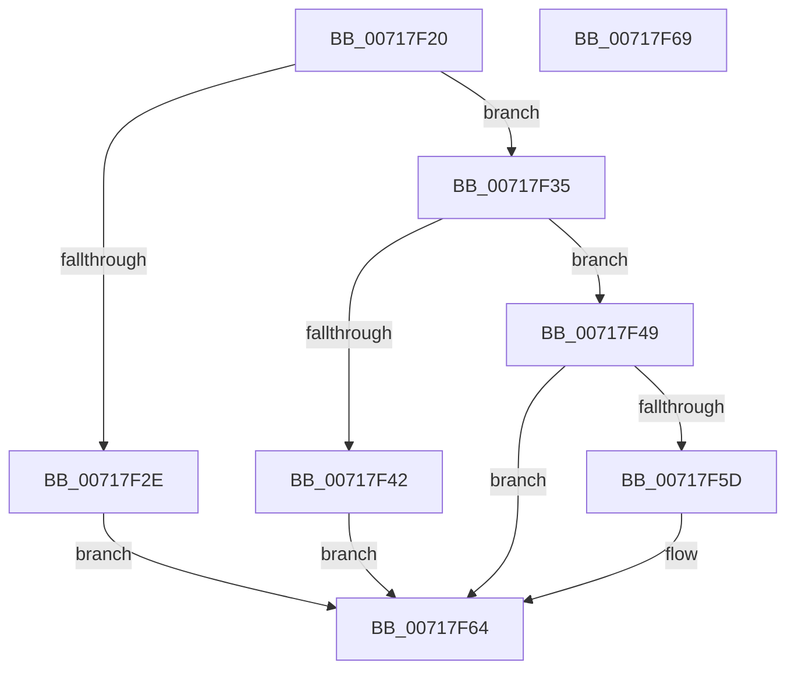

# HvlRegisterWheaErrorNotification

- RVA: `0x00717F20`–`0x00717F6A` (길이 `74` bytes)
- VA: `0x0000000140717F20`
- 실행 섹션: `PAGE`
- PDB 이름 있음: `예`; PDB Function 태그: `아니요`
- unwind 정보 RVA: `0x0005C788`
- 디코드: `21`개 명령, `74/74` bytes 표시
- 미해석 바이트: `0` (있으면 어셈블리에 `.byte`로 보존)

> 이 문서는 커널 이미지의 기계어와 PDB 기호를 분석해 생성했습니다. 4번과 5번은 함수 원형과 자료형을 바이너리 사용 방식에서 추정한 C 해석이며 원본 소스 복구 결과는 아닙니다.

## 1. Dependencies

- 직접 호출 지점: **1**; 고유 호출 대상: **1**
- 직접 호출자로 확인된 함수: **0**
- RIP 상대 이미지 참조: **4**

### Outgoing calls
- `0x00717F52` → [WheaRegisterInUsePageOfflineNotification](../7D/WheaRegisterInUsePageOfflineNotification_function_007D76F0.md) (function, `0x007D76F0`)

### Direct callers
- 이 함수 시작 RVA로 연결되는 직접 call은 확인되지 않았습니다. 간접 호출은 완전히 역산할 수 없습니다.

### Static image references
- `0x00717F24` → RVA `0x00FC6AD8` (`ALMOSTRO`; read)
- `0x00717F37` → RVA `0x00E65E30` (`.data`; read)
- `0x00717F4B` → RVA `0x005844A0` (`HvlWheaInUsePageOfflineNotificationCallback`; read)
- `0x00717F5D` → RVA `0x00E65E30` (`.data`; read/write)

## 2. Other-region calls and transfers

- 다른 실행 섹션으로 향하는 call: **0**
- 별도 외부 분기/꼬리 이동을 확인하지 못했습니다.

## 3. Assembly (complete function range)

```asm
00717F20  48 83 EC 28                     sub rsp, 0x28
00717F24  8B 05 AE EB 8A 00               mov eax, dword ptr [rip + 0x8aebae]
00717F2A  A8 01                           test al, 1
00717F2C  75 07                           jne 0x140717f35
00717F2E  B8 BB 00 00 C0                  mov eax, 0xc00000bb
00717F33  EB 2F                           jmp 0x140717f64
00717F35  33 C0                           xor eax, eax
00717F37  F0 48 0F B1 0D F0 DE 74 00      lock cmpxchg qword ptr [rip + 0x74def0], rcx
00717F40  74 07                           je 0x140717f49
00717F42  B8 01 00 00 C0                  mov eax, 0xc0000001
00717F47  EB 1B                           jmp 0x140717f64
00717F49  33 D2                           xor edx, edx
00717F4B  48 8D 0D 4E C5 E6 FF            lea rcx, [rip - 0x193ab2]
00717F52  E8 99 F7 0B 00                  call 0x1407d76f0
00717F57  33 C9                           xor ecx, ecx
00717F59  85 C0                           test eax, eax
00717F5B  79 07                           jns 0x140717f64
00717F5D  48 87 0D CC DE 74 00            xchg qword ptr [rip + 0x74decc], rcx
00717F64  48 83 C4 28                     add rsp, 0x28
00717F68  C3                              ret
00717F69  CC                              int3
```

## 4. C-style interpretation (structured pseudocode)

```c
__int64 __fastcall HvlRegisterWheaErrorNotification(__int64 a1, int a2)
{
    __int64 result;
    __int64 v_rsp;

    v_rsp = (v_rsp) - (40);
    if ((((unsigned __int8)((unsigned int)(*(unsigned int *)(v_rip + 9104302)))) & (1)) != 0) goto loc_00717F35;
    goto loc_00717F64;
loc_00717F35:
    result = 0;
    if (condition_is_equal) goto loc_00717F49;
    goto loc_00717F64;
loc_00717F49:
    a2 = 0;
    result = WheaRegisterInUsePageOfflineNotification(v_rip - 1653426, a2, a3, a4);
    a1 = 0;
    if (sign_flag) {
    }
    v_rsp = (v_rsp) + (40);
    return result;
}
```

## 5. (Beta) C Style

```c
int64_t HvlRegisterWheaErrorNotification(int64_t Arg1, int32_t Arg2)
{
    int64_t result;
    int64_t local_rsp;

    local_rsp = (local_rsp) - (40);
    if ((((uint8_t)((uint32_t)(*(uint32_t *)(v_rip + 0x8AEBAE)))) & (1)) != 0) goto loc_00717F35;
    goto loc_00717F64;
loc_00717F35:
    result = 0;
    if (condition_is_equal) goto loc_00717F49;
    goto loc_00717F64;
loc_00717F49:
    Arg2 = 0;
    result = WheaRegisterInUsePageOfflineNotification(v_rip - 1653426, Arg2, a3, a4);
    Arg1 = 0;
    if (sign_flag) {
    }
    local_rsp = (local_rsp) + (40);
    return result;
}
```

## 6. Execution-region graph

[열기: 2D/3D 그래프와 함수 탐색 컨트롤 패널](../../../control-panel.html?section=page&rva=0x00717F20&view=graph)

- 2D 그래프는 위에서 아래로 흐르고, 3D 그래프는 빈 공간을 드래그해 회전합니다. Shift+드래그는 이동, 휠은 확대·축소, 함수 노드 선택은 대상 보고서 이동입니다.

### Static fallback


