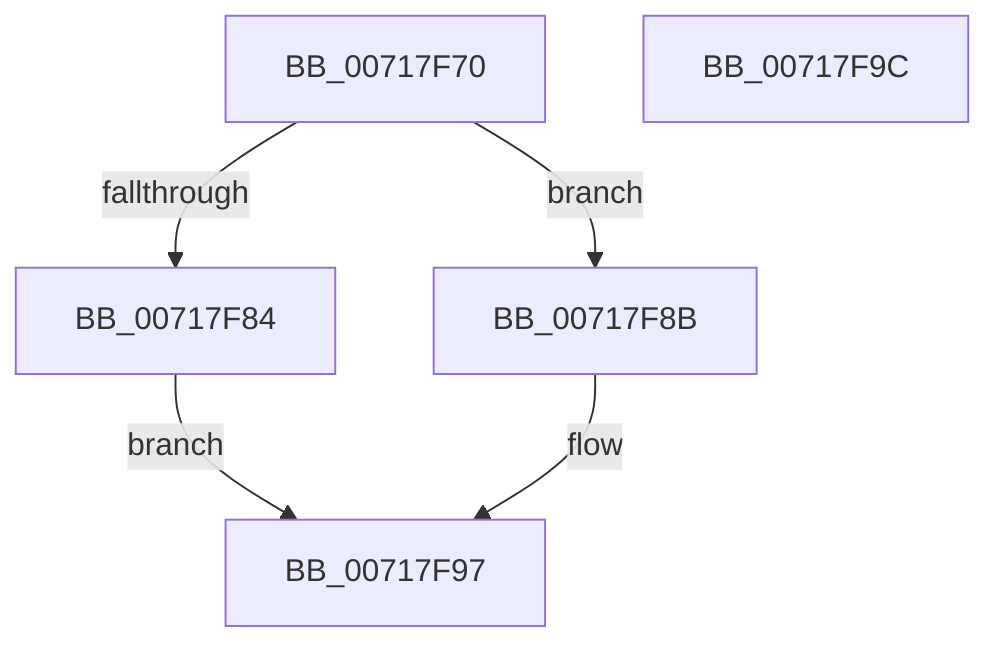

# HvlUnregisterWheaErrorNotification

- RVA: `0x00717F70`–`0x00717F9D` (길이 `45` bytes)
- VA: `0x0000000140717F70`
- 실행 섹션: `PAGE`
- PDB 이름 있음: `예`; PDB Function 태그: `아니요`
- unwind 정보 RVA: `0x0005C788`
- 디코드: `12`개 명령, `45/45` bytes 표시
- 미해석 바이트: `0` (있으면 어셈블리에 `.byte`로 보존)

> 이 문서는 커널 이미지의 기계어와 PDB 기호를 분석해 생성했습니다. 4번과 5번은 함수 원형과 자료형을 바이너리 사용 방식에서 추정한 C 해석이며 원본 소스 복구 결과는 아닙니다.

## 1. Dependencies

- 직접 호출 지점: **1**; 고유 호출 대상: **1**
- 직접 호출자로 확인된 함수: **0**
- RIP 상대 이미지 참조: **2**

### Outgoing calls
- `0x00717F92` → [WheaUnregisterInUsePageOfflineNotification](../7D/WheaUnregisterInUsePageOfflineNotification_function_007D7890.md) (function, `0x007D7890`)

### Direct callers
- 이 함수 시작 RVA로 연결되는 직접 call은 확인되지 않았습니다. 간접 호출은 완전히 역산할 수 없습니다.

### Static image references
- `0x00717F79` → RVA `0x00E65E30` (`.data`; read)
- `0x00717F8B` → RVA `0x005844A0` (`HvlWheaInUsePageOfflineNotificationCallback`; read)

## 2. Other-region calls and transfers

- 다른 실행 섹션으로 향하는 call: **0**
- 별도 외부 분기/꼬리 이동을 확인하지 못했습니다.

## 3. Assembly (complete function range)

```asm
00717F70  48 83 EC 28                     sub rsp, 0x28
00717F74  33 D2                           xor edx, edx
00717F76  48 8B C1                        mov rax, rcx
00717F79  F0 48 0F B1 15 AE DE 74 00      lock cmpxchg qword ptr [rip + 0x74deae], rdx
00717F82  74 07                           je 0x140717f8b
00717F84  B8 01 00 00 C0                  mov eax, 0xc0000001
00717F89  EB 0C                           jmp 0x140717f97
00717F8B  48 8D 0D 0E C5 E6 FF            lea rcx, [rip - 0x193af2]
00717F92  E8 F9 F8 0B 00                  call 0x1407d7890
00717F97  48 83 C4 28                     add rsp, 0x28
00717F9B  C3                              ret
00717F9C  CC                              int3
```

## 4. C-style interpretation (structured pseudocode)

```c
__int64 __fastcall HvlUnregisterWheaErrorNotification(__int64 a1, int a2)
{
    __int64 result;
    __int64 v_rsp;

    v_rsp = (v_rsp) - (40);
    a2 = 0;
    if (condition_is_equal) goto loc_00717F8B;
    goto loc_00717F97;
loc_00717F8B:
    result = WheaUnregisterInUsePageOfflineNotification(v_rip - 1653490, a2, a3, a4);
loc_00717F97:
    v_rsp = (v_rsp) + (40);
    return result;
}
```

## 5. (Beta) C Style

```c
int64_t HvlUnregisterWheaErrorNotification(int64_t Arg1, int32_t Arg2)
{
    int64_t result;
    int64_t local_rsp;

    local_rsp = (local_rsp) - (40);
    Arg2 = 0;
    if (condition_is_equal) goto loc_00717F8B;
    goto loc_00717F97;
loc_00717F8B:
    result = WheaUnregisterInUsePageOfflineNotification(v_rip - 1653490, Arg2, a3, a4);
loc_00717F97:
    local_rsp = (local_rsp) + (40);
    return result;
}
```

## 6. Execution-region graph

[열기: 2D/3D 그래프와 함수 탐색 컨트롤 패널](../../../control-panel.html?section=page&rva=0x00717F70&view=graph)

- 2D 그래프는 위에서 아래로 흐르고, 3D 그래프는 빈 공간을 드래그해 회전합니다. Shift+드래그는 이동, 휠은 확대·축소, 함수 노드 선택은 대상 보고서 이동입니다.

### Static fallback


