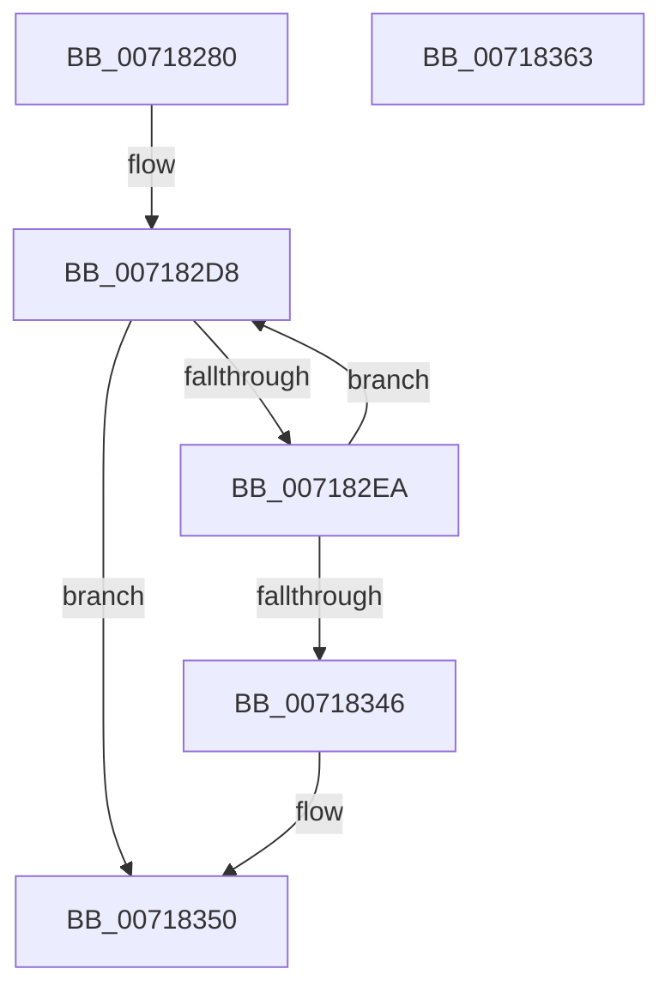

# HvlpCreateRootVirtualProcessor

- RVA: `0x00718280`–`0x00718364` (길이 `228` bytes)
- VA: `0x0000000140718280`
- 실행 섹션: `PAGE`
- PDB 이름 있음: `예`; PDB Function 태그: `예`
- unwind 정보 RVA: `0x00099F28`
- 디코드: `63`개 명령, `228/228` bytes 표시
- 미해석 바이트: `0` (있으면 어셈블리에 `.byte`로 보존)

> 이 문서는 커널 이미지의 기계어와 PDB 기호를 분석해 생성했습니다. 4번과 5번은 함수 원형과 자료형을 바이너리 사용 방식에서 추정한 C 해석이며 원본 소스 복구 결과는 아닙니다.

## 1. Dependencies

- 직접 호출 지점: **5**; 고유 호출 대상: **5**
- 직접 호출자로 확인된 함수: **1**
- RIP 상대 이미지 참조: **2**

### Outgoing calls
- `0x007182D3` → [HvcallInitInputControl](../../text/46/HvcallInitInputControl_function_00464730.md) (function, `0x00464730`)
- `0x007182E1` → [HvlpDepositPages](../../text/58/HvlpDepositPages_function_00585474.md) (function, `0x00585474`)
- `0x007182F9` → [HvlpAcquireHypercallPage](../../text/47/HvlpAcquireHypercallPage_function_00471410.md) (function, `0x00471410`)
- `0x0071832E` → [HvcallInitiateHypercall](../../text/31/HvcallInitiateHypercall_function_00313630.md) (function, `0x00313630`)
- `0x0071833B` → [HvlpReleaseHypercallPage](../../text/31/HvlpReleaseHypercallPage_function_00313480.md) (function, `0x00313480`)

### Direct callers
- [HvlInitializeProcessor](HvlInitializeProcessor_function_0071804C.md) at `0x007180A6`

### Static image references
- `0x007182B7` → RVA `0x00FCF6C0` (`CACHEALI`; read)
- `0x007182FE` → RVA `0x00FC6F80` (`ALMOSTRO`; read)

## 2. Other-region calls and transfers

- 다른 실행 섹션으로 향하는 call: **5**
  - `0x007182D3` → [HvcallInitInputControl](../../text/46/HvcallInitInputControl_function_00464730.md) (`PAGE` → `.text`)
  - `0x007182E1` → [HvlpDepositPages](../../text/58/HvlpDepositPages_function_00585474.md) (`PAGE` → `.text`)
  - `0x007182F9` → [HvlpAcquireHypercallPage](../../text/47/HvlpAcquireHypercallPage_function_00471410.md) (`PAGE` → `.text`)
  - `0x0071832E` → [HvcallInitiateHypercall](../../text/31/HvcallInitiateHypercall_function_00313630.md) (`PAGE` → `.text`)
  - `0x0071833B` → [HvlpReleaseHypercallPage](../../text/31/HvlpReleaseHypercallPage_function_00313480.md) (`PAGE` → `.text`)
- 별도 외부 분기/꼬리 이동을 확인하지 못했습니다.

## 3. Assembly (complete function range)

```asm
00718280  4C 8B DC                        mov r11, rsp
00718283  49 89 5B 10                     mov qword ptr [r11 + 0x10], rbx
00718287  49 89 6B 18                     mov qword ptr [r11 + 0x18], rbp
0071828B  56                              push rsi
0071828C  57                              push rdi
0071828D  41 56                           push r14
0071828F  48 83 EC 40                     sub rsp, 0x40
00718293  49 83 63 08 00                  and qword ptr [r11 + 8], 0
00718298  33 C0                           xor eax, eax
0071829A  48 8B F1                        mov rsi, rcx
0071829D  0F 57 C0                        xorps xmm0, xmm0
007182A0  0F 11 44 24 20                  movups xmmword ptr [rsp + 0x20], xmm0
007182A5  49 89 43 D8                     mov qword ptr [r11 - 0x28], rax
007182A9  8B EA                           mov ebp, edx
007182AB  89 44 24 38                     mov dword ptr [rsp + 0x38], eax
007182AF  49 8D 53 08                     lea rdx, [r11 + 8]
007182B3  0F B7 41 02                     movzx eax, word ptr [rcx + 2]
007182B7  48 8D 0D 02 74 8B 00            lea rcx, [rip + 0x8b7402]
007182BE  48 8B 04 C1                     mov rax, qword ptr [rcx + rax*8]
007182C2  0F B7 78 02                     movzx edi, word ptr [rax + 2]
007182C6  48 8B 04 F9                     mov rax, qword ptr [rcx + rdi*8]
007182CA  B9 4E 00 00 00                  mov ecx, 0x4e
007182CF  44 8B 70 04                     mov r14d, dword ptr [rax + 4]
007182D3  E8 58 C4 D4 FF                  call 0x140464730
007182D8  45 33 C9                        xor r9d, r9d
007182DB  45 33 C0                        xor r8d, r8d
007182DE  0F B7 CF                        movzx ecx, di
007182E1  E8 8E D1 E6 FF                  call 0x140585474
007182E6  85 C0                           test eax, eax
007182E8  75 66                           jne 0x140718350
007182EA  44 8D 48 28                     lea r9d, [rax + 0x28]
007182EE  45 33 C0                        xor r8d, r8d
007182F1  8D 50 01                        lea edx, [rax + 1]
007182F4  48 8D 4C 24 20                  lea rcx, [rsp + 0x20]
007182F9  E8 12 91 D5 FF                  call 0x140471410
007182FE  48 8B 0D 7B EC 8A 00            mov rcx, qword ptr [rip + 0x8aec7b]
00718305  45 33 C0                        xor r8d, r8d
00718308  48 8B 54 24 38                  mov rdx, qword ptr [rsp + 0x38]
0071830D  48 89 08                        mov qword ptr [rax], rcx
00718310  89 68 08                        mov dword ptr [rax + 8], ebp
00718313  C6 40 0F 00                     mov byte ptr [rax + 0xf], 0
00718317  44 89 70 18                     mov dword ptr [rax + 0x18], r14d
0071831B  C7 40 1C 01 00 00 80            mov dword ptr [rax + 0x1c], 0x80000001
00718322  8B 4E 04                        mov ecx, dword ptr [rsi + 4]
00718325  48 89 48 20                     mov qword ptr [rax + 0x20], rcx
00718329  48 8B 4C 24 60                  mov rcx, qword ptr [rsp + 0x60]
0071832E  E8 FD B2 BF FF                  call 0x140313630
00718333  48 8D 4C 24 20                  lea rcx, [rsp + 0x20]
00718338  48 8B D8                        mov rbx, rax
0071833B  E8 40 B1 BF FF                  call 0x140313480
00718340  66 83 FB 0B                     cmp bx, 0xb
00718344  74 92                           je 0x1407182d8
00718346  66 F7 DB                        neg bx
00718349  1B C0                           sbb eax, eax
0071834B  25 01 00 00 C0                  and eax, 0xc0000001
00718350  48 8B 5C 24 68                  mov rbx, qword ptr [rsp + 0x68]
00718355  48 8B 6C 24 70                  mov rbp, qword ptr [rsp + 0x70]
0071835A  48 83 C4 40                     add rsp, 0x40
0071835E  41 5E                           pop r14
00718360  5F                              pop rdi
00718361  5E                              pop rsi
00718362  C3                              ret
00718363  CC                              int3
```

## 4. C-style interpretation (structured pseudocode)

```c
__int64 __fastcall HvlpCreateRootVirtualProcessor(__int64 a1, int a2, int a3, int a4)
{
    __int64 result;
    __int64 v_rbx;
    __int64 v_rsp;
    unsigned int v_stack_m20;
    unsigned __int64 v_stack_m38;
    unsigned __int64 v_stack_p10;
    unsigned __int64 v_stack_p18;
    unsigned __int64 v_stack_p8;

    *(unsigned __int64 *)(v_rsp + 16) = v_rbx;
    *(unsigned __int64 *)(v_rsp + 24) = v_rbp;
    v_rsp = (v_rsp) - (64);
    result = 0;
    v_stack_m38 = v_xmm0;
    *(unsigned __int64 *)(v_rsp - 40) = 0;
    v_stack_m20 = 0;
    result = HvcallInitInputControl(78, v_rsp + 8, a3, a4);
loc_007182D8:
    a4 = 0;
    a3 = 0;
    result = HvlpDepositPages((unsigned __int16)(*(unsigned __int16 *)(*(unsigned __int64 *)(v_rip + 9139202 + *(unsigned __int16 *)(a1 + 2) * 8) + 2)), v_rsp + 8, a3, a4);
    if ((unsigned int)(result) != 0) goto loc_00718350;
    a3 = 0;
    result = HvlpAcquireHypercallPage(v_stack_m38, result + 1, a3, result + 40);
    a3 = 0;
    *(unsigned __int64 *)(result) = *(unsigned __int64 *)(v_rip + 9104507);
    *(unsigned int *)(result + 8) = (unsigned int)((unsigned int)(a2));
    *(unsigned __int8 *)(result + 15) = 0;
    *(unsigned int *)(result + 24) = (unsigned int)((unsigned int)(*(unsigned int *)(*(unsigned __int64 *)(v_rip + 9139202 + *(unsigned __int16 *)(*(unsigned __int64 *)(v_rip + 9139202 + *(unsigned __int16 *)(a1 + 2) * 8) + 2) * 8) + 4)));
    *(unsigned int *)(result + 28) = 0x80000001ULL;
    *(unsigned __int64 *)(result + 32) = (unsigned int)(*(unsigned int *)(a1 + 4));
    result = HvcallInitiateHypercall(v_stack_p8, v_stack_m20, a3, result + 40);
    result = HvlpReleaseHypercallPage(v_stack_m38, v_stack_m20, a3, result + 40);
    if (((unsigned __int16)(result)) == 11) goto loc_007182D8;
    v_rbx = (unsigned __int16)(-(result));
    result = (unsigned int)((result) & (0xC0000001ULL));
loc_00718350:
    v_rsp = (v_rsp) + (64);
    return result;
}
```

## 5. (Beta) C Style

```c
int64_t HvlpCreateRootVirtualProcessor(void *Arg1, int32_t Arg2, int32_t Arg3, int32_t Arg4)
{
    uint8_t *arg1 = (uint8_t *)Arg1;

    int64_t result;
    int64_t local_rbx;
    int64_t local_rsp;
    uint32_t v_stack_m20;
    uint64_t v_stack_m38;
    uint64_t v_stack_p10;
    uint64_t v_stack_p18;
    uint64_t v_stack_p8;

    *(uint64_t *)(local_rsp + 0x10) = local_rbx;
    *(uint64_t *)(local_rsp + 0x18) = local_rbp;
    local_rsp = (local_rsp) - (64);
    result = 0;
    v_stack_m38 = v_xmm0;
    *(uint64_t *)(local_rsp - 0x28) = 0;
    v_stack_m20 = 0;
    result = HvcallInitInputControl(78, local_rsp + 8, Arg3, Arg4);
loc_007182D8:
    Arg4 = 0;
    Arg3 = 0;
    result = HvlpDepositPages((uint16_t)(*(uint16_t *)(*(uint64_t *)(v_rip + 0x8B7402 + *(uint16_t *)(arg1 + 0x2) * 8) + 0x2)), local_rsp + 8, Arg3, Arg4);
    if ((uint32_t)(result) != 0) goto loc_00718350;
    Arg3 = 0;
    result = HvlpAcquireHypercallPage(v_stack_m38, result + 1, Arg3, result + 40);
    Arg3 = 0;
    *(uint64_t *)(result) = *(uint64_t *)(v_rip + 0x8AEC7B);
    *(uint32_t *)(result + 0x8) = (uint32_t)((uint32_t)(Arg2));
    *(uint8_t *)(result + 0xF) = 0;
    *(uint32_t *)(result + 0x18) = (uint32_t)((uint32_t)(*(uint32_t *)(*(uint64_t *)(v_rip + 0x8B7402 + *(uint16_t *)(*(uint64_t *)(v_rip + 0x8B7402 + *(uint16_t *)(arg1 + 0x2) * 8) + 0x2) * 8) + 0x4)));
    *(uint32_t *)(result + 0x1C) = 0x80000001ULL;
    *(uint64_t *)(result + 0x20) = (uint32_t)(*(uint32_t *)(arg1 + 0x4));
    result = HvcallInitiateHypercall(v_stack_p8, v_stack_m20, Arg3, result + 40);
    result = HvlpReleaseHypercallPage(v_stack_m38, v_stack_m20, Arg3, result + 40);
    if (((uint16_t)(result)) == 11) goto loc_007182D8;
    local_rbx = (uint16_t)(-(result));
    result = (uint32_t)((result) & (0xC0000001ULL));
loc_00718350:
    local_rsp = (local_rsp) + (64);
    return result;
}
```

### 관측된 메모리 오프셋

구조체 형식이 확인되지 않은 접근은 인자 기준의 오프셋으로만 기록했습니다.

| 기준 인자 | 오프셋 표현 | 폭 (bit) | 접근 |
|---|---:|---:|---|
| `Arg1` | `+ 0x2` | `16` | `R` |
| `Arg1` | `+ 0x4` | `32` | `R` |

## 6. Execution-region graph

[열기: 2D/3D 그래프와 함수 탐색 컨트롤 패널](../../../control-panel.html?section=page&rva=0x00718280&view=graph)

- 2D 그래프는 위에서 아래로 흐르고, 3D 그래프는 빈 공간을 드래그해 회전합니다. Shift+드래그는 이동, 휠은 확대·축소, 함수 노드 선택은 대상 보고서 이동입니다.

### Static fallback


